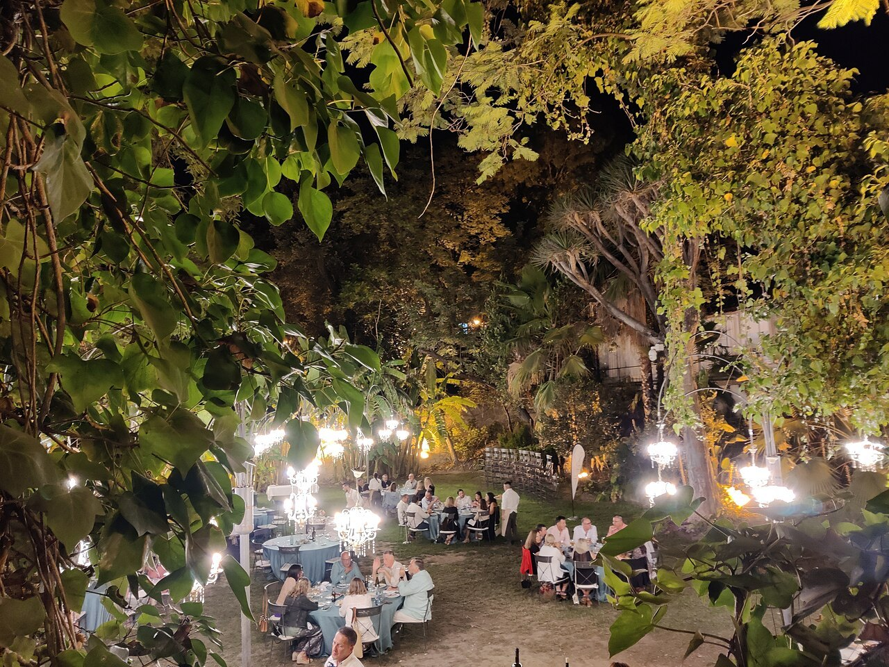

# Bodegas González Byass

González Byass occupies a block of cellars in central Jerez de la Frontera, at Calle Manuel María González 12. Manuel María González Ángel founded the house in 1835 and it is best known for the Fino brand Tío Pepe. Unlike a vineyard estate, this is a piece of the old town: courtyards, cobbled lanes, whitewashed bodegas with high windows, and gardens. A visit explains how Sherry ages biologically and oxidatively inside city buildings.

Figure: Bodegas González Byass. Photograph: Jardines de las Bodegas González Byass - IMG 20220811 230512. Credit: El Pantera, CC BY-SA 4.0, via Wikimedia Commons ([source](https://commons.wikimedia.org/w/index.php?curid=121644467)).

## A winery quarter inside the city

The entrance is at number 12. The official site gives postcode 11402 while some maps say 11403, so follow the booking confirmation. The station is a 20-minute walk or an 8-minute taxi ride; the airport is 18 minutes by car.

The complex is a group of bodegas — La Constancia, Los Apóstoles, La Cuadrada, La Concha and Lepanto — each with a different structure. Limewashed walls, high roofs and windows far above the barrels admit air without direct sun. Sherry, unlike Port, ages in the city rather than in riverside lodges; wall thickness, orientation, roof height and floor dampness are production conditions, which makes the buildings equipment, not scenery. The coordinates 36.68005, -6.14280 point to the block; the gate and meeting point come with the booking.

## 1835 and the making of Tío Pepe

In 1835 Manuel María González Ángel founded the business. His uncle, José Ángel y Vargas, was known as Uncle Pepe, or Tío Pepe; he understood cellars and flor, handed over the first Fino solera, and the nickname became the brand. The British merchant Robert Blake Byass soon took a share, giving the firm its double name and access to the British market.

By 1844 Tío Pepe was sold beyond Spain. When the founder died in 1887, La Constancia, Los Apóstoles, La Cuadrada, La Concha and Lepanto were standing and the urban shape was set. In 1935 Luis Pérez Solero drew the figure in the red jacket, wide hat and guitar; in 1958 it appeared as a neon sign on Madrid's Puerta del Sol. In 2010 came the unfiltered Tío Pepe En Rama, and from 2012 the cellars have hosted the Tío Pepe Festival.

## La Concha and the solera at work

La Concha is the cellar people remember: a plan close to a circular arc spanning about 28 metres, with a roof folding inward like a shell. Sketches are often attributed to Gustave Eiffel; Joseph Coogan and the Seville foundry Portilla and White executed it. It holds 214 barrels of Amontillado in rows.

A solera is not one cask but tiers: the oldest is the solera, with first, second and further criaderas above. Each year a proportion is drawn from the oldest tier and replaced from above. Casks are filled to about seven-tenths, leaving air for flor. Fino is fortified to 15%, flor forms a pale film, oxygen is excluded, and the wine stays dry and pale with almond, bread dough and sea salt. Amontillado ages biologically first, then is fortified to 17%; the flor dies and oxidative ageing brings hazelnut and caramel. Oloroso is fortified to 17% from the start and never grows flor. The fork is decided at fortification.

## From Fino to Pedro Ximénez

The Jerez-Xérès-Sherry DO allows Palomino Fino, Pedro Ximénez and Moscatel. Dry generoso may hold at most 5 grams per litre of residual sugar; above that, the wine is usually a sweet or medium blend made by cabeceo. Fortified strength is set at 15% or 17%, and the house chooses biological or oxidative ageing accordingly — the most useful clue on a label.

Tío Pepe is the Fino benchmark: dry, saline, yeasty, usually 15%, served at 7–9 °C and drunk soon after opening. Viña AB is an Amontillado; Alfonso an Oloroso; Apostoles a VORS Palo Cortado averaging over 30 years; Nectar a thick Pedro Ximénez. La Concha Medium blends dry Sherry with sweet wine. The group also makes Lepanto brandy and Nomad whisky. VOS means 20 years on average, VORS 30.

## Booking a visit

Visits run Tuesday to Sunday by reservation only, with no walk-in tours. Book at tiopepe.com or call +34 956 357 016; replies slow in high season. The Tío Pepe Experience costs about €25.50 with two wines, The Colors of Sherry about €28.50 with four, Between Tapas about €30.50 with snacks, and Premium VORS about €50 with Tío Pepe from the cask and four VORS wines.

The route covers cobbled lanes, gardens, old cellars and a tasting room. There is Wi-Fi, a shop, a wine bar and accessible space, though thresholds and cobbles need care. A standard tour runs about an hour. `operating_status: verified` means the house is trading, not that walk-in places exist; Holy Week, the Jerez fair and cruise calls are busy.

## What visitors get wrong

The first mistake is to treat all Sherry as sweet: most production is dry Fino, Manzanilla, Amontillado and Oloroso. The second is to cellar Fino like red wine; it depends on flor and keeps changing, so drink it soon. The third is to see only Tío Pepe, since González Byass also makes brandy and wine elsewhere.

Cellars are cool and sometimes damp, so bring a light jacket and shoes with grip. Spitting is acceptable, especially when driving. Do not use a flash on barrels or old photographs. For context, read [Jerez](ref:jerez), [Sherry](ref:sherry), [solera](ref:solera), [flor](ref:flor) and [fortification](ref:fortification); for another traditional house, see [López de Heredia](ref:lopez) in Rioja.

Start with the address. From there, consider the current opening status, then what the place is known for. That is how a practical judgment about Bodegas González Byass is built.

Read [Bodegas López de Heredia](ref:lopez) for the address and space side of Bodegas González Byass, and [Sherry](ref:sherry) for the operating status side. Together they locate it.

**At a glance:** A Sherry winery complex in central Jerez de la Frontera, founded in 1835 by Manuel María González Ángel and known for the Tío Pepe Fino solera and the shell-shaped La Concha cellar; visits are by reservation, Tuesday to Sunday.

**Key facts.**

| Item | Detail |
| --- | --- |
| In one line | A Sherry winery complex in central Jerez de la Frontera, founded in 1835 by Manuel María González Ángel and known for the Tío Pepe Fino solera and the shell-shaped La Concha cellar; visits are by reservation, Tuesday to … |
| Address | Calle Manuel María González 12, 11402 Jerez de la Frontera, Spain |
| City and country | Jerez de la Frontera / Spain |
| Status | verified open |
| Official site | gonzalezbyass.com |

**Sources and limits.** The key claims about Bodegas González Byass are checked against the following sources: Bodegas Tío Pepe / González Byass, Consejo Regulador de las Denominaciones de Origen Jerez-Xérès-Sherry y Manzanilla, Mapcarta / OpenStreetMap contributors. For current products, addresses or opening status, use gonzalezbyass.com. Prices, batches and status change; the body is project-written and does not reproduce source text.
