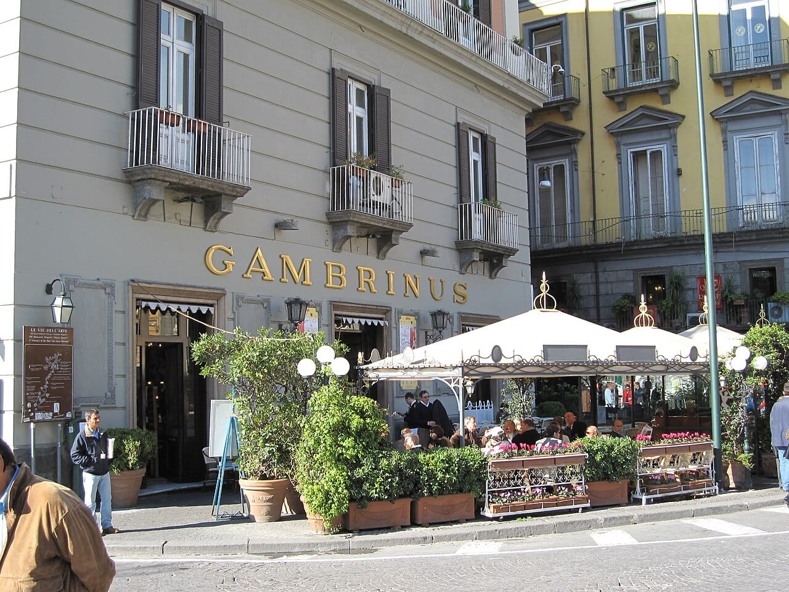

# Gran Caffè Gambrinus

Walk south from Piazza del Plebiscito and turn into Via Chiaia: the corner front of Gran Caffè Gambrinus appears almost immediately, with dark wood doors, brass handles and a glass display stacked with sweets and cake boxes. It sits between the Royal Palace, the Teatro San Carlo and the Galleria Umberto I, which makes it the easiest historic café in Naples to pass by — and the easiest to mistake for a museum. The better use is to order a coffee or a babà, sit for ten minutes among mirrors and stucco, and listen to the city argue about football, politics or dinner.

Figure: The GAMBRINUS lettering, awnings and entrance terrace at Gran Caffè Gambrinus, on the corner of Piazza Trieste e Trento. Image: Armando Mancini, CC BY-SA 2.0, via Wikimedia Commons ([source page](https://commons.wikimedia.org/wiki/File:Napoli_-_Il_Bar_Gambrinus.jpg)).

## Location and history

Gambrinus has two beginnings. In 1860, the year of Italian unification, a "Gran Caffè" opened on the ground floor of the Palazzo della Foresteria, facing the Royal Palace and Piazza del Plebiscito. In 1890 the premises were substantially rebuilt and reopened under the name Gambrinus. Gambrinus is the legendary "king of beer" of European folklore, a name that carried the late-nineteenth-century café's mix of coffee, alcohol and entertainment rather than coffee alone. The name above the door and the arrangement of the mirror rooms were essentially fixed by that 1890 reworking.

The 1890 interior is often attributed to the architect Antonio Curri: stucco ceilings, gilt-framed mirrors, painted lunettes, dark woodwork and marble tops turned the café into a sequence of salons of different scales. It quickly became a meeting place for the Neapolitan bourgeoisie, journalists, lawyers and aristocrats. Gabriele D'Annunzio, Benedetto Croce, Matilde Serao, Eduardo Scarpetta and Totò are all associated with the address; Empress Elisabeth of Austria, known as Sissi, visited in 1890. For the city, this was not simply a place to drink coffee but a drawing room where news, literature and politics were exchanged.

In 1938 the prefect Giovanni Battista Marziale ordered Gambrinus closed. The café's own chronology gives two explanations: one says the prefect lived nearby and objected to the noise at night; the other says the café was regarded as a meeting place for anti-fascists. The two accounts are not mutually exclusive. After the closure, part of the historic rooms was occupied by the Banco di Napoli, cutting the café's space apart; the old whole was not immediately restored after the war. From the 1970s, Michele Sergio, his sons Arturo and Antonio and his son-in-law Giuseppe Rosati began recovering the rooms and repairing the stucco and paintings. 1973 is the key year for the Sergio family's takeover; the family still runs the café today.

## The rooms and the drinks

Gambrinus feels like a set of nineteenth-century stage sets that has been cut into separate rooms. In the main hall, mirrors multiply the painted ceilings and chandeliers; banquettes along the walls, dark wooden counters and small marble tables preserve the density of an old café. Further in, smaller salons and staircases lead past old photographs, posters and portraits of writers. It is not a modern specialty-coffee bar with the counter as a stage; guests are distributed among rooms, each of which seems to be waiting for an old conversation to resume.

The drinks are built around Neapolitan coffee: espresso, caffè macchiato, caffè freddo and hot drinks with milk or cocoa. Sweets are ordered more often than alcohol: sfogliatella, babà soaked in syrup, pasticciotti, chocolate and boxes of candies. The drinks list covers Italian sparkling wine, Campanian white wines, limoncello and the usual aperitivo; in the evening the counter puts out small snacks, and guests can stand for a drink before moving on. This is not a craft-beer bar or a cocktail laboratory. The formula is coffee, a pastry and a small glass of something.

## How to drink here

For a first visit, the safest move is to order an espresso or caffè macchiato at the counter, drink it standing, and absorb the fastest, most everyday rhythm of the café. If you want a pastry, order a sfogliatella or a babà with an unsweetened coffee; Neapolitan sweets are generally sweet, and the coffee's bitterness balances the syrup. To sit longer, find a seat in the mirror rooms and order a caffè freddo or a local white wine, treating the café as an afternoon pause.

Aperitivo is better standing: a glass of sparkling wine or a Campari-style bitter with a few snacks, finished within half an hour. Do not treat Gambrinus as a full restaurant, and do not expect a complete cocktail menu; coffee, sweets and the feeling of an old café are what it does best. If you mainly want photographs, avoid the busiest morning tour hours; mid-afternoon is usually easier for finding a seat.

## Practical information

- Address: Via Chiaia 1/2 (at the corner of Piazza Trieste e Trento), 80132 Naples.
- Hours: approximately 07:00–24:00 daily, often until 01:00 on Saturdays; holidays and events can change this, so check the official site or telephone before going.
- Transport: Municipio metro (Line 1) is about a five-minute walk; Piazza del Plebiscito, the Royal Palace and the Teatro San Carlo are all within three minutes.
- Ordering: pay or order at the counter first, then collect your coffee with the receipt; sitting down brings table service and a correspondingly higher price, while standing is usually cheaper.
- Peak times: tour groups are heaviest in the morning and on weekend afternoons; the first hour after opening or late afternoon is best for a quieter look at the mirror rooms.

## Etiquette and common mistakes

First, do not treat standing at the bar as rude. The standing counter is the normal flow in an Italian café, especially before work and at lunch; sitting down to drink slowly is simply another choice. Second, check the price list before taking a seat: the same coffee can cost different amounts standing and seated, and the gap is wider in tourist areas. Third, do not treat the mirror rooms as a free photo studio; people come to drink or talk, so avoid shooting straight across their tables and do not use a flash. Fourth, do not assume that every historic room is open to visitors; parts of the building close for events, weddings or private bookings. Fifth, do not reduce Gambrinus to an "oldest café" title. Its value lies in the Liberty interior fixed in 1890 and the twentieth-century literary salon, not in a simple record of age.

## Around and nearby

Outside Gambrinus, Piazza del Plebiscito and the Royal Palace are directly opposite; the Teatro San Carlo is two minutes east, and the Galleria Umberto I and Via Toledo lie to the north through the arcade. A sensible walking route is the Royal Palace facade, Piazza del Plebiscito, a drink at Gambrinus, the Teatro San Carlo foyer, the Galleria Umberto I and then Via Toledo toward the Quartieri Spagnoli. With more time, continue toward the sea to Castel dell'Ovo or the entrance to Napoli Sotterranea, another twenty to thirty minutes on foot.

## Further reading and see also

- The café's history page: <https://grancaffegambrinus.com/en/il-salotto/> for the 1860, 1890, 1938 and Sergio-family sequence.
- The Visit Naples entry: <https://www.visitnaples.eu/en/where-to-eat/bakeries-in-naples/gran-caffe-gambrinus> for the address and guest list.
- Compare `place:antico-caffe-greco` and `place:caffe-san-carlo-torino` for other Italian historic café interiors.
- For Viennese café seating etiquette, see `route:vienna-coffee-house-evening`.
- This entry sets the two explanations of the 1938 closure side by side rather than declaring one cause final; hours and prices should be checked with the official venue on the day.
- Related entries: [Antico Caffè Greco](ref:greco)、[Caffè Florian](ref:florian)、[Camparino in Galleria](ref:camparino)、[Caffè San Carlo](ref:san-carlo)、[A Vienna coffee-house evening](ref:vienna)

**Short definition:** Naples' Gran Caffè Gambrinus, on Via Chiaia, opened in 1860 and was rebuilt under the Gambrinus name in 1890; its Liberty stuccoes, mirrors and literary salons made it the city's drawing room after Italian unification.

Start with the address. From there, consider the current opening status, then what the place is known for. That is how a practical judgment about Gran Caffè Gambrinus is built.
