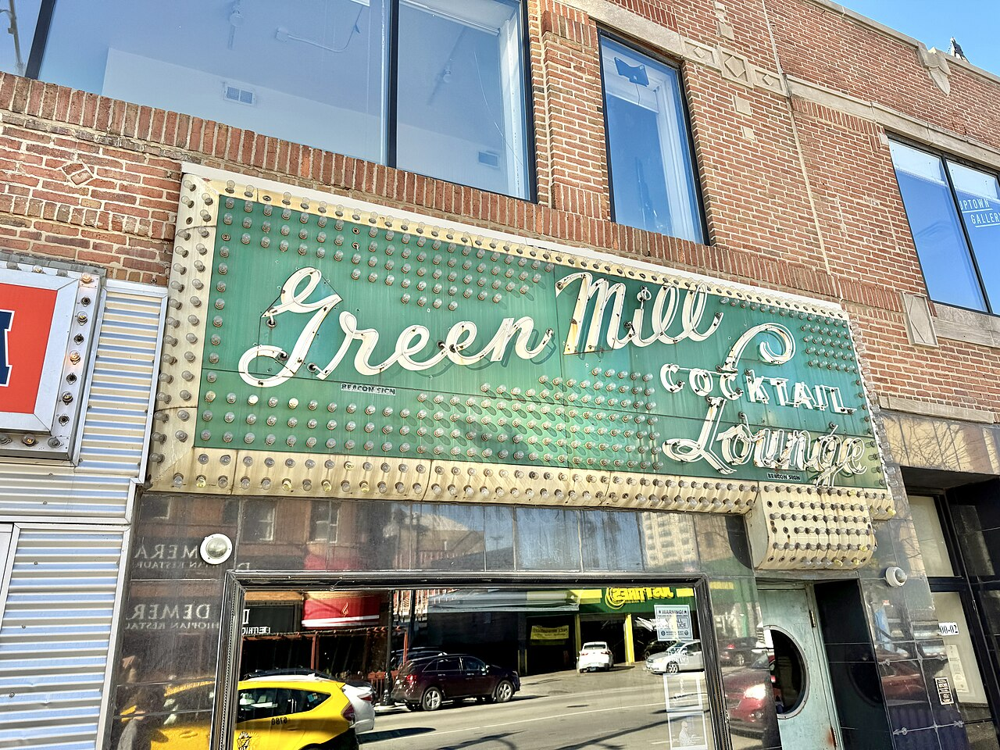

# Green Mill Cocktail Lounge

At Broadway and Lawrence in Chicago's Uptown, a green neon sign hangs over a low corner building. In daylight it looks faded; at night it turns into a piece of 1920s stage design. This is the Green Mill. It is not a large concert hall and not a nostalgia theme bar. It is a working tavern that still books jazz seven nights a week, still takes cash, and still shows the physical traces of the Prohibition era. For Chicagoans, its reputation rests on the music; for visitors, it is usually remembered through Al Capone, the underground tunnels and the birth of the poetry slam.

Figure: The Green Mill Cocktail Lounge neon sign on Broadway in Chicago's Uptown; the club traces its origins to Pop Morse's Roadhouse around 1907, the present building was completed in 1914 and today's room took shape in 1935. Image: Warren LeMay from Chicago, IL, United States, CC BY-SA 4.0, via Wikimedia Commons ([source page](https://commons.wikimedia.org/wiki/File:Green_Mill_Cocktail_Lounge_Sign,_Broadway,_Uptown,_Chicago,_IL_(54842064706).jpg)).

## Location and history

Green Mill has two start dates. The common story says 1907; Chicago city records trace Pop Morse's Roadhouse at this corner to 1898. The two are not necessarily in conflict: 1907 is the date the Green Mill brand tends to use, while 1898 is the earlier record of a saloon on the same block. In 1914 the present building was completed at Broadway and Lawrence, and the place was expanded as Green Mill Gardens, named after Paris's Moulin Rouge but using “green” to avoid association with Chicago's red-light district.

During Prohibition in the 1920s, Green Mill was one of the city's best-known speakeasies. It had financial ties to Jack “Machine Gun” McGurn, an associate of Al Capone; a trapdoor behind the bar connected to underground storage tunnels and, according to the well-rehearsed story, gave patrons a route out during raids. The building still contains structural traces of that era, but the bar does not offer tunnel tours and does not sell organized-crime history as a theme. It is a site of Prohibition-era urban history, not a gangster theme park.

After Prohibition, the room that visitors see today took shape in 1935. The bar changed hands several times; Dave Jemilo took over in 1986 and gradually made live jazz the center of the program. In 1984, Marc Smith started the Uptown Poetry Slam here, later widely described as a key origin of the modern poetry slam. In 2000, the Uptown Square Historic District was listed on the National Register of Historic Places, with Green Mill as one of its buildings; in 2016 the district was also designated a Chicago Landmark District, and Green Mill Gardens was named among its notable buildings. The place therefore carries four identities at once: corner tavern, Prohibition speakeasy, jazz club and poetry room.

## Space and drinks

The interior is a long, narrow room. The bar is near the entrance, the stage is farther in, and curved booths line the walls. The back bar is Art Deco in style, with murals, old light fixtures and a worn, dark finish. There has been no major modernization, and seating is limited, so the room fills quickly once a set begins. The stage is low, which puts the musicians close to the audience and makes the jazz experience more intimate than at a large club.

Green Mill does not serve food. It sells drinks: classic cocktails, beer, whiskey, simple highballs and seasonal mixtures. The bar moves reasonably fast, but lines form before and after sets. It is cash only, so check your wallet or use the ATM inside. Within walking distance there are Mexican, Ethiopian, Chinese and American restaurants; the common pattern is to eat first and come for the music, or to go out for a bite during a break.

## How to drink

Check the night's lineup and cover charge first. Green Mill takes no reservations; seating is first come, first served, and popular shows and weekend nights require arriving early. A simple cocktail or whiskey is easier than a long, labor-intensive drink because the bar is busy around sets. Once the music starts, keep conversation low. This is not a “talk while listening” bar; the musicians and audience share a small room, and voices carry over the band.

For the poetry slam, look for the Uptown Poetry Slam or special programming on the calendar. For jazz, weeknights are generally easier than weekends; the late weekend sets run into the early morning, which suits people who are not in a hurry.

## Practical information

The address is 4802 N Broadway, Chicago, IL 60640, at Broadway and Lawrence in Uptown. The CTA Red Line Lawrence stop is a short walk; there is street parking and a lot that opens after 18:30 according to the official FAQ. Hours per the FAQ: Monday–Thursday 16:00–01:00, Friday 16:00–04:00, Saturday 13:00–05:00, Sunday 16:00–01:00. Shows and holidays can change that.

Green Mill enforces 21+ entry with valid ID. It is cash only, with an ATM on site. It takes no reservations and sells no tickets; entry is first come, first served with the night's cover charge. There is no dress code: jeans or formal wear both work. It serves no food and offers no tunnel tours. Tip $1–2 per drink or 18%–20% of the bill.

## Etiquette and common misconceptions

The first misconception is that “1907” means the building dates from 1907. The saloon record goes back to 1898, the Green Mill brand is usually dated to 1907, the present building was completed in 1914, and today's room took shape in 1935. The second is treating Al Capone as the bar's selling point; the Prohibition traces are real, but music and neighborhood life are the core. The third is expecting a tunnel tour; the official FAQ says no. The fourth is using a camera with flash or moving around during a set; put the phone on silent and follow the room's photo rules. The fifth is assuming you can pay by card; cash only is a hard rule.

## Nearby and routes

Leave Green Mill and walk south on Broadway to the Lawrence and Uptown theater cluster, including the Aragon Ballroom, the Riviera Theatre and the Uptown Theatre; east lies the lakefront and Foster Beach. Green Mill fits a “Prohibition and jazz” route: read [Prohibition](ref:prohibition) and [US Prohibition](ref:us-prohibition), then compare Boston's [Bell in Hand](ref:bell), Los Angeles's [Musso & Frank](ref:musso) and New Orleans's [Old Absinthe House](ref:absinthe) to see how different cities turned bar history into a working business.

## Further reading and see also

- [Prohibition: How America Banned Drink, and Why It Failed](ref:prohibition)
- [US Prohibition](ref:us-prohibition)
- [Bell in Hand Tavern](ref:bell)
- [Musso & Frank Grill](ref:musso)
- [Old Absinthe House](ref:absinthe)

Start with the address. From there, consider the current opening status, then what the place is known for. That is how a practical judgment about Green Mill Cocktail Lounge is built.

Setting [Prohibition: bans change supply, not demand](ref:prohibition)'s address and space beside [Bell in Hand Tavern](ref:bell)'s operating status makes the boundary between them visible.

Checked on 2026-11-21: the address at 4802 N Broadway, show times and ticket prices were confirmed on the official site. "Oldest" and "birthplace" appear in quotation marks in the body and are not treated as undisputed history. Image credits and licences are given in the captions.

The Green Mill's history begins in the 1890s.

## Related images

Image: During Prohibition in the United States, officials pour barrels of liquor into a sewer.. Credit: Unknown author, Public domain, via Wikimedia Commons ([source page](https://commons.wikimedia.org/wiki/File:5_Prohibition_Disposal(9).jpg)). Related image for Green Mill Cocktail Lounge.

Musso & Frank Grill opened in 1919 and took its current name in 1927; a later street view is used as a visual reference.
