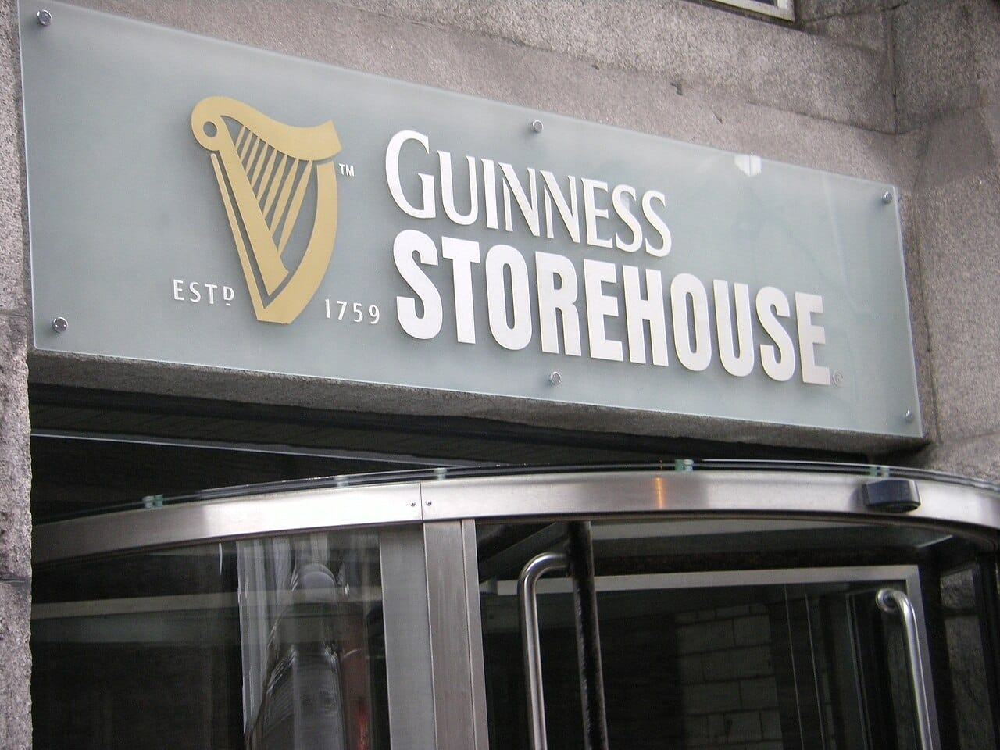

# Guinness Storehouse: Telling the Black Stuff at St. James's Gate

The Guinness Storehouse stands at St. James's Gate in Dublin, postcode Dublin 8, D08 VF8H. Many visitors treat it as a brewery tour, but it is a visitor centre: exhibition, tasting and rooftop bar occupy an old fermentation building, while the working brewery continues next door. Ordinary tickets do not enter the brewhouse, and keeping the two apart sharpens what you actually see.

> **Visit information**
> - Address: St. James's Gate, Dublin 8, D08 VF8H, Ireland.
> - Opening and booking: check the [official page](https://www.guinness-storehouse.com/) before travelling; hours, tours and booking rules change by season.
> - Getting there and cost: check the official page before booking; this entry does not promise a fixed price.
> - Status: Verified; sources checked: 2026-11-21.

Figure: Guinness Storehouse: Telling the Black Stuff at St. James's Gate. Photograph: Guinness Storehouse. Credit: Greatal386 at English Wikipedia, CC BY 2.5, via Wikimedia Commons ([source](https://commons.wikimedia.org/w/index.php?curid=12671330)).

## A city entrance built inside a fermentation hall

The building belonged to the St. James's Gate complex and became a public attraction in 2000. The conversion kept the industrial shell and reorganised the interior as a seven-storey route: entrance, shop and food below; ingredients, brewing and brand history in the middle; the glass-and-steel Gravity Bar on top. Lifts carry visitors up, then the route unfolds floor by floor, so city view and exhibition become one movement.

The site sits in the Liberties, on the south bank of the Liffey, among old industrial buildings, terraced streets and newer apartments. Walking from Trinity College takes roughly twenty minutes. The Storehouse is no isolated attraction: it edges a site still in use, visible in the service entrances and distant fermentation vessels.

## From the 1759 lease to a brand archive

The route begins in 1759, when Arthur Guinness signed a lease at St. James's Gate running for 9,000 years. The figure anchors the brand story rather than a contract detail to verify clause by clause; it conveys continuous operation at one address. The brewery then grew into a multinational brand, with St. James's Gate remaining its geographical origin.

The exhibition makes heavy use of advertising: posters, television commercials, packaging and merchandise. This is not brewing documentation but the key to how Guinness is narrated. The brand turned dark liquid, white foam, slowly sinking bubbles and the act of waiting into visual signals, and those signals shape what drinkers expect from a stout. It helps to keep advertising and process separate.

## Three parts of the exhibition worth slowing down for

The first is the section on ingredients and roasting. The colour of Guinness stout comes mainly from roasted barley, not simply scorched malt; roasting brings coffee, cocoa and toasted-bread notes plus a dry finish. Displays separate water, barley, hops and yeast, but proportions and roasting curves remain company details.

The second is the tasting room. Tickets normally include a pint of Guinness or Guinness 0.0, and the tasting guides visitors through foam, aroma and texture. The richness of a stout is not the same as sweetness; dryness and bitterness are its frame. If you remember only "it tastes like coffee", you miss the freshness created by fermentation and carbonation.

The third is the Gravity Bar. Its 360-degree view puts Dublin's skyline, church spires and distant hills into one frame, and the glass in your hand becomes a marker for where you are looking from. To go deeper into production, visitors can pay extra for the Guinness Brewery Experience, which takes a small group into the working site; ordinary tickets do not include this, and availability should be checked online.

## What kind of beer Guinness stout is

Stout belongs to the top-fermenting dark ale tradition, while Guinness turns it into a standardised modern product served with nitrogen. Nitrogen gives a finer, creamier foam and the visual effect of bubbles sinking through the glass; the mouthfeel differs from beer carbonated with carbon dioxide alone. Roasted barley supplies coffee and cocoa, hops give mild bitterness, and the finish is dry.

Guinness also makes Guinness 0.0, an alcohol-free version that has to balance removing alcohol with preserving flavour; both the exhibition and the bar serve it. Tasting the two side by side makes the sources of body and bitterness easier to identify. For the wider framework, return to the overview of [beer](ref:beer) and compare the entries on [stout](ref:stout) and [fermentation](ref:fermentation). Stout is not simply a synonym for "dark beer": colour, fermentation type and recipe do not map onto one another neatly.

## Tickets, hours and getting there

The address is St. James's Gate, Dublin 8, D08 VF8H. The official site lists Monday to Friday 10:00–19:00 with last admission at 17:00, Saturday 9:30–20:00 with last admission at 18:00, and Sunday 9:30–19:00 with last admission at 17:00; Saturday hours shorten in December and January. Holidays can change these times, so check the official page on the day.

Book a timed ticket online. Adult admission starts at €24 and includes the self-guided tour and one drink; tasting upgrades and the pouring academy cost extra. Allow two to three hours, and expect the busiest crowds on summer afternoons. The Luas Red Line stops at St. James's, a short walk away. The building has accessible routes and sensory-friendly hours; alcohol is served only to visitors of legal drinking age.

## After the visit: putting the brand story back in the city

Leaving the Storehouse and walking east along the Liffey soon brings you back to Dublin's pub district. To see how Guinness is drunk in an ordinary pub, visit [The Brazen Head](ref:brazen-head) on Lower Bridge Street: no seven-floor exhibition, only a wooden bar, traditional music and a normal pint. Pub culture belongs to everyday life in [Ireland](ref:ireland), not to the exhibition.

The Storehouse tells a successful brand story, and its history, advertising and process are selected. It is worth seeing, but not a complete history of the beer industry. Put exhibition, working brewery and pubs together, and you see how a brand is made, how beer is produced and how people consume it.

**Short definition:** Dublin's Guinness Storehouse occupies an old fermentation building and uses seven floors, an advertising archive and the Gravity Bar to tell the story of Guinness stout; it is a visitor centre, not a working-brewery tour.

The usual confusion is to treat Guinness Storehouse as a brand or a region. Check whether it is still open first, then whether it accepts visitors; the two need not agree.

**Key facts.**

| Item | Detail |
| --- | --- |
| In one line | Dublin's Guinness Storehouse occupies an old fermentation building and uses seven floors, an advertising archive and the Gravity Bar to tell the story of Guinness stout; it is a visitor centre, not a working-brewery tour… |
| Address | St. James's Gate, Dublin 8, D08 VF8H, Ireland |
| City and country | Dublin / Ireland |
| Status | verified open |
| Official site | guinness-storehouse.com |

**Sources and limits.** The key claims about Guinness Storehouse: Telling the Black Stuff at St. James's Gate are checked against the following sources: Guinness Storehouse (Used to check the St. James's Gate address, the Dublin 8 postcode and the visitor entrance; Used to check weekday, Saturday and Sunday opening hours and last admission times), UNESCO (the entry's background, terminology and regulatory context). For current products, addresses or opening status, use guinness-storehouse.com. Prices, batches and status change; the body is project-written and does not reproduce source text.

## Related images

Image: Stout. Credit: 55belgianbeerfan, CC0, via Wikimedia Commons ([source page](https://commons.wikimedia.org/wiki/File:A_Pint_of_English_Imperial_Stout.png)). Related image for Guinness Storehouse: Telling the Black Stuff at St. James's Gate.
