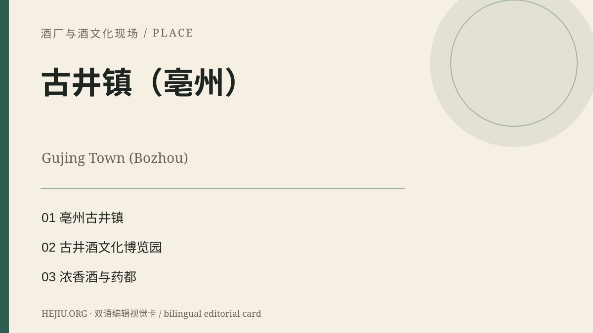

# Gujing Town (Bozhou)

Gujing Town in Qiao District, Bozhou, joins plant, culture park and town. Many know only the name “Gujing Gongjiu” and spend their Bozhou time in the old town and herb markets. Its value is that strong-aroma pits, the Gujing water system and liquor-culture displays sit in one town. Separate plant, culture park and town before choosing a half-day of liquor or a full day of liquor and medicine.

Figure: Gujing Town (Bozhou) bilingual editorial card. Project-created bilingual editorial card for topic identification, not a documentary photograph.

> **Quick verdict**
> **Best for:** travellers who want strong-aroma baijiu in the context of a northern Anhui liquor town and medicine capital; pairs with Bozhou old town and herb markets.
> **Not for:** visitors who only want a “Gujing” archway photo and will not book; plant and culture park have separate entrances.
> **One line:** culture park first for the craft framework, then plant exterior and town, with tasting separate from buying.

## Liquor town and medicine capital

Gujing is a liquor-industry market town where the Gujing Gongjiu plant, the Gujing Wine Culture Park, homes and shops overlap. Bozhou is a medicine capital, with its old town, herb markets and Hua Tuo culture forming another line. The two meet in Bozhou: liquor needs water, grain, starter and pits; medicine needs cultivation, processing and trade; both are long-cycle handwork. See liquor town and medicine capital separately, then look for intersections, rather than repeating “liquor and medicine share a source”. Culture park first for craft, then old town and herb markets, is the smoother order.

## Gujing Wine Culture Park

The park explains Gujing Gongjiu’s history, craft and brand, with starter culture, pits, distillation, storage and vessels. Strong-aroma baijiu ferments in solid state in mud pits; longer continuous use stabilises the microbial community. The Gujing water system and local grain are part of the origin but not the only variables. Follow three lines: how Gujing water affects brewing, how pits and grain work, and how finished liquor is stored and blended. Models and cutaways carry more information than single bottles, so see them before the objects.

## Strong-aroma craft and Gujing

Gujing Gongjiu is mainly strong-aroma, stressing starter culture, mud-pit fermentation, distillation and long storage. From the plant exterior, note the relative positions of starter rooms, pit workshops, distillation towers and jar warehouses; from the town, note how the plant coexists with roads, homes and shops. Do not read “Gujing” as only a well: it is water, place name and brand narrative at once. If the plant is closed, use cutaways and flow diagrams in the park, then compare the space in town. Ask about strength, volume and charge before tasting; the driver abstains.

## Getting there and time needed

Gujing lies northwest of Qiao District, roughly half an hour from central Bozhou, usually reached via Bozhou station or airport; check live schedules. The culture park takes about two hours; town and tasting make half a day; old town and herb markets fill a day. The town is walkable, but plant and old town need a taxi or car. Northern Anhui is hot in summer, so bring water and a hat; winter wind demands a windproof jacket. From the old town, put Gujing in the morning and return in the afternoon to avoid a late trip.

## Bozhou old town and herbs

Bozhou’s old town has the Flower Theatre, Cao Cao’s underground troop passage, Hua Tuo Temple and old streets; the herb market is a separate trading space. A half-day can run culture park, Gujing town and old town; a full day adds the herb market and Hua Tuo Temple. For food, try Bozhou beef bun, sa soup, medicinal dishes and northern Anhui home cooking, keeping strong-aroma liquor modest. Buy liquor from official or authorised shops and keep receipts; buy herbs in regulated markets and ask about origin, grade and processing rather than treating “wild” or “special supply” as the only standard. With children, see park models before the old town.

## Put Gujing into a day of liquor and medicine

Start at the Gujing Wine Culture Park in the morning with models and objects for starter culture, pits, distillation and storage, building the strong-aroma framework. Then see the plant exterior and liquor-town life, eat lunch in Bozhou, and spend the afternoon in the old town and herb market before returning. This order puts indoors before outdoors and craft before city, avoiding midday heat at the plant. With two hours, choose park and town and skip the herb market; with older relatives, reduce walking and understand the models first. Leave liquor and herb purchases to the end, not an impulse at a gate; buy herbs in regulated markets and ask origin, grade and processing rather than treating “wild” or “special supply” as the only standard. Town restaurants follow local meal times and thin out after lunch; confirm the last bus, bring a folding stool for older relatives, and carry water and a hat in summer.

## Check before you go

- Confirm culture-park and plant entrances
- Do not enter working plant areas
- Do not drive after tasting
- Buy only from official or authorised shops
- Ask origin and grade in the herb market
- Bring water and a hat in summer
- Check drive time from the old town
- Reduce walking for older relatives
- Ask talk times at the culture park
- Do not touch liquor vessels in the exhibition
- Do not trust “wild” claims in the herb market
- Ask about opening hours before eating in town
- Check batch codes when buying liquor
- Keep receipts for liquor and herbs

## Limits and next steps

Gujing town takes its name from the old well and the distillery, with the town, the wine-culture museum, the old pits and the modern plant in different places. Visits usually centre on the museum and old workshop, and whether production opens depends on the day; do not treat "town" and "plant" as one freely walkable attraction.

Bozhou is a medicine city, and the herb market, Huaxilou and Cao Cao's underground tunnels can fill one or two days; Gujing town lies outside the city and needs its own drive. Food and lodging in town are limited, so in peak season stay in Bozhou.

This page does not promise every workshop, nor present Gujing as the "only Huanghuai region". It is for understanding strong aroma's grain and transport conditions on the plain, then connecting to Bozhou's urban history. When buying, compare the plant, the city and official channels rather than judging by packaging.

## References

- bozhou.gov.cn — official source — https://www.bozhou.gov.cn/News/show/105123.html (checked 2026-11-25)
- wlt.bozhou.gov.cn — official source — https://wlt.bozhou.gov.cn/News/show/367285.html (checked 2026-11-25)
- gujing.com — official source — https://gujing.com/about/index.html (checked 2026-11-25)
- fgw.bozhou.gov.cn — official source — https://fgw.bozhou.gov.cn/News/show/685103.html (checked 2026-11-25)

Related entries: [Gujing Wine Culture Park](ref:museum), [Bozhou Gujing route](ref:route), [Gujing Gongjiu](ref:brand), [Gujing Distillery](ref:producer), [strong-aroma baijiu](ref:style), [Anhui](ref:region), [First baijiu guide](ref:guide), [History of Chinese wine](ref:history).

## Related images

Image: Category image for Gujing Wine Culture Museum. Credit: Jeremy Thompson, CC BY 2.0, via Wikimedia Commons ([source page](https://commons.wikimedia.org/wiki/File:Bozhou_Railway_Station_(54488765713).jpg)). Related image for Gujing Town (Bozhou).
