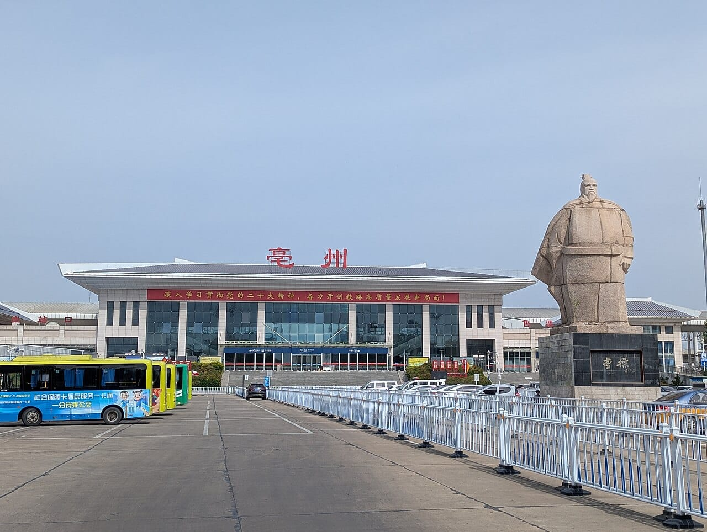

# Gujing Wine Culture Museum

The Gujing Wine Culture Museum stands in Gujing Town, Qiaocheng District, Bozhou, Anhui, opposite the Gujing distillery. Gujing Group built it in 1994 and opened it in 1996; in 2008 the wider Gujing Wine Culture Park, of which it is the core, was rated a national 4A tourist attraction. It is not a standalone city museum. Distillery, ancient wells, park and exhibition halls form one industrial-tourism destination, and that shapes both the route and what a visitor should expect.

Figure: Gujing Wine Culture Museum. Photograph: File:Bozhou Railway Station (54488765713).jpg. Credit: Jeremy Thompson, CC BY 2.0 ([source page](https://commons.wikimedia.org/wiki/File:Bozhou_Railway_Station_(54488765713).jpg)). Category image; not a claim that it shows the exact product, site or event.

> **Quick verdict**
> **In one line:** This entry helps you decide whether Gujing Wine Culture Museum deserves a detour, and what to check before visiting.
>
> - **Best for:** Anyone planning a visit to Gujing Wine Culture Museum who needs to decide whether it deserves a half-day or a full day.
> - **Not for:** If you want only want a must-visit list and will not check booking, transport or opening hours.
> - **Check first:**
>   - Gujing Group traces its corporate line to the Gongxing distillery of 1515, during the Ming Zhengde reign.
>   - The museum covers about 3,200 square metres of land and 2,200 square metres of floor area, all in a traditional-style compound.

## Place and history

Gujing Group traces its corporate line to the Gongxing distillery of 1515, during the Ming Zhengde reign. In 1959 the site was converted into the state-run Bozhou Gujing Distillery; the group was established in 1992 and Gujing Gongjiu was listed on the stock market in 1996. The brand story reaches further back: in 196 AD Cao Cao presented "Jiuyun spring wine" and its production method from his home region of Bozhou to Emperor Xian of Han. The company uses this as its origin narrative, and in 2018 Guinness World Records recognised the "Jiuyun method" as the world's oldest surviving distilled-liquor production method.

Gujing Group built the museum itself with an investment of more than 1500 wan yuan (about 15 million yuan). The Bozhou municipal government says it was completed in 1994 and formally opened in 1996, and describes it as one of Anhui's ten major industry museums and one of China's earliest wine-culture museums. The National Cultural Heritage Administration's museum report records construction beginning in 1995 and its first public opening on 1 January 1997. The two official sources do not fully agree on construction, completion and opening dates. This entry follows the municipal account of completion in 1994 and opening in 1996, while keeping the discrepancy visible rather than treating either version as undisputed.

In 2008 the Gujing Wine Culture Park became a national 4A tourist attraction. In 2013 the Gujing Gongjiu brewing site was listed as a nationally protected cultural relic. In 2019 the "Gujing Gongjiu vintage raw wine traditional brewing area" entered the national industrial heritage list. In 2022 the park was named a national industrial-tourism demonstration base. Company materials also say that in 2025 the brewing site entered China's tentative list for World Cultural Heritage. These overlapping designations explain why the site is more than a single gallery: corporate history, heritage protection and industrial tourism all support it.

## Why Gujing Town

Gujing Town grew around the distillery. The museum faces the plant across the road; the park's northern zone contains the Gujing garden, the automated filling workshop and the brewing workshops, while the southern zone contains the museum and Gujing Villa. A visitor can see wells, cellars, workshops and exhibition halls within one site. That layout explains why the museum does not settle for displaying bottles: it wants to present water, cellars, manual brewing and modern filling as one production system.

The name "Gujing" points to water. The town has ancient wells, including the Wei well and the Song well, and the museum preserves an underground Song well about six metres deep. The quality story of Gujing Gongjiu is often summarised as "peach-blossom yeast, Wuji water, the Jiuyun method and Ming-dynasty cellars". Water sits alongside yeast, cellars and technique, so the well is not a romantic backdrop but part of the production conditions. A first-time visitor who remembers only "a famous liquor brand" will miss this geography.

The site also differs from a city museum. Its exhibits sit next to a working production line, and some stops require joining a group and following factory rules. Visitors are not seeing a fully museumified past; they are seeing a past that is still in production. That "living" quality is an advantage, but it also explains why access is less free than at a municipal museum.

## Exhibits and route

The museum covers about 3,200 square metres of land and 2,200 square metres of floor area, all in a traditional-style compound. The Han-style gate towers and the Qing-style corridor are the most visible elements; the corridor walls carry inscriptions and reliefs. The main hall is a double-eaved hall with Ming- and Qing-style glazed tiles and is the principal exhibition space. Inside, the decoration is modern, creating a sharp contrast with the antique shell.

The Bozhou municipal government divides the displays into four parts. The ground floor holds the preface hall, the origins of wine and the character of wine, covering the long history of Chinese liquor culture, vessels and customs. The upper floor covers Gujing's growth, its product range, its honours, its brand strategy, its calligraphy and painting, and a conclusion. There are also a painting and calligraphy gallery, an experience area, and underground spaces containing the Song well, the Ming-dynasty cellar cluster, a manual-production viewing room, a visitor brewing experience area, a wine shop, an outdoor leisure area, a relief wall and a souvenir shop. The National Cultural Heritage Administration report instead summarises the main galleries as seven parts: preface, origins of wine, character of wine, traces of wine, wine gardens, wine honours and wine fragrance. This is a finer subdivision, not a contradiction; the two accounts operate at different levels.

The underground Song well and the cellars are the most distinctive part. The government says the Song well lies about six metres underground, and that visitors can watch manual brewing while viewing the cellars. Above ground are antique halls and corporate history; below ground are well walls, cellar mud and working craft. This is what pulls "wine culture" away from text panels and back into specific materials and spaces.

There is no single trophy object to hunt for. Ancient wine vessels, inscriptions and reliefs, old labels and company archives, the Song well and the Ming cellars each represent a different line: drinking culture, corporate history and production history. Compare the ground-floor "origins and character of wine" with the upper-floor "growth and brand strategy": the first covers the long run of Chinese liquor culture, the second shows how a local brand was organised in the modern period.

## How to visit

Allow two to three hours. Start with the main hall's two floors to cover the origins of wine and the company story, then go down to the Song well and Ming cellars, and finish at the manual-production viewing room, experience area and wine shop. A guided group may change the order; follow the guide and do not leave the group to enter production areas for photographs.

Keep four words in mind: well, yeast, cellar and brewing. The well is water and the town's name; the yeast is "peach-blossom yeast"; the cellar is the Ming-dynasty cluster; brewing is the Jiuyun method and manual work. These four connect the scattered displays and explain why Gujing Gongjiu emphasises "ancient methods" rather than vintage marketing alone.

Whether production areas are open, and which workshops can be seen, depends on the day's bookings and factory arrangements. Government information mentions the northern zone's automated filling and brewing workshops and the southern zone's museum and Gujing Villa, but independent visitors cannot assume access to all of them. Do not treat a ticket as permission to wander the plant. Groups, school visits and media trips usually need advance arrangements.

The museum suits visitors interested in Chinese baijiu production, industrial heritage and local corporate history, as well as school and family study groups. It does not suit people expecting vineyards, a chateau restaurant or an internationally curated exhibition programme. Interpretive material is mainly in Chinese; foreign-language guides and materials need to be confirmed in advance.

## Practical information

Address: San Cao Avenue, Gujing Town, Qiaocheng District, Bozhou, Anhui, China, opposite the Gujing distillery. The museum is about 25 kilometres north of Bozhou's urban area, usually reached by car or taxi in roughly half an hour. Public transport involves reaching Gujing Town and changing to a local vehicle; check current routes and timetables locally.

Hours: the National Cultural Heritage Administration report says the museum opens year-round, 365 days a year. Baidu Baike and travel platforms list 08:00–12:00 and 13:30–17:00 daily, while another source gives 13:00 for the afternoon; there is no single official timetable and these times have not been confirmed item by item. Telephone the site on 0558-5200055 or check the official "Gujing Wine Culture Park" booking channel before setting out.

Tickets: a Bozhou Development and Reform Commission notice sets a maximum price of 50 yuan per ticket; the museum is not free. Baidu Baike's museum entry and some platforms give 60 yuan, so the on-site notice is the guide. Children aged six or under, or 1.2 metres or under, and visitors aged 65 and over are among the free-admission groups; the full list and how it is applied follow the on-site notice.

Bookings are made with real names through the "Gujing Wine Culture Park" Alipay mini-programme. Groups, study visits and guides should be arranged in advance; whether production areas are open depends on the day's bookings and factory arrangements.

No verifiable source for the coordinates was found, so latitude and longitude are left empty (unverified).

Page verified 2026-11-08; opening status, prices and reservations are subject to official channels.

## Etiquette and common misconceptions

The first misconception is that the museum and the distillery are the same visit. The museum is the core of the park; the distillery is the production entity. They are adjacent, but access areas, booking arrangements and safety rules differ. Treating "visit the museum" as "tour the whole plant" will get you stopped at a gate.

The second is to expect a fully commercial 4A visitor circuit. The value here lies in the authenticity of the wells, cellars and manual brewing; food, souvenirs and interactive exhibits are less developed than at a large city museum. Anyone who only wants easy photo stops may find it hard going.

The third is to overlook the date discrepancy. Official material gives both 1996 and 1997 for the opening. This entry keeps both rather than declaring one absolute. If a panel on site says 1997, it is not contradicting this entry; the two records use different conventions.

In the heritage and cellar areas, follow the rules: do not touch, step over barriers or enter closed zones. Well walls, cellar mud and inscriptions do not survive handling. Production areas involve machinery and spent grain, so heels and sandals are unsuitable. Check photography notices before taking pictures; some workshops prohibit it.

Remember that baijiu is much stronger than wine. Do not taste on an empty stomach, do not swallow a whole cup at once, and do not drive afterwards. If a companion does not drink, the vessels, corridor inscriptions and manual workshops are still worth seeing. Minors may not drink; families should separate the visit from the tasting.

## Neighbourhood and routes

Gujing Town itself has few attractions beyond the park, so do not set aside a whole day for it. A sensible route is to leave Bozhou in the morning, spend two to three hours at the museum and park, return to the city for lunch, then visit the Flower Theatre, Cao Cao's underground troop tunnel or the Hua Tuo shrine in the afternoon, and finish around the old city and the Guo River.

Bozhou is the home region of Cao Cao and Hua Tuo and a major Chinese-medicine trading centre. The Flower Theatre is known for its brick, wood and painted carvings; Cao Cao's tunnel is an ancient military passage; the Hua Tuo shrine commemorates the physician. These sites are different in theme from the wine museum, but together they give a day a layer of "historical figures, urban commerce and liquor culture".

By public transport, reach Bozhou station or Bozhou South station first, then take a taxi to Gujing Town; bus connections need extra transfer time. By car, head north from the city towards Shangqiu for about 25 kilometres, then follow signs to Gujing Town after the Zhangji area. Use live navigation for current road conditions.

With only half a day in Bozhou, choose either the Gujing museum or the Flower Theatre rather than both. Trying to fit Gujing Town and the city sights into half a day means most of the time is spent travelling.

## See also

The Gujing Wine Culture Museum is linked to [Anhui Gujing Distillery Co., Ltd.](ref:producer) through the "visitor place of" relationship: the company profile covers the business and products, while this entry covers the visit and the space. For the city context, continue with [Bozhou](ref:bozhou).

Further reading: [Strong-aroma baijiu](ref:c-extra-1), [Gujing Gongjiu](ref:c-extra-2), [Wuliangye Wine Museum](ref:c-extra-3).
