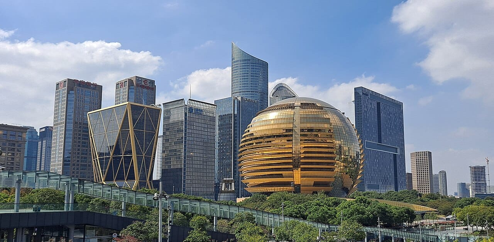

# Guyuelongshan: the central cellar and a Shaoxing wine visit

Guyuelongshan is one of the most recognisable names in Shaoxing yellow wine, but a visit here is not a vineyard tour. It is an encounter with time: rows of clay jars hold wines of different vintages in the company's central cellar on Qiantao Road, and the air mixes clay, wine and damp warehouse. Once you have stood among those jars, the word "aged" in Shaoxing wine stops being an adjective on a label and becomes a physical process.

Figure: "Guyuelongshan: the central cellar and a Shaoxing wine visit". Photograph: File:Shaoxing Bazi Qiao 2017.12.09 16-16-06.jpg. Credit: Zhangzhugang, CC BY-SA 4.0 ([source page](https://commons.wikimedia.org/wiki/File:Shaoxing_Bazi_Qiao_2017.12.09_16-16-06.jpg)). Category image; not a claim that it shows the exact product, site or event.

## The company and the region

Zhejiang Guyuelongshan Shaoxing Wine Co. has its headquarters at Beihai Bridge in Shaoxing. Its official site places the company firmly inside the core Shaoxing production area, where glutinous rice, wheat qu and the water system of Jian Lake are treated as the basic conditions of the style. The site breaks the traditional process into screening and steeping the rice, steaming, putting it into vats, fermenting and opening the mash, pressing, clarifying and boiling the wine, and sealing it into jars for storage. These steps look simple on a page; what is difficult is the coordination of temperature, humidity and time.

Guyuelongshan also invested in the China Yellow Wine Museum, which opened in 2007 at 557 Xia Da Road in Yuecheng District. The museum presents the history of Chinese yellow wine, drinking customs, technique and Huadiao decoration; the central cellar, by contrast, shows wine still inside the jars. They are not the same site and not the same visit. First-time visitors often collapse "Guyuelongshan", "China Yellow Wine Museum" and "central cellar" into one sentence. Keeping the three names apart makes the day much easier to plan.

## The central cellar: jars and time

The central cellar stands on Qiantao Road in Yuecheng District; local reports also place it in Sunduan Subdistrict. Shaoxing News reported in 2025 that the site covers 308 mu, contains 28 large cellars and holds about 260,000 kilolitres of wine, roughly 1100 ten-thousand jars of base wine, about 11 million, making it one of the largest yellow-wine cellars in China. A 2026 page from the Shaoxing culture and tourism bureau gives the opening hours as 08:00–16:00 and notes that the cellar was built in the mid-twentieth century with funds allocated on the instruction of Premier Zhou Enlai. The two accounts complement each other, but the exact entrance, accessible area and daily reception should always be confirmed through official channels.

What matters is not only the number of jars but the way they are arranged and the environment they sit in. A clay jar is not a completely sealed glass bottle: its wall has a slight permeability, so the wine slowly oxidises and esters form in a temperature- and humidity-stable cellar. Sharp alcohol softens, and the aroma moves from rice and wheat qu toward aged, nutty and dried-fruit notes. Vintage tags, seals, markings on the jars and the division of the cellars are the physical evidence behind the phrase "aged for the full term". In recent years the cellar has added exhibition, sales and e-commerce functions as it turns toward industrial tourism, but storage remains its main job; it is not a theme park.

## Craft: wheat qu, wine starter and winter brewing

Shaoxing yellow wine relies on two starters. Wheat qu is made from wheat and supplies the enzymes for saccharification as well as the aromatic backbone of the wine. Wine starter, or jiuyao, is a small fermentation culture, usually made from rice flour and herbs such as smartweed, inoculated with moulds and yeasts and passed down from one generation to the next. Steamed glutinous rice is spread to cool, mixed with wheat qu and starter, and put into vats, where saccharification and fermentation proceed together. During fermentation the mash must be "opened" and turned, a step called kai pa, to release heat and admit oxygen; the winemaker reads temperature, bubbles and smell rather than following a fixed clock.

Winter brewing, or dong niang, is the most important seasonal idea in Shaoxing wine. Low winter temperatures suppress unwanted microbes and slow fermentation, producing a cleaner wine with finer aromas. Traditionally the weeks around the winter solstice are the key period for starting the mash; a long, cool fermentation is followed by pressing, clarification, boiling the wine and storage in clay jars. Boiling, or jian jiu, is a heating step that stabilises the wine and prepares it for ageing. Once you have followed this sequence, the jars in the cellar make more sense: vintage is not a number printed on a box but the result of temperature, microbes and container.

The water of Jian Lake is the other thread. The traditional Shaoxing production area sits around the lake, and the water's mineral content and microbial environment influence fermentation and texture. The museum explains the relationship between water, rice, qu and jar; Xianheng serves it in a bowl; the central cellar stretches it over years and decades. Only together do the three stops tell a complete story.

## Visiting (and practical notes)

The address is Qiantao Road, Yuecheng District, Shaoxing (Guyuelongshan Central Cellar). The Shaoxing culture and tourism bureau's 2026 page lists 08:00–16:00, but hours may change with season, events and reception arrangements, so check Guyuelongshan's official channels or on-site notices before travelling. Groups, school visits and anyone needing a guide should contact the company in advance; independent visitors should also confirm whether walk-in entry and fixed tours are available.

Allow about an hour, with the cellar and the sales area as the focus. Do not expect to see the full sequence of steaming, fermentation and bottling: the central cellar is for ageing and storage, while production is distributed across other sites. If you arrive expecting a complete factory tour, the visit will feel incomplete. Watch your step on the cellar floor, do not touch jar mouths, seals or vintage tags, and do not open cellar doors on your own. The air inside carries alcohol, so keep children close.

Transport is straightforward by taxi from the old city or from Shaoxing North Station, though journey times depend on traffic. The old city's lanes are narrow, so park in a public car park rather than driving to the cellar entrance. In summer the temperature difference between the cellar and the outdoors is noticeable, so bring a light layer; in the plum-rain season the floor can be damp, so wear shoes with grip. If you want to combine exhibition and storage in one day, visit the China Yellow Wine Museum in the morning and the central cellar in the afternoon, taking a taxi between them rather than counting on a walk.

## Manners and common mistakes

The first mistake is to treat the central cellar as a winery. Shaoxing yellow wine is a grain wine, not a grape wine: there are no vineyards and no winery lunch. The second is to confuse the central cellar with the China Yellow Wine Museum. The museum is at 557 Xia Da Road; the cellar is on Qiantao Road, and although both belong to the Guyuelongshan orbit, their spaces and contents differ. The third is to read "central cellar reserve" as meaning every bottle has aged for decades; the vintage, base-wine proportion and blending depend on the specific label and official description.

The cellar is a production and storage site, not a bar. Do not enter without permission, do not touch jars, seals or racks, and do not use a flash directly on labels. If a tasting is offered, ask whether it is included or charged separately. Yellow wine is usually 14%–20% alcohol, stronger than it tastes, so do not drive afterwards. Minors must not drink. Finally, do not turn "older is better" into an absolute rule: ageing needs the right wine, container and conditions, and poorly stored old wine can lose its balance.

## See also

Guyuelongshan is an industrial gateway into [yellow wine](ref:yellow-wine) and places [Shaoxing](ref:shaoxing)'s waterways, rice farming and storage traditions in one site. Set it within the wider map of [China](ref:china) and read [the history of yellow wine](ref:yellow-history) to see why winter brewing and cellaring are the keywords of this craft.

Further reading: [Zhejiang Province](ref:c-extra-1).

## Related images

Image: Zhejiang Province. Credit: EditQ, CC BY-SA 4.0, via Wikimedia Commons ([source page](https://commons.wikimedia.org/wiki/File:%E6%9D%AD%E5%B7%9E%E9%92%B1%E6%B1%9F%E6%96%B0%E5%9F%8E_4_(cropped).jpg)). Related image for Guyuelongshan: the central cellar and a Shaoxing wine visit.
