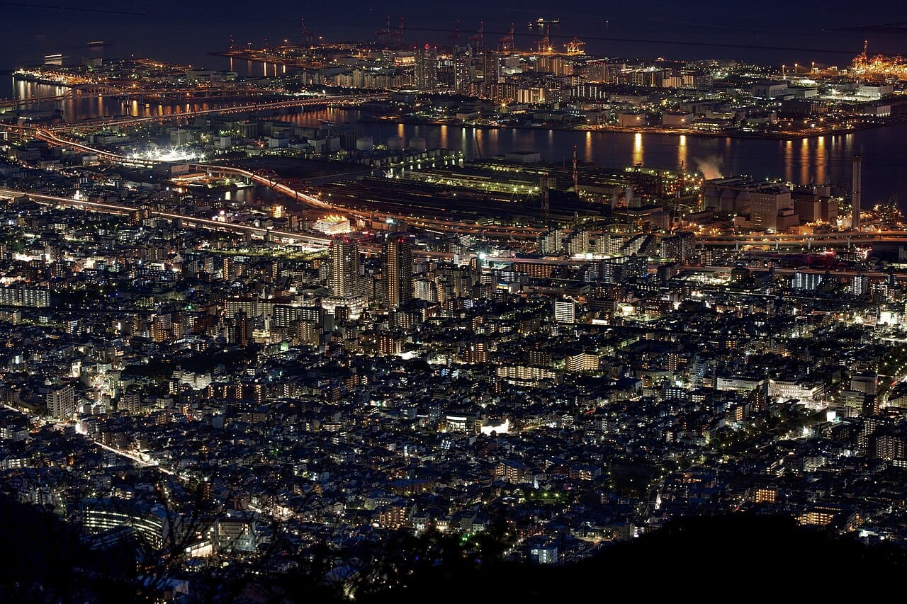

# Hakushika Memorial Museum of Sake

The Hakushika Memorial Museum of Sake is formally the Hakushika Kinen Shuzo Hakubutsukan, and locally it is simply the Sake Museum. It stands in Kurakake-cho, Nishinomiya, Hyogo, at the northern edge of Nadagogo, the sake district squeezed between Mount Rokko and the Seto Inland Sea. It is not a single exhibition hall but a complex founded by the Hakushika brewer Tatsuuma-Honke: an 1869 brewery on one side of the road and a memorial building with galleries and a reference room on the other.

Figure: Related photograph of Hakushika Memorial Museum of Sake. Image: 663highland, CC BY 2.5, via Wikimedia Commons ([source page](https://commons.wikimedia.org/wiki/File:Hakushika_Memorial_Museum02st3200.jpg)).

> **Quick verdict**
> **In one line:** This entry helps you decide whether Hakushika Memorial Museum of Sake deserves a detour, and what to check before visiting.
>
> - **Best for:** Anyone planning a visit to Hakushika Memorial Museum of Sake who needs to decide whether it deserves a half-day or a full day.
> - **Not for:** If you want only want a must-visit list and will not check booking, transport or opening hours.
> - **Check first:**
>   - Tatsuuma-Honke dates its founding to 1662.
>   - The museum is self-guided.

## Place and history

Tatsuuma-Honke dates its founding to 1662. The first Tatsuya Kichizaemon dug a well inside his Nishinomiya residence, found the water clear and sweet, and began brewing with it. That origin, in which a well starts a brewery, later became part of the Nishinomiya sake story. Hakushika, the white deer, is the company's sake brand and carries an auspicious meaning. The company still has its head office and brewery in Nishinomiya, while the museum is run by a public-interest foundation and combines display, collection and research.

The museum was established in 1982, the 320th anniversary of the founding. Its core building, the Sakagura-kan, was built in 1869, the second year of Meiji, and served as a Tatsuuma-Honke brewing house. It has a timber frame, white plaster walls and a heavy earthen storehouse structure typical of the Nada brewery quarter. The Great Hanshin-Awaji earthquake of 1995 damaged the area badly, and the museum reopened only after repairs; today's beams and walls therefore combine original fabric with post-disaster reinforcement. It is not a completely untouched Edo-period building.

The Kinen-kan, the memorial building, stands on the south side of the road, facing the Sakagura-kan on the north. It contains three rooms: a planned exhibition room, a sake reference room and the Sasabe Sakura reference room. The last commemorates Sasabe Shintaro (1887–1978), known as the "cherry blossom man" for his long work on cherry conservation and varieties. Putting sake and cherry blossoms in one museum looks incongruous, but it fits the seasonal rhythm of Nadagogo: brewing is winter work, cherry blossoms are spring, and together they frame life in Nishinomiya.

## Space and displays

The Sakagura-kan is the heart of the visit. The interior keeps the scale of a brewing space: tall beams, a low floor and light entering from above. The route follows washing, soaking, steaming, koji making, fermentation, pressing and bottling, with wooden vats, koji trays, steamers, presses and labels set alongside film and recordings of brewing songs. Visitors can see the marks of use on the tools but cannot touch them. Some areas offer replicas that can be handled, which helps children understand that sake does not come out of a bottle fully formed.

The Kinen-kan is more archival. The planned exhibition room changes theme by season; the sake reference room holds labels, advertisements, vessels and documents; the Sasabe Sakura room displays cherry diagrams, specimens and conservation records. The two buildings are separated by a road called Rinkosen Road, so visitors cross the street. The ticket covers both; when the Kinen-kan is between exhibitions, only the Sakagura-kan opens and the admission price is reduced.

Next door stands Hakushika Classics, a shop and restaurant run by the brewery, where visitors can pay for a tasting of several Hakushika sake and buy vessels, sake lees and limited products. It is outside the museum ticket, but it completes the circuit of exhibition, tasting and shopping. Anyone who only wants to drink can go straight to Hakushika Classics; anyone who wants to understand why the sake tastes as it does should see the Sakagura-kan first.

## How to visit

The museum is self-guided. At the time of checking on 2026-11-07, the combined adult ticket was 500 yen, with junior and elementary students at 250 yen and concessions for visitors aged 65 and over and for visitors with disabilities; when only the Sakagura-kan is open, the adult ticket was 300 yen. Special exhibitions are priced separately. Groups of 20 or more must book by telephone or email and pay in one cash payment. Prices can change, so check the official Visit page before travelling.

A sensible order is north then south: the Sakagura-kan for process and architecture, then across the road to the Kinen-kan for documents and the temporary exhibition. The ground floor of the Sakagura-kan has no steps and a slope, and wheelchairs can move through the displays. Both buildings lend wheelchairs and strollers free of charge, and the Kinen-kan has a nappy-changing table. There is no audio guide and limited English labelling, but English and Chinese booklets are available at the entrance.

Tasting is not included in museum admission; it happens for a fee at Hakushika Classics next door. To compare grades of Nada sake, order a small set of junmai, ginjo and daiginjo, smell first and then sip, noticing the difference polishing makes. Drivers should not taste at all. Japanese law enforcement takes drink-driving seriously, and there is no "just one sip" exemption.

## Practical information

The address is 8-21 Kurakake-cho, Nishinomiya, Hyogo 662-0926, Japan; telephone 0798-33-0008. Hours are 10:00 to 17:00, with last admission at 16:30. The museum closes on Tuesdays; if a Tuesday is a national holiday it opens that day and closes the next business day. It also closes for three days in summer and over the New Year, and temporary exhibitions or severe weather can alter the schedule.

Tickets for the combined Kinen-kan and Sakagura-kan: 500 yen for adults, 250 yen for junior and elementary students, 400 yen for visitors aged 65 and over, 250 yen for visitors with disabilities and 200 yen for children with disabilities, and 400 yen for groups of 20 or more. When only the Sakagura-kan is open the adult ticket is 300 yen. Special exhibitions are priced separately; groups must book by telephone or email and pay in one cash payment. Tasting is not included and is charged at Hakushika Classics next door.

Hanshin Electric Railway is the most direct approach: from Nishinomiya Station, walk south along Fudabasuji Road for about 15 minutes and turn right at Rinkosen Road. Alternatively, take a Hanshin bus bound for Marina Park from the south side of Hanshin Nishinomiya or JR Nishinomiya to Kotsu-Koen Mae, then walk about one minute. From Hankyu Nishinomiya-Kitaguchi, take a Hankyu bus bound for Asanagi-cho to Higashi-machi and walk about seven minutes. There are six free parking spaces; coach parking must be booked.

Page verified 2026-11-08; opening status, prices and reservations are subject to official channels.

## Etiquette and misconceptions

The first misconception is that this is a Hakushika factory tour. It is a museum in a former brewery, and the working brewing facilities are not on the route; to see production, look for brewery open days. The second is to arrive on a Tuesday: the fixed closure applies, with a holiday exception followed by a compensatory closure, so leave flexibility. The third is to assume the ticket includes sake: admission covers the displays only, and tasting at Hakushika Classics is charged separately.

Inside the Sakagura-kan, do not touch vats or tools, do not cross the barriers and do not handle parts of the press. The building is an old timber structure with uneven floors, so high heels and hard soles are uncomfortable. Photography is allowed, but do not use a flash against display glass and do not block the narrow stairs.

At a tasting, follow ordinary sake etiquette: hold the bottle with both hands when pouring for someone else, and receive the cup with both hands. Do not fill your own cup to the brim and do not knock sake back like a spirit. Nada sake is not low in alcohol, and several pours on an empty stomach go to the head quickly, so eat something first. Families with children can focus on the tools and the cherry archive without entering the tasting area.

## Neighbourhood and routes

The museum sits in southern Nishinomiya, with Nishinomiya Shrine and Hanshin Nishinomiya Station to the north and the Rinkosen Road and waterfront industry to the south. A half day can run as follows: the Sakagura-kan and Kinen-kan in the morning, lunch at Hakushika Classics, a walk to Nishinomiya Shrine, then the Hanshin line back to Osaka or Kobe. Those interested in Nadagogo as a whole can continue east to the Kobe brewery district to see the exteriors and reference rooms of Kikumasamune, Hakutsuru and others, but two areas in one day is rushed.

From Osaka Umeda or Kobe Sannomiya, the Hanshin main line reaches Nishinomiya in about 20 minutes; from Shin-Osaka, take JR to Nishinomiya and change to a bus. Nishinomiya is not a major overnight base, and most visitors treat it as a half-day stop between Osaka and Kobe. Anyone travelling specifically for sake should keep Nishinomiya and Fushimi on separate days: hard-water Nada and soft-water Fushimi are best compared when you are not rushing.

## See also

The Hakushika Memorial Museum of Sake places [Hyogo](ref:hyogo) and the craft of [sake](ref:sake) in one site; it covers water and rice as well as earthquake repair and local memory. For the technical difference between sake and shochu, read [Sake and shochu: both Japanese, entirely different processes](ref:sake-and-shochu).

Further reading: [Japan](ref:c-extra-1), [A Ginjinha](ref:c-extra-2).

## Related images

Image: Hyogo Prefecture. Credit: Laitr Keiows, CC BY-SA 3.0, via Wikimedia Commons ([source page](https://commons.wikimedia.org/wiki/File:Night_view_of_Rokk%C5%8D_Island_and_Higashinada-ku,_Kobe,_Japan.jpg)). Related image for Hakushika Memorial Museum of Sake.
