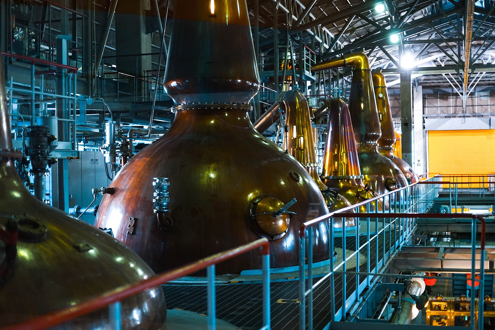
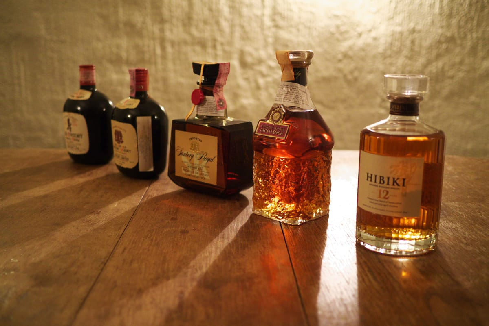

# Hakushu Distillery

Hakushu Distillery stands in Hakushu, Hokuto, Yamanashi, at 2913-1 Torihara, with the Southern Alps behind it. Suntory calls it a distillery in the forest: the site is surrounded by woodland, the visitor route passes through trees and birdsong, and the production buildings come later. It opened in 1973 as Suntory's second malt whisky distillery after Yamazaki. Unlike Yamazaki's position at the edge of a city, Hakushu was planned around the natural setting from the beginning: water, air, humidity and forest are treated as part of the whisky.

Figure: Related photograph of Hakushu Distillery. Image: tetsuya yamamoto, CC0, via Wikimedia Commons ([source page](https://commons.wikimedia.org/wiki/File:Hakushu_Distillery_-_32128449586.jpg)).

## A distillery in the forest

The central idea is the forest park factory. The site includes a bird sanctuary, building heights are controlled so that the skyline is not cut, and visitors see trees and grassy slopes before the fermentation and distillation halls. This is not only landscape design; it affects production. The forest moderates temperature and humidity, making warehouse maturation more stable, and the soft water around the site has been filtered through granite for a long time and contains few minerals, which suits clean, fresh new make. The official description of Hakushu as light and comfortable is less a marketing phrase than a result of water, fermentation and distillation. Walking a stretch of woodland path before entering the buildings makes the connection between forest and whisky easier to understand than stepping directly from a car park into a hall.

## 1973: Suntory's second malt distillery

Suntory built Yamazaki in 1923 and started Japanese whisky from almost nothing; fifty years later, Hakushu came on stream in 1973 with a different task. It was not meant to copy Yamazaki but to create another family of malt spirits from different water, environment and equipment. [Japanese whisky](ref:japanese-whisky) labelling is governed by the Japan Spirits and Liqueurs Makers Association standard, which sets requirements for ingredients, mashing, distillation, maturation location and minimum ageing; Hakushu, as a malt whisky made in Japan, is labelled within that framework. This explains why Hakushu and Yamazaki share a parent company yet deliberately diverge in flavour: they are not two labels from one production line but two complete distilleries. To compare them, start with the [Yamazaki distillery](ref:yamazaki) entry and then look at [Yamazaki 12 Year Old](ref:yamazaki-12) beside Hakushu 12.

## Water, wooden washbacks and different stills

Several details define Hakushu's process. The first is water: natural water from the Southern Alps has passed through granite for roughly twenty years, is soft, and suits long fermentation and clean new make. The second is fermentation: the distillery uses wooden washbacks, whose insulation and breathability differ from steel and give a more complex aroma. The third is distillation: Hakushu does not use a single still shape but runs pot stills with different neck lengths and lyne arm angles, so the same malt can produce both light and heavy spirits. The fourth is the cask: bourbon, sherry, mizunara and other types are matured separately and later combined by the blender. The point is technical: Hakushu's freshness is not simply granted by nature, it is built through a deliberately varied set of stills and casks.

## How to read Hakushu

Hakushu 12 Year Old is the core expression, with green apple, mint, light smoke and a mineral note; the body is not heavy and the finish is clean. Distiller's Reserve is younger and easier, well suited to a Highball. The 18 and 25 Year Old expressions are rounder, moving from green fruit towards dried fruit, honey and spice. Hakushu also produces lightly peated versions, where smoke sits beside the fresh forest character rather than dominating it as on Islay. Read the list in three tiers: start with Distiller's Reserve to establish the fresh baseline, then the 12 Year Old for structure and smoke, and only then the older expressions for complexity. Do not treat Japanese whisky as one uniform style; the differences between [Japanese](ref:japan) malt distilleries are no smaller than those between Scottish regions. Yamanashi is a wine region, but its [whisky story](ref:yamanashi) is separate.

## Booking and visiting rules

Hakushu operates by reservation, and both the free tour and the paid Monozukuri tour must be booked on the official site. Free tours close at noon on the day before the visit; paid tours close at noon three days before, and some slots use a lottery. Arrive early on the day, as staff check the reservation and age at the entrance. Opening hours are 9:30 to 16:30, with last entry at 16:00; the distillery closes at the turn of the year and on factory holidays, and temporary closures are announced on the official site. Minors may not enter alone. Anyone arriving by car, motorcycle or bicycle may not drink, and the same applies to a designated driver in the group. Outside food is not allowed, and pets are not admitted except assistance dogs. Hakushu is a working food factory; following the rules is part of the visit.

## Transport, seasons and drinking safely

From Tokyo, the usual route is the JR Chuo Line to Kobuchizawa Station, then the free Suntory shuttle bus from the station forecourt, which takes about 20 minutes. The shuttle is first come, first served. By car, leave the Chuo Expressway at Kobuchizawa or Sutama and use the car park, which holds about 150 cars. New green in spring and red leaves in autumn are the most attractive seasons and also the busiest; mountain roads can freeze in winter, so check weather and road conditions before setting out. If you are driving afterwards, do not join a tasting with alcohol; Japanese drink-driving penalties are severe. The distillery does not publish precise coordinates for citation, so follow official channels and the official map link for navigation. Hakushu and Yamazaki are not realistic in one day; allow two days.

**Short definition:** Suntory malt whisky distillery opened in 1973 in Hakushu, Hokuto, Yamanashi, at the foot of the Southern Alps. Known for its forest setting, granite-filtered soft water and varied still shapes; visits require a reservation and include a free tour and a paid Monozukuri tour. 

For Hakushu Distillery, begin with the address. Then look at the current opening status, and finally ask what the place is known for. The answers point to different choices, not to a single score.

The comparison with [Japan](ref:japan) and [Japanese whisky](ref:japanese-whisky) runs through address and space and operating status. Each answers a different question.

**Key facts.**

| Item | Detail |
| --- | --- |
| In one line | Suntory malt whisky distillery opened in 1973 in Hakushu, Hokuto, Yamanashi, at the foot of the Southern Alps. Known for its forest setting, granite-filtered soft water and varied still shapes; visits require a reservati… |
| Address | 2913-1 Hakushu, Hokuto, Yamanashi 408-0316, Japan |
| City and country | Hokuto / Japan |
| Status | verified open |
| Official site | suntory.co.jp |

## Related images

Image: Japanese whisky. Credit: Mikael Leppä, CC BY 2.0, via Wikimedia Commons ([source page](https://commons.wikimedia.org/wiki/File:Vintage_Suntory_Tasting.jpg)). Related image for Hakushu Distillery.
