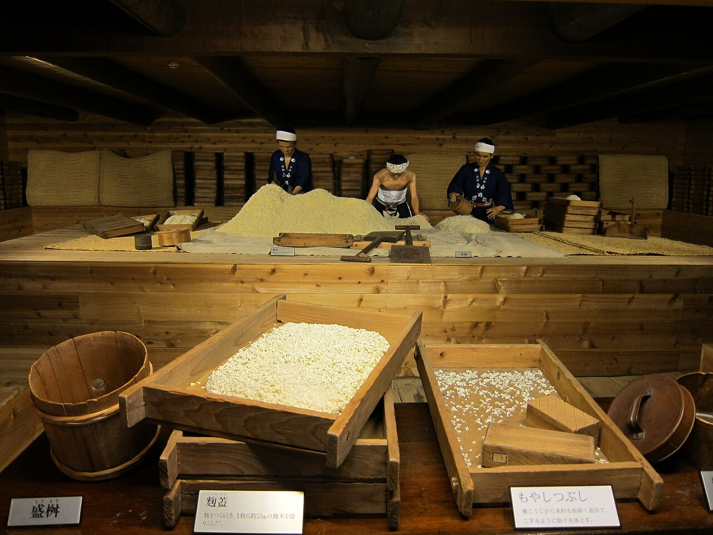

# Hakutsuru Sake Brewery Museum

From Hanshin Sumiyoshi Station, walk five minutes through a residential neighbourhood and a long brewery building appears: dark wooden walls, a white plaster band, a traditional tiled roof. It does not look like a corporate museum with a glass lobby and a guided-tour desk. It is a working brewery left in place: beams, plaster, barrel racks, the koji room and the steaming floor are all still there, only the workers have been replaced by life-size figures.

Figure: A brewing-tool display in the Hakutsuru Sake Brewery Museum: wooden vats, vessels and hand tools. Image: hslo, CC BY-SA 2.0, via Wikimedia Commons ([source page](https://commons.wikimedia.org/wiki/File:A_Hakutsuru_Sake_Brewery_Museum_exhibit.jpg)).

## Location and history

Hakutsuru’s museum occupies “Main Brewery No. 1.” The official “about” page is precise: the brewery was built in the early Taisho era and operated as Main Brewery No. 1 until March 1969 (Showa 44); it was then converted to a museum in its original form and opened in 1982 (Showa 57). Its building area is 1,098.95 square metres (332.43 tsubo), total floor area 1,951.13 square metres (590.21 tsubo); as a brewery its capacity was 900 kilolitres of pure sake, roughly 600,000 bottles of 1.8 litres.

Hakutsuru itself was founded in 1743 (Kanpo 3) and is one of the representative breweries of Mikage, in the Nada five-village area. The museum is not “company history on panels”: it keeps a decommissioned brewery together with its tools. The 1995 Great Hanshin-Awaji earthquake damaged the museum and the wooden brewery; it reopened after restoration in 1997. What you see today combines the early Taisho structure with the marks of post-earthquake repair.

## Architecture and space

This is a long “machiya-style” brewery: a long façade, a low roof, horizontal bands of white plaster and dark wood, and a small ventilation tower at the ridge. Its spatial logic is “something is always happening”: steaming and cooling on one side, the koji room on another, the great wooden vats and pressing area in the centre, storage and carrying at the end. The museum did not knock down walls to make a white box; it kept the original column grid, beams and floor, so visitors walk the brewery’s original route.

On the ground floor the most striking object is the huge cedar fermentation vat, its wall made of staves bound into a circle almost the height of a person; beside it are pressing vats, filter cloths, sake vessels and measures. The upper floor lays out the cooling equipment, koji room, steaming floor and tools by process stage; life-size figures steam rice, turn koji, stir vats and press, fixed at a single moment. The roof frame is exposed, light falls from high windows and skylights, and the wood runs from dark brown to pale yellow. The atmosphere is the quiet of a storehouse, not the brightness of an exhibition hall.

## The displays and collection

The official English page divides the route into two floors: the ground floor displays brewing implements, including the huge cedar vat once used for fermentation; the tasting area offers freshly pressed, unpasteurised sake that is hard to find elsewhere; the shop sells Hakutsuru products and original museum goods, with the sake jelly especially popular. The upper floor breaks the sake-making process into stages, showing cooling equipment, the koji room and many tools, explaining traditional methods with objects and video; the old brewery itself becomes the display, so the atmosphere of early sake making is unusually real.

Hyogo Tourism gives more specific numbers: about 500 brewing tools across the two floors, with life-size figures of brewery workers, arranged by process; a 15-minute film introduces Hakutsuru’s history, followed by about 20 minutes through the displays, about 35 minutes in total. Allow 45–60 minutes in practice, plus tasting and the shop. The point is not to see every object but to understand the chain: rice—steaming—koji—yeast—brewing—pressing—storage.

## How to visit

Hours are 9:30–16:30, last entry 16:00; admission is free. Groups of 10 or more must book ahead; individual visitors are self-guided. The museum closes at year-end/New Year and during Obon (summer holidays), with additional maintenance closures; check the official site or call before travelling. There is no fixed public tour; groups can book a guide, while individuals follow the signs.

See the great vat and tasting area on the ground floor first, then go upstairs for the process tools, then return to the ground floor for tasting and the shop. Tastings are small; eat something first if you have not, and drivers and minors should not drink. Photography is allowed, but no flash, no touching exhibits and no crossing barriers; the vats and tools are real objects, not replicas. The shop’s “cellar sake” and sake jelly are common gifts; carry alcohol according to airline checked-baggage rules.

## Practical information

- Address: 4-5-5 Sumiyoshi-minamimachi, Higashinada-ku, Kobe, Hyogo 658-0041.
- Coordinates: 34.7101952, 135.2616997.
- Phone: 078-822-8907; fax 078-822-4891.
- Hours: 9:30–16:30 (last entry 16:00); closed at year-end/New Year and Obon, with occasional maintenance closures.
- Admission: free.
- Booking: groups of 10+ book ahead; individual visitors self-guided.
- Transport: Hanshin Sumiyoshi Station about five minutes on foot; JR Sumiyoshi Station about 15 minutes; Hankyu Mikage Station about 10 minutes by car.
- Time: about 35 minutes for the route; 45–60 minutes with tasting and shop.
- Parking: available on site (check on the day); large coaches should confirm ahead.
- Accessibility: stairs and old thresholds; call ahead to confirm wheelchair access.

## Etiquette and common misconceptions

First, do not confuse this with the [Kiku-Masamune Sake Brewery Museum](ref:kiku). Both are in eastern Kobe, but Hakutsuru shows an “original brewery with 500 tools,” while Kiku-Masamune shows a “post-earthquake museum with yeast and the Nada system.” Second, do not confuse Hakutsuru with Hakushika; Hakushika is another company in Nishinomiya. Third, do not assume “free” means you can touch anything; the vats, koji room and tools are real objects, and handling accelerates damage. Fourth, do not “cheers” in the tasting area; it is a small-cup, small-quantity tasting, not a drinking contest. Fifth, do not bring food or drinks into the galleries or take loud phone calls. Sixth, do not read “Obon closure” as a single day; Japanese summer closures can run for several days, so check the official site.

## Nearby and routes

From the museum, walk to the [Kiku-Masamune Sake Brewery Museum](ref:kiku) in Uozaki for another narrative of “yeast and tools”; continue west to the [Hakushika Sake Museum](ref:hakushika) in Nishinomiya, or to the [Gekkeikan Okura Sake Museum](ref:gekkeikan) in Fushimi, Kyoto. For a longer “Nada five villages” line, link Mikage, Sumiyoshi, Uozaki and Nishinomiya; further afield is [Kamotsuru](ref:kamotsuru) in Sakata. Within the [Japan sake brewery route](ref:route) framework, this stop pairs best with Kiku-Masamune for a half-day two-museum visit.

Eastern Kobe is easiest on the Hanshin line: Hanshin Sumiyoshi to Uozaki is two stops, and the walk is also manageable. The museum and Kiku-Masamune are about 20–30 minutes apart on foot, through the Sumiyoshi River and residential streets; carry water in summer and prepare for cold sea wind in winter. If you can see only one, choose Hakutsuru for “original brewery,” Kiku-Masamune for “system and yeast.”

## Further reading and see also

- Official English museum page: <https://www.hakutsuru.co.jp/english/culture/museum.html>, for the old brewery opened in its original form, the two-floor route, tasting, hours, free admission and booking rules.
- Official “about” page: <https://www.hakutsuru.co.jp/community/shiryo/about/>, for the early Taisho construction, the March 1969 closure, building and capacity data, life-size figures and preserved process.
- Company history: <https://www.hakutsuru.co.jp/community/history/>, for the 1982 opening, the 1995 earthquake damage, the 1997 reopening and the 1743 founding.
- Hyogo Tourism page: <https://www.hyogo-tourism.jp/spot/result/87?0=9>, for the roughly 500 exhibits, 35-minute route, Obon/year-end closures, parking and access.
- Sake route comparisons: [Kiku-Masamune Sake Brewery Museum](ref:kiku), [Hakushika Sake Museum](ref:hakushika), [Gekkeikan Okura Sake Museum](ref:gekkeikan), [Kamotsuru](ref:kamotsuru), [Japan sake brewery route](ref:route).

Read Hakutsuru Sake Brewery Museum through the address, then the current opening status, and finally what the place is known for. The sequence matters.