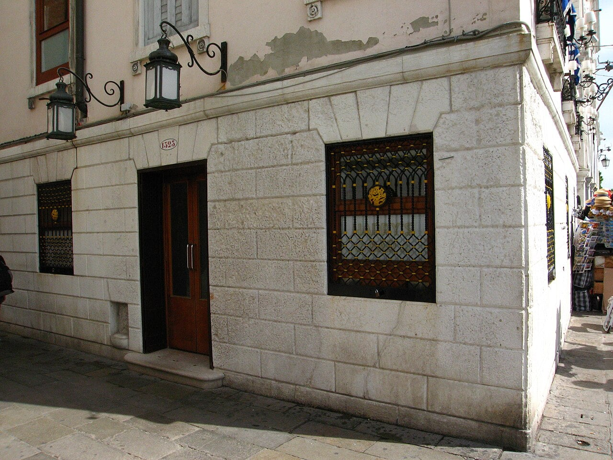
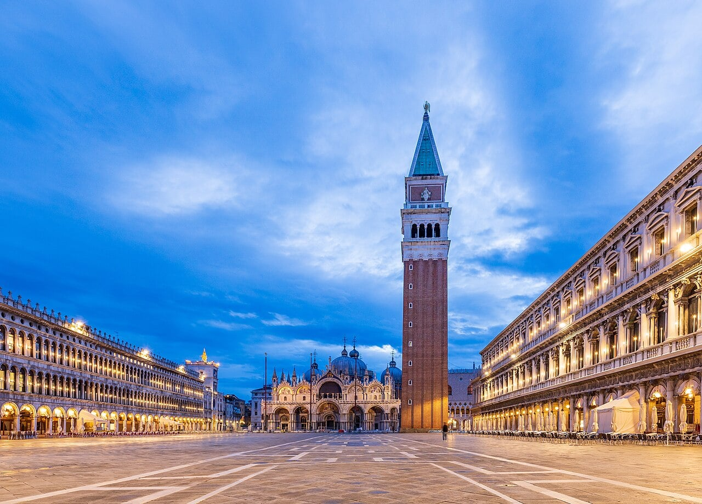

# Harry's Bar Venice

Figure: The entrance to Harry’s Bar on Calle Vallaresso, with the house number 1323 above the door. Image: Felix Haslimeier, CC BY-SA 2.0, via [source page](https://commons.wikimedia.org/wiki/File:Italy_-_Venice,_Harry%27s_Bar,_San_Marco.jpg).

## Setting and history

Harry's Bar stands at Calle Vallaresso 1323, a few minutes on foot from Piazza San Marco through the arcades and lanes. Giuseppe Cipriani opened it on 13 May 1931. In the house's own account, the name comes from a young American, Harry Pickering: Cipriani, then a barman at the Hotel Europa in Venice, helped him when he was stranded, and the guest later repaid the money and put up the funds for the bar. "Harry's Bar" is therefore a customer's name, not the owner's, and not the property of an American writer.

Two inventions shaped the menu. In 1948 Cipriani mixed white peach purée with Prosecco and named the drink after the Venetian painter Giovanni Bellini, whose painted robes are said to have suggested its colour. That is the Bellini. In 1950 a regular guest, Countess Amalia Nani Mocenigo, was advised by her doctor to eat only raw meat; the kitchen sliced raw beef paper-thin, dressed it with a pale sauce and named it after the painter Vittore Carpaccio. "Carpaccio" has since become a generic dish, but this version is treated as the original.

Hemingway was in Venice in the late 1940s and 1950s, and his name became bound up with the bar in later writing and tourism. That association is cultural memory: it explains why the place is famous, but it is not evidence that a particular table belonged to him. Another common confusion is the name itself. Many bars around the world called Harry's Bar have no connection to this one; imitations of the sign and the recipes are widespread, so identify the place by address and operator rather than by the name.

## The room and the menu

The room is small and the entrance discreet, with no large illuminated sign. Inside, a compact bar and closely spaced tables keep voices low; waiters dress formally and service moves at a brisk pace. It feels like an upscale small restaurant with a bar attached, not a nightclub where groups settle in for hours.

The Bellini is the centre of the drinks list: white peach purée and Prosecco, light in body, with sweetness from the fruit rather than syrup. Rossini, the strawberry version built on the same logic, is the usual variation. Beyond those, the bar mixes classic cocktails and aperitifs, with the list changing by season and supply. On the food side, carpaccio is the signature starter, served with a pale sauce and cheese; mains include pasta, fish and Venetian dishes, but most first-time visitors need only a drink and a starter.

Prices are at the top of the Venice scale. The per-glass price of a Bellini is much discussed, but the whole cost structure matters more: drinks, food, service and where you sit all shape the bill. Ask about anything the menu does not price, especially if you plan to sit for only one drink.

## What to order on a first visit

Say at the door whether you want only a drink or a meal. For a drink, the bar or a small table is the natural choice, and the Bellini is the direct order; add a carpaccio to share if you want something to eat with it. If you plan to linger, take a classic cocktail or an aperitif and read the menu at leisure rather than occupying a dining table with one glass.

There is no need to chase the most expensive or most cinematic combination. A Bellini and a plate of carpaccio already explain the two house traditions; if you mainly want the room, choose a quiet mid-morning or mid-afternoon slot rather than the dinner peak. White peaches are seasonal, and the house itself acknowledges that the drink out of season is not the same as in high summer. Do not expect every glass to match a single standard.

Dress need not be formal, but shorts, flip-flops and wet beachwear are out of place. This is not a ferry landing or a sight to photograph at will. The door and the bar are narrow, so step aside for people coming in and out.

## Practical information

**Address:** Calle Vallaresso 1323, 30124 Venezia, Italy (officially given as San Marco 1323), about 2–3 minutes on foot from Piazza San Marco through the arcades and lanes.

**Getting there:** there are no cars in Venice; ACTV water-bus lines 1 and 2 stop at San Marco Vallaresso, about 1–2 minutes' walk from the landing stage and much closer than Piazzale Roma. When navigating to "Harry's Bar", check the street name and number, because imitations with the same name are common in tourist areas.

**Opening hours:** the official site gives daily 11:00–23:00 (page verified 8 November 2026). Holidays and seasonal arrangements may alter this; confirm on the official channels on the day.

**Tickets and reservations:** there is no admission charge; you pay for what you order. In high season and at dinner, confirm availability in advance through official channels (phone +39 041 52 85 777); walk-ins can usually ask at the door outside main meal times.

**Prices and dress:** prices are in the highest Venice band, with drinks and food priced separately, so budget for a high-end bar even if you only have one glass. Dress is "neat, quiet, no beachwear"; there is no enforced jacket rule.

Page verified 8 November 2026; opening status, prices and reservations are subject to the official channels.

## Etiquette and common mistakes

First, the Bellini is not peach-flavoured Champagne. It uses Prosecco, not Champagne, and peach purée, not juice or syrup, which gives a softer body and finer bubbles. Second, carpaccio is not a Japanese-style raw-meat dish: it is thin-sliced raw beef with a sauce, served as a starter, so do not ask for a thick cut or for it to be seared. Third, do not treat the drink as a Hemingway souvenir; the writer's connection is history, not a menu item.

Other common mistakes include treating the bar as a place for loud group gatherings, reading formal service as coldness, and leaving cash on the table as a tip. Tipping is not compulsory in Italy; saying a total that includes the tip, or telling the server when paying by card, is more natural than leaving notes behind. If you only want photographs, buy something first and stay clear of the bar and doorway.

There are clear cases where the bar does not suit: families with small children, groups looking for cheap large beers, and anyone wanting to work at a table for two hours. The room and the service are designed for a short, polished drink.

## Around and routes

A few minutes towards the square brings you to St Mark's Basilica, the campanile and the Doge's Palace; the other direction leads towards Teatro La Fenice. The natural pairing is to sit first at [Caffè Florian](ref:florian) under the arcades, then walk back to Calle Vallaresso for a Bellini. The two stops are laid out in the [Venice San Marco two-bar walk](ref:venice-route).

If you have time for only one stop, put Harry's Bar in the early evening, when the square begins to empty and the bar picks up its evening rhythm; afterwards you can walk a stretch of canal. San Marco is very crowded at high tide and when cruise groups arrive, so check the water level and ship schedules instead of squeezing into the lanes.

## See also

- [Pub and city](ref:pub-and-city): how bars differ from cafés, pubs and beer halls, and how seating sells time.
- [Caffè Florian](ref:florian): the eighteenth-century café in the same quarter, a useful contrast with this twentieth-century bar.
- [Venice San Marco two-bar walk](ref:venice-route): the two stops as a short walking route.

To read Harry's Bar Venice, start with the address, then the current opening status, then what the place is known for; no single check settles it.

## Related images

Image: Piazza San Marco in Venice at dusk, with the campanile and the Procuratie framing the square.. Credit: Matthias Süßen, CC BY-SA 4.0, via Wikimedia Commons ([source page](https://commons.wikimedia.org/wiki/File:Piazza_San_Marco_(Venice)_at_night-msu-2021-6449-.jpg)). Related image for Harry's Bar Venice.
