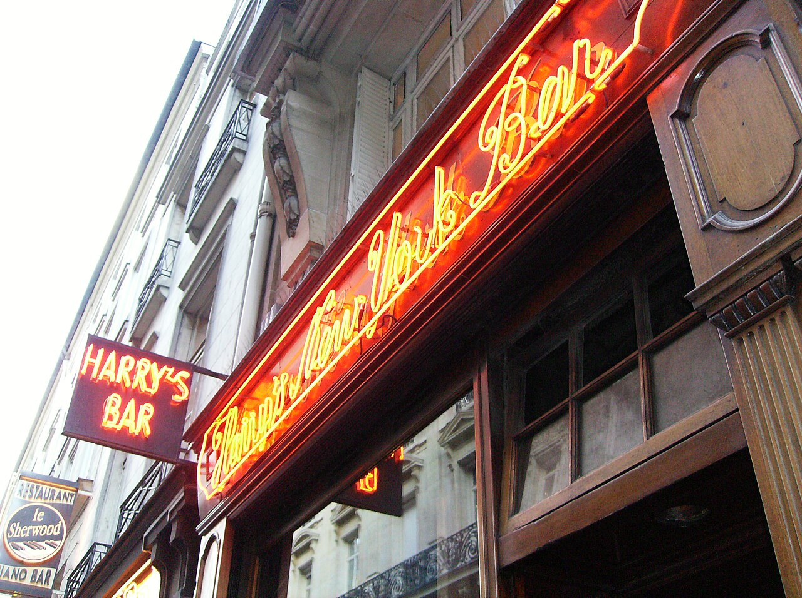

# Harry's New York Bar

Figure: Harry's New York Bar. Image: Drhaggis, CC BY-SA 4.0, via Wikimedia Commons ([source page](https://commons.wikimedia.org/wiki/File:HarrysNewYorkBar_Neon.JPG)).

## Why this one

Harry's New York Bar stands at 5 Rue Daunou in the second arrondissement, a few minutes from the Paris Opera. It is not a faux-American bar assembled from retro fittings: a New York bar was genuinely taken apart and moved to Paris. On 26 November 1911 the American jockey Tod Sloan shipped the woodwork, counter and mirrors of a Seventh Avenue bar across the Atlantic and reassembled them here. He hired the well-known bartender Harry MacElhone to run it; MacElhone later took over, and the house gradually became Harry's New York Bar. It remains one of the few places in Paris where American cocktails, the Lost Generation, a downstairs piano and a century of disputed recipes share the same room.

Its appeal is not tranquillity. There are many tourists, it is loud, tables are tight and service moves fast. But if cocktail history interests you, the bar is a living archive: Bloody Mary, Sidecar, French 75 and White Lady all have some connection to this address, even if the "invention" is usually claimed by more than one house. Treat it as a working classic bar rather than a museum, and the experience improves.

## Timeline: 1911 and two Harrys

The official page dates the opening to 26 November 1911, Thanksgiving Day in the United States. That date suits a "New York bar" and is part of the house's story. One common simplification needs correcting: the person who opened in 1911 was Tod Sloan, and Harry MacElhone was the bar manager he hired. MacElhone later took over and made the place his own. "Opened in 1911 by Harry MacElhone" is therefore not precise; the safer formula is "opened in 1911, with MacElhone taking over and shaping its character".

MacElhone was Scottish. He worked in bars in London and Paris, returned to Paris after the First World War and became the owner in the 1920s. He caught the years when Prohibition drove a large American crowd to Paris: journalists, writers, musicians, wealthy young people and political exiles all wanted a place that served a proper cocktail. Harry's therefore became more than a bar; it was a social base for Americans in Paris. There are many stories about Hemingway, Fitzgerald and Gershwin, some documented and some amplified in retelling. They are useful as evidence of atmosphere, not as verbatim records.

## Cocktails: Bloody Mary, Sidecar and the origin arguments

The house lists Bloody Mary, Sidecar, Blue Lagoon and White Lady among its creations, a claim that has shaped cocktail history. The common version is that in the 1920s the bartender Fernand "Pete" Petiot worked on a tomato-juice-and-vodka mixture at Harry's in Paris, then continued developing it at the King Cole Bar in New York's St. Regis; New York's 21 Club and others have their own early claims. Sidecar attribution is similarly scattered: Harry's in Paris, Buck's Club in London and the Ritz in Paris are all regularly named. The point is that "birthplace" is not a question with a single answer; it is a set of competing local narratives.

There is no need to settle the argument while ordering. For a classic, start with a Bloody Mary, Sidecar, French 75 or Dry Martini; for whisky, the collection is the other main thread, with the official site claiming more than 350 whiskies and a house bottling made with Scottish distilleries. The cocktail list is long, over 400 by the house's count. If you cannot choose, tell the bartender your preferred base spirit, acidity and sweetness rather than reciting names. Prices are on the official menu; classics are not cheap, but the measures and methods follow the traditional route.

## The rooms and the music

Upstairs is the main bar, dark wood and low light, with university flags and old photographs on the walls; downstairs is the piano bar, tighter and livelier, with live piano and singing in the evening. The official page puts live music after 22:00, though the actual programme changes, so check before going. When the piano starts, the two floors separate: upstairs for conversation, downstairs for listening. The most famous house slogan, "Sank Roo Doe Noo", is a phonetic rendering of "Cinq, Rue Daunou" (number 5, rue Daunou) as an American visitor might say it; it appears on the mirror and on merchandise, and Ian Fleming used it in a James Bond story.

The space is small, and the stools at the bar are the most contested. At busy times, do not camp at the counter for photographs or pile coats and bags on the next seat; staff need to move, and keeping the passage clear matters more than getting the perfect angle. When the downstairs piano is playing, voices naturally drop. If you want a drink without a show, ask whether there is music that night.

## Practical information

The address is 5 Rue Daunou, 75002 Paris, France. The nearest Métro is Opéra (lines 3, 7 and 8), about two minutes on foot; Auber on RER A is also close. The Opera, Galeries Lafayette and Place Vendôme are within walking distance, but the streets are narrow and parking is difficult, so do not drive. The official page lists opening hours of 12:00–02:00 Monday to Saturday and 17:00–01:00 Sunday, with live music from 22:00. Holidays and private events alter this, so check the website before travelling.

There is no admission charge; you pay for what you order. At peak times, especially weekend evenings and after shows, you may have to wait. Whether bookings are taken and whether there is a minimum spend depend on the day and on official channels. Smart casual is the safest dress code: no suit and tie required, but flip-flops, vests and sports shorts are out of place. There is no spacious area to wait outside, and queueing in the rain is unpleasant; people with limited mobility should telephone ahead about the entrance and stairs. This entry was verified on 2026-11-08.

## Bar rules and telling the bars apart

The most common mistake is to confuse Harry's New York Bar in Paris with Harry's Bar in Venice. Both carry the name, but the Venetian bar was founded by Giuseppe Cipriani and is known for the Bellini and carpaccio; it has no ownership link to Paris. The second mistake is to present every classic cocktail as "invented here, no dispute"; more accurately, the house and popular accounts list it as one of the places of origin. The third is to read "1911" as the year MacElhone opened the bar; Tod Sloan opened it, and MacElhone took over later. The fourth is to assume the room is all tourists. It is tourist-heavy, but the bar tradition and whisky collection still draw serious drinkers.

When ordering, decide on a base spirit and a flavour direction first; do not ask a busy bartender for ten different improvised drinks. Classics are made to their traditional recipes, and you can ask for less sugar, less ice or a different base, but accept that a changed drink is no longer the original. French bills usually include service, so an extra tip is not compulsory; at the bar, a few euros for good service is enough. Photographs are fine, but do not use a flash in the bartender's or neighbours' faces, and do not stand in the passage filming during the piano set.

Nearby you can see the Palais Garnier, the dome of Galeries Lafayette, Place Vendôme and the Tuileries; the Louvre is a longer but manageable walk. To place the cocktail bar in the wider context of urban nightlife, read [Beyond the pub](ref:beyond-the-pub) and [Pub and city](ref:pub-and-city); for the whisky collection, read [Whisky](ref:whisky); for French drinking culture, read [France](ref:france). Harry's works best after dinner and before a show, not as an all-day sight.

Further reading: [A Ginjinha](ref:c-extra-1).
