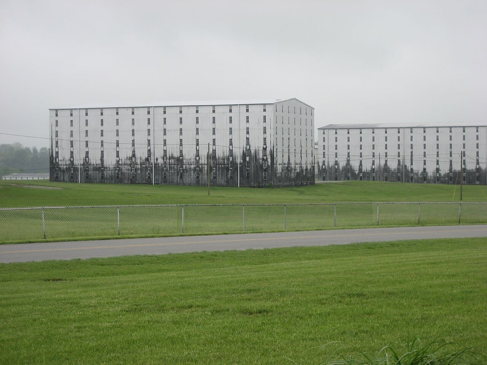
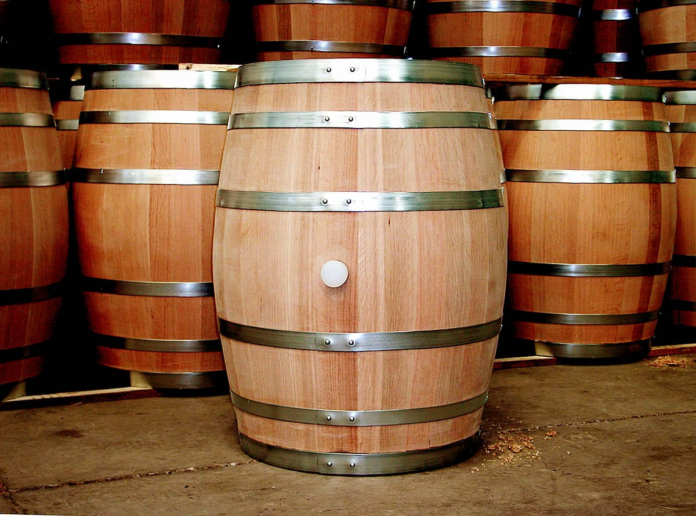

# Heaven Hill Distillery

The address at 1311 Gilkey Run Road in Bardstown is Heaven Hill's visitor centre, the Heaven Hill Bourbon Experience, not the still house. Every tour assembles here and takes a shuttle to the Springs distillery two miles away; visitors cannot enter the production site on their own. Heaven Hill is one of America's largest family-owned distillers, founded in 1935 by the five Shapira brothers and local Bardstown investors.

Figure: Heaven Hill Distillery. Photograph: Heaven Hill distillery, Bardstown, Kentucky. Credit: Shadle, CC BY-SA 3.0, via Wikimedia Commons ([source](https://commons.wikimedia.org/w/index.php?curid=4136725)).

## 1935: five brothers and twelve employees

In 1935, David, Ed, Gary, George and Mose Shapira joined local investors to found the Old Heavenhill Springs distillery in Bardstown, starting with 12 employees. From the beginning the company ran a multi-brand, multi-recipe house: rye bourbon, wheat bourbon, corn whiskey and rye whiskey all belonged to the portfolio. That structure became an advantage, because it did not depend on a single brand and could manage different styles through one warehousing and bottling system. Family ownership continues, and the company treats independence and long-held stock as its core story rather than as decoration.

## 1996: the fire and the maturation that did not stop

On 7 November 1996, a wind-driven fire destroyed the distillery built in 1935 and seven rickhouses, damaging about 100,000 barrels of maturing whiskey; no one died. Distilling moved to the Bernheim distillery in Louisville, which Heaven Hill bought outright in 1999, while bottling, maturation and some office functions stayed in Bardstown. That history explains today's division of labour: the "experience" handles exhibitions, tastings and tour assembly, while the actual stills are elsewhere. It also explains why the company tells the return to Bardstown as a complete story: ground was broken on the 61-acre Springs site in 2022, and the new distillery came on stream in 2025.

## Starting from the Bourbon Experience

The visitor centre was expanded in 2021, with an exterior that copies the 1935 distillery, three tasting rooms arranged around a giant barrel, an 11-minute film in the 1935 Distillery Theater, and self-guided galleries on Elijah Craig, Larceny and Bottled-in-Bond. Five Brothers Bar & Kitchen on the upper floor serves cocktails and light food; from the terrace you can see rows of warehouses. Tours come in several forms. Magic of the Mashbill is a 45-minute tasting built around five recipes; Whiskey Connoisseur also runs 45 minutes and focuses on premium and limited releases; You Do Bourbon lasts about an hour and includes blending, bottling, labelling and lab work; a limited-time Deatsville rickhouse tour goes deeper into the site's history. Every tasting requires legal drinking age, so read the booking details.

For a quick orientation, Magic of the Mashbill is enough: five glasses, five recipes, and a clear explanation of how the same rules produce different flavours. Choose You Do Bourbon if you want to take home a bottle you helped bottle and label; its subject is process and quality control, not drinking. The self-guided galleries need no extra ticket and are useful before or after a tour, especially the Bottled-in-Bond room, which explains the "bonded" labels on the shelf.

## Springs: continuous production over three floors

The Springs tour lasts about 60 minutes across three floors. On the first, stainless mash tanks cook corn, rye, wheat and malt with Kentucky limestone water before yeast is added. Unlike Bernheim, which uses dry yeast, Springs propagates and conditions live yeast on site; the proprietary strain has been passed down for generations and survived the fire. The second floor holds the lab and the still: a single 66-inch column still produces about 500 barrels a day, with plans for two more stills. Distillers check the new make at the try box before it goes to barrel. The third floor has the tasting room and shop, and the shuttle returns visitors to the Experience. The grounds include 500 white oaks and 32 acres of native grasses and wildflowers.

## The range and Bottled-in-Bond

Heaven Hill's brands span a wide field: Evan Williams is the volume leader, Elijah Craig leans towards oak and caramel, Larceny uses a wheat recipe, Rittenhouse and Pikesville are rye whiskeys, and Henry McKenna and Old Fitzgerald often appear as age-stated or single-barrel releases. It also has one of the deepest Bottled-in-Bond portfolios in the United States. The Bottled-in-Bond Act of 1897 requires one distillery, one distilling season, at least four years in a bonded warehouse and bottling at 100 proof, with no blending of other spirits; the rules were written for quality and tax transparency and now function as a style label.

The basic bourbon rules still apply: at least 51% corn, new charred oak, and no less than 40% alcohol by volume at bottling; a "straight" whiskey must also age at least two years. The [angels' share](ref:angels-share) takes its cut every year, and the same batch can taste different on different warehouse floors. Heaven Hill manages that variation with multi-storey warehouses and several mashbills rather than by chasing identical barrels.

## Practical notes and around Bardstown

The address is 1311 Gilkey Run Rd, Bardstown, KY 40004. Louisville is about an hour away and Frankfort a little over an hour; Bardstown has restaurants and lodging, and the Bourbon Trail gets busy in autumn, so book ahead. Reserve tours online, especially at weekends, and arrive early to assemble in the ground-floor hall. Wear comfortable shoes, because the temperature changes between warehouse and production area. Drivers should skip tasting flights or hand their samples to a companion. About half an hour north is [Maker's Mark](ref:makers-mark), and about an hour northeast is [Buffalo Trace](ref:buffalo-trace); the three sites differ enough to justify two days. The coordinates 37.7933, -85.4657 come from a public geographic listing; check official channels for the exact entrance and shuttle arrangements. For background, read the [bourbon](ref:bourbon), [Kentucky](ref:kentucky) and [United States](ref:usa) entries.

**At a glance:** A bourbon distillery in Bardstown, Kentucky, founded in 1935 by the five Shapira brothers and local investors; after a 1996 fire it distilled in Louisville, and in 2025 the new Springs distillery brought production back to Bardstown, with tours starting at the Heaven Hill Bourbon Experience.

Start with the address. From there, consider the current opening status, then what the place is known for. That is how a practical judgment about Heaven Hill Distillery is built.

[Bourbon Whiskey](ref:bourbon) and [United States](ref:usa) are the nearest useful comparisons: one clarifies address and space, the other tests operating status.

**Key facts.**

| Item | Detail |
| --- | --- |
| In one line | A bourbon distillery in Bardstown, Kentucky, founded in 1935 by the five Shapira brothers and local investors; after a 1996 fire it distilled in Louisville, and in 2025 the new Springs distillery brought production back … |
| Address | 1311 Gilkey Run Rd, Bardstown, KY 40004, USA |
| City and country | Bardstown / United States |
| Status | verified open |
| Official site | heavenhilldistillery.com |

**Sources and limits.** The key claims about Heaven Hill Distillery are checked against the following sources: Heaven Hill Distillery, Heaven Hill Brands, Barlist and 12 sources in total. For current products, addresses or opening status, use heavenhilldistillery.com. Prices, batches and status change; the body is project-written and does not reproduce source text.

## Related images

Image: Angel's share. Credit: Gerard Prins, CC BY-SA 3.0, via Wikimedia Commons ([source page](https://commons.wikimedia.org/wiki/File:Oak-wine-barrel-at-toneleria-nacional-chile.jpg)). Related image for Heaven Hill Distillery.
