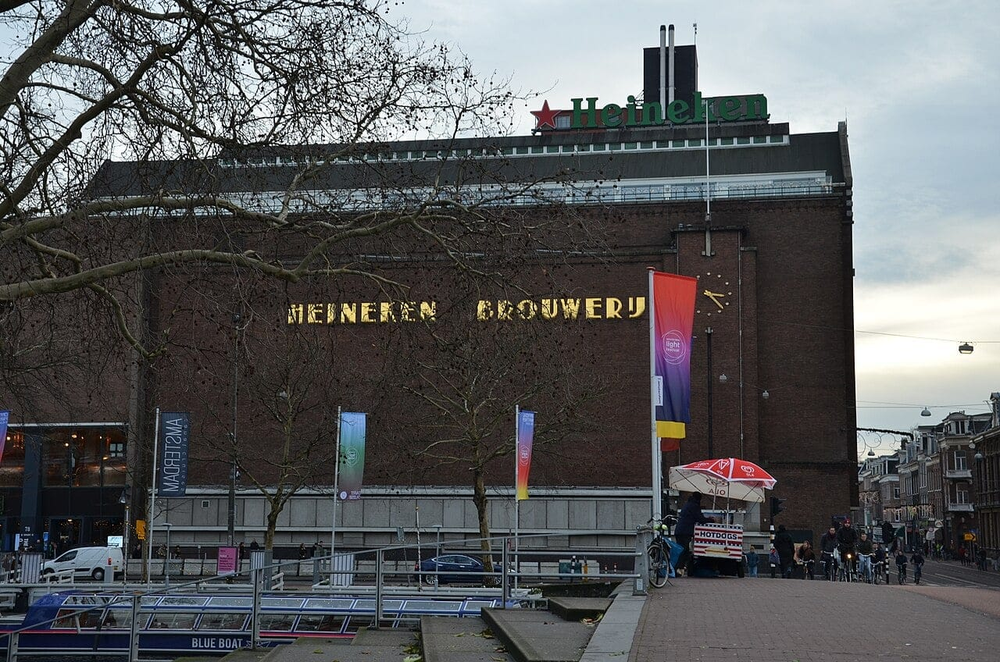

# Heineken Experience: A Second Life for an Old Brewery

South of central Amsterdam, along the Singelgracht to Stadhouderskade 78, a row of nineteenth-century industrial buildings carries the green Heineken sign. This is not a working brewery: it is the visitor attraction created in Heineken's oldest brewery after production left in 1988. Brand history, brewing and tasting fill one indoor route, useful for a quick grasp of Dutch lager, but no substitute for a production visit.

> **Visit information**
> - Address: Stadhouderskade 78, 1072 AE Amsterdam, Netherlands.
> - Opening and booking: check the [official page](https://www.heinekenexperience.com/) before travelling; hours, tours and booking rules change by season.
> - Getting there and cost: check the official page before booking; this entry does not promise a fixed price.
> - Status: Verified; sources checked: 2026-11-21.

Figure: The brick façade of the Heineken Experience in Amsterdam, with the green Heineken sign on the roof. Image: Steven Lek, CC BY-SA 4.0, via [source page](https://commons.wikimedia.org/wiki/File:Heineken_Experience_Amsterdam_2018_3.jpg).

## An old brewery on the canal

The building sits where canal and street meet, modest in height, with brick walls, window openings and a factory roof profile. Such sites were common in nineteenth-century Amsterdam: close to water for barley and finished beer, and close to workers. Today the museum quarter, De Pijp and busy roads surround it; the factory has been absorbed by the city.

The entrance is easy to miss and queues form along the street. Inside, visitors pass reception, cloakroom and shop. The space is divided into galleries, installations and bars, yet old columns and floor levels remain legible. Read it as an industrial conversion rather than a brewery: the shell and some historic brewing spaces survive, but production continuity ended.

## From 1864 to 1988

The Heineken story usually starts in 1864, when Gerard Adriaan Heineken bought the De Hooiberg brewery in Amsterdam. The company expanded, and Stadhouderskade became one of its most important production bases. In 1886 Heineken began using the strain later known as A-yeast, the basis of the brand's flavour consistency and a recognisable fermentation signature.

As volumes grew, the old site could not expand, and production moved out in 1988. The buildings were converted into a visitor centre rather than demolished. The timeline explains why the attraction contains genuine old buildings and equipment as well as visitor installations: industrial heritage and brand communication mixed along one route.

## The route: brand, process and tasting

The route opens with brand history: family, advertising, sponsorship and global reach. The green colour, red star, typeface and slogans recur through film, posters and screens. This is closer to a brand museum than a technical exhibition; it explains recognition, not recipes.

The middle turns to brewing: raw materials, mashing, fermentation, filtration and packaging. Models, pipes and multimedia break the process down, and visitors can press buttons, smell aromas and watch animations. For newcomers this explains why lager needs cool fermentation and what malt and hops do; for experienced brewers, the old equipment and spaces are the real draw.

The final stretch is tasting and the bar. Tickets include drinks, with number and type depending on the ticket; staff show how to pour a proper head, and alcohol-free options exist. Rooftop tickets add a city view. The tasting is quick, a finish rather than a serious vertical.

## Where Heineken lager sits

Heineken is a typical Dutch lager: pale, clear, bottom-fermented, matured cold, clean on entry, mildly bitter and dry at the finish. Its aroma relies less on heavy hopping than on light malt sweetness and fermentation esters; A-yeast keeps the flavour consistent worldwide. Serve it cold with fine foam so carbonation and bitterness stay balanced.

Within the framework of [lager](ref:lager), Heineken sits closer to a commercial variation on Czech and German pale lager, with lower bitterness and a smoother body, suited to food and long drinking. Malted [barley](ref:barley) supplies sugar and malt aroma, hops supply bitterness, and [fermentation](ref:fermentation) determines cleanliness and aroma. For the wider classification, return to [beer](ref:beer); the [Netherlands](ref:netherlands) also has many small breweries and regional styles.

## Tickets, timing and transport

The address is Stadhouderskade 78, 1072 AE Amsterdam. The official site lists Monday to Thursday and Sunday 10:30–19:30 with last entry at 17:15, and Friday and Saturday 10:30–21:00 with last entry at 18:45; holidays can differ, so check on the day. Book a timed ticket online in advance; prices vary, with the basic tour usually in the mid-twenties of euros.

Trams 1, 7, 19 and 24 and metro line 52 stop nearby, about twenty minutes from Centraal; cycling is easy, with parking outside. Allow one and a half to two hours, longer with the rooftop. The legal drinking age in the Netherlands is 18, and entry and service may involve ID checks; families can visit, but tasting follows on-site rules.

The Heineken Experience occupies the former Heineken brewery on Stadhouderskade in Amsterdam. It is a visitor attraction with historic brewing equipment, exhibitions and tastings, not a working production brewery. The building’s brewing past belongs to company history; the beer served today comes from modern production. A visit explains branding and process, but it is not a substitute for seeing an operating brewhouse.

## Reading the Experience as industrial heritage

What is most interesting here is not the self-praise but how a closed factory is handled. Old buildings are kept, production spaces become galleries, equipment becomes scenery, and visitors drink where fermentation once happened. Such conversions are common in European industrial cities: after the factory leaves, buildings, memory and brand remain.

The limits are obvious. The route is brand-centred, history is edited into an easy story, and process is compressed into displays; for real production, go to a working brewery. Read the Experience alongside the city's pubs and breweries to see how Heineken became a global brand and how industrial heritage has been reused.

**At a glance:** Amsterdam's Heineken Experience occupies Heineken's oldest brewery on Stadhouderskade; after production moved out in 1988, the building became an interactive visitor attraction about Heineken lager rather than a working production line. 

For Heineken Experience, begin with the address, then the current opening status, and finish with what the place is known for; that order keeps the account grounded.

Treating Heineken Experience as a brand or a region mixes two different questions: identity and use. Separate them before comparing.

**Key facts.**

| Item | Detail |
| --- | --- |
| In one line | Amsterdam's Heineken Experience occupies Heineken's oldest brewery on Stadhouderskade; after production moved out in 1988, the building became an interactive visitor attraction about Heineken lager rather than a working … |
| Address | Stadhouderskade 78, 1072 AE Amsterdam, Netherlands |
| City and country | Amsterdam / Netherlands |
| Status | verified open |
| Official site | heinekenexperience.com |

**Sources and limits.** The key claims about Heineken Experience: A Second Life for an Old Brewery are checked against the following sources: Heineken Experience (Used to check the "oldest brewery" location, the 1988 closure and the interactive-experience framing; Used to check the Stadhouderskade 78 address, daily opening hours, last entry times and tram/metro routes), UNESCO (the entry's background, terminology and regulatory context). For current products, addresses or opening status, use heinekenexperience.com. Prices, batches and status change; the body is project-written and does not reproduce source text.
