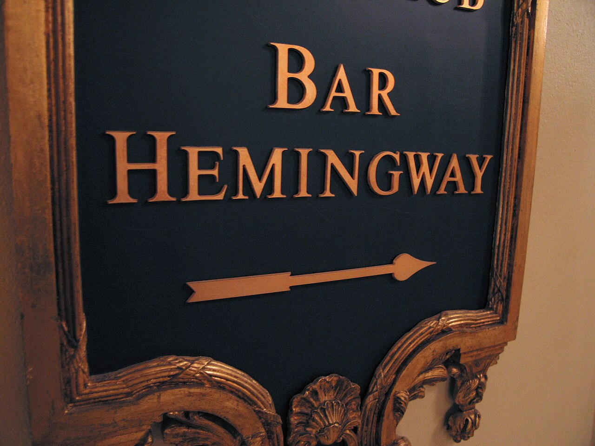
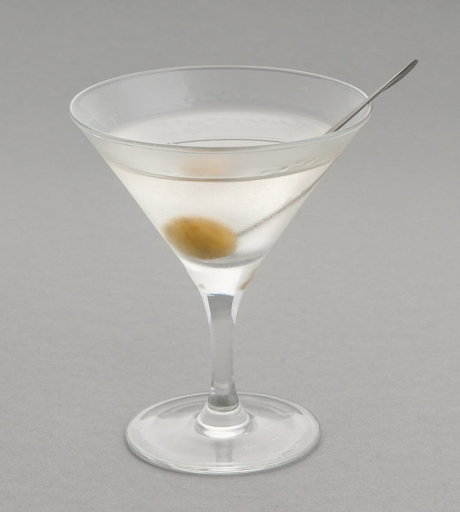

# Bar Hemingway

On one side of Place Vendôme, the entrance of the Ritz Paris shuts the street noise outside. Walk through the lobby and deeper into the hotel and the door of Bar Hemingway is easy to miss. There is no music inside. You hear ice against glass, low conversation and, further away, the sound of a waiter's steps. The room has only 25 seats, dark wood and old leather on the walls, and amber light. It feels like a private library that happens to serve cocktails, not a literary theme park.

Figure: The brass Bar Hemingway sign at the entrance to the Ritz Paris bar; the room has just 25 seats and no background music. The photograph shows the entrance sign, not the bar interior. Image: Pablo Sanchez, CC BY 2.0, via Wikimedia Commons ([source page](https://commons.wikimedia.org/wiki/File:Bar_Hemingway_Ritz.jpg)).

## Location and history

The Ritz opened in 1898, and from the 1920s Hemingway used its bar as a base in Paris, drinking cognac or dry martinis with the Fitzgeralds and befriending the bartenders Georges and Bertin. The bar that bears his name today is not a simple restoration of the 1920s room. Its present site was once Le Petit Bar, which the Ritz describes as the first upscale bar in Paris open to women on their own. In 1994, the hotel renamed it Bar Hemingway for the 50th anniversary of the Liberation of Paris and brought in Colin Field to reopen it. Field worked there until 2023, when Anne-Sophie Prestail took over. The story that Hemingway "liberated" the Ritz in 1944 and drank 51 dry martinis in one sitting is treated by the hotel itself as legend, not a combat record.

Placing the bar in the hotel's history makes more sense of it. César Ritz opened the hotel in 1898, and by the 1920s it was one of the most fashionable meeting places in Paris. Hemingway, in A Moveable Feast, treated the Ritz as part of Paris itself, and he built friendships with Georges and Bertin behind the bar. Whether he really "liberated" the bar in 1944 and drank 51 dry martinis is not fully documented; the Ritz presents it as a legend. In 1994 the hotel used the 50th anniversary of the Liberation to rename Le Petit Bar as Bar Hemingway and install Colin Field. Over nearly 30 years Field made it a room of 25 seats, no music and conversation-driven, tailor-made drinks. When Anne-Sophie Prestail succeeded him in 2023, the menu and the rose service continued, but the bar was no longer one bartender's personal stage.

## Space and drinks

The bar has 25 seats, tables close together, leather armchairs, old photographs, letters and Hemingway-related objects on the walls. The hotel stresses that there is no music, only the sound of ice and conversation. The drinks list is built around classics and custom cocktails. The most famous is the Serendipity, invented here: Calvados, fresh mint, apple juice and Champagne, opening with apple freshness and closing on the lift of sparkling wine. The other pillar is the Dry Martini. Women are served their drinks with a rose, a detail the bar has kept. There is also a tapas menu, but most people come for a drink and a quiet stretch of time.

## How to drink

For a first visit, order the Serendipity as the "only here" entry point, then a Dry Martini for contrast. If you want something less strong, ask the bartender for a low-alcohol or custom version. The bar does not take reservations, and 25 seats fill quickly; arriving a few minutes before opening is safest, and after 7pm there is often a wait. It is not a place for loud conversation or a group taking turns posing for photographs. Sitting at the bar and talking to the bartender suits the room better than touring it with a glass in hand. To slow down, order a classic and a small plate of tapas.

## Practical information

The address is Ritz Paris, 15 Place Vendôme, 75001 Paris. Concorde or Opéra metro stations are a few minutes' walk away. The bar is open daily 17:00–00:00, with tapas 17:30–22:30, and does not take bookings. The Ritz has a dress code, and the bar is on the formal side; shorts and sportswear are not appropriate. Prices are among the highest in Paris, so read the list before ordering rather than being surprised by the word "custom." The room is small and narrow; visitors with mobility needs should contact the hotel in advance about the entrance and seating.

## Etiquette and common misconceptions

First, this is not a Hemingway museum. The letters, boxing gloves and photographs are the bar's display, not all personal relics, and they should not be touched. Second, the "51 dry martinis" story is a widely repeated liberation legend, presented as such by the hotel; it is not a confirmed fact. Third, the Serendipity is the Ritz signature, but published versions vary. Use the official Calvados, mint, apple juice and Champagne structure and do not add unverified bitters. Fourth, the absence of music is not a service failure but a deliberate choice to preserve conversation. Put your phone on silent and do not use a speaker.

## Surroundings and routes

Outside the bar is Place Vendôme; to the west lies La Madeleine, and to the south, through Place de la Concorde, the Tuileries and the Louvre. For a Paris literary route, the Saint-Germain café walk is a separate itinerary; here, start with [Time in a cup](ref:time-in-cup) to understand the idea of consuming time in a bar. To compare European classic bars, read [The American Bar at the Savoy](ref:american-bar), [Dukes Bar](ref:dukes) and [The Connaught Bar](ref:connaught); the history and recipe of the Dry Martini are in [Dry Martini](ref:dry-martini).

## Further reading and see also

- [Time in a cup](ref:time-in-cup)
- [Dry Martini](ref:dry-martini)
- [The American Bar at the Savoy](ref:american-bar)
- [Dukes Bar](ref:dukes)
- [The Connaught Bar](ref:connaught)

**At a glance:** A legendary cocktail bar inside the Ritz Paris, reopened under Hemingway's name in 1994, with 25 seats, the Serendipity, the Dry Martini and a music-free, library-like atmosphere. 

For Bar Hemingway, begin with the address. Then look at the current opening status, and finally ask what the place is known for. The answers point to different choices, not to a single score.

Checked on 2026-11-21 against the official pages of Ritz Paris and Bar Hemingway. The bar opens daily 17:00–00:00, tapas 17:30–22:30, does not take reservations, and its 25 seats and dress code can change with hotel events; confirm before visiting. Hemingway's "51 dry Martinis" liberation story and the question of whether the displays are his relics are qualified in the body. The Serendipity recipe follows the official Calvados, mint, apple juice and Champagne formula. The image shows the brass entrance sign, not the bar or the drinks list.

## Related images

Image: Dry Martini. Credit: Ralf Roletschek, CC BY-SA 3.0, via Wikimedia Commons ([source page](https://commons.wikimedia.org/wiki/File:15-09-26-RalfR-WLC-0084.jpg)). Related image for Bar Hemingway.
