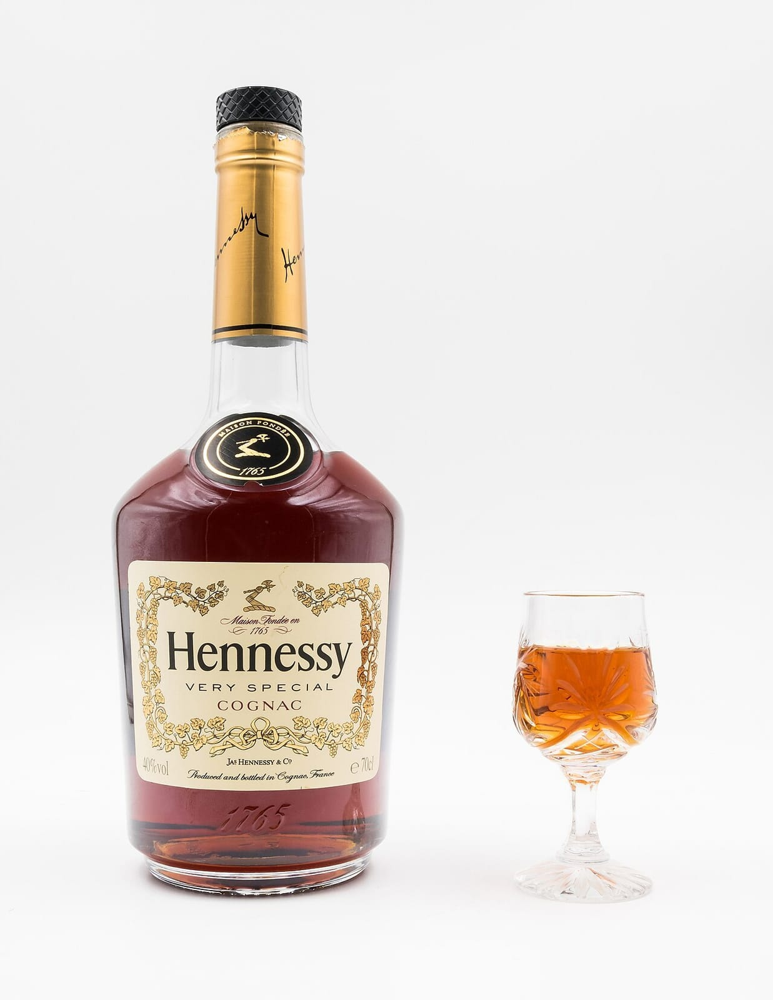

# Hennessy in Cognac

Hennessy is one of the oldest and largest cognac houses, founded in 1765 on the Charente in Cognac by the Irishman Richard Hennessy. What visitors see today is not a single distillery building but a visit system anchored on the Quai Richard Hennessy: historic cellars, ageing and blending rooms, a boutique, and a route that can approach the old town from the river. Three strands need separating: the trading house's commercial history, a craft built around blending, and a visitor programme designed as a ladder of products.

Figure: Hennessy in Cognac. Photograph: 2023 Hennessy V.S. Cognac. Credit: Jacek Halicki, CC BY-SA 4.0, via Wikimedia Commons ([source](https://commons.wikimedia.org/w/index.php?curid=132066502)).

## 1765: from Ireland to the Charente

Richard Hennessy was born in Ireland in 1724, later served the French crown, and opened a trading house in Cognac in 1765. His capital was not vineyards but an eye for eaux-de-vie: buying young spirits from growers, then ageing, blending and bottling them in his own cellars and shipping down the Charente to Atlantic ports. The house calls the Cognac quays its birthplace, and old photographs and postcards still document the river trade.

The route reached far. In 1794 the first casks went to the United States; in 1859 the first cases reached China; by the end of the 19th century the house sold on five continents. Hennessy now says it is present in 160 countries and describes itself as the world leader in premium spirits. Those are brand claims; for a visitor, the useful reading is a trading house that became a global brand, with the cellars as the interface between a region and distant markets.

## A visitor centre on the quays

The visitor centre and boutique stand at Quai Richard Hennessy, and the official postal address is Quai Richard Hennessy, 16100 Cognac, France. The boutique occupies a building by the architect Jean-Michel Wilmotte, with an interior by the designer Benjamin Graindorge that uses wood, limestone and copper in reference to cognac making; the house calls it the only boutique in the world showing the entire Hennessy collection.

Visits usually begin in the historic cellars, where thick walls, humidity and rows of old casks are working conditions rather than a set. A guided tasting follows. Some formats include a crossing of the Charente in a solar-powered boat, a nod to the flat-bottomed gabares that once carried casks downstream. No stable public coordinates are published; take coordinates from official channels and navigate by the address.

## Ten tours and a price ladder

Hennessy has turned visiting into a clear product matrix. The lightest is the Flash Tour added for 2026: 19 euros, one hour, with a VSOP cocktail, running from May to October. The Initiation costs 25 euros for 1 hour 30 minutes and tastes VS and VSOP; it is the family-friendly option. The most popular is the Immersive Initiation at 35 euros for two hours, adding a VR sequence in the historic cellars before VSOP and XO.

Above that, Prestige is 60 euros and focuses on James Hennessy, XO and XXO. The Distillery Tour, 85 euros, runs only during the distillation season from October to February and enters a working still house. The cooperage tour is 170 euros, the cognac and caviar tasting 99 euros, the private Paradis tour 330 euros and the private Richard Hennessy tour 550 euros. Prices and slots move with the season, so check the official calendar. For a first visit the 35-euro immersive tour carries the most information; in winter, and for process rather than range, the 85-euro distillery tour is the better buy.

## A dynasty of blenders

In the early 19th century the house entrusted its cognacs to the Fillioux family. Jean Fillioux was a cooper; his son Christophe became the first Master Blender, and the role has passed within the family for eight generations, held today by Renaud Fillioux de Gironde. The lineage explains why Hennessy stresses continuity: a blender works from smell and memory to combine eaux-de-vie of different years, crus and casks into a recognisable annual style.

Blending is often mistaken for dilution. In practice it answers the variability of ageing: new spirit changes year by year in cask, and only [blending](ref:blending) keeps a VS or an XO within a recognisable house style. The grade sets a minimum age, not the age of every drop, so an XO may contain spirit far older than the stated threshold. Keeping [distillation](ref:distillation), maturation and blending apart is the way to avoid treating vintage as the only measure.

## Practical information: address, booking and access

The address is Quai Richard Hennessy, 16100 Cognac, France. Visits should be booked, online or on +33 5 45 35 06 44. Opening is seasonal: closed from 1 to 13 January; open most days from May to October; mostly Wednesday to Saturday in November and December, with Monday and Tuesday reserved for groups and private bookings. Check the official calendar before travelling. The highlights are the historic cellars, the riverside boutique and the seasonal boat crossing. Visitors with access needs can join the Initiation, Immersive Initiation and XO tours, with a "Mobility Inclusion" reduced rate.

Cognac station is about five minutes on foot from the visitor centre; Angoulême's TGV station is about 45 minutes away, and Bordeaux and La Rochelle about 1 hour 30 minutes by car. The centre sits on the Flow Vélo cycle route, with a bike stand opposite and a self-service bike terminal within 300 metres. Anyone driving should leave the tasting to a companion or a booked driver; parking in the old town is limited in high season.

## Placing Hennessy in Cognac

Cognac is a protected appellation of grape brandy: mainly Ugni Blanc, twice distilled in copper pot stills, aged at least two years in French oak and graded by minimum age as VS, VSOP and XO, as the [Cognac](ref:cognac) region entry sets out. Hennessy belongs to the wider category of [brandy](ref:brandy), but its scale as a négociant sets it apart from a single estate: fruit comes from a broad network of growers, the cellars hold an extraordinary spread of vintages, and the brand depends on consistency rather than one plot.

Since 1987 the house has been part of LVMH ([LVMH](ref:lvmh)), which explains its density in travel retail, flagship stores and large events. It helps to read two lines side by side: the craft line of quays, cellars and blending room, and the brand line of boutiques, limited editions and collaborations. Where they meet is what a cognac visit has become.

Hennessy in Cognac is best read by starting with the address, moving to the current opening status, and ending with what the place is known for.

**Key facts.**

| Item | Detail |
| --- | --- |
| In one line | A cognac house founded in 1765 by the Irishman Richard Hennessy, now running a visitor centre and the only boutique carrying the full collection on the Quai Richard Hennessy, with eight generations of blenders and tours … |
| Address | Quai Richard Hennessy, 16100 Cognac, France |
| City and country | Cognac / France |
| Status | verified open |
| Official site | hennessy.com |

## Related images

Image: Category image for LVMH. Credit: bgvjpe, CC BY 2.0, via Wikimedia Commons ([source page](https://commons.wikimedia.org/wiki/File:Glass_of_champagne.jpg)). Related image for Hennessy in Cognac.
