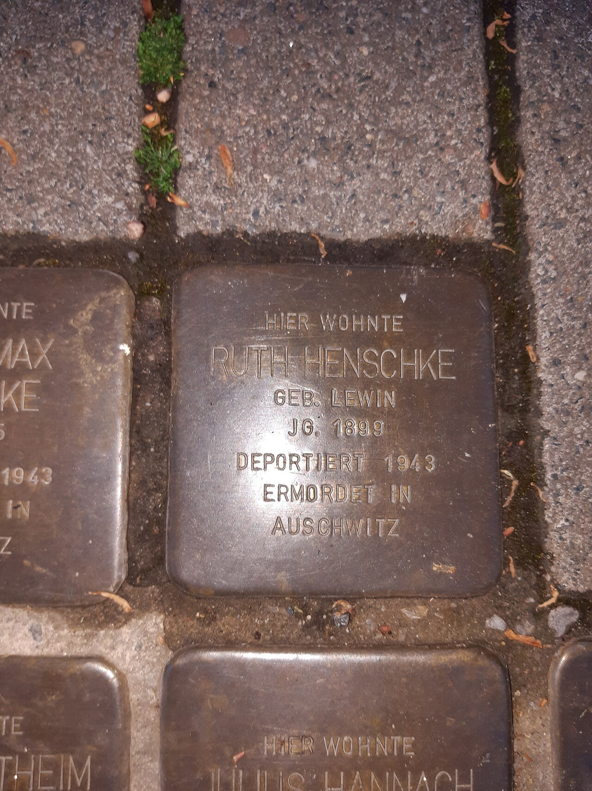

# Henschke

Henschke stands at Keyneton in Eden Valley, reached by a climb from the Barossa floor. Its cellar door is modest and its cellars do not win on scale. What carries the reputation is a pair of old-vine Shiraz sites, six generations of family records, and a narrative that puts site ahead of brand. A visitor who treats the estate only as a place to taste Hill of Grace misses the most valuable part: how altitude, old vines and family memory overlap on one hillside.

Figure: Henschke. Photograph: Henschke Ruth Stolperstein Magdeburg. Credit: Adnon, CC BY-SA 4.0, via Wikimedia Commons ([source](https://commons.wikimedia.org/w/index.php?curid=90422028)).

## 1868: from Silesia to Keyneton

In 1841 Johann Christian Henschke emigrated from Kutschlau in Silesia to South Australia, first settling in the Adelaide Hills before buying land at Krondorf and later at North Rhine, renamed Keyneton. The family planted a small vineyard in the early 1860s, and the first recorded wine sale dates from 1868; that year is used officially as the winery's starting point. Johann was a stonemason and wheelwright by trade, and early winemaking was closer to exchange among family and neighbours, moving to sales only as demand grew.

This migration history explains the estate's character. It is not a large project driven by city capital but a family business that grew inside a German-Lutheran migrant community. Stone cellars, church, village and vineyard formed a production unit that could be passed from one generation to the next. The buildings and sites are not merely old; they are evidence of how early settlers rebuilt a way of life far from home.

## Eden Valley altitude and old vines

In the [Barossa](ref:barossa), Barossa Valley vineyards sit at 112–596 metres and Eden Valley at 219–632 metres; the latter ripens cooler, with colder nights and better retention of acidity. Henschke's Keyneton site belongs to Eden Valley's higher band, so the wines are usually more compact than valley-floor examples, with more prominent spice and acidity. The old vines are not decoration either: Wine Australia records Shiraz planted in the Barossa in 1843, and older vines have deeper roots and more stable yields, though vintage and site still decide the final flavour.

Do not treat "old vine" as a quality guarantee. Old vines can give a steadier ripening curve and a more complex root system, but they also face drought, heatwaves and disease; the same block can perform quite differently from year to year. Read Henschke through altitude, old vines and vintage together, not through a single number on the label.

## Hill of Grace and Mount Edelstone

The official family history treats Hill of Grace and Mount Edelstone as two core Shiraz vineyards. Hill of Grace's original planting goes back to around 1860, linked to vines planted by Nicolaus Stanitzki near the Gnadenberg Church; in 1891 second-generation Paul Gotthard Henschke bought the land with its small vineyard, which became Hill of Grace Vineyard. Mount Edelstone was developed into a single-vineyard wine by fourth-generation Cyril Henschke in the 1950s; Cyril took over the winery in 1950 and shifted its focus from fortified wine to dry table wine.

The significance of these two sites is not price but a long family commitment to single vineyards: one site, one variety, many consecutive vintages. In a tasting, place the two wines side by side and watch how site difference can outweigh vintage difference; if you taste only one, at least ask which site and year it comes from, and what that year's weather did.

## The cellars of six generations

The estate is now in its sixth generation. Fifth-generation Stephen and Prue Henschke introduced new winemaking and viticultural methods from the 1970s onward, including barrel fermentation, French oak and more detailed site management; sixth-generation Johann, Justine and Andreas are already involved. The official account stresses complete integration of vineyard and winery: the cellar does not passively receive fruit but intervenes in ripening and flavour decisions from the growing stage.

The cellar door and cellar visit therefore feel like reading a family archive: old photographs, site maps, barrel samples and wines from different years are placed together to show how one site changes over time. In 1975 Cyril was a founding member of the Barons of the Barossa; such local organisations show that Henschke is not an isolated brand but part of a Barossa wine community.

## Booking, hours and getting there

The cellar door opens Monday to Saturday, 9:00–16:30, closed Sunday, and 10:00–15:00 on public holidays; the official site states that capacity limits make bookings essential. That rule is stricter than at many larger wineries, and an unannounced drive may leave you looking at the landscape. Confirm the length, whether a cellar visit or food is included, and cancellation rules; meeting points can differ by experience.

The address is 1428 Keyneton Road, Keyneton, South Australia 5353, Australia. It is about an hour by car from central Adelaide and about an hour from Magill Estate; rural roads are narrow and winding, unlit at night, so leave margin for the return. Coordinates should be taken from official channels; for navigation, use the address. If pairing this with [Penfolds Magill Estate](ref:penfolds) in one day, book Henschke first and work backward to Magill, because Henschke's capacity limit is the harder constraint.

## Common misconceptions

First, Henschke is not a Barossa Valley floor winery. It sits at Keyneton in Eden Valley, with a different altitude and ripening rhythm. Second, Hill of Grace is not a vineyard open to casual wandering; it is a production site, and visits follow the estate's arrangements. Third, old vines do not equal high scores. They offer stability, but vintage, site and winemaking still decide quality. Fourth, do not ignore the booking rule; the capacity limit is official. Fifth, "family winery" does not mean a tiny workshop. Henschke covers multiple sites and price levels, and family ownership does not imply small volume.

**At a glance:** A family winery at Keyneton in South Australia's Eden Valley, with the first recorded wine sale in 1868 and six generations to date; it is known for the old-vine Shiraz sites Hill of Grace and Mount Edelstone, and its cellar door opens Monday to Saturday 9:00–16:30, closed Sunday, with bookings essential because of capacity limits.

**Key facts.**

| Item | Detail |
| --- | --- |
| In one line | A family winery at Keyneton in South Australia's Eden Valley, with the first recorded wine sale in 1868 and six generations to date; it is known for the old-vine Shiraz sites Hill of Grace and Mount Edelstone, and its ce… |
| Address | 1428 Keyneton Road, Keyneton, South Australia 5353, Australia |
| City and country | Keyneton / Australia |
| Status | verified open |
| Official site | henschke.com.au |

## References

This entry was checked against Henschke's official contact, home and family history pages, and Wine Australia's Barossa Valley material. Page verified 2026-11-09. To place this stop in a day, see the [Barossa wine trail](ref:route); for variety and style background, see [Shiraz](ref:shiraz) and [red wine](ref:red-wine). Opening hours, booking rules and wines are subject to official channels.

## Related images

Image: Related photograph of Barossa. Credit: No machine-readable author provided. ScottDavis assumed (based on copyright claims)., CC BY-SA 3.0, via Wikimedia Commons ([source page](https://commons.wikimedia.org/wiki/File:Tanunda.jpg)). Related image for Henschke.
