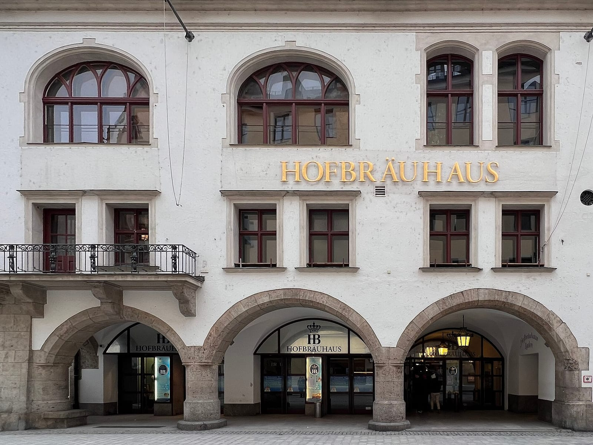
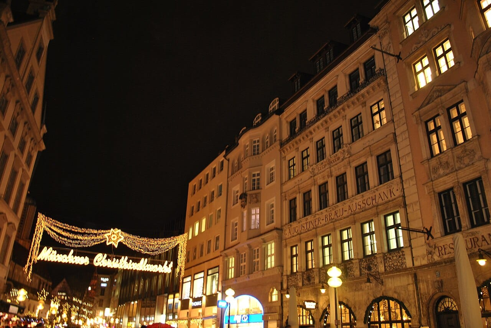

# Hofbräuhaus

Figure: Related photograph of Hofbräuhaus. Image: Burkhard Mücke, CC BY-SA 4.0, via Wikimedia Commons ([source page](https://commons.wikimedia.org/wiki/File:2023-02-03_Hofbr%C3%A4uhaus_am_Platzl_07.jpg)).

## Setting and history

The Hofbräuhaus stands at Platzl 9 in Munich's old town, a few minutes on foot from Marienplatz. On 27 September 1589 Duke Wilhelm V of Bavaria founded a court brewhouse at the Alten Hof, initially supplying the court rather than the public. In 1828 King Ludwig I authorised public sales and catering, and the Hofbräuhaus became the tavern we recognise today. The main building seen now dates from the late nineteenth century, was badly damaged in the Second World War and was rebuilt afterwards, so it is both a historic site and a working building.

The name means "court brewhouse", often rendered in Chinese as "royal beer hall". It is easy to mistake for a palace dining room, but it is the public taproom attached to a court brewery: long tables, benches, big glasses and a band, designed from the outset for many people drinking at once. The brewery and the tavern brand belong to the Free State of Bavaria, a "state-owned brand plus mass-market beer hall" arrangement that is unusual among Munich's six breweries.

The building also carries a difficult history. In the early twentieth century it was used for political meetings, and in 1920 Hitler read out the Nazi Party programme here. It no longer serves that function, and the building and brand are now centred on beer culture. Knowing this history is more honest than treating the place as a simple photo stop.

## The rooms and the beer

The tavern consists of several halls. The main hall is the liveliest, with the bandstand at its centre and long tables and benches around it; below is the vaulted Bierkeller, darker and more echoing; there are also smaller side rooms and a bar area. Seats are not allocated, so you walk in and find a space. Sitting down at a long table with a free place is the normal procedure.

The beer is the house brand, Hofbräu. The core range is Hofbräu Original (a pale lager with malt sweetness and mild bitterness, the closest thing to an everyday beer), Münchner Dunkel (a dark lager with more toasted bread and cocoa notes) and Münchner Weisse (a wheat beer with banana and clove aromas and low bitterness). Seasonal beers such as Maibock and Oktoberfestbier appear at the relevant times; check the current list on site. Orders are usually by 0.5-litre glass (a Halbe) or by the litre (a Maß). Start with a Halbe, confirm which style you like, then size up.

Food is Bavarian home cooking: roast pork knuckle (Schweinshaxe) with sauerkraut and potato mash, Weisswurst with sweet mustard and bread, Obatzda cheese with rye bread, radishes and Brezn. Weisswurst is traditionally eaten in the morning with sweet mustard and is not cut into pieces; ordering it at night is not "wrong", but locals will notice the odd timing.

## What to order on a first visit

Decide first whether you want one beer or a comparison. The safest first combination is a 0.5-litre Original with a pork knuckle or Weisswurst; to compare, add a Dunkel or a Weisse and cover pale, dark and wheat in one meal. If you like bitterness, ask what Pils or seasonal beer is on; if you do not, go straight for the Weisse.

Order by glass size and name, for example "ein Halbe Original" or "eine Maß Helles"; the waiter marks it on the table card and you settle at the end. Do not order several glasses far ahead, because the beer warms and loses its aroma. When the band plays, the main hall is very loud; choose a side room or the Bierkeller if you want to talk.

The classic Weisswurst method is to split the skin lengthwise, dip bread in sweet mustard and drink a pale beer alongside; do not cut the sausage into rounds on the plate. The pork knuckle crackling is hard, so tap it open with the back of a knife before carving and use sauerkraut to cut the richness. For a light snack, Obatzda with a Brezn is the cheapest and most local combination.

## Practical information

**Address:** Platzl 9, 80331 Munich, Germany.

**Getting there:** take the S-Bahn or U3/U6 to Marienplatz and walk about 5–6 minutes; Tram 19 to Nationaltheater is about a 4-minute walk. The old town is walkable and a car is unnecessary. Check MVG for the day's connections, step-free exits and last trains.

**Opening hours:** the official homepage states daily 11:00–24:00. Hours can change around holidays, events and New Year's Eve; check the official site on the day.

**Reservations:** walk-ins do not need to book and can find a seat or share a table on the ground floor (Schwemme and other rooms). Reservations are required only for groups of four or more, through the official booking page; large tours, events and private hires should email in advance. Weekend evenings in high season involve long waits.

**Tickets and spending:** there is no admission charge; you pay for what you order. Beer is charged by the glass, portions are large, and one main plus two beers usually feeds two people. Prices in central Munich are mid-range; use the official 2026 PDF menus and the menu on the day.

Dress is entirely casual; many people wear Tracht during Oktoberfest, but a T-shirt is normal at other times. Carry some cash for small bills.

Page verified 8 November 2026; opening status, prices and reservations are subject to the official channels.

## Etiquette and common mistakes

Sharing tables is normal. Ask "Ist hier frei?" before sitting at a long table, and do not spread bags across a whole bench or move other people's glasses. When you clink glasses, say "Prost" and look the other person in the eye; the superstition attached to it is half a joke, but it does make the moment feel right.

Do not leave money on the table and walk out. In Germany you call the waiter over and state the total you want to pay, including the tip, with phrases such as "zusammen, bitte" or "stimmt so"; tipping is usually rounded up or 5%–10%. Do not bring your own food and drink, and do not take a Maß glass home as a souvenir; the house sells proper versions.

Four myths are common: that "royal" means a smart restaurant; that formal dress is required; that a reservation is necessary; and that this is a bar for a single quick drink. It is better understood as a beer hall where you also eat, suited to two hours or more of sitting, talking and listening to the band. It is also heavily visited, so for a local everyday contrast, look at the [Augustiner brewery](ref:augustiner) side of town.

## Around and routes

Step out onto the Platzl lanes; two minutes south is Marienplatz and the new town hall clock, and a few minutes east is the Viktualienmarkt open-air market, good for cheese and bread before the beer hall. About ten minutes north is the Residenz, and west are the grain market and shopping streets. A half-day old-town route runs well: market in the morning, Weisswurst at midday, Residenz in the afternoon, beer hall and band in the evening.

To compare a beer hall with a brewery, spend another day at the [Augustiner brewery](ref:augustiner) site and its associated restaurants in the west of Munich; one is a state-owned, visitor-heavy hall, the other a family firm's production site and local dining, and the two organise space very differently. The Hofbräuhaus becomes extremely crowded during Oktoberfest, so check for events before setting out.

## See also

- [Beer](ref:beer): the basic framework of Helles, Dunkel and Weizen.
- [Pub and city](ref:pub-and-city): how beer halls use long tables, big glasses and bands to organise social life.
- [Augustiner brewery](ref:augustiner): another old Munich brewery, useful as a contrast in site and beer range.

Hofbräuhaus is best read by starting with the address, moving to the current opening status, and ending with what the place is known for.

Setting [Beer](ref:beer)'s address and space beside [Augustiner-Bräu](ref:augustiner)'s operating status makes the boundary between them visible.

## Related images

Image: Augustiner-Bräu. Credit: Elisa.rolle, CC BY-SA 4.0, via Wikimedia Commons ([source page](https://commons.wikimedia.org/wiki/File:Augustiner-Br%C3%A4u_0004.jpg)). Related image for Hofbräuhaus.
