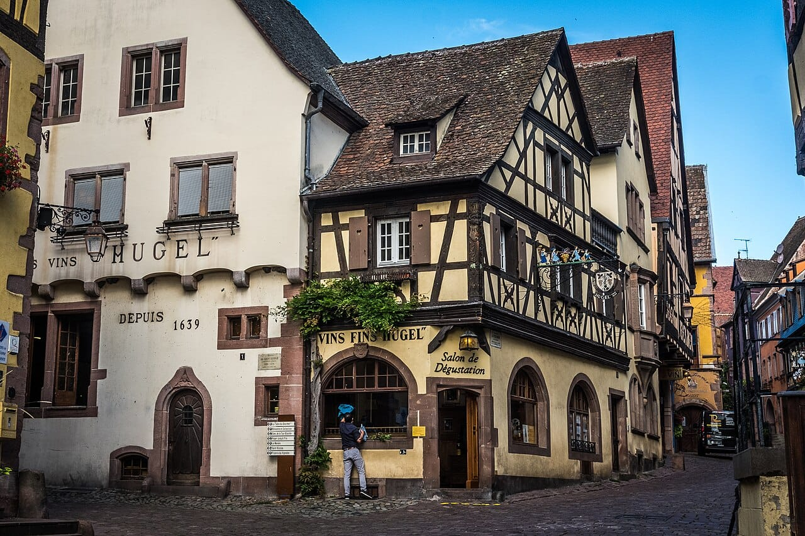
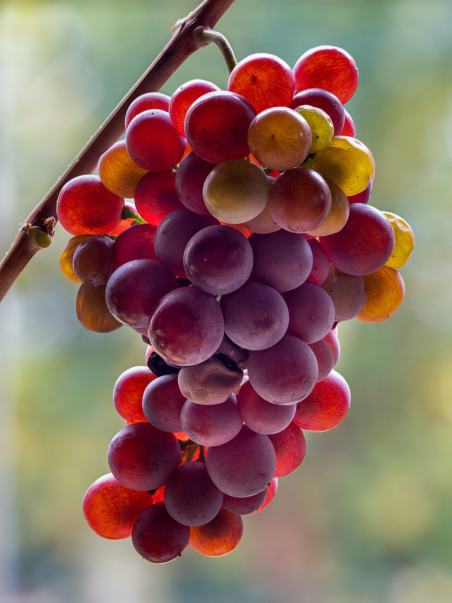

# Hugel

Hugel & Fils / Famille Hugel stands at 3, rue de la Première Armée in Riquewihr, Alsace. It has worked in the same medieval town for more than three centuries, with cellars under the old buildings and a tasting room a few steps from the street. Hugel is not a closed estate that keeps visitors outside: it has a seasonal tasting room and cellar tours by appointment, but the underground cellars still require planning.

Figure: Hugel. Image: Photo Claude TRUONG-NGOC, CC BY-SA 4.0, via Wikimedia Commons ([source page](https://commons.wikimedia.org/wiki/File:Hugel_et_Fils_Riquewihr_ao%C3%BBt_2020-3.jpg)).

## Riquewihr: a family estate inside the walls

Riquewihr is a classic Alsace wine village: walls, towers, narrow streets and coloured houses are well preserved, and the centre is largely pedestrian, with vehicles limited to loading. Hugel's buildings stand in the middle of the town, and both the cellar entrance and tasting room sit behind modest facades; first-time visitors can walk past them, so look for the house number and the yellow-label wine signs.

That "estate inside the village" shape decides how a visit works: coaches cannot pull up at the door, parking is outside the walls, and the tasting room is small enough to need waiting in high season. The official page also notes that arrival at the cellars and tasting room is on foot, with vehicles allowed only for loading. Put that in the plan rather than hunting for a space on arrival.

## The family since 1639

The official account dates the family's presence in Riquewihr to 1639. Over the centuries the Hugels have been both growers and merchants, gradually combining their own vineyards with fruit from contract growers. Today the estate owns about 30 hectares, mostly on Riquewihr's best sites, many classed as Grand Cru, and also works with roughly 100 hectares of contract growers to secure supply for export.

Production is about 60,000 cases a year, with 90% exported to more than 100 countries. These figures are the key to Hugel: it is not a small estate serving only local tables but a trading family house selling Alsace around the world. That is why the range stresses consistency — the yellow label, the same bottle shape and the same style language, so distant buyers find a familiar taste every year.

## The cellars and the 1715 S. Caterine cask

The cellars lie under sixteenth-century buildings, cool and damp, and still hold large oak casks over a century old. The most famous is "S. Caterine", described by the estate as made in 1715 and recorded as one of the oldest casks still in use. It is not an antique on display but part of a working cellar; on a visit it stands among other old casks, and the scale and grain are immediately visible.

Old casks mean something different in Alsace from new ones: they do not chase toast and vanilla but slowly stabilise the wine with a little oxygen. Hugel's range deliberately avoids obvious oak, and the yellow-label wines stress variety aroma and freshness. Reading "old cask" as "heavy oak" is the most common misunderstanding in the cellar.

## Noble varieties under the rain shadow

The Vosges block Atlantic moisture on Alsace's western side, leaving the eastern foothills dry and sunny, so grapes ripen slowly. Hugel uses only Alsace's noble varieties: Riesling, Gewurztraminer, Pinot Gris and Muscat; [Gewurztraminer](ref:gewurztraminer) gives lychee and rose, [Pinot Gris](ref:pinot-gris) pear and honey, Riesling acid and mineral, and Muscat the floweriness of the grape. Pinot Blanc and Sylvaner exist too, but are not in the noble group.

The estate's vines average about 35 years, with old vines complemented by younger contract fruit. The rain shadow brings stable ripening, but vintage differences come more from autumn rain and botrytis conditions than from general cold. Remembering only "dry" overlooks the fact that Alsace autumns can also bring long rain, which is exactly what late-harvest years have to judge.

## How to read the yellow label

Hugel's yellow label is its most recognisable visual sign. The range runs from entry level to Grand Cru and then Vendanges Tardives and Sélection de Grains Nobles, with variety and site becoming more specific at each step. Entry wines stress freshness and balance and suit food; Grand Cru labels name the site and variety, cost more and age longer; the late-harvest wines sit in another dimension, ordered by sweetness and concentration.

Read the label by variety first, then look for "Grand Cru" and the site, then for Vendanges Tardives or Sélection de Grains Nobles. Do not treat the yellow label as one wine: the same label covers different varieties, vintages and levels. For an everyday bottle, choose an entry Riesling or Pinot Blanc; to understand the estate, choose a Grand Cru Riesling.

## A driving force behind the late-harvest rules

The Hugel family played a driving role in shaping Alsace's late-harvest rules. The official account says the family helped establish Vendanges Tardives and Sélection de Grains Nobles and took part in fixing their production conditions; these rules later became part of the Alsace AOC system. For consumers this means VT and SGN are not estate marketing terms but labels with legal thresholds.

The rules settle "minimum sugar and permitted varieties", not style. Hugel's VT can be relatively fresh and its SGN rich; two sweet wines from one estate may suit completely different occasions. Ask about the botrytis share and residual sugar in the year before relying on the label alone.

## The tasting room and booked cellar tours

The official page states that the tasting room is open daily from Easter to Christmas, 09:00–12:00 and 13:00–18:00; outside those dates, contact the estate first. The room takes at most 8 to 10 people at a time, wines are kept under inert gas, and some rare bottles are priced separately. Cellar tours are limited to weekdays outside harvest and need advance booking, for groups of up to about 15, aimed at wine professionals or reasonably experienced amateurs.

The address is 3, rue de la Première Armée, 68340 Riquewihr, France; the phone is +33 (0)3 89 47 92 15. Drivers should park outside the village and walk in; spit at the tasting and do not drive afterwards. For buying only, the tasting room and online shop both work; for the cellars, book first and confirm the meeting point.

### Key dates and figures

- 2026: page checked on 2026-11-09; opening times, booking and transport should be confirmed with the official channel.

## See also

- [Alsace](ref:alsace): the Vosges rain shadow, Grand Cru and noble varieties.
- [Gewurztraminer](ref:gewurztraminer) and [Pinot Gris](ref:pinot-gris): core varieties of the yellow-label range.
- [White wine](ref:white-wine): reading Alsace labels and matching food.

Opening hours, bookings and transport are subject to official channels; no coordinates are given here, so use official channels

**Short definition:** A family estate in Riquewihr, Alsace, working in the same town since 1639, known for its yellow-label range, medieval cellars and the 1715 S. Caterine cask, and a driving force behind the Vendanges Tardives and Sélection de Grains Nobles rules; the tasting room is seasonal and cellar tours need booking.

## Related images

Image: Pinot Gris. Credit: Ermell, CC BY-SA 4.0, via Wikimedia Commons ([source page](https://commons.wikimedia.org/wiki/File:Pinot_Grigio-20201027-RM-114053.jpg)). Related image for Hugel.
