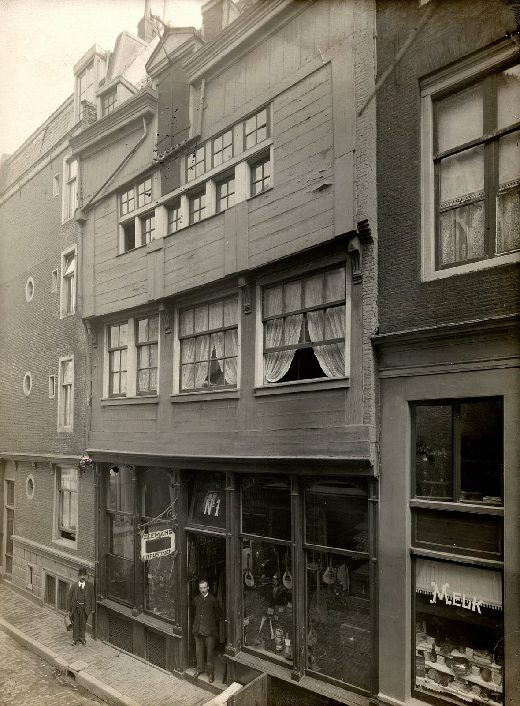

# In ’t Aepjen

A few minutes south of Amsterdam Centraal, the Zeedijk narrows abruptly. A black timber façade, white window frames, gold lettering reading “In ’t Aepjen,” and a window full of monkey figurines and old bottles make the place look like a woodcut left behind at the edge of the red-light district. It is not a reconstructed “Dutch theme bar”: the house is genuinely mid-sixteenth-century, and the ground floor became a café only in the late 1980s.

Figure: Historic photograph of the wooden facade at Zeedijk 1; the house dates from about 1550 and is now cared for by the Hendrick de Keyser Association. Image: Unknown author Unknown author, Public domain, via Wikimedia Commons ([source page](https://commons.wikimedia.org/wiki/File:Historische_stadswoning_met_houten_gevel,_SFA022811075.jpg)).

> **Quick verdict**
> **In one line:** This entry helps you decide whether In ’t Aepjen deserves a detour, and what to check before visiting.
>
> - **Best for:** Anyone planning a visit to In ’t Aepjen who needs to decide whether it deserves a half-day or a full day.
> - **Not for:** If you want only want a must-visit list and will not check booking, transport or opening hours.
> - **Check first:**
>   - Three dates need separating: the building, the shopfront, and the bar.
>   - In ’t Aepjen is a Dutch brown café at heart: beer, jenever and simple bar food.

## Location and history

Three dates need separating: the building, the shopfront, and the bar. The official page of the Hendrick de Keyser association gives 1550 as the building year and says the association bought the house in 1920. Amsterdam Monumentenstad records the earliest mention of “Het Aepgen” in 1543 and dates the present house to about 1560. The two accounts differ by a decade, but both point to the mid-sixteenth century, not the often-quoted 1519.

The “1519 inn” is the most stubborn legend. Atlas Obscura and many travel articles say the place has offered ale, jenever, food and lodging since 1519; Amsterdam Tourism’s 2026 research article states plainly that this claim lacks archival evidence, and that the monkey-payment story has no reliable record either. More importantly, Hendrick de Keyser’s house history is clear: in the mid-sixteenth century this was the home of Jan Claesz “int Aepgen,” not a sailors’ inn; in the eighteenth century it was a paper shop; in the nineteenth a grocery; the present shopfront was installed in 1878; and only after the 1986–87 restoration did the ground floor receive a café use. The name is old, the house is old, but “five centuries of continuous bar service” is a later construction.

The name has layers. “In ’t Aepjen” literally means “at the monkey’s,” and the house history and archives write “Het Aepgen.” Monkey images are everywhere inside today: carved figures, posters, oil paintings, small statues on the bar. They come from a later folk tale: sailors returning from the colonies, short of money, paid their bill with monkeys brought on the voyage; the monkeys multiplied until customers complained of fleas, and they were passed to a regular customer, eventually becoming entangled with the origin story of Artis Zoo. It is a good story, but there is no verifiable archival chain between the bar and the zoo. Treat it as an Amsterdam urban legend, not as history.

## Architecture and space

This is one of the last specimens of Amsterdam’s timber tradition. After the fire of 1452 the city required brick side walls and later banned wooden fronts altogether; Zeedijk 1 has brick side walls but a timber-framed front clad in boards, which places it in the rare “wooden façade” category. Hendrick de Keyser calls it a transition between timber and brick: the plan is almost square, about 7 metres wide and 5.6 metres deep, with the roof parallel to the street—a “cross house” (dwarshuis), not the narrow, deep canal house.

The timber frame survives most completely on the first and second floors; on the ground floor, only the old beam ceiling remains because the space became a café. The spiral stair is sixteenth-century, but it is now blocked and does not lead to guest rooms; the upper floors belong to the neighbouring hotel. That detail matters: you drink on the ground floor, but the floors above are not part of the same tavern—they are a historic building absorbed into a hotel. The horizontal boards, large white windows and Louis XVI mouldings date roughly from around 1800, while the present shopfront was installed in 1878; the “old bar” window is therefore much younger than the house.

The room is small: the bar and a few tables are immediately inside. Dark wood, brass lamps, old mirrors, rows of bottles and monkey figures pull the sightline low; at the back hangs a large painting of a drinking crowd. In daylight the wood grain is clear through the Zeedijk window; at night the room is lit only by lamps and candles and looks like a block of warm amber. It suits a dozen people, not a large group; watch your backpack and glass when turning.

## The drinks

In ’t Aepjen is a Dutch brown café at heart: beer, jenever and simple bar food. The beer list leans on Dutch lager and wheat beer—Palm, Heineken or a local seasonal—while jenever usually comes in a small glass as jonge (young) or oud (aged). Young jenever is cleaner and sharper; aged is rounder and sweeter, often taken with a beer or a bitter. There is no cocktail programme and no “Amsterdam-themed special”; the taste comes from cold beer, juniper and old wood.

Food is bar level: bitterballen, cheese cubes, fried meatballs, sandwiches and nuts. Portions are small and meant to accompany a drink, not to replace dinner. For a proper meal, use this as a first stop and go on to an Indonesian restaurant or Chinatown. Order “een biertje” or “een jenever”; if unsure, let the bar recommend jonge or oud. Do not expect a long English menu explaining every bottle—the list is short and the choice is verbal.

## How to drink

The easiest times are 15:00–17:00 or after 22:00. Before the tourist peak, a drink by the window lets you watch the street and bicycles; weekend nights become very crowded once the red-light district fills. It is not suitable for large parties or children; tourists often photograph the façade, so lower your voice once inside.

Order at the bar and return empty glasses there. Dutch bars sometimes settle immediately and sometimes at the end; ask when you order. Do not block the doorway—Zeedijk is narrow and the entrance is also a neighbour’s passage. Photos are fine, but do not use a flash on the people behind the bar; the room is dark and a flash destroys its atmosphere. Finally, do not take the monkey figures down for a staged photo; they are part of the room, not props.

## Practical information

- Address: Zeedijk 1, 1012 AN Amsterdam.
- Coordinates: 52.376303, 4.900146.
- Transport: about five minutes on foot from Amsterdam Centraal; take tram or metro to Centraal and follow the Zeedijk signs.
- Hours: commonly listed as Sunday–Thursday 12:00–01:00 and Friday–Saturday 12:00–03:00; the window lettering and secondary sources agree, but check on site for temporary changes.
- Reservations: no large bookings; walk in and take available seats. Groups should split up.
- Payment: cards and cash are both common; small change helps for small orders.
- Accessibility: a threshold at the door and a narrow interior make wheelchair access difficult; look before entering.
- Neighbourhood: Zeedijk sits at the edge of the red-light district; at night it is busy and mixed, so watch your belongings and do not photograph people in windows.

## Etiquette and common misconceptions

First, do not treat “1519 inn” as fact. The house is about 1550, the café use began after the 1987 restoration, and the monkey payment is legend, not a ledger entry. Second, do not treat the whole building as a bar; the upper floors belong to the hotel, the spiral stair is blocked, and there is no “upstairs tour.” Third, do not expect a “historic theme menu” or fancy cocktails; this is a brown café, and beer and jenever are the point. Fourth, do not use a flash inside or move the monkey figures. Fifth, do not play music at the door or block the passage; the street is narrow and shared with neighbours. Sixth, do not reduce the place to an “oldest bar” photo stop; what is worth seeing is the timber house, the 1878 shopfront and the layers left by the 1980s restoration.

## Nearby and routes

From Zeedijk 1, two streets south lead to Chinatown and Nieuwmarkt; west is Dam Square, north is Centraal. The stop fits a half-day “Amsterdam small bars” line: start at [Café Hoppe](ref:hoppe) for the standing/sitting double space on Spui, walk to [Café De Dokter](ref:dokter) for the 18-square-metre extreme, and come to In ’t Aepjen in the evening for the timber house and the monkey collection. To add the beer industry, [Heineken Experience](ref:heineken) is the brand museum; across in Brussels, [Cantillon](ref:cantillon) is the lambic and gueuze contrast. Further away, Lisbon’s [A Brasileira](ref:brasileira) is another urban sample of the literary café.

Do not drive this line: central Amsterdam is almost impossible to park in, and Zeedijk to Spui is about a 20-minute walk through Dam and the Royal Palace. For a single drink, late afternoon to dusk works best; for the façade, morning side light is clearest, while at night only neon and windows remain.

## Further reading and see also

- Hendrick de Keyser’s Zeedijk 1 page: <https://www.hendrickdekeyser.nl/de-huizen/zeedijk-1>, for 1550, the 1920 purchase, the paper/grocery shop, the 1878 shopfront and the 1987 café use.
- Amsterdam Monumentenstad’s Zeedijk 1 entry: <https://www.amsterdam-monumentenstad.nl/database/grachtenboek_objecten.php?id=340>, for the 1543 first mention, the house of about 1560 and the 1986/87 restoration.
- Amsterdam Tourism’s In ’t Aepjen article: <https://amsterdamtourism.net/in-t-aepjen/>, for the monkey story as folklore and the indicative hours.
- Atlas Obscura’s In’t Aepjen page: <https://www.atlasobscura.com/places/in-t-aepjen>, for the address, coordinates and the popular version of the legend; do not read its 1519 date as archival fact.
- Nearby entries: [Café Hoppe](ref:hoppe), [Café De Dokter](ref:dokter), [Heineken Experience](ref:heineken); cross-city contrasts: [Cantillon](ref:cantillon), [A Brasileira](ref:brasileira).

Begin with the address, move on to the current opening status, and finish with what the place is known for. That order keeps the reading of In ’t Aepjen practical.