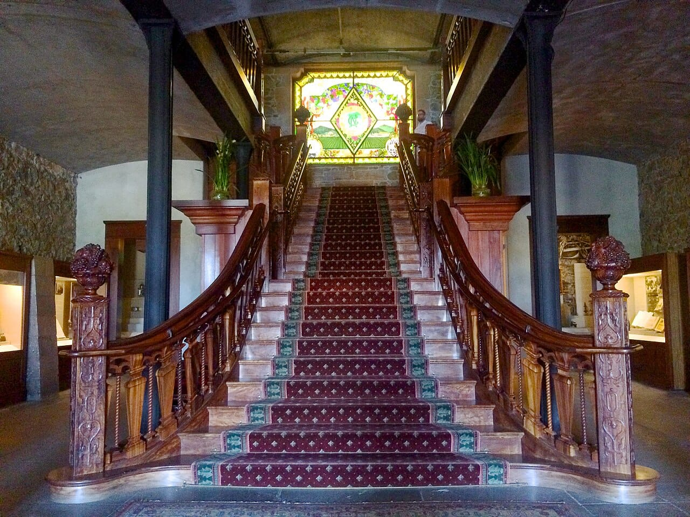

# Inglenook

Rutherford sits in the middle of Napa Valley, where Highway 29 runs between long vineyards and low stone walls. Inglenook’s entrance is a tree-lined drive ending at an 1882 stone chateau, with a fountain, lawn and tall oaks in front. It looks like a European manor, but the story is American: a Finnish sea captain bought the land in 1879 and applied the capital and discipline of shipping to a winery. In the mid-twentieth century the estate was split, sold and renamed, until the Coppola family bought the pieces back one by one. Today it is both a historic building and a working winery; keep the chateau and the vineyard separate, because the first is memory and the second is wine.

Figure: The main staircase and wood panelling inside Inglenook’s chateau. Image: Lou Stejskal, CC BY 2.0, via Wikimedia Commons ([source page](https://commons.wikimedia.org/wiki/File:Inglenook_-_26022139253.jpg)).

## Location and history

Gustave Niebaum was a Finnish sea captain who built wealth in Alaska shipping. In 1879 he bought land in Rutherford and founded Inglenook. In 1882 he hired 25 masons to build the stone chateau; the estate bottled its first wine in 1887. After Niebaum’s death, his wife Susie and nephew John Daniel Jr. continued the work. In 1941 John Daniel Jr. made the Cabernet that later became a Napa legend and the benchmark of the house style. In 1964 the estate was sold to United Vintners, and the name and parcels were dispersed. Francis Ford Coppola bought part in 1975, most in 1995 and reunified the property in 2011. In 1994 Inglenook became one of Napa’s first certified organic vineyards. Today the Coppola family manages the estate; Rubicon is the flagship Cabernet, RC Reserve is a Rhône-style Syrah and Blancaneaux is a white Rhône blend.

## Architecture and spaces

The chateau is an 1882 stone building, with local sandstone, arched windows and a tower in a nineteenth-century European revival mood. Inside, the original stone and vaults remain; the ground floor is a history museum, the upper floor a Magic Lantern museum of early glass slides and projection equipment, with classic cars nearby. The courtyard has a fountain, hedges and benches, and the tasting room and restaurant open around it. The detail worth studying is the masonry: 25 masons laid irregular stones with joints of varying width, a strong contrast to the concrete and glass of later California wineries. The working winery is behind the chateau, and fermentation and cellars are not open to casual visitors; the visit stays around the chateau, courtyard and tasting rooms.

## The wines and palate

Rubicon is the flagship Cabernet, first made in 1978 from estate parcels and old vines. It is deep and tannic, with cassis, cedar, graphite and leather, a high proportion of new oak and long ageing potential. RC Reserve Syrah is a Rhône-style wine made with the Coppola family and winemaking team: blackberry, black pepper, olive, smoke and violet, aged 18–20 months in French oak with some new barrels. It shows that Inglenook is not only a Bordeaux-style house. Blancaneaux is a Viognier, Marsanne and Roussanne blend with white flowers, apricot, honey and mineral, a rare white Rhône style in Napa. There are also Cabernet Sauvignon, Zinfandel, Sauvignon Blanc and Syrah. Do not focus only on Rubicon; RC Reserve and Blancaneaux reveal the experimental side.

## How to drink

Serve Rubicon at 16–18°C, one to two hours ahead when young and 30–60 minutes when older, with roast beef, lamb, game, mushrooms and hard cheese. RC Reserve Syrah is best at 16–17°C with pepper steak, barbecue, braised lamb or smoked dishes; its pepper and olive notes suit spice. Blancaneaux at 10–12°C with roast chicken, seafood in cream sauce, white meat or soft cheese. Zinfandel at 15–17°C with barbecue, pizza and tomato stews. Do not pair high-alcohol Rubicon with very spicy food, which amplifies heat, and do not over-chill Blancaneaux or its perfume will close down.

## Practical information

The address is 1991 St Helena Highway, Rutherford, CA 94573; telephone 707-968-1100, reservations 707-968-1179. The estate is open daily 10:30–17:00, with tastings Thursday to Monday 10:30–16:00; reservations are recommended and required for nine or more. From Napa city, drive north on CA-29 for about 20 minutes; the entrance is on the west side, with parking at the end of the drive. The chateau and courtyard are largely wheelchair accessible, but historic parts have steps; tasting rooms and restaurant share the same area. Rutherford is hot in summer, so morning or late afternoon is more comfortable; during harvest, trucks slow Highway 29.

## Etiquette and common misreadings

First, Inglenook is not simply “Coppola’s winery”; it was an 1879 estate before the Coppola family bought it back, and the director’s name should not cover the whole history. Second, Rubicon is not the best wine every year; it depends on vintage and blend, and RC Reserve and Blancaneaux deserve separate attention. Third, the museum and classic cars are not playground equipment: do not touch exhibits or climb on vehicles. Fourth, the courtyard and fountain are shared tasting space; do not picnic, enter the water or fly a drone. Fifth, groups of nine or more must book, and the estate does not take large walk-in groups. Sixth, do not drive after tasting; Highway 29 is fast and alcohol levels are high.

## Around and routes

Around Rutherford are the [Napa Valley](ref:napa) Rutherford Bench, St. Helena and Oakville; Calistoga is north and Napa city south. Half a day is enough for the chateau, courtyard and one tasting; a full day can add the estate vineyards, a [United States](ref:usa) wine history stop and the Highway 29 scenery. Read [Cabernet Sauvignon](ref:cabernet) and [red wine](ref:red) together to understand Rubicon’s structure, and [oak ageing](ref:oak) to explain its new-oak proportion. Do not put Inglenook and Montelena in the same morning: both need reservations, and one is in Rutherford while the other is in Calistoga.

## Further reading and see also

- Comparisons: [napa-valley](ref:napa), [usa](ref:usa), [cabernet-sauvignon](ref:cabernet), [red-wine](ref:red), [oak-ageing](ref:oak).
- Background: [napa-valley](ref:napa), [usa](ref:usa).
- This entry provides no map; visits, vintages and prices should be checked with official channels.

Begin with the address, move on to the current opening status, and finish with what the place is known for. That order keeps the reading of Inglenook practical.

Read [Napa Valley](ref:napa) for the address and space side of Inglenook, and [Cabernet Sauvignon](ref:cabernet) for the operating status side. Together they locate it.

**Short definition:** A historic Rutherford estate in Napa Valley, founded in 1879 by Finnish sea captain Gustave Niebaum. The stone chateau was built in 1882, and John Daniel Jr.’s 1941 Cabernet became a Napa legend; from 1975 the Coppola family gradually reassembled the property, whose vineyards were among Napa’s first to be certified organic in 1994. It is known for Rubicon, RC Reserve Syrah and Blancaneaux.

**Key facts.**

| Item | Detail |
| --- | --- |
| In one line | A historic Rutherford estate in Napa Valley, founded in 1879 by Finnish sea captain Gustave Niebaum. The stone chateau was built in 1882, and John Daniel Jr.’s 1941 Cabernet became a Napa legend; from 1975 the Coppola fa… |
| Address | 1991 St Helena Highway, Rutherford, CA 94573, United States |
| City and country | Rutherford / United States |
| Status | verified open |
| Official site | inglenook.com |

**Sources and limits.** The key claims about Inglenook are checked against the following sources: Inglenook (1991 St Helena Highway, Rutherford, CA 94573, the telephone and reservation line; RC Reserve Syrah, Rutherford, 20 months in oak, 35% new oak and Coppola family management), Napa Valley Vintners. For current products, addresses or opening status, use inglenook.com. Prices, batches and status change; the body is project-written and does not reproduce source text.

## Related images

Image: Cabernet Sauvignon grapes from Château Cos D'Estournel. Credit: Megan Mallen, CC BY 2.0, via Wikimedia Commons.. Credit: Megan Mallen, CC BY 2.0, via Wikimedia Commons ([source page](https://commons.wikimedia.org/w/index.php?curid=13318021)). Related image for Inglenook.
