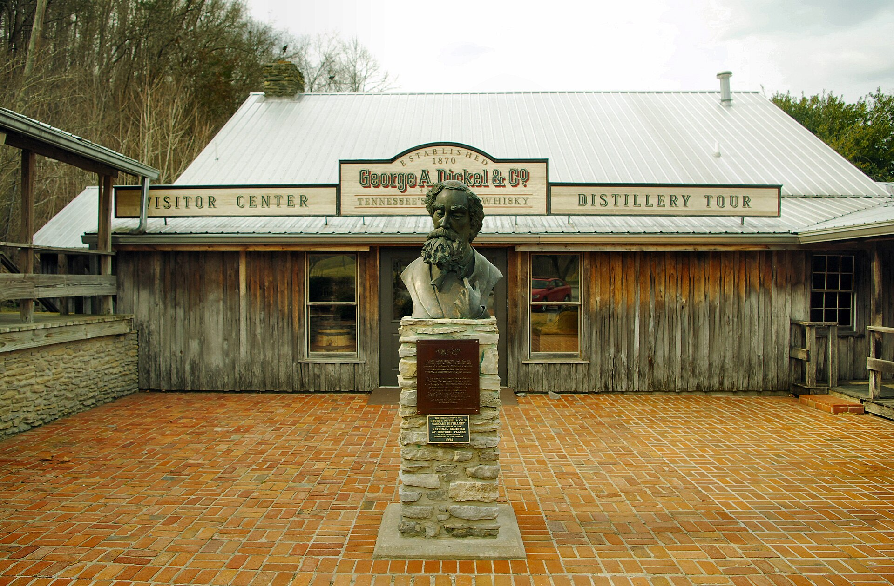

# Jack Daniel's Distillery

Jack Daniel's sits in the small town of Lynchburg, Tennessee, in Moore County. It is often treated as a synonym for American whiskey, but strictly it makes [Tennessee whiskey](ref:tnwhiskey): the grain and barrel rules are close to [bourbon](ref:bourbon), with an extra sugar-maple charcoal filtration and a requirement that the whiskey be made in Tennessee. The tour runs through the spring, charcoal area, stills and barrel houses before a tasting.

> **Visit information**
> - Address: 280 Lynchburg Hwy, Lynchburg, TN 37352, USA.
> - Opening and booking: check the [official page](https://www.jackdaniels.com/) before travelling; hours, tours and booking rules change by season.
> - Getting there and cost: check the official page before booking; this entry does not promise a fixed price.
> - Status: Verified; sources checked: 2026-11-08.

Figure: Jack Daniel's Distillery. Image: Ben Jacobson ( Kranar Drogin ), CC BY 2.5, via Wikimedia Commons ([source page](https://commons.wikimedia.org/wiki/File:Jack_Daniel_Distillery_Lynchburg_TN_001.JPG)).

## A distillery in a dry county

Lynchburg is the seat of Moore County, and the county has been dry since Prohibition: there are no liquor stores, and restaurants cannot simply sell spirits. The exception is the distillery itself, which may sell bottles at the visitor centre and pour samples on its tours. That contradiction defines the place: a town famous for whiskey where you cannot buy a drink in the ordinary way.

The common address is 280 Lynchburg Hwy, while the official visitor centre page gives 133 Lynchburg Highway as the entrance; both are on the same road, so follow the entrance given on the official page. It is 1.5 hours from Nashville, two from Chattanooga. A rental car is the realistic option.

## 1866 and "America's oldest registered distillery"

The distillery dates its registration to 1866 and calls itself America's oldest registered distillery. Official material says Jack Daniel registered early, when the federal government began taxing whiskey. Historians still debate the exact date because early records are incomplete, so the safer wording is that the official account begins in 1866, not that "first" is beyond argument.

In 1904, Old No. 7 won a gold medal at the Louisiana Purchase Exposition in St. Louis, a turning point that took a local distillery into the national market. The marketing history is half the story; the craft is the other half.

## The Lincoln County Process: charcoal, time and spring water

The main difference from bourbon is the Lincoln County Process: before going into the barrel, new make is slowly filtered through a thick bed of sugar-maple charcoal, then filled into new charred oak. Jack Daniel's burns its own charcoal on site, and the filtration is not a quick pass but a drip that lasts for days.

The water comes from Cave Spring, which official material describes as around 56 Fahrenheit and free of iron; iron would give whiskey an off flavour, so the spring is one reason the site was chosen. Charcoal filtration does not make the whiskey sweet; it changes texture and the rough edges. The sweetness and vanilla come mainly from the new oak and maturation. Set [Tennessee](ref:tennessee) inside the American whiskey map and the division of labour with Kentucky bourbon becomes visible.

## The tour: from the spring to the tasting room

The standard tour lasts about 1.8 hours, costs $35 per adult, takes groups of 1 to 24 and ends with six samples of different Tennessee whiskeys. The route normally covers the visitor centre, the Cave Spring, the charcoal area, the still house, the barrel houses and the tasting room. It is a walking tour, the outdoor sections are hot in summer and windy in winter, and comfortable shoes matter more than smart ones.

For more, the distillery also offers All About the Barrel, Bonded and A Day at Jack; some include lunch or gifts, and some are 21+ only. The standard tour admits under-21s but does not let them taste; every tasting requires photo ID. Tours run daily and sell out in high season and at weekends, so book online and read the cancellation policy.

## The whiskeys and the house style

Old No. 7 is the benchmark, bottled at 40% alcohol, with banana, vanilla, caramel and oak on the nose, a sweet entry and a dry, faintly charred finish. Gentleman Jack is charcoal-filtered twice for a cleaner profile; Single Barrel is bottled from individual casks at higher strength and with more concentration; Bonded, Bonded Rye and Triple Mash cover different legal categories and recipes.

The [Jack Daniel's](ref:jackdaniels) style is usually summed up as sweet, smooth and lightly charred, which follows from the grain bill, the charcoal filtration and the new barrels. To compare, order Old No. 7 next to a Single Barrel: the first is the steady everyday pour, the second shows what cask and selection can do.

## Booking, arriving and prices

The official site is the only reliable ticket channel; walk-up tickets often leave awkward times. The standard tour is $35, Bonded about $55, All About the Barrel about $75 and A Day at Jack about $160; check the page for what tax and fees include. The visitor centre opens daily 9:00–16:30 and closes on a few holidays; the White Rabbit bottle shop keeps different hours.

From Nashville take I-24; from Chattanooga, the reverse. Coordinates should come from official channels; navigate to the visitor centre car park. There is no useful public transport; taxis are unreliable, so arrange your return. To link the Tennessee distilleries, pair this visit with [George Dickel](ref:georgedickel) on the same day or the next; the two are half an hour to forty minutes apart, and the contrast is clear.

## Common mistakes and the neighbourhood

The first mistake is to call Jack Daniel's bourbon: it meets the grain and barrel rules, but the company labels it Tennessee whiskey. The second is to assume a dry county means no alcohol at all: the distillery may sell and pour at the visitor centre, but not every restaurant in town may serve. The third is to think Jack Daniel invented charcoal mellowing: several Lincoln County distilleries used it.

Around town, walk the square and the old jail, or head to Tims Ford Lake. Read the wider map of [American](ref:usa) whiskey before renting a car; three distilleries in one day is rushed, two plus lunch is comfortable.

For Jack Daniel's Distillery, begin with the address. Then look at the current opening status, and finally ask what the place is known for. The answers point to different choices, not to a single score.

[George Dickel Distillery](ref:georgedickel) and [United States](ref:usa) are the two useful reference points for Jack Daniel's Distillery. [George Dickel Distillery](ref:georgedickel) sets out address and space; [United States](ref:usa) brings in operating status. Read them together.

**Key facts.**

| Item | Detail |
| --- | --- |
| In one line | A Tennessee whiskey distillery in Lynchburg, Tennessee, registered by Jack Daniel in 1866 and known for the Lincoln County Process of sugar-maple charcoal filtration and Old No. 7; Moore County is dry, tours are booked a… |
| Address | 280 Lynchburg Hwy, Lynchburg, TN 37352, USA |
| City and country | Lynchburg / United States |
| Status | verified open |
| Official site | jackdaniels.com |

**Sources and limits.** The key claims about Jack Daniel's Distillery are checked against the following sources: Jack Daniel's (Used to check visitor centre hours, location, tour prices and age rules; Used to check the 1.8-hour duration, $35 price, six-sample tasting and daily departures), Brown-Forman. For current products, addresses or opening status, use jackdaniels.com. Prices, batches and status change; the body is project-written and does not reproduce source text.

## Related images

Image: Related photograph of George Dickel Distillery. Credit: Brian Stansberry (photographer), CC BY 3.0, via Wikimedia Commons ([source page](https://commons.wikimedia.org/wiki/File:George-dickel-distillery-visitor-center-statue-tn1.jpg)). Related image for Jack Daniel's Distillery.
