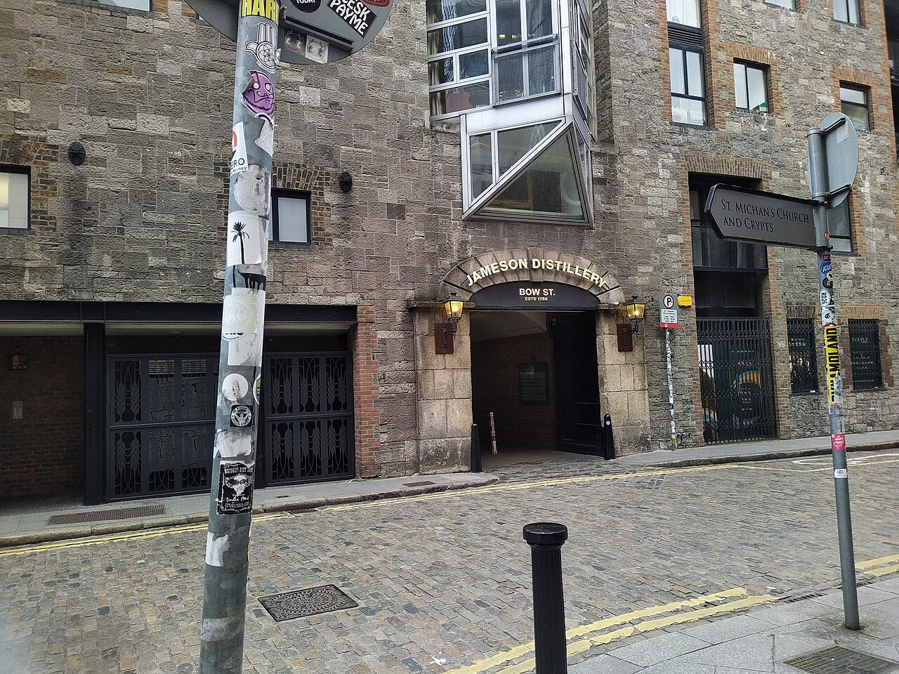

# Jameson Distillery Bow St.

Bow Street distillery stands in Smithfield, Dublin 7, a short walk from the north bank of the Liffey, and it is a former distillery turned visitor experience. John Jameson founded it in 1780, and it grew into a six-acre city works employing hundreds of craftspeople. After the last pot still run in 1970, production moved to Midleton in County Cork, and the old site reopened as a visitor centre in 1997. You can still see the buildings, the copper and the warehouses, but you will not see whiskey being made.

Figure: Jameson Distillery Bow St.. Image: Lingual Friendulum, CC0, via Wikimedia Commons ([source page](https://commons.wikimedia.org/wiki/File:Jameson_distillery_2.jpg)).

## Starting on Bow Street in 1780

John Jameson was born in Alloa, Scotland, and came to Dublin in the late 1770s. In 1780 he started his own whiskey business on Bow Street. It became a city within a city, with coopers, blacksmiths, carpenters and stonemasons alongside the stills; Smithfield still mixes workshops and old warehouses. By the later nineteenth century Bow Street was one of Dublin's largest distilleries, shipping out through the port and the railways. That industrial history explains why the site is worth keeping.

It also helps to separate brand from distillery. Jameson is a brand, not a family firm that stayed independent; it became part of Irish Distillers and is now owned by Pernod Ricard. Bow Street is its birthplace and brand home, while the actual production is concentrated in Midleton. The displays then read as brand history, not a production manual.

## A distillery that no longer distils

In June 1970 the last pot still whiskey ran at Bow Street, and production moved to Midleton. The old site was left idle and decayed, then reopened as a visitor centre in 1997. In 2017 a major refurbishment added new tasting rooms, a bar and interactive exhibits. Today the place works as an explanation centre: old buildings, copper stills and projection tell the process, and a guided tasting explains style.

So do not come expecting fermentation smells or a live production line. If you want to see copper and mash tuns in use, put [Bushmills](ref:bushmills) or [Kilbeggan](ref:kilbeggan) in the itinerary; if you want concepts first, Bow Street is the better start. The official coordinates are 53.348376, -6.277354, and Smithfield is the navigation target.

## The route: equipment, warehouses and a comparative tasting

The standard tour begins with the old buildings and the brand story, passes preserved copper stills and sections on fermentation and warehousing, and ends in a tasting room. The explanation centres on triple distillation and blending: why Irish whiskey is often distilled three times, what pot still and grain whiskey contribute, and how cask changes aroma. Some sessions pour a three-way comparison of Irish, Scotch and American whiskey, which is the most useful introduction and easier to remember than a single dram.

There are also cocktail classes and longer tastings for people who have already done a round. A tour lasts about an hour, and times and languages change with the season; the bar and shop can be visited without a tour. Thresholds and stairs are uneven, so ask about accessibility, and families should check whether their session admits under-18s to the tasting.

## The style in the glass: blend, pot still and cask

Jameson Original is a textbook [blend](ref:blending) of Irish whiskey: pot still whiskey supplies spice and body, grain whiskey supplies softness and sweetness, and triple distillation makes the whole rounder. Black Barrel uses double-charred bourbon casks, pushing vanilla and caramel forward; the 18-year-old and Bow Street 18 sit in higher price brackets. The house signature is drinkability, but that is not the same as simplicity; a little water opens the spice and the grain sweetness.

Under the rules, [Irish whiskey](ref:irish) must be distilled and matured on the island of Ireland, pot still whiskey has barley requirements, and blends combine pot still with grain. Triple distillation is common but not compulsory; the shape and reflux of the [pot still](ref:potstill), and the number of passes, are where house styles really diverge.

## Booking, opening and getting there

The address is Bow St, Smithfield, Dublin 7, D07 N9VH, Ireland. The official page lists the site as open seven days: Sunday from 11:45, Monday to Thursday from 10:00, and Friday and Saturday from 10:00, with the last tour at 18:00 or 18:30 and the bar and shop closing later. Irish licensing rules restrict alcohol sales before 10:30 on weekday mornings and before 12:30 on Sundays.

Access is easy: the Luas Red Line stops at Smithfield, two minutes' walk away; O'Connell Street is about twenty minutes on foot; the nearest car park is at Queen Street and Smithfield Square. Book online at weekends and on holidays, and check age rules and cancellation terms for a cocktail class. The site pairs well with Dublin Castle, St Michan's Church or a walk around Smithfield Square.

## Common mistakes and a half-day route

Three mistakes recur. The first is to assume the distillery is still working: Bow Street does no commercial distillation today, and the real plant is in Midleton. The second is to think Jameson is one whiskey: Original to Black Barrel, the 18-year-old and single casks cover a wide spread. The third is to expect a tour that is mostly drinking: the guide spends most of the time on process and buildings, the tasting is the ending, and non-drinkers still get value.

Nearby you can walk to Smithfield Square, the Light House Cinema and St Michan's Church, and across the river to Dublin Castle and Temple Bar. To link Irish whiskey into a route, spread Bow Street, [Bushmills](ref:bushmills) and [Kilbeggan](ref:kilbeggan) across separate days: one shows urban industrial history, one a working north-coast distillery, one a small-town revival. Read the background on [Ireland](ref:ireland) first, then decide the order.

Begin with the address, move on to the current opening status, and finish with what the place is known for. That order keeps the reading of Jameson Distillery Bow St. practical.

The comparison with [Bushmills Distillery](ref:bushmills) and [Ireland](ref:ireland) runs through address and space and operating status. Each answers a different question.

**In brief:** The former Jameson distillery in Smithfield, Dublin, founded on Bow Street in 1780 and closed as a distillery after its last pot still run in 1970; it reopened as a visitor centre in 1997 and now teaches Irish whiskey through tours, comparative tastings and cocktail classes.

**Key facts.**

| Item | Detail |
| --- | --- |
| In one line | The former Jameson distillery in Smithfield, Dublin, founded on Bow Street in 1780 and closed as a distillery after its last pot still run in 1970; it reopened as a visitor centre in 1997 and now teaches Irish whiskey th… |
| Address | Bow St, Smithfield, Dublin 7, D07 N9VH, Ireland |
| City and country | Dublin / Ireland |
| Status | verified open |
| Official site | jamesonwhiskey.com |

**Sources and limits.** The key claims about Jameson Distillery Bow St. are checked against the following sources: Jameson (Used to check the Bow St address, coordinates, opening hours, Luas access and parking advice; Used to check the 1780 founding, the last pot still run in 1970 and the 1997 reopening as a visitor centre), The Spirits Business (Used to check the 1997 conversion and the refurbishment completed in 2017). For current products, addresses or opening status, use jamesonwhiskey.com. Prices, batches and status change; the body is project-written and does not reproduce source text.
