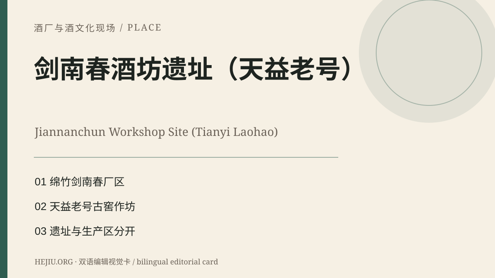

# Jiannanchun Workshop Site (Tianyi Laohao)

Mianzhu was already known for “Jiannan spring-burnt” liquor in the Tang dynasty, and today’s Jiannanchun anchors that history in a workshop site and the Tianyi Laohao ancient pit workshop inside its campus. Many visitors see only the gate and the bottles and assume the “site” is a stone marker; the pits, workshops and production system behind it are the real subject. Separate heritage site, plant and exhibition first, then decide whether this trip is about history, craft or both.

Figure: Jiannanchun Workshop Site (Tianyi Laohao) bilingual editorial card. Project-created bilingual editorial card for topic identification, not a documentary photograph.

> **Quick verdict**
> **Best for:** travellers interested in traditional strong-aroma pits and workshop spaces; pairs with Mianzhu New Year pictures, Deyang or Chengdu.
> **Not for:** visitors who expect a free-open old street or will not book; the working plant has clear boundaries.
> **One line:** start with the marker and site extent, then Tianyi Laohao’s pits and workshops; exhibition and tasting follow official arrangements.

## Separate site, plant and exhibition

The first layer is the protected Jiannanchun workshop site, whose core is the workshop remains, pits and related spaces, not a free old street. The second is the working Jiannanchun plant, with workshops, warehouses, transport and gates; “coming to see the site” does not grant access. The third is the exhibition or liquor-history space, which may sit inside or outside the campus and has its own opening and booking entry. The three may share a road but not rules; read the guide board and boundary lines instead of following the crowd past a fence. Only then does the national heritage marker stop being the whole story.

## Tianyi Laohao and the ancient workshop

Tianyi Laohao is the representative traditional workshop of Jiannanchun. Focus on continuous pit use, mud maintenance, grain going into the pits and distillation. Strong-aroma baijiu ferments in solid state in mud pits; older, well-maintained pits tend to produce more stable pit aroma and ethyl caproate. Do not just count pits: look at wall thickness, the mud layer at the bottom, ventilation and drainage, and the distance between stills and pits. The value of the old workshop is that it still explains a complete chain of grain, starter, pit, still and liquor, not that it is an old building. Keep clear of workers, do not touch the mud, and do not put a camera into a pit.

## Getting to Mianzhu and time needed

Mianzhu lies northwest of the Chengdu Plain, roughly an hour and more from Chengdu and closer to Deyang; connections via Chengdu East or Deyang stations work, but check live schedules. The site and exhibition take about two hours; adding the New Year-picture village and old town makes a half or full day. The plant area mixes industry and housing, with fewer restaurants than Chengdu, so lunch may mean returning to central Mianzhu. The pit area smells strong in summer and can be slippery; wear non-slip shoes and check photo signs rather than shooting workers and equipment close up. On a Chengdu day trip, put Mianzhu in the morning and return before the evening peak.

## Booking and production boundaries

Opening arrangements change with production, maintenance and receptions, so check Jiannanchun official channels or Mianzhu tourism notices before leaving rather than an old guide. Even when the heritage area is open, a working workshop is not a visitor area: steam, machinery, forklifts and spent grain all create risk, and you cannot walk in. Ask about alcohol strength, volume and charge before tasting; the driver abstains. Buy from official or authorised shops and keep receipts; do not treat “internal liquor” as part of the heritage visit. With children, explain that pits are not playgrounds and keep them from running along the edge.

## New Year pictures, Longmen Mountains and the liquor country

Mianzhu is more than liquor: the New Year-picture village in Xiaode, the Mianzhu New Year Picture Museum and the old town place the liquor country inside western Sichuan folk life. A half-day loop can run workshop site, New Year-picture village and old town; with another day, consider Jiulong Mountain, Lutang hot springs or the Longmen range, but mountain weather and roads change, so check forecasts. For food, try Mianzhu rice noodles, preserved duck, steamed dishes and Sichuan home cooking, keeping strong-aroma baijiu modest. If you try rubbing or painting a New Year picture, ask whether a template is used and whether there is an extra fee; do not mistake the result for an original hand-painted work.

## Shape Mianzhu as one day of liquor and pictures

Start at the Jiannanchun workshop site in the morning, following on-site boundaries to see the marker, pits and workshop and to understand the strong-aroma chain of pit, grain, still and liquor. Return to central Mianzhu for lunch, then spend the afternoon at the New Year-picture village learning drafting, block carving, colour printing and hand painting, and finish with a walk in the old town. This order separates the production site from folk craft and keeps both away from the lunch rush. With only two hours, choose the site and exhibition and do not force in the village; with older relatives, reduce walking, understand the museum models and cutaways first, then compare them on site. Buy liquor before heading back, not on an impulse at the gate. With only an hour, skip the picture village and focus on the site and exhibition; with older relatives, understand the models first, then compare them on site to avoid extra walking.

## Check before you go

- Check the open entry for site and exhibition
- Do not enter working workshops
- Do not touch pit mud or pit openings
- Wear non-slip shoes; mask in summer
- Buy liquor before departure and keep receipts
- The heritage marker is not the whole route
- Allow drive time between the site and the picture village
- Do not climb remains or run inside the site

## Limits and next steps

The core value of the Tianyi Laohao workshop site is the old pits and workshop space still in use, not a newly built exhibition hall. Confirm the open area first: some parts are protected production units visible only from outside, and you should ask on site whether guiding and photography are allowed. Keep "seeing the site" separate from "buying wine" so a sales pitch does not set the pace.

The site is close to central Mianzhu and can be combined with the New Year picture village and the old town in one day; from Chengdu, take the high-speed train to Mianyang or Deyang and change there. Roads around the workshop are narrow and holiday parking is tight, so arrive early.

This page does not cover the whole Jiannanchun estate. To see modern bottling lines or warehouses, book a separate company visit; a relic-site ticket is not a pass to the entire plant. Check opening hours and booking rules before leaving, which is easier than asking on arrival.

## References

- mz.gov.cn — official source — https://www.mz.gov.cn/meilimianzhu.htm (checked 2026-11-25)
- jnc.cn — official source — https://www.jnc.cn/about (checked 2026-11-25)
- deyang.gov.cn — official source — https://www.deyang.gov.cn/ (checked 2026-11-25)
- Official source — official source —  (checked 2026-11-25)

Related entries: [Mianzhu New Year Picture Village](ref:village), [Mianzhu Jiannanchun route](ref:route), [Jiannanchun](ref:brand), [Jiannanchun Group](ref:producer), [strong-aroma baijiu](ref:style), [Sichuan](ref:region), [First baijiu guide](ref:guide), [History of Chinese wine](ref:history).

## Related images

Image: 剑南春酒坊遗址国保碑. Credit: Nekitarc, CC BY-SA 4.0, via Wikimedia Commons.. Credit: Nekitarc, CC BY-SA 4.0, via Wikimedia Commons ([source page](https://commons.wikimedia.org/w/index.php?curid=44292018)). Related image for Jiannanchun Workshop Site (Tianyi Laohao).

The administrative division reference is the 2007 edition of GB/T 2260.
