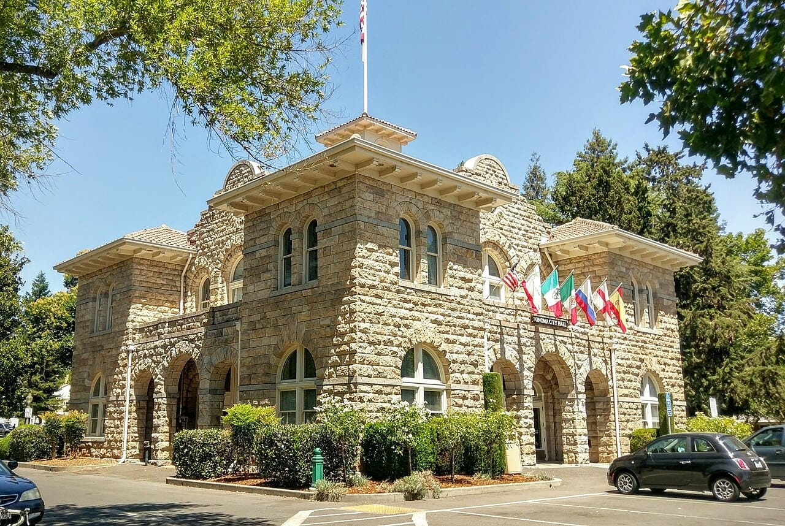

# Jordan Vineyard & Winery

Jordan is one of the most Bordeaux-like estates in Alexander Valley: founded in 1972 by Tom and Sally Jordan from Denver, it makes just one Alexander Valley Cabernet Sauvignon and one Russian River Valley Chardonnay, and uses a 58,000-square-foot French château to put winemaking, food and hospitality under one roof.

Figure: Jordan Vineyard & Winery. Photograph: File:Sonoma City Hall (cropped).jpg. Credit: Cullen328, CC BY-SA 3.0 ([source page](https://commons.wikimedia.org/wiki/File:Sonoma_City_Hall_(cropped).jpg)). Category image; not a claim that it shows the exact product, site or event.

> **Quick verdict**
> **In one line:** This entry helps you decide whether Jordan Vineyard & Winery deserves a detour, and what to check before visiting.
>
> - **Best for:** Anyone planning a visit to Jordan Vineyard & Winery who needs to decide whether it deserves a half-day or a full day.
> - **Not for:** If you want only want a must-visit list and will not check booking, transport or opening hours.
> - **Check first:**
>   - Jordan is in Sonoma County’s Alexander Valley, with the winery at 1474 Alexander Valley Road north of Healdsburg.
>   - Visits are mainly by appointment and include château tours, estate tours, terrace food-and-wine pairings and library tastings.

## Position and history

Jordan is in Sonoma County’s Alexander Valley, with the winery at 1474 Alexander Valley Road north of Healdsburg. Tom and Sally married in 1959 and were devoted to French wine and food; after a glass of Beaulieu Vineyard’s Georges de Latour in San Francisco, they decided to realise a French-style estate dream in California. In May 1972 they bought 275 acres on the Alexander Valley floor; by coincidence, their son John was born on the same day the deed was signed.

In 1974 the Jordans decided to build a winery and acquired about 1,300 acres of Alexander Valley hillside through a property swap — today’s Jordan Estate. They hired André Tchelistcheff as consulting winemaker and San Francisco architect Bob Arrigoni to design a 58,000-square-foot château combining winemaking, warehouse, offices, kitchen and guest rooms. In 1976 the winemaking wing was finished one week before harvest, and Jordan’s first vintage — Cabernet and Merlot — went into tank that year.

Rob Davis joined as winemaker in 1976 and retired in 2019 after 43 harvests, one of the longest tenures in Sonoma County. Maggie Kruse, who had worked alongside him for 13 vintages, took over in 2019. John Jordan began running day-to-day operations in 2005 and became sole owner in 2007; in 2022 the estate celebrated its 50th anniversary.

## Architecture and estate

The château is Jordan’s most direct French quotation: yellow walls, steep roofs, chimneys and arches, closer to a Bordeaux or Burgundy country house than the glass boxes common in Napa. Inside, working areas and guest areas deliberately share one building, so visitors can see how winemaking, kitchen and dining occupy the same space.

Jordan Estate covers about 1,200 acres, roughly three-quarters left as natural habitat: oak woodland, grassland, lakes and creek banks are preserved, while vines, olive trees and the chef’s garden occupy only a fraction. After phylloxera destroyed the valley-floor vines in the 1990s, the estate did not replant everything; it divided the land into a dozen small blocks, kept buffer zones and mature trees, and made “leave space first, farm second” the basis of its sustainability story.

In 2021 Jordan bought a 45-acre Alexander Valley property, its first land purchase since 1974, and completed the first major renovation of its three château guest suites. The estate also grows olives, keeps bees and makes olive oil, putting “the table” at the centre of the visit rather than isolating the tasting room.

## Grapes and terroir

Jordan’s Cabernet comes mainly from Alexander Valley, where alluvial valley-floor soils meet volcanic hillside deposits and warm days are followed by cool nights — enough heat to ripen Cabernet without losing acidity. Early on the estate used only its own vineyards; over time it moved to a Burgundy-style blend of estate and long-term grower sites: fruit from the northeast toward the mountains gives structure and cassis, while valley-floor and creek-side fruit gives softer red berry notes.

The Chardonnay comes from Russian River Valley, close to the Pacific, where summer fog and a wide day-night range keep acidity high and ripening slow. In 2000 Jordan’s Chardonnay shifted entirely to Russian River Valley; today the estate works with several long-term growers there, ferments by block and blends to house style. In 2022 it bought eight concrete eggs to add texture and detail to the Chardonnay.

Vineyard management emphasises sustainability: in 2019 Jordan was certified by the California Sustainable Winegrowing Alliance (CSWA), and all Cabernet grower vineyards met third-party standards through CSWA, Fish Friendly Farming or USDA Organic. The estate keeps pollinator habitat and has been recognised by Pollinator Partnership for monarch butterfly conservation.

## Wines and style

Jordan makes only two wines, rare for a California estate. The first is Jordan Cabernet Sauvignon Alexander Valley: mostly Cabernet with small amounts of Merlot, Petit Verdot, Malbec and Cabernet Franc, aged in French oak, styled to be approachable young yet age gracefully — cassis, black cherry, cedar, vanilla and fine tannin, with moderate alcohol rather than Napa-style density.

The second is Jordan Chardonnay Russian River Valley: Burgundy-style, partly barrel-fermented with lees stirring, clear acidity and lemon, white peach, hazelnut and creamy texture; new oak is restrained so vanilla does not bury the fruit. The estate historically also made Riviere Russe dessert wine (1982, 1983, 1985 and others), but the core remains the one red and one white.

Jordan’s style is often described as “more French than Californian”: fine tannin, moderate alcohol, fruit that does not explode, and a focus on pairing rather than concentration contests. That also explains why the kitchen and dining room matter so much: the wines are meant for a table, not a trophy shelf.

## Visiting and spaces

Visits are mainly by appointment and include château tours, estate tours, terrace food-and-wine pairings and library tastings. The château tour covers architecture, history and winemaking; the estate tour goes into vineyards, olive groves and gardens and takes longer, better for anyone wanting to understand the whole property.

Tastings usually take place in the château or on the terrace with chef-made bites; the food experience has a strong reputation in Sonoma, but places are limited and peak season needs early booking. Three château guest suites are available for stays, useful if you want to split the visit over two days; with one night, choose a package that includes the estate tour and a food pairing.

The winery is about fifteen minutes from Healdsburg and two hours from San Francisco. There is parking, but large groups and accessibility needs should be discussed in advance; the château and vineyards are connected by slopes and gravel paths, so high heels are a poor choice.

## Drinking and pairing

Cabernet is best at 16–18°C, opened thirty to sixty minutes ahead; young vintages can be opened earlier, while older bottles should be poured and tasted first to avoid over-oxidising. Chardonnay is best at 10–12°C — not icy, or the hazelnut and cream are lost — and needs no decanting, just a few minutes in the glass.

For food, Cabernet suits grilled steak, braised beef, roasted lamb, hard cheese and dark chocolate; its fine tannin does not handle very spicy dishes. Chardonnay suits roast chicken, lobster, creamy mushrooms, roasted fish and soft cheese; with oysters, choose a sharper vintage rather than a heavily oaked older bottle.

Jordan’s wines are not built to explode on opening; they unfold at the table. With one bottle, take the Cabernet with red meat; with two, start with Chardonnay for the starter and move to Cabernet for the main course, not the other way round.

## Practical information

From Healdsburg, take Alexander Valley Road north for about fifteen minutes; from San Francisco, take 101 north for about two hours. Allow ninety to 120 minutes for a visit; an estate tour plus food pairing needs three hours or more. Weekends, harvest and holidays are busy, so book several weeks ahead.

Hours, package prices and available wines change, so check the estate website before travelling. With children or older relatives, confirm step-free access, restrooms and seating; parts of the château are stone steps, and the vineyards are grass and gravel. If the estate is closed, keep Healdsburg or Russian River Valley wineries as a backup.

## Etiquette and common misreadings

Jordan is a working estate, not a photo set. Arrive at your booked time, wear shoes that can handle grass; you may photograph the château, but not the fermentation rooms, warehouse or offices, and do not touch equipment. Ask before bringing large groups, children or pets; spitting into a spit bucket is normal, and drivers should keep to one or two tastes.

The most common misreading is to treat Jordan as a “Napa-style big winery”. It makes only two wines and does not rely on volume; the Cabernet is not supposed to be the darkest, and the Chardonnay is not supposed to be the coldest. Another mistake is treating the château as a standalone sight: what matters is the estate behind it — olives, gardens and the logic of wine at the table.

## Surroundings and routes

Jordan works as the core of an Alexander Valley day: start in Healdsburg, take the château tour in the morning, lunch at the estate or back in town, then visit one contrasting winery in the afternoon. To see Russian River Valley Chardonnay, pair Jordan with Williams Selyem or Ridge, but do not cross too many sub-appellations in one day.

With half a day, choose Jordan plus Healdsburg and skip a third winery; the tour and food experience need time. With a full day, split Alexander Valley and Russian River Valley: Cabernet in the morning, Chardonnay in the afternoon, with lunch and driving in between.

## Further reading and see also

- Related entries: [sonoma](ref:sonoma), [usa](ref:usa), [cabernet-sauvignon](ref:cabernet), [chardonnay](ref:chardonnay), [oak-ageing](ref:oak).
- This entry does not provide live prices, package availability or opening status; check the estate website and Alexander Valley Winegrowers before visiting.
- To understand Jordan, compare its Cabernet and Chardonnay on one trip, then add one other Alexander Valley and one Russian River Valley wine to see how valley heat and coastal fog change ripeness and acidity.
