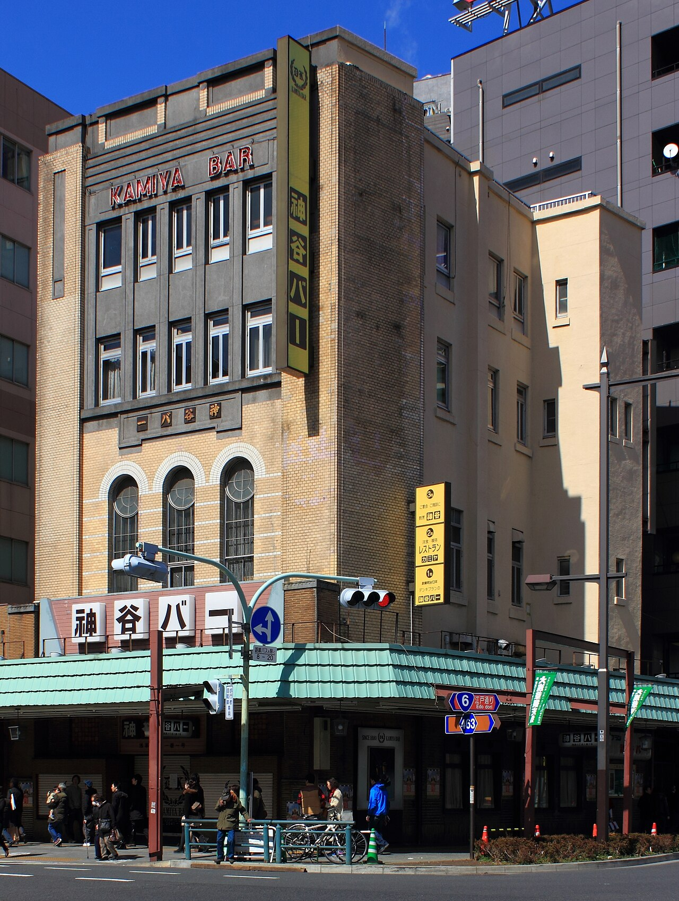

# Kamiya Bar

On Kaminarimon-dori in Asakusa stands an old building with a red-brick facade and a white sign reading "Kamiya Bar" and "Founded Meiji 13". This is Kamiya Bar, Asakusa's best-known old bar and one of Japan's earliest Western-style bars. It is not a quiet, expensive Ginza cocktail bar; it puts a glass of Denki Bran, a few plates of snacks, the noise of everyday Asakusa and more than 140 years of history in the same room.

Figure: Kamiya Bar in Asakusa, Tokyo. Image: Kakidai, CC BY-SA 3.0, via Wikimedia Commons ([source page](https://commons.wikimedia.org/wiki/File:Kamiya_bar_at_Asakusa_Tokyo.JPG)).

## Setting and history

The founder was Denbei Kamiya. In April 1880 he opened Mikawaya Meishuten at 4 Hanakawado-machi in Asakusa and began selling sake by the glass. In 1881 he started selling imported wine, and in 1882 he began making and selling "quick brandy", the ancestor of Denki Bran. On 10 April 1912 the shop was remodelled in Western style and renamed Kamiya Bar. In 1921 the Kamiya Building, still in use today, was completed. On 28 October 2011 the main hall was registered as a tangible cultural property of Japan.

The claim "Japan's first bar" needs a qualifier. It means one of the earliest Western-style bars in Japan that still operates, not "the first place in Japan to sell alcohol". The official English page says "Japan's first bar", which is the house's own positioning. From a historical point of view, "a pioneer of the modern Japanese bar" is more precise. Treat "first" as a marketing phrase while acknowledging its place in Japanese bar history.

Denki Bran is the core. It began with a brandy base, combined with gin, wine, curaçao and selected herbs; the recipe remains secret. The original strength was about 45%; the current regular version is 30%, and Denki Bran "Old" is 40%. The "denki" (electric) in the name comes from the Meiji-era fascination with electricity: modern, advanced things were often prefixed with "electric". "Bran" is short for brandy. It is sweet, warm and aromatic, an "old Tokyo" after-dinner drink rather than a fresh modern cocktail.

Kamiya Bar also has a literary record. Hagiwara Sakutarō's poem "At Kamiya Bar" describes a man drinking alone; Nagai Kafū, Kawabata Yasunari and Miura Tetsuo wrote about Asakusa, and Kamiya Bar appears in works such as The River Shinobu. It is not a "literary café" but a "literary bar": writers and ordinary citizens share the same table and the same glass of Denki Bran.

## The rooms and the drinks

The Kamiya Building has three floors with distinct functions. The first floor is Kamiya Bar: buy a ticket at the entrance or the ticket machine, hand it to the staff and receive the drink or food. There are tables and a counter, all seats are non-smoking, and there is a separate smoking room. The second floor is Restaurant Kamiya, serving Western dishes, hamburger steak, steak, omurice, desserts and coffee, suited to families and groups. The third floor is a kappo restaurant that opened in 1970, serving Japanese cuisine. The shop on the Kaminarimon side sells Denki Bran, Kamiya wine and original goods; its hours differ from the bar's.

The first-floor drinks list revolves around Denki Bran: regular and Old Denki Bran, draft beer, wine, sake, shochu, soft drinks and snacks. Denki Bran usually comes in a small glass and is finished in one or two sips; you can also ask for it with beer or ice. Draft beer is the usual after-work choice in Asakusa. Snacks include edamame, pickles, fried items, oden-style small dishes and Western-style bites; the menu is not complicated.

The second-floor menu is fuller: hamburger steak, steak, fried shrimp, omurice, curry, salad, cakes and ice cream. Prices are higher than the first floor but still "Asakusa Western food" range. For a proper sit-down meal, go upstairs; for a quick glass in a crowd, stay on the first floor. The third-floor kappo requires a reservation and suits guests who want Japanese cuisine.

## What to order on a first visit

On a first visit, go straight to the first floor and buy a ticket at the entrance. You do not need Japanese: point to "デンキブラン" (Denki Bran) on the menu and say "one", or point to "Old". Hand the ticket to the staff and the drink arrives. To taste it, start with the regular 30% version in the small glass; if it is too sweet, order a draft beer or sparkling water. For food, choose edamame, pickles or a fried item; do not order a large meal, because the first-floor space is not built for dinner.

Timing: the bar opens at 11:00; early afternoon is quiet and good for photographs and a slow drink. After work and at weekends it is loud, with locals and tourists mixed together. Last order is 19:30 and the bar closes at 20:00. It is closed on Tuesdays and on two Mondays each month, so check the official calendar. For quiet conversation, go to the second floor; for "everyday Asakusa", stay on the first.

Payment: the first floor uses tickets, and the exact cash/card arrangement depends on the counter; the official notice says cards are accepted except on the first floor, so bring cash for the bar. The second floor accepts cards but not debit cards. Denki Bran is inexpensive, an "everyday glass" rather than a luxury cocktail; do not expect a bartender's performance.

## Practical information

**Address**: 1-1-1 Asakusa, Taito-ku, Tokyo 111-0032, Japan. Facing Kaminarimon-dori near Asakusa Station. Look for the red-brick facade, the white "Kamiya Bar" sign and the "Founded Meiji 13" lettering.

**Transport**: Tokyo Metro Ginza Line to Asakusa, exit 3, then 1–2 minutes on foot; Toei Asakusa Line to Asakusa, exit A5, then 1–2 minutes; Tobu Skytree Line to Asakusa, main exit, then 1–2 minutes; Tsukuba Express to Asakusa, exit A1, then about 10 minutes. The station area is busy, so pushchairs should move slowly.

**Opening hours**: 11:00–20:00, last order 19:30; closed on Tuesdays and on two Mondays each month; the shop is open 10:00–19:00 and closed on Tuesdays. Holidays and Asakusa events may alter this; check the official calendar. `operating_status` is `verified`, meaning the official site still showed the bar as trading on 20 November 2026; this does not guarantee that it opens every day. Telephone 03-3841-5400.

**Reservations**: The first floor does not take reservations and works walk-in with tickets; the second-floor restaurant can be consulted by telephone for groups; the third-floor kappo requires booking. There is no dress code; everyday clothes are fine. The first floor is narrow and large luggage is awkward.

**Prices**: First-floor Denki Bran and snacks are everyday prices; the second-floor Western restaurant is around JPY 1,500–3,000 per person; the third-floor kappo is higher. Check the menu. Bring cash for the first floor; cards work upstairs.

Page verified 20 November 2026; opening hours, prices and closed days are subject to official channels.

## Etiquette and common mistakes

First, do not turn "Japan's first bar" into "Japan's first tavern". Kamiya Bar is a pioneer of the modern Western-style bar, not the starting point of every drinking place. Second, do not expect to sit down and order on the first floor. It is a ticket system: buy first, then exchange the ticket for the drink. Third, do not occupy a small first-floor table with a large meal; the first floor is for snacks, and proper meals belong upstairs.

Three more mistakes are common. One is treating Denki Bran as an ordinary sweet wine; it is 30% alcohol, and Old is 40%, so it goes to the head quickly and should be sipped. Another is assuming it opens every day; it closes on Tuesdays and two Mondays a month. The third is assuming the Kamiya Building is the 1880 original; the main building dates from 1921 and was registered in 2011, while 1880 is the founding year.

Kamiya Bar is not right for someone looking for a quiet, refined cocktail, someone who does not drink and only wants a meal (the second floor is the answer), or anyone with large luggage or a pushchair. It suits a glass during an Asakusa walk, and anyone interested in the history of the modern Japanese bar.

## Nearby and routes

Kamiya Bar is at 1-1-1 Asakusa. North are Kaminarimon and Sensō-ji; south are Azumabashi and the Sumida River; east are Hanayashiki and Asakusa's Rokku entertainment district. Put the bar on a "Kaminarimon–Sensō-ji–Nakamise–Kamiya Bar" walk: the temple in the morning, tempura or soba at midday, a glass of Denki Bran in the afternoon, the Sumida River at dusk. About 30 minutes on foot, with no transport needed.

For a "Tokyo bar" theme, add Star Bar in Ginza or a modern cocktail bar in Shinjuku. Kamiya is a "mass bar"; Star Bar is "refined cocktail". The comparison is useful. Do not treat Kamiya as a lesson in mixing technique; it sells history, price and Asakusa atmosphere.

Asakusa is extremely crowded at weekends and on holidays, and people queue for photographs at Kaminarimon; do not block the bar entrance. If a group has booked the bar or a film crew is working, the first floor may be adjusted; come back another day.

## See also

- [Star Bar Ginza](ref:star-bar): a classic Ginza cocktail bar, a useful contrast with Kamiya's mass-bar tradition.
- [Brandy](ref:brandy): the base of Denki Bran, and its raw materials and style.
- [Liqueur](ref:liqueur): the curaçao and herbal blends in Denki Bran belong to this broad family.
- [Pubs and the city](ref:pub-and-city): how bars use price, seating and opening hours to organise night life.
- [Café Central](ref:cafe-central): a Viennese literary café, another version of the "writers' regulars" tradition.

For Kamiya Bar, begin with the address, then the current opening status, and finish with what the place is known for; that order keeps the account grounded.