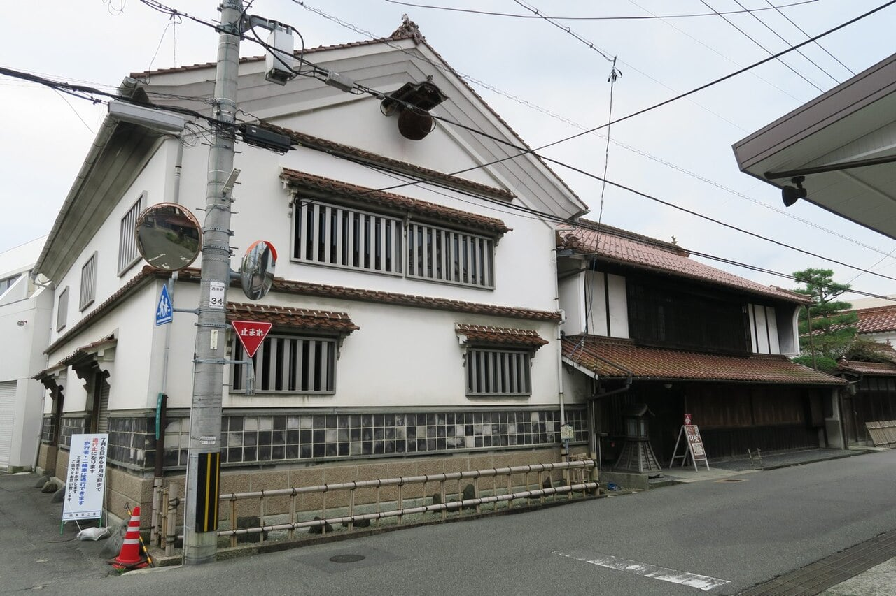

# Kamoizumi Sake Brewery

Kamoizumi stands at 2-4 Saijo Kamiiichi-machi in Higashihiroshima, Hiroshima Prefecture, [Japan](ref:japan), and is the brewery on Sakagura-dori that puts junmai sake at the centre of its range. Visitors enter through the Enju warehouse inside the brewery: on weekdays a booked visit combines a film, a walk through the hall, a talk and a tasting, arranged around the time the guest has; at weekends and on holidays the nearby Shusenkan cafe takes over, keeping more than twenty Kamoizumi sakes open for small-glass comparisons before you buy. One warning comes first: the official site currently says tour bookings are suspended, with no restart date, so call before travelling.

Figure: The main building of Kamoizumi Shuzo, with white plaster walls and dark timber lattice windows. Image: Lumi iori, CC BY-SA 4.0, via [source page](https://commons.wikimedia.org/wiki/File:Kamoizumi_shuzou.jpg).

## The Enju warehouse and the Kamiiichi-machi buildings

Sakagura-dori is stitched together from several old streets, and Kamoizumi sits on the Kamiiichi-machi side. There is no large visitor centre and no single ticket desk. The Enju warehouse is the building that actually receives visitors, with white walls, timber framing and an old internal route: a small room for the introductory film, then the working brewery. That scale sets the format. Only a limited number can enter at once, groups are split, parties of forty or more are refused, and there is no space for large coaches.

Put Kamoizumi back into the district and the industrial structure becomes clearer. Seven breweries each have a main product and a favourite process, yet share one body of spring water, one pool of rice suppliers and one street to the station. Kamoizumi's identity comes from the word junmai. It has long placed sake made without added brewer's alcohol at the centre of the range rather than as a footnote to daiginjo. That choice puts more weight on rice and water, and makes the raw-material differences in [sake](ref:sake) easier to taste.

## The junmai route

The official product page describes the flagship as a junmai daiginjo made from 100% Hiroshima-grown [sake rice](ref:rice), Yamada Nishiki and brewed with Saijo spring water, stressing gentle aroma, transparent rice sweetness and fresh acidity. The point is not the word junmai by itself but the constraint it imposes. Junmai may use only rice, rice koji and water, with no added brewer's alcohol. Junmai ginjo must polish rice to 60% or less, junmai daiginjo to 50% or less, while junmai has no polishing ceiling but must still meet aroma and colour standards.

Lower polishing ratios strip more of the outer grain, giving a cleaner aroma and a lighter body. Tasted side by side, junmai daiginjo and junmai ginjo usually differ less in rank than in how outward the aroma is, how thick the rice umami feels and how quickly the finish closes. For everyday food, the acidity and rice flavour of junmai ginjo often last longer; for a gift or a solo glass, the clarity of junmai daiginjo is easier to notice. Move further into tradition and a [kimoto or yamahai](ref:kimoto) starter brings higher acidity and a longer fermentation, a different route from fast modern starters.

## Shusenkan: compare before you buy

Shusenkan is Kamoizumi's permanent window on Sakagura-dori, closer to a sake cafe than a shop. It keeps more than twenty Kamoizumi sakes available, sold in small glasses for comparison; non-drinkers can have sake buns, sake fruit cake, or coffee and matcha made with brewing water. A sake library upstairs holds Japanese sake and drinks books, and the shop next door sells the full range plus Shusenkan-only bottles.

The hours are specific: Saturdays, Sundays and public holidays, 10:00–17:00, closed around Obon and the New Year holidays. That fits the gap in the brewery's weekday visits. Weekday hall tours need a booking; weekend comparisons belong to Shusenkan. If you only want to buy, shop and tasting are in one building. If you want a reference point, start with a junmai ginjo, a junmai daiginjo and one seasonal sake, then decide which bottle travels with you.

## The visit and the booking notice

The Enju visit is split into segments: a brewery film of about twenty-five minutes, an indoor introduction of about ten minutes, a brewing-hall walk of about thirty minutes, a talk on sake and the brewery of ten to fifteen minutes, a tasting of ten to fifteen minutes, and time to buy souvenirs. Slots run on weekdays from 8:30–12:00 and 13:30–16:00, with weekends and holidays generally refused. Book at least one week before the visit. The ceiling is forty people, and parties of twenty or more may be split in two. Drivers are told at booking that they cannot taste.

A notice at the top of the tour page says that, in light of the pandemic, bookings for brewery visits are currently suspended and that a restart will be announced on the site. That notice matters more than any guide. Even if an old article says bookings are open, treat the official page as current. Before travelling, call the main number to ask whether the day is open, whether tasting is possible and how long to allow; if tours are still suspended, put the focus on Shusenkan and save the hall for another trip.

## Visiting notes and the neighbourhood

The address is 2-4 Saijo Kamiiichi-machi; from JR Saijo Station, walk into Sakagura-dori and follow the street signs. Ordinary cars can park nearby, but there is no dedicated coach bay. Take coordinates from official channels; this page gives none. Wear flat shoes, because the floor can be wet, and ask about the route before bringing small children or a pushchair: not every stretch around the fermentation and equipment areas is suitable for stopping.

To set two versions of the junmai story side by side, the [Hakushika Sake Museum](ref:hakushika) in Nishinomiya offers a different sample: a museum and archive first, with a visit closer to a gallery. Kamoizumi is a working brewery plus a weekend cafe. Both reward a slow visit, but only at Kamoizumi can you compare several glasses and then walk back to the brewery gate in a few steps. Kamotsuru's No. 1 Brewery and other permanent tasting stops are also near Saijo Station, so half a day can hold two or three addresses.

**At a glance:** A brewery at 2-4 Saijo Kamiiichi-machi in Higashihiroshima, Hiroshima Prefecture, entered through the Enju warehouse, where weekday tours cover film, hall, talk and tasting; its Shusenkan cafe opens at weekends with more than twenty Kamoizumi sakes to compare. The official site currently says tour bookings are suspended, so call before travelling.

## References

- [The brewery](https://kamoizumi.co.jp/kura/index.html), Kamoizumi Sake Brewery, checked for the address, visit format, slots and suspension notice.
- [The sake](https://kamoizumi.co.jp/sake/index.php), Kamoizumi Sake Brewery, checked for the 100% Yamada Nishiki and junmai daiginjo wording.
- [Shusenkan](https://www.kamoizumi.co.jp/syusenkan/index.php), Kamoizumi Sake Brewery, checked for the more than twenty sakes and weekend hours.
- [Classification of Japanese sake](https://japansake.or.jp/sake/about-sake/classification-of-sake/), Japan Sake and Shochu Makers Association, checked for junmai and ginjo labelling rules.
- [The Saijo sake town, Hiroshima](http://www.saijosake.com/japanese/town/), Saijo Sake Brewers Association, checked for the position on Sakagura-dori.

Page verified on 2026-11-09; tour bookings and Shusenkan hours are subject to official channels.
