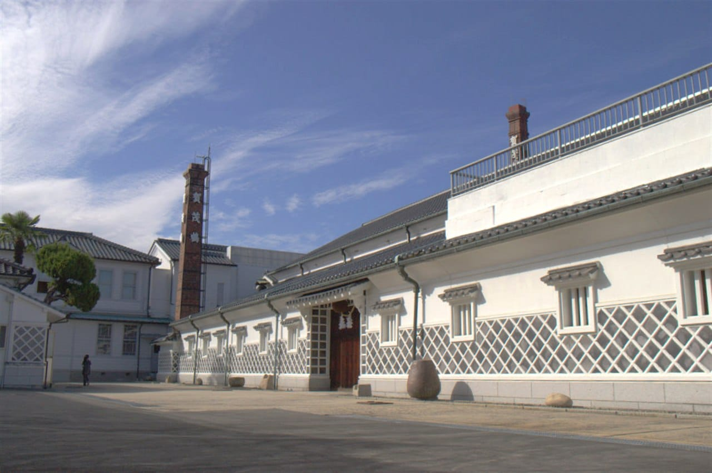

# Kamotsuru Sake Brewery

Kamotsuru is one of the breweries of Saijo in Higashihiroshima, Hiroshima Prefecture, [Japan](ref:japan), and visitors enter through the No. 1 Brewery shop at 9-7 Saijo Honmachi, about three minutes on foot from JR Saijo Station. It is often mistaken for a static museum, but the site is still a working brewery: the No. 1 Brewery occupies a warehouse built in 1872, reopened in 2019 as an exhibition room and shop, and in February 2024 was listed as a national historic site as part of the Saijo Sake Brewery Group. The working brewery stands nearby, normally closed to the public and reachable only on irregular booked tours.

Figure: Related photograph of Kamotsuru Sake Brewery. Image: OS6, CC BY-SA 3.0, via Wikimedia Commons ([source page](https://commons.wikimedia.org/wiki/File:Kamotsuru_Sake_Brewing.jpg)).

## An industrial cluster on Sakagura-dori

Sakagura-dori is not a planned pedestrian street. It is the result of seven brewing companies setting up plants within about 1.5 km of one another. Sea-cucumber walls, red-brick chimneys and red-tiled roofs run together, and you can walk from one gate to the next in a few minutes. That density, with the brewery itself forming the neighbourhood, is the first difference between Saijo and the older sake districts of Fushimi and Nada. In 2017 the Saijo brewing buildings were selected by ICOMOS for its list of twenty Japanese 20th-century heritage sites; in 2024 the No. 1 Brewery and others were listed as a national historic site under the name Saijo Sake Brewery Group. Here the buildings are not fenced-off exhibits but working halls, warehouses and shops.

For a visitor, the street lets you set your own pace. Look at the displays in the morning, taste after lunch, and eat around the station in between, without depending on thin rural buses. The risk is remembering only that the old buildings look good and missing the technical choices made by each brewery. The legal definition of [sake](ref:sake) and the winter production window are shared; rice, yeast, starter culture and polishing ratio are not.

## What the No. 1 Brewery shows

The route inside is short. The exhibition area is self-guided and takes about fifteen minutes, with brewing tools, documents and a looped film in Japanese with English subtitles; QR codes on the panels give French, Chinese and Korean explanations. Beyond that is a paid tasting bar that takes cash only, with common sets of three 30 ml glasses for 500 yen or four 30 ml glasses for 500 yen, the list changing with the season and stock. The shop sells brewery-only and seasonal sake, plum sweets and cloths, and can arrange local delivery.

The visit and the tour are two different things. The No. 1 Brewery is open for self-guided entry and needs no booking; only groups of twenty or more must give advance notice, and staff may adjust the arrival slot. Entering the brewing hall is another matter. Tours run irregularly, require a booking, cost 2000 yen per person and last about an hour, led by the head brewer; after a film the group walks the hall, with no tasting, and each guest leaves with a 180 ml bottle of daiginjo.

## Kamotsuru's sake and the label rules

The range covers daiginjo, junmai ginjo, honjozo and ordinary sake. Read the label in three steps. Ginjo and junmai ginjo both require a rice-polishing ratio of 60% or less; daiginjo and junmai daiginjo require 50% or less. Junmai ginjo may use only rice, rice koji and water, while ginjo allows a small addition of brewer's alcohol. Honjozo requires 70% or less, and junmai has no polishing ceiling but still forbids added alcohol. These conditions tell you more about a bottle than a brand name.

Kamotsuru works mainly with Yamada Nishiki and Hiroshima-grown [sake rice](ref:rice). The fruit and clarity of its daiginjo come from cool, slow fermentation at a high polishing ratio, while the junmai ginjo leans on rice umami and balanced acidity. A higher polishing ratio is not automatically better: more polishing gives a cleaner aroma but puts more pressure on the raw rice and on pasteurisation. For everyday meals, junmai ginjo or honjozo often holds up better than daiginjo.

## Soft water, Yamada Nishiki and winter brewing

Saijo's brewing water is drawn from the foothills of the Kamo range. It is clear and on the soft side, which suits slow fermentation and gives a gentle body with a clean finish. Local breweries still keep the habit of drawing from wells, with the source only a few lanes from the street. Soft water means fewer off-flavours and a rounder texture, but fermentation depends more on temperature and yeast health than it would with harder water, which builds a heavier frame more easily. Yamada Nishiki, a large-grained rice with a visible white core, is a common choice for ginjo-style sake; Hiroshima is itself an important producing prefecture, and breweries often print "prefecture-grown rice" on the label.

Brewing is concentrated in winter. Rice is polished and koji made in autumn; as winter arrives, [kimoto and yamahai](ref:kimoto) or other starter methods begin, with low temperatures limiting wild microbes and keeping fermentation controllable. Pressing, pasteurisation and bottling follow in spring, and the brewery rests in summer. "Winter brewing" is not a romantic phrase but the rhythm left by the era before refrigeration, and breweries still use it to schedule the head brewer and the crew.

## The brewing-warehouse tour and kurabiraki

The brewing-hall tour is announced irregularly by the brewery, usually meeting at the No. 1 Brewery. After a film, the head brewer explains raw materials, koji, starter, mash and pressing, then walks the working hall. Places and dates are set by the official site; when booking, confirm whether tasting is included, whether sturdy shoes are needed and whether photography is allowed. The production area has steam, wet floors and running machinery, so do not cross yellow lines or touch valves.

The other event is kurabiraki, the opening of the brewery. Kamotsuru announced its 2026 opening for 18 April 2026, 10:00–16:00, at the main brewery at 4-31 Saijo Honmachi, with free entry and no booking, limited sake and lucky bags on sale, and parts of the hall open to visitors. Dates and contents change each year and may move for rain or maintenance, so check the official notice before travelling. Crowds concentrate on that day, parking near the station tightens, and the train is easier than driving.

## Visiting notes and the neighbourhood

Keep the two addresses apart: the visitor entrance and No. 1 Brewery are at 9-7 Saijo Honmachi; the main brewery and some events are at 4-31 Saijo Honmachi. Navigate to the first, not the second. The No. 1 Brewery opens 10:00–18:00 with last entry at 17:45, and may close temporarily around Obon, the New Year holidays and before the sake festival. Admission is free and the tasting bar takes cash only. Take coordinates from official channels; this entry gives none.

The site is about twenty minutes by car from Hiroshima Airport and three minutes on foot from JR Saijo Station. There is municipal parking near the station, while large coaches must use the municipal coach lot. To set a brewery visit against a working plant, the [Gekkeikan Okura Sake Museum](ref:gekkeikan) in Fushimi, Kyoto, makes a useful contrast: one is a district still producing sake, the other a museum-led experience with a different route and story. Saijo also has permanent tasting stops such as Kamoizumi's Shusenkan, so half a day to a full day both work.

[Sake](ref:sake) and [Kimoto and yamahai](ref:kimoto) are the nearest useful comparisons: one clarifies address and space, the other tests operating status.

## References

- [No. 1 Brewery (brewery shop)](https://www.kamotsuru.jp/tour/), Kamotsuru Sake Brewing Co., Ltd., checked for the address, hours and tour fee.
- [Sake brewery experience tours](https://www.kamotsuru.jp/taiken/), Kamotsuru Sake Brewing Co., Ltd., checked for the seven Saijo breweries and tour information.
- [The Saijo sake town, Hiroshima](http://www.saijosake.com/japanese/town/), Saijo Sake Brewers Association, checked for brewery addresses and the street layout.
- [Sakagura-dori](https://dive-hiroshima.com/explore/1199/), Dive! Hiroshima, checked for the national historic site and 20th-century heritage wording.
- [Classification of Japanese sake](https://japansake.or.jp/sake/about-sake/classification-of-sake/), Japan Sake and Shochu Makers Association, checked for polishing ratios and ingredient rules.

Page verified on 2026-11-09; hours, tasting prices and tour arrangements are subject to official channels.
