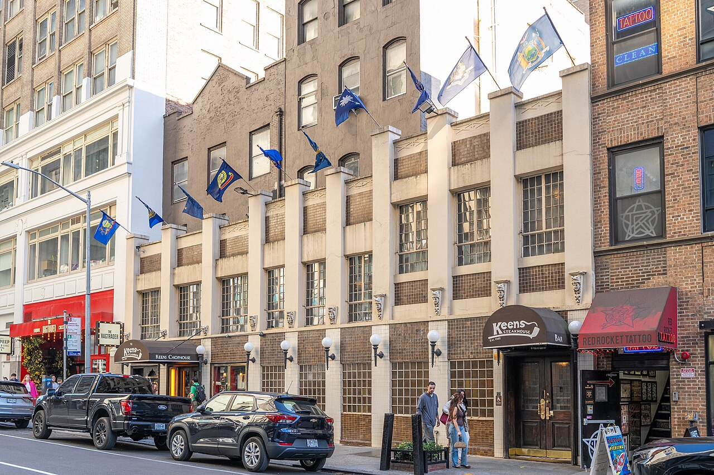
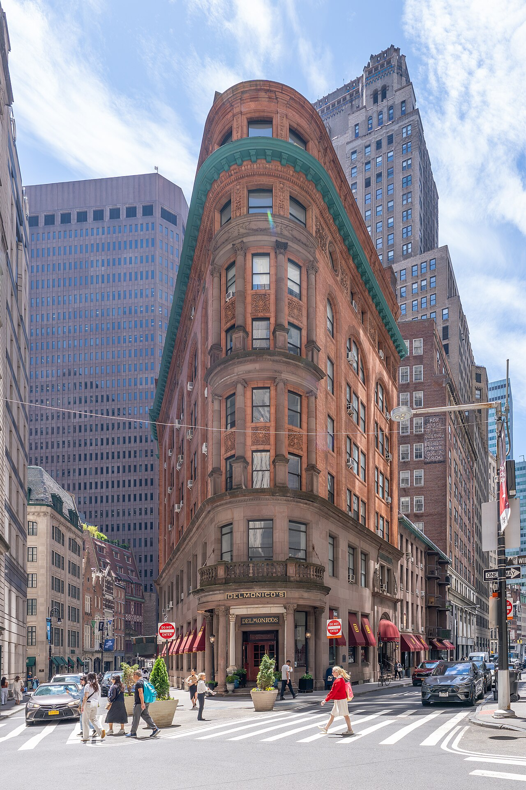

# Keens Steakhouse

On West 36th Street near Sixth Avenue, the block is a mix of garment-district buildings, convenience stores and delivery trucks. Keens Steakhouse's black awning and white "Keens Chophouse" lettering are not especially conspicuous, but once you push through the door, rows of long clay pipes overhead pull the room back into the 19th century. This is not a restaurant that manufactures atmosphere with retro fittings: the pipes, theatre posters, old menus and panelling accumulated in this building, and many of the objects are older than most New York restaurants.

Figure: The street facade and entrance of Keens Steakhouse on West 36th Street, New York; the building merges three former townhouses, with the pipe collection inside. Image: ajay_suresh, CC BY 4.0, via Wikimedia Commons ([source page](https://commons.wikimedia.org/wiki/File:Keens_Steakhouse_(54821833498).jpg)).

## Location and history

In 1885 Albert Keen opened Keens Chophouse in the Herald Square theatre district; he had previously managed the Lambs Club, which met upstairs. The Garrick Theatre stood back-to-back with the restaurant, and actors came through the rear door between acts for a "nerve steadier." The Pipe Club began with a lifetime membership of 5 dollars: members could store a clay pipe carved with their name, and the roster grew to more than 90,000 names, including Theodore Roosevelt, Babe Ruth and Buffalo Bill Cody. Thousands of churchwarden pipes still hang on the walls and ceilings. In 1905 the actress Lillie Langtry sued after being refused entry; she won and entered the restaurant to order a mutton chop. The episode is often treated as the moment Keens began opening to women. The restaurant closed in 1977 and reopened in 1981 after a restoration; in 2013 it received the James Beard Foundation's America's Classic award.

The theatre-district context matters. Herald Square in the late 19th century was a centre of New York theatres and newspapers, and Keens backed onto the Garrick Theatre, so actors came through the rear door between acts for ale or a chop. The Pipe Club worked like an early storage service: members paid 5 dollars, stored a clay pipe carved with their name, and a pipe warden recorded it while pipe boys fetched and carried. The pipes were ordered from the Netherlands, sometimes 50,000 at a time every three years. The 1905 Langtry lawsuit allowed women in, but Keens did not become a fully mixed room overnight; it opened gradually. When it closed in 1977, the New York Times wrote its obituary; in 1981 George Schwarz and Kiki Kogelnik spent three years and about 1.4 million dollars restoring and reopening it. The 2013 James Beard America's Classic award recognised not novelty cooking but continuity and local memory.

## Space and drinks

Keens occupies three merged townhouses and a series of panelled rooms: the Lincoln Room, the Bull Moose Room, the Lambs Room and others, each hung with objects linked to theatre, politics or sport. The pipes overhead are not decorative replicas but the pipes members stored, some still carrying names and dates. The signature dish is the 26-ounce "mutton chop," which today is usually lamb, although the menu and old customers still call it mutton chop. There are also dry-aged steaks, porterhouse, lamb chops, Dover sole and classic American sides. The bar serves single malts, house ale and a Bloody Mary made with balsamic vinegar, and is a good choice if you only want a drink.

## How to drink

For a full meal, book ahead and make the signature chop the centre of the order; two people sharing one 26-ounce chop with a salad or side usually works better than one each. The bar accepts walk-ins, so you can order a whisky or house ale with a bar snack and study the theatre memorabilia. Portions are large; do not force a European appetiser-main-dessert rhythm. Start with a shared chop and add dishes according to appetite. Around show times the bar is livelier than the dining rooms; for a quiet look at the walls, go on a weekday afternoon.

## Practical information

The address is 72 West 36th Street, New York, NY 10018, between Fifth and Sixth Avenues. The nearest subway is 34th Street–Herald Square (B/D/F/M/N/Q/R/W), a few minutes' walk; Times Square and Penn Station are also within walking distance. The restaurant is open year-round except Christmas Day; lunch and dinner hours differ, and the bar usually runs later than the dining room. Dress is smart casual: no jacket and tie required, but not flip-flops and tank tops either. The chop and steaks are expensive, so read the menu before ordering; the bar is cheaper.

## Etiquette and common misconceptions

First, the pipes on the walls are a historic collection, not for customers to smoke. Do not reach for them or ask to "order a pipe." Second, today's "mutton chop" is usually lamb; that is a continuation of the menu name and tradition, not a deception, and writers should say so. Third, Keens is a working restaurant and bar, not a museum; do not stand in the middle of the dining room to photograph the ceiling. Fourth, the Langtry story is often reduced to "she won her lawsuit." More accurately, she sued after being refused entry to the men-only area and won, becoming a symbolic turning point. Fifth, the 2013 James Beard award is America's Classic, not Best New Restaurant or a Michelin star.

## Surroundings and routes

From Keens, the Empire State Building is two blocks north, Bryant Park and the New York Public Library are east, and the edge of the theatre district is south at 34th Street. In [the New York historic pub route](ref:ny-route), Keens works better as a meal-and-bar finish than a quick drink stop. To compare two different historic New York dining spaces, read [Delmonico's](ref:delmonicos); for the difference between a chophouse and a tavern, read [A history of taverns](ref:taverns) and [A city through its pubs](ref:pub-city); for the idea of consuming time in a restaurant, see [Time in a cup](ref:time-in-cup).

## Further reading and see also

- [The New York historic pub route](ref:ny-route)
- [A history of taverns: from alehouses and inns to bars](ref:taverns)
- [A city through its pubs](ref:pub-city)
- [Delmonico's](ref:delmonicos)
- [Time in a cup](ref:time-in-cup)

**In brief:** A New York chophouse opened in 1885, known for its 26-ounce mutton chop, thousands of clay pipes and Herald Square theatre memories, and a 2013 James Beard America's Classic award.

For Keens Steakhouse, begin with the address. Then look at the current opening status, and finally ask what the place is known for. The answers point to different choices, not to a single score.

Read [New York historic pubs: East Village to Gramercy](ref:ny-route) for the address and space side of Keens Steakhouse, and [Reading a city through its bars](ref:pub-city) for the operating status side. Together they locate it.

Checked on 2026-11-21 against the Keens Steakhouse official page. The restaurant opens year-round except Christmas; lunch, dinner and bar hours differ, and mutton chop and steak prices change, so confirm before booking. The pipe wall is a members' collection, today's mutton chop is usually lamb, and the Lillie Langtry lawsuit and the 2013 James Beard "America's Classic" award are qualified in the body. The image shows the street facade and entrance, not the pipe wall or interior.

**Key facts.**

| Item | Detail |
| --- | --- |
| In one line | A New York chophouse opened in 1885, known for its 26-ounce mutton chop, thousands of clay pipes and Herald Square theatre memories, and a 2013 James Beard America's Classic award. |
| Address | 72 West 36th Street, New York, NY 10018, USA |
| City and country | New York / United States |
| Status | verified open |
| Official site | keens.com |

**Sources and limits.** The key claims about Keens Steakhouse are checked against the following sources: Keens Steakhouse, James Beard Foundation, Tasting Table. For current products, addresses or opening status, use keens.com. Prices, batches and status change; the body is project-written and does not reproduce source text.

## Related images

Image: The curved corner portico of Delmonico's at 56 Beaver Street; the present building was designed by James Brown Lord and built in 1890–91, not in 1837. Credit: Ajay Suresh, CC BY 4.0, via Wikimedia Commons ([source page](https://commons.wikimedia.org/wiki/File:Delmonico%27s_-_56_Beaver_Street_(55312935822).jpg)). Related image for Keens Steakhouse.
