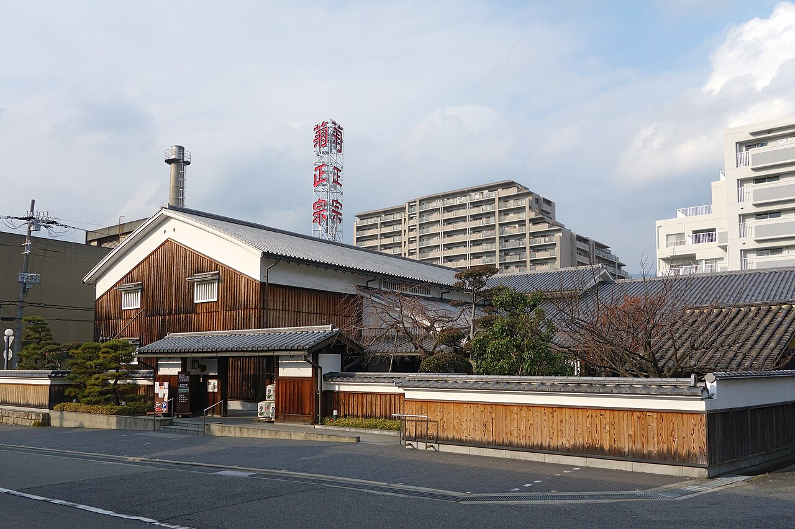

# Kiku-Masamune Sake Brewery Museum

From Hanshin Uozaki Station, follow the Sumiyoshi River promenade south and the white walls and dark wooden lattice windows of the sake breweries gradually appear. Kiku-Masamune’s museum sits beside the Uozaki-nishimachi production site. It is free, but it is not a corporate exhibition hall full of trophies and advertising: it lays out the tools, yeast, barrels, rice and water of Nada sake in layers, so you can see the physical work behind a glass of dry sake.

Figure: The main building of the Kiku-Masamune Sake Brewery Museum; the brewery building from the 1659 Mikage Kanaya residence was moved here in 1960. Image: Oilstreet, CC BY 2.5, via Wikimedia Commons ([source page](https://commons.wikimedia.org/wiki/File:Kikumasamune_Kobe_Japan01-r.jpg)).

## Location and history

The official “about” page tells the story clearly: the predecessor was a brewery built in 1659 (Manji 2) inside the Hon-Kano family residence in Mikage, Kobe. In 1960 (Showa 35) it was relocated to the present site, preserved as a sake museum and opened to the public. It held the nationally designated Important Tangible Folk Cultural Property “Nada sake brewing tools” and a large collection of small implements, and once welcomed about 50,000 visitors a year.

On 17 January 1995 the Great Hanshin-Awaji earthquake collapsed the old museum. Fortunately, most of the brewing tools and small objects were dug out by hand from the rubble, almost intact or repairable. After a full rebuild, the museum reopened on 25 January 1999: two storeys above ground, fire- and earthquake-resistant, about 1,400 square metres of total floor area (including the existing reference room), with traditional roof tiles and charred cedar cladding on the walls and corner walls. Some of the old pillars and beams, made from trees over 400 years old, were reused inside. Today it receives more than 100,000 visitors a year.

## Architecture and space

The new building is not the old brewery moved intact; it is rebuilt in the grammar of a brewery: white walls, dark charred cedar, traditional tiles, a low entrance and a high interior ceiling, creating a transition from street to storehouse. The two floors are not large, but the route is clear: the ground floor emphasises process and tools, the upper floor the water, rice, climate and culture of Nada. The old pillars and beams are left visible in the structure, a reminder that this museum grew out of a ruin, not a new build.

Lighting is warm, mixing cases and open displays. Barrels, yeast tanks, presses, koji boxes, measures and sake vessels are arranged by process, some close enough to see the grain and wear; life-size figures and reconstructed scenes fix the motions of steaming rice, making koji, preparing the yeast, brewing, pressing and storing. The space does not chase immersive projection tricks; it lets the tools speak. For visitors new to sake, read the process first, then go upstairs for the terroir—it makes “why Nada sake is dry” easier to understand.

## The displays and collection

The theme is “knowing the origin of sake brewing.” The official summary lists the brewing process and tools, Nada’s technique, water, rice and climate, the passion and tradition of brewing, and new ways to enjoy sake and its culture. In other words, it is not only about one brand; it treats the Nada sake system as the subject. Nada, in eastern Kobe, is known for “Miyamizu” water and hard water, high-quality Yamadanishiki rice, cold winters and sea breezes; Kiku-Masamune is known for the kimoto (生もと) yeast method, where the acidity and lactic acid bacteria management are central to the dry profile.

Key exhibits include the nationally designated “Nada sake brewing tools” and small implements: wooden barrels, yeast tanks, koji lids, pressing vats, filter cloths, measures, sake vessels and carrying tools. They are not decorative antiques; each can be mapped to a step in the process. There are also cup and vessel displays and content on new ways to enjoy sake. Ground floor first, upper floor second, gives a chain of “tools—process—terroir—culture.”

## How to visit

The museum itself is free. One to ten visitors are treated as a small group and need no booking; 10–40 must apply online for a date and time; 40+ must call the museum counter. Hours are 9:30–16:30. From April 2026 the museum closes on Tuesdays; if Tuesday is a holiday it opens and Wednesday closes; if both Tuesday and Wednesday fall in a holiday week it stays open; year-end and New Year have separate closures. Check the official 2026 calendar before travelling.

To see the Taru Sake Meister Factory and cup museum, apply at the museum. The Taru workshop is not a museum but a craft workshop showing Yoshino cedar coopering and taru sake brewing. From April 2026 tours run at 10:30, 13:30 and 14:30, maximum 15 people, book two days ahead on the official reservation page, about 30 minutes, free. Preschool children are not admitted; anyone unwell or drunk is refused; pets are not allowed (guide dogs excepted); there is no toilet in the workshop, so use the museum first; do not bring food or drinks inside, touch exhibits or enter the coopering area.

## Practical information

- Address: 1-9-1 Uozaki-nishimachi, Higashinada-ku, Kobe, Hyogo 658-0026.
- Coordinates: 34.7086206, 135.2679126.
- Phone: 078-854-1029; fax 078-854-1028; email kinenkan@kikumasamune.co.jp.
- Hours: 9:30–16:30; from April 2026 closed Tuesday, Wednesday instead if Tuesday is a holiday; year-end and New Year closures.
- Admission: free.
- Booking: 1–10 no booking; 10–40 online; 40+ by phone.
- Transport: JR Sumiyoshi Station, change to the Rokko Line to Minami-Uozaki (about 4 minutes), then about 2 minutes northwest on foot; Hanshin Uozaki Station, about 10 minutes south along the Sumiyoshi River promenade.
- Time: about 60–90 minutes for the museum; add 30 minutes for the Taru workshop, with a separate booking.
- Accessibility: stairs inside; call ahead to confirm wheelchair access; the workshop route crosses a road, so watch for cars and bicycles.

## Etiquette and common misconceptions

First, do not treat the museum as a “factory tour.” It displays tools, history and terroir, not a filling line; for production visits, check Kiku-Masamune’s separate factory tour arrangements. Second, do not assume “free” means you can photograph or touch anything; follow the signs and do not handle barrels, vessels or tools. Third, do not bring food or drinks into the galleries or take loud phone calls; it is a museum, not a restaurant. Fourth, do not treat the Taru workshop as a drop-in extra; it is capped at 15 people, requires booking two days ahead, and excludes preschool children. Fifth, do not wear heels or hard-to-walk shoes; the museum stairs and the workshop route involve walking. Sixth, do not read “closed Tuesday” as fixed all year; holiday weeks are exceptions, so check the official calendar.

## Nearby and routes

From the museum, walk through the Uozaki and Sumiyoshi brewery streets to the [Hakutsuru Sake Brewery Museum](ref:hakushika) for another large company’s “main brewery No. 1” and life-size figures; or fit the stop into a “Nada five villages” sake line: Kiku-Masamune in Uozaki, Hakutsuru in Sumiyoshi, Hakushika in Nishinomiya, the [Gekkeikan Okura Sake Museum](ref:gekkeikan) in Fushimi, Kyoto, and further to [Kamotsuru](ref:kamotsuru) in Sakata and [Kamoizumi](ref:kamoizumi) in Hiroshima. For Kobe only, use the [Japan sake brewery route](ref:route) framework to link Uozaki and Sumiyoshi in a half-day walk.

Eastern Kobe is not car-friendly for brewery hopping; the Hanshin and Rokko lines are easier. The museum and Hakutsuru are about 20–30 minutes apart on foot, through the Sumiyoshi River and residential streets; carry water in summer and prepare for cold sea wind in winter. If you have time for only one, choose Kiku-Masamune for “tools and yeast,” Hakutsuru for “building and figures”; they do not repeat each other.

## Further reading and see also

- Official Chinese access page: <https://www.kikumasamune.co.jp/kinenkan/zh-cn/access.html>, for the address, phone, hours, booking rules, Tuesday closure and transport.
- Official “about” page: <https://www.kikumasamune.co.jp/kinenkan/about.html>, for the 1659 brewery, 1960 relocation, 1995 earthquake, 1999 reopening, building data and exhibition theme.
- Museum homepage: <https://www.kikumasamune.co.jp/kinenkan/>, for “since Manji 2 (1659), more than 360 years,” kimoto and overall positioning.
- Taru Sake Meister Factory Chinese page: <https://www.kikumasamune.co.jp/tarusake-mf/zh-cn.html>, for the workshop’s nature, Yoshino cedar coopering, tour times, capacity, booking and safety rules.
- Sake route comparisons: [Hakutsuru Sake Brewery Museum](ref:hakushika), [Gekkeikan Okura Sake Museum](ref:gekkeikan), [Kamotsuru](ref:kamotsuru), [Kamoizumi](ref:kamoizumi), [Japan sake brewery route](ref:route).
