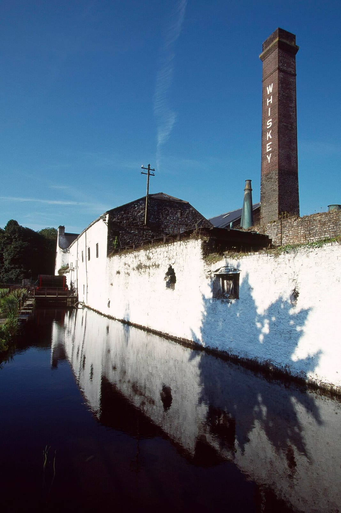

# Kilbeggan Distillery

Kilbeggan sits in a small town in County Westmeath in [Ireland](ref:ireland)'s midlands, with Lower Main Street running past the door. The brick chimney is a local landmark; the waterwheel, old mill and warehouses are still in place. In 1757 Matthias McManus obtained a distilling licence here, and the site was first called Brusna Distillery. It survived fire, closure and a community rescue, resumed distillation in 2007, and is now run within Beam Suntory's Cooley operation.

Figure: Kilbeggan Distillery. Image: Whisky lover, Public domain, via Wikimedia Commons ([source page](https://commons.wikimedia.org/wiki/File:Old_Kilbeggan_Distillery_-_Low_Res.jpg)).

## A town distillery with a chimney for a landmark

Kilbeggan is not a fenced-off heritage park with a ticket booth: the visitor centre, bar and shop occupy old buildings, and production still happens on site. The waterwheel, steam engine and old pot stills are not props but part of its history. The official material says the site has the world's oldest operating pot still, in use for more than 180 years. For someone new to [Irish whiskey](ref:irish-whiskey), this feels more like a real country distillery than a Dublin brand centre: small scale, short routes, little distance between equipment and people. The River Brosna runs beside the site; the wheel it once powered is now mainly a historical witness. After a visit it is easy to walk the main street, with pubs, a church and old shopfronts.

## The 1757 licence and the limits of "oldest"

Kilbeggan describes itself as Ireland's oldest licensed distillery, based on a licence record from 1757. That claim is often misread as uninterrupted production: the distillery stopped in 1957 and did not distil again until 2007. A more accurate reading is that licensing on this site goes back to 1757, while continuous production is not the selling point. In 1843 John Locke took over. In 1878 a warehouse fire broke out and local people ran in to roll the casks into the street, saving most of the stock. In 1982 local people formed a preservation association, restored the waterwheel and buildings and opened the site as a museum. In 1987 John Teeling took over and renamed it Kilbeggan Distillery; in 2007, the 250th anniversary of the founding, distillation restarted, and restoration was completed in 2010.

## From waterwheel to old mill: the visitor route

The visit usually begins in the old part of the site, passing the waterwheel, drive shafts, milling equipment and old mash tun before moving into distillation and warehousing. The point of Kilbeggan is not modernity but that the equipment still works: a wooden waterwheel, iron pipes, an old steam engine and copper pot stills form a complete nineteenth-century production line. Guides explain the Irish [pot still](ref:pot-still) tradition: batch distillation gives the spirit long contact with copper, so new make is heavier and more oily, and single pot still whiskey also mashes malted and unmalted barley together. The warehouse section covers cask types and maturation. Watch for signs before photographing, as some production areas are off limits.

## The whiskeys: blend, single pot still and rye

Irish whiskey is legally divided into blended, single malt, single grain and single pot still, and the differences lie in raw materials and distillation rather than age. Single pot still must use pot stills and mash malted and unmalted barley together; a blend can combine pot still and grain whiskey from different distilleries.

The Kilbeggan range can be understood in three lines. The first is the blend: Kilbeggan Blended is double distilled in the traditional way, aimed at smooth, easy drinking and suited to a Highball or Irish Coffee. The second is single pot still: Kilbeggan Single Pot Still uses pot stills and a mix of malted and unmalted barley, with spice, green grass and an oily texture, and it is a good entry to the Irish style. The third is rye: Small Batch Rye was the first whiskey fully distilled and matured at Kilbeggan after the restoration was completed, with pepper and a dry finish. Triple Cask and Berry Selection sit on the easier-drinking side. Blend is not a synonym for cheap; in Ireland it is a parallel tradition.

## Choosing an experience

The Distillery Experience lasts about 90 minutes and ends with a four-whiskey masterclass, which suits a first visit. Distillers Cask Bottling lasts about 30 minutes, excludes the tour, and lets visitors fill a 70cl bottle from the cask. The Irish Coffee Masterclass lasts about 60 minutes, is for visitors aged 18 and over, and combines a walk through the old distillery with a lesson in Locke's Lounge. The Cask Selection Premium Tasting lasts about 60 minutes and draws from heritage casks, suiting people who already know the core range. The Warehouse Bar serves drams, cocktails, coffee and light food, and can be used without booking an experience. All experiences should be booked online in advance. Tasting experiences are for guests of legal drinking age, and families can choose a visit without alcohol plus soft drinks in the bar.

## Getting there from Dublin or Galway

The address is Kilbeggan Distillery, Lower Main Street, Kilbeggan, Co. Westmeath N91 W7YY. By car from Dublin or Galway, take the M6 and leave at Junction 5, then follow signs for the town centre; parking can be busy at weekends and on event days. Public transport is limited; check Bus Éireann or Local Link times for the day. Opening hours change with the season: 17 March to 31 October, daily 10:00 to 17:30; 1 November to 16 March, daily 10:00 to 15:30. Putting Kilbeggan on the same trip as [Jameson Bow Street](ref:jameson) in Dublin and [Bushmills](ref:bushmills) in Northern Ireland shows how Irish whiskey moves from city brand to country distillery, but allow at least two days for the drives. The distillery does not publish precise coordinates for citation, so use official channels for navigation.

**Short definition:** Old distillery in the town of Kilbeggan, County Westmeath, licensed in 1757 and described by its owner as Ireland's oldest licensed distillery. Production stopped in 1957, the town helped restore the site, and distillation resumed in 2007; the range includes Kilbeggan blend, single pot still and small batch rye.

A frequent error is to treat Kilbeggan Distillery as a brand or a region. Establish whether it is still open, then whether it accepts visitors. Neither answer settles the question alone.

**Key facts.**

| Item | Detail |
| --- | --- |
| In one line | Old distillery in the town of Kilbeggan, County Westmeath, licensed in 1757 and described by its owner as Ireland's oldest licensed distillery. Production stopped in 1957, the town helped restore the site, and distillati… |
| Address | Kilbeggan Distillery, Lower Main Street, Kilbeggan, Co. Westmeath N91 W7YY, Ireland |
| City and country | Kilbeggan / Ireland |
| Status | verified open |
| Official site | kilbeggandistillery.com |

**Sources and limits.** The key claims about Kilbeggan Distillery are checked against the following sources: Kilbeggan Distillery / Beam Suntory (the 1757 licence, experiences, Warehouse Bar, shop and seasonal opening hours; no text copied; the distillery name, brand and visit entry point; no text copied), Beam Suntory. For current products, addresses or opening status, use kilbeggandistillery.com. Prices, batches and status change; the body is project-written and does not reproduce source text.

## Related images

Image: Ireland. Credit: Jeff Schmaltz, Public domain, via Wikimedia Commons ([source page](https://commons.wikimedia.org/wiki/File:Ireland_(MODIS).jpg)). Related image for Kilbeggan Distillery.
