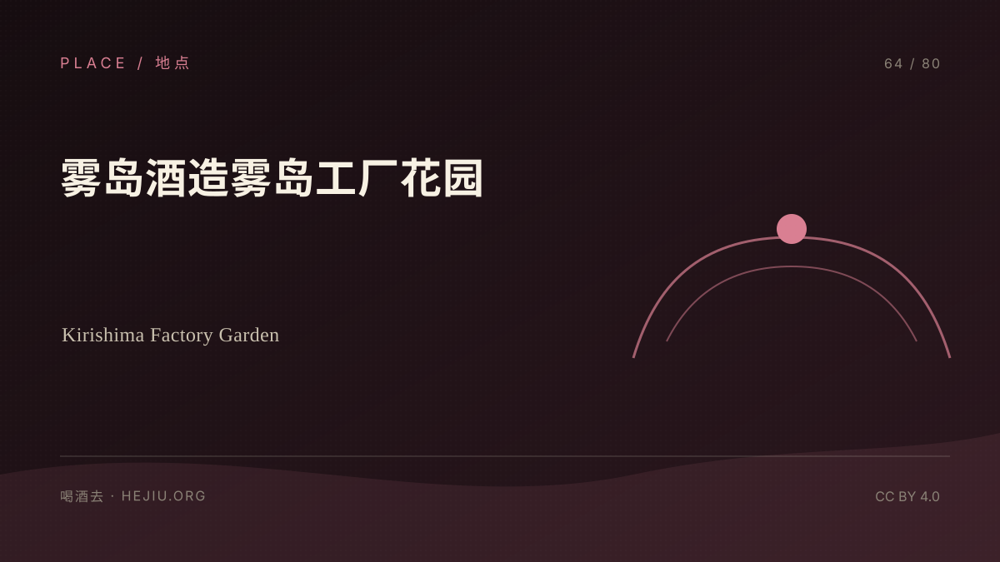

# Kirishima Factory Garden

Kirishima Factory Garden is officially Shochu-no-Sato Kirishima Factory Garden, at 5480 Shibitacho in Miyakonojo, Miyazaki Prefecture, [Japan](ref:japan). It is often mistaken for the Kirishima Shuzo head office in Kirishima, Kagoshima, but it is a separate visitor site: about ten minutes west of the head office by car, and about five minutes by car from KIRISHIMA GREENSHIP icoia on National Route 10, so navigation should use the name Kirishima Factory Garden directly. Tours, restaurants, shops and gardens share one site, with the walking factory KIRISHIMA WALK FACTORY at the centre.

Figure: Kirishima Factory Garden. Project-generated or category illustration used for Asian alcohol context; not a photograph of the subject.

## A shochu village in Miyakonojo

The site sits on one side of the Miyakonojo basin, with the Kirishima range behind it and fields and roads around it. Unlike Meijigura, where the brewery hugs the harbour, this is a designed industrial park: lawns, paths, restaurants, a bakery, a museum and shops are laid out separately, and the tour route runs from indoor exhibits into the working plant. It suits families and groups, and also people who only want a drink or a bottle without entering the factory.

The "Kirishima" in the name is a brand and a mountain range, not an administrative address. The site is in Miyakonojo, Miyazaki, and not in Kirishima, Kagoshima; coming from Kagoshima Airport or central Kagoshima means crossing a prefecture, and the drive is longer than the map suggests. Lodging in Miyakonojo or Kagoshima both work, but if Meijigura in Makurazaki is on the same day, count the mountain roads between southern Satsuma and Miyakonojo.

## The walking factory and five senses

KIRISHIMA WALK FACTORY organises the visit around sight, sound, smell, taste and touch. The route starts with sweet potatoes and raw materials and moves through koji, steaming, fermentation and distillation; walls, lighting and film turn microbes and steam into something you can feel, and some sections let you hear fermenting bubbles and steaming potatoes or smell different stages. Equipment is not fenced off at a distance; the route brings visitors close while rails and paths keep a safe gap.

Taste is the most direct part. The site offers free tastings of several Kirishima products, plus Kirishima Rekkasui water and sweet-potato samples. For non-drinkers and children, the samples and aroma experiences still work, which is why it is easier for families than a traditional brewery. Tastings are not unlimited; the staff manage cup size and timing, and anyone driving should skip them.

## Rekkasui, sweet potato and white koji

Kirishima's signature water is Kirishima Rekkasui, drawn from fissures in the Kirishima range, and the site has a spring where visitors can taste it. Water is not background here: brewing water shapes fermentation speed and the finished texture, and hardness, temperature and microbial state must stay stable. Sweet potato is the other lead, turned into something touchable through a giant installation and samples; the sweetness of steamed sweet potato is the most memorable smell of sweet-potato shochu.

Kirishima's main products rely on white koji. White koji produces citric acid strongly, suppresses wild microbes in an acidic environment, ferments reliably and gives a lighter aroma and a clean entry; black koji takes the richer route. Put white koji, sweet potato and Rekkasui together and it becomes clear why many Kyushu sweet-potato shochus taste clean and suit hot water or ice rather than aiming only at intensity. Rice koji supplies enzymes and flavour in the second mash, so [rice](ref:rice) remains an ingredient that cannot be left out of this sweet-potato route.

## Distillation and strength: clean or rich

Honkaku shochu uses single [distillation](ref:distillation), usually in a [pot still](ref:potstill), which differs from continuous-still shochu. Single distillation keeps more raw-material aroma and trace compounds. Atmospheric distillation gives a heavier spirit with more sweet potato and grain; vacuum distillation runs at lower temperature, with fewer off-flavours and a cleaner result. A brewery chooses pressure and cut points by product, and the same raw material can become different styles.

On strength, [shochu](ref:shochu) commonly ships at 25 degrees, while 20 degrees is lighter and better suited to food. Japan's liquor tax uses 20 degrees as the base and adds per degree above it, so the gap between 25 and 20 degrees is not only taste but tax and product positioning. At the tasting counter, notice that different strengths from one brand usually answer different drinking situations rather than simply meaning stronger and weaker.

## Shops, restaurants and opening hours

The shop opens 9:00–18:30 and sells shochu, craft beer, original goods and souvenirs. The Kirishima Museum opens 9:00–16:00 and covers sweet-potato shochu and the company's history; the Founder's Memorial Hall Kichisuke, rebuilt from the 1924 founding office, also opens 9:00–16:00. The restaurant serves lunch 11:00–15:00, tea 15:00–17:00 and dinner 17:00–21:00; there is a beer garden in summer and a fermentation buffet in winter, with dates set by the official calendar. The bakery closes on Tuesdays and the eco factory on Sundays.

These hours are not one table but several, managed by facility. For a half day, fix the tour session first and fit the museum and restaurant around it; for shopping only, the shop stays open until 18:30, later than the museum, so it belongs at the end. Temporary closures and changes are posted on the official calendar, so check it the day before.

## Booking and visiting notes

Factory tours run five times a day at 10:00, 11:00, 13:30, 14:30 and 15:30, lasting about 45 minutes, with advance booking by telephone on 0986-21-8111, answered 9:00–17:00. Sessions may shift for maintenance, events or group buyouts; confirm the meeting point, whether tasting is included and how long to allow. Arriving late does not guarantee a place in the next session.

Driving from Miyakonojo Station or National Route 10 is easy, and parking is free, including for large coaches. The coordinates are taken from the official map link, about 31.741422 north and 131.062057 east, and should still be rechecked on an official map before travel. Much of the site is outdoors, with limited shade in summer and strong wind in winter; the tour route has stairs and slopes, so walking shoes beat formal ones. Ask by telephone about the day's route before bringing pets, a pushchair or needing accessibility help.

To compare the factory garden with a traditional brewery, put Meijigura in Makurazaki on another day: one is a designed experience park, the other an old brewery still run on jars and labour. Seeing both makes it easier to understand how Kyushu shochu depends on traditional craft as well as scale production and tourism.

## References

- [Access](https://www.kirishima-fg.jp/access/), Kirishima Factory Garden, checked for the 5480 Shibitacho address and surrounding distances.
- [Opening hours and contacts](https://www.kirishima-fg.jp/contact/), Kirishima Factory Garden, checked for shop, museum, restaurant and tour times.
- [KIRISHIMA WALK FACTORY](https://www.kirishima-fg.jp/factory/), Kirishima Factory Garden, checked for the five-senses route, free tastings and sweet-potato samples.
- [Kirishima Shuzo facilities](https://kirishima.co.jp/facility/), Kirishima Shuzo, checked for the site layout and tour positioning.
- [Kirishima Founder's Memorial Hall Kichisuke](https://www.kirishima-fg.jp/kichisuke/), Kirishima Factory Garden, checked for the 1924 founding office relocation.

Page verified on 2026-11-09; hours, tour sessions and restaurant arrangements are subject to official channels.
