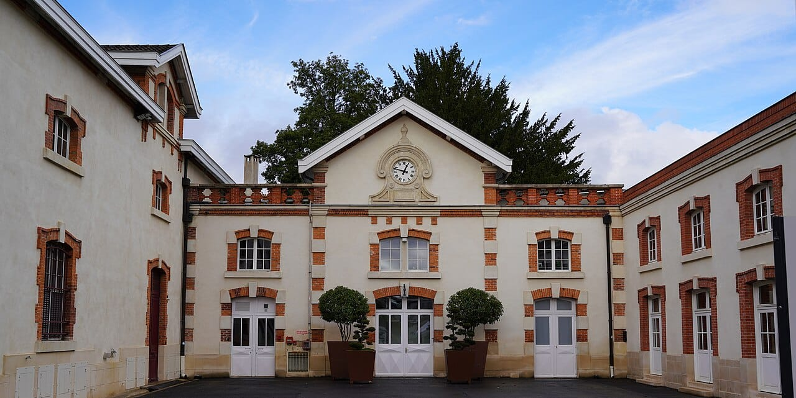
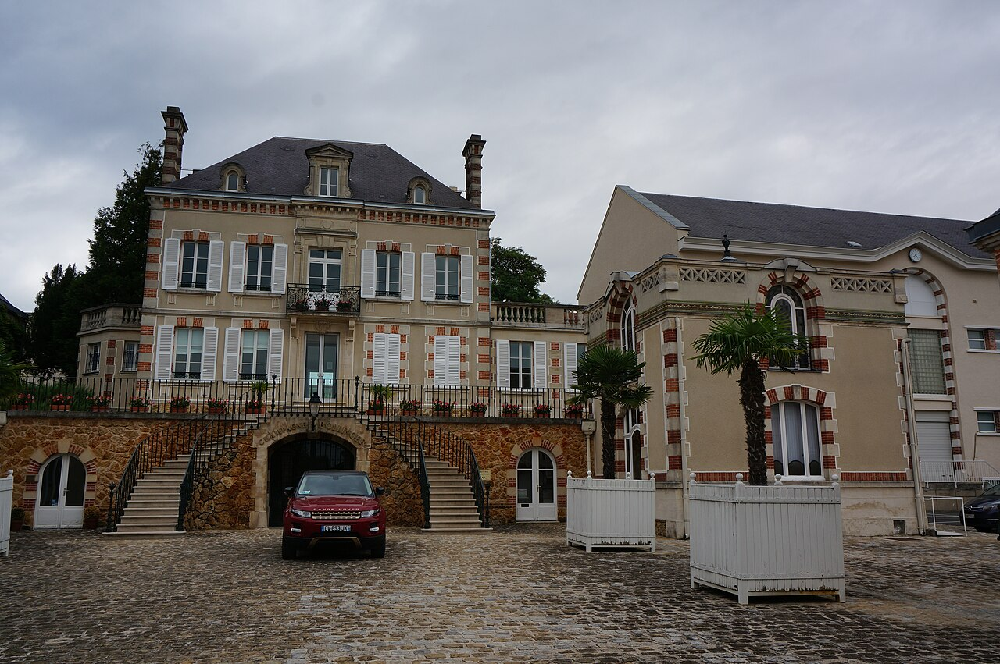

# Krug

Rue Coquebert in central Reims is a narrow street, and the Krug house sits quietly inside it. There is no glittering frontage on the Avenue de Champagne and no daily public reception. Krug’s core is not a building but a method: bring wines from different years and plots together, remake a new Édition of Grande Cuvée every year, and keep two single-plot, single-year “soloists” apart. To understand Krug, start with the logic of writing vintage with reserve wine.

Figure: The Krug building in Reims, seen from the Boulevard Lundy side. Image: G.Garitan, CC BY-SA 4.0, via Wikimedia Commons ([source page](https://commons.wikimedia.org/wiki/File:Krug_boulevard_Lundy_1512968.jpg)).

## Location and history

Joseph Krug founded the house in Reims in 1843. His aim was not vintage champagne but the best champagne he could offer every year, regardless of weather. In 1848 he wrote the idea into a dark-cherry notebook: respect each plot, build a library of reserve wines across years, and blend them into a new Grande Cuvée. The notebook remains the source of the method.

Six generations of the Krug family ran the house before it joined LVMH’s wines and spirits division. In the early 1970s, fifth-generation Rémi and Henri Krug acquired a walled vineyard in Le Mesnil-sur-Oger and made the first Clos du Mesnil in 1979. They then spent seven years looking for a Pinot Noir “solo” plot, found Clos d’Ambonnay in 1991, bought it in 1994, harvested it first in 1995 and revealed the wine only in 2007. In 2011 Krug introduced the Krug iD, a six-digit code on the back label that explains each bottle’s blend and ageing; from 2016 the Édition number of Grande Cuvée and Rosé has appeared on the front label.

## Architecture and spaces

The Reims headquarters is a nineteenth-century house, restrained outside, with offices, tasting rooms and cellars inside. The real work happens in the cellar and fermentation rooms: Krug presses and ferments each plot separately in small old oak barrels, preserves each individuality, and then the tasting committee decides which edition it will join. “One plot, one wine” is not a slogan but the daily handling of hundreds of small lots.

In 2024 Krug opened the Joseph winery in Ambonnay. The building was designed for sustainability and sits close to Clos d’Ambonnay and the Pinot Noir heartland. It does not empty the Reims headquarters; it moves fermentation and part of production closer to the vines. A visit that only looks at a pretty cellar misses the point: Krug’s architecture serves parcel-by-parcel handling and small-lot fermentation.

## The wines and palate

The range has three layers. First, Krug Grande Cuvée: each Édition blends more than 120 wines from over ten different years. The house tastes around 400 base wines each year, 250 of the year and 150 reserves, drawn from about 15 vintages. It ages about seven years in the cellars; the bubbles are fine, the perfume moves from toast, hazelnut and honey to citrus and mineral, and the palate is broad without heaviness. Second, Krug Vintage: only the best year, more concentrated, with clearer fruit and acidity. Third, the two “soloists”: Clos du Mesnil, a 1.84-hectare walled Chardonnay plot first made in 1979, and Clos d’Ambonnay, a 0.68-hectare walled Pinot Noir plot first harvested in 1995. Both are single-year and tiny in quantity.

Krug Rosé is another line: not a simple splash of red wine, but a blend built on long reserves and a little red wine, salmon-coloured, with red berries, citrus peel and spice. Édition variation matters. The same Grande Cuvée changes between editions; that is not inconsistency but the result of remaking the blend every year.

## How to drink

Krug recommends 9–12°C. Do not take it below 6°C, or the perfume and fine bubbles shut down. Use a large white-wine glass or a wide Champagne glass; pour in two stages, a third first, then top up after the foam settles. Grande Cuvée can be opened 15–20 minutes before drinking to let toast and nut notes unfold; Clos du Mesnil and Clos d’Ambonnay do not need violent decanting but can be opened half an hour ahead.

Pair Grande Cuvée with roast chicken, mushrooms, Comté, lobster or scallops; Vintage with creamy white meat and roast fish; Clos du Mesnil with lobster, crab or white truffle; Clos d’Ambonnay with veal, duck breast or mushrooms. Rosé works with salmon, strawberries and Mediterranean spice. Avoid very sweet or very hot dishes, which push the acidity forward.

## Practical information

Address: 5 Rue Coquebert, 51100 Reims. Krug has no daily public visits; access is normally by official invitation, professional appointment or LVMH open days, so being in Reims does not mean you can enter Krug. TGV from Paris Gare de l’Est to Reims takes about 45 minutes; the walk from the station to Rue Coquebert is about 15 minutes. Park in a central underground car park and walk in.

If you only want a glass, Reims bars and restaurants are easier than the house. If you want to see vineyards, Clos du Mesnil is in Le Mesnil-sur-Oger and Clos d’Ambonnay in Ambonnay; neither is open to walk-in visitors, and both can only be seen from public roads. Pair Krug with the [Avenue de Champagne](ref:avenue) or the [Champagne avenue walk](ref:route) on another day, and never taste before driving.

## Etiquette and common misreadings

First, Krug is not only about expensive wine. Grande Cuvée is the core and the entry into the house; do not stare only at the Clos. Second, the Édition number is not a vintage. Grande Cuvée is a multi-year blend; the Édition says how many times the house has remade the wine, while the Krug iD on the back label gives the specific blend. Third, fine bubbles are not the only criterion; Krug’s breadth and perfume matter as much.

Fourth, do not enter or film the cellars without an invitation; the production area is not a restaurant. Fifth, do not judge Champagne by “sweet or not”. Krug is dry, broad and balanced, not a dessert wine. Sixth, aged Champagne is not automatically better. Grande Cuvée has already spent about seven years in cellar; drink it within two to three days of opening, and treat older bottles with more care against oxidation.

## Around and routes

In Reims, build a day around cathedral, house and bar: Notre-Dame Cathedral and Saint-Remi in the morning, then the [Avenue de Champagne](ref:avenue) or the direction of [Taittinger](ref:taittinger) and [Bollinger](ref:bollinger), and dinner back in Reims. To see the walls of Clos d’Ambonnay, drive about 25 minutes from Reims or 20 from Épernay. Open the [Champagne](ref:champagne) map and separate the Reims, Épernay and Côte des Blancs axes before planning.

One day: walk Reims and book one tasting. Two days: add Épernay’s avenue and a Côte des Blancs village. Do not squeeze Krug, Taittinger and Bollinger too tightly; Champagne tasting needs time and a clear palate.

## Further reading and see also

- Champagne comparisons: [Bollinger](ref:bollinger), [Taittinger](ref:taittinger), [Avenue de Champagne](ref:avenue), [Champagne avenue walk](ref:route).
- Background: [Champagne](ref:champagne).
- This entry provides no map; Krug visit and release information should be checked with official channels.

**At a glance:** A Champagne house in Reims founded in 1843 by Joseph Krug, centred on the multi-vintage Krug Grande Cuvée. Clos du Mesnil is 1.84 hectares and Clos d’Ambonnay 0.68 hectares, both single-plot, single-year champagnes; the house is part of LVMH and opened the Joseph winery in Ambonnay in 2024. 

Start with the address. From there, consider the current opening status, then what the place is known for. That is how a practical judgment about Krug is built.

The Clos d'Ambonnay wall dates to 1766.

## Related images

Image: The Bollinger house and courtyard in Aÿ. Credit: G.Garitan, CC BY-SA 3.0, via Wikimedia Commons ([source page](https://commons.wikimedia.org/wiki/File:Bollinger_01315.JPG)). Related image for Krug.
