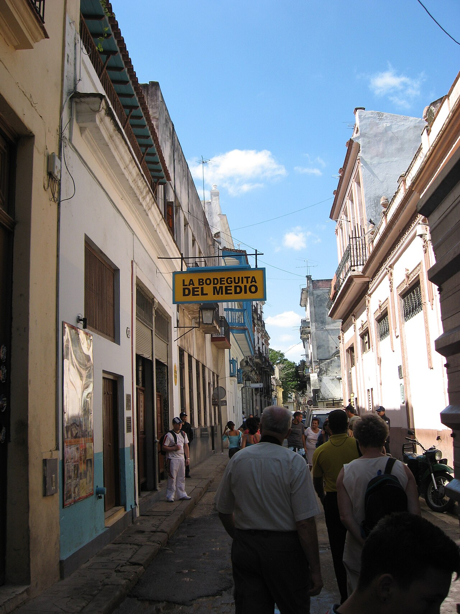

# La Bodeguita del Medio

La Bodeguita del Medio (Bàntú Xiǎojiǔguǎn) stands at Calle Empedrado 207 in Old Havana, between Cuba and San Ignacio streets, barely a hundred metres from the Havana Cathedral. It opened in 1942, but not as a bar. It was a small grocery called “La Complaciente,” bought by the Cuban Ángel Martínez Borroto and renamed “Casa Martínez.” The shop sold everyday goods and occasionally cooked for regulars. The name means “the little grocery in the middle of the block,” and that modest origin explains the room better than the “Hemingway bar” label: narrow, old, and covered in signatures and photographs.

Figure: La Bodeguita del Medio. Image: Derek Blackadder from Cobourg, ON, Canada, CC BY-SA 2.0, via Wikimedia Commons ([source page](https://commons.wikimedia.org/wiki/File:Bodeguita_del_Medio,_Havana,_Cuba_9.jpg)).

## Place and history

In 1942 Ángel Martínez took over the small shop, and nearby intellectuals, journalists and artists began to gather there. The typographer Felito Ayón had a print shop nearby; his clients came to use the telephone and stayed for a glass of rum, and the grocery gradually became a meeting place. Around 1948 Ayón began organising meals there. In 1949 the cook Silvia Torres, known as “la china,” joined and turned white rice, black beans, pork and fried plantains into the house’s home-style food. In 1950 the name was formally changed to La Bodeguita del Medio. According to the house, early visitors included the Cuban poet Nicolás Guillén and the writer Alejo Carpentier; in the 1950s Nat King Cole, Hemingway, Brigitte Bardot, Sophia Loren and others appeared on the guest list. Hemingway did visit, but the claim that he was a regular is often overstated; his steadier base was El Floridita a few minutes away. The signatures began as customers’ informal notes and became the bar’s archive; today they are treated as historic fittings rather than a guest book.

## The room and the drinks

The house is a small late-nineteenth-century colonial building. The space is tight, and the walls and ceiling are almost entirely covered with signatures, photographs and old objects. Mint, lime and rum hang in the air. Small groups—quartets and quintets—play traditional Cuban music, and the sound of the band and the crowd is part of the experience. The drinks list centres on the mojito: rum, lime, mint, sugar and soda, plus other rum cocktails and simple drinks. Food is Cuban Creole home cooking: white rice, black beans, pork and fried plantains are typical, not fine-dining plating. Prices are at the tourist level of Old Havana, and portion size and quality vary with the hour and the crowd.

## How to order on a first visit

Start with a mojito, and note that it is usually on the sweet side. If you dislike sweetness, ask the bartender to reduce the syrup, but do not demand “no sugar at all,” which would upset the balance of mint and lime. For food, order a Creole plate or a simple meat dish; do not expect a seafood feast. There is often live music, so check whether you are at the bar or in the dining area before sitting; the bar suits a quick drink, the dining area a slower meal. In high season a queue forms at the door. Arrive shortly after opening or before the evening rush. If you only want a photograph, do not block the entrance; let people leave first.

## Practical information

Address: Calle Empedrado 207, entre Cuba y San Ignacio, La Habana Vieja, Havana 10100, Cuba; coordinates 23.14083, -82.35222. It is about 79 metres from the Havana Cathedral and 400 metres from Plaza de Armas, so it is reached on foot from anywhere in Old Havana; no transport is needed. The official Palmares page lists daily hours of 12:00–23:30, and at the time of checking the page showed an “opening soon” status consistent with normal daily operation. There is no entrance ticket; you pay for drinks and food. Prices in Havana’s tourist area and the use of convertible pesos or foreign currency change quickly, and public information is limited, so the exact prices and payment methods were not verified. The house publishes no booking channel, and ordinary bar seats generally cannot be reserved; for dining or a group, call +53 7 866 8857 or email first. Dress is casual; the space is narrow with a steep staircase, so visitors with limited mobility or a stroller should confirm the layout first. Page checked 2026-11-08; opening status, prices and reservations are subject to official channels.

## Etiquette and common mistakes

The signatures on the walls are historic fittings, not a guest book: do not add to them with a pen, key or fingernail, and do not peel off photographs. The entrance and stairs are narrow, so step aside before taking a picture, and ask the band before photographing; a tip after the set is polite. Do not use “Hemingway’s drink” instead of a name; if you want a mojito, say mojito and state your preferred sweetness. The biggest mistake is treating the line attributed to Hemingway on the wall—“My mojito in La Bodeguita, my daiquiri in El Floridita”—as verified handwriting. The sentence is widely repeated, but its authorship and authenticity are disputed; the house treats it as brand storytelling, not archival proof. Another mistake is crediting La Bodeguita with the invention of the mojito. The drink’s ancestors are older; this bar made it famous, but it is not the only source.

## When not to come

This is the wrong place if you dislike enclosed spaces, crowds or live music, or if you want a quiet conversation or refined dining. Large groups struggle in the narrow house; visitors with accessibility needs should confirm the entrance and stairs first. Anyone looking for a cheap drink will also be disappointed: these are tourist-area prices. If the “celebrity signature wall” feels like a tourist trap to you, Old Havana has smaller, more local bars. But if you want to see how literature, music and everyday life were mixed in Havana’s bar culture, this is a high-density sample.

## Nearby and around

Step out onto Empedrado Street: the Havana Cathedral and Cathedral Square are a short walk north, and Plaza de Armas and the Castillo de la Real Fuerza lie to the northwest. The Obispo pedestrian street, the Museum of the Revolution and the Malecón are also within walking distance or a short taxi ride. [El Floridita](ref:floridita) is about ten minutes on foot, and the two make a natural “mojito and daiquiri” route: first the narrow signed walls and home-style food here, then the long bar, bronze statue and frozen daiquiri at Floridita. Both are busy tourist addresses in Old Havana, so avoid the midday tour-group peak.

## See also

To understand where such bars sit in the city, read [Pub and city](ref:pub-and-city), which also compares cafés, pubs and beer halls. For the drink itself, read [Mojito](ref:mojito); for the base spirit, read [Rum](ref:rum); for Havana’s other famous old house, read [El Floridita](ref:floridita).

**At a glance:** A famous bar in Old Havana, opened in 1942 and known for mojitos and the signatures of writers on its walls.

To read La Bodeguita del Medio, start with the address, then the current opening status, then what the place is known for; no single check settles it.

[Reading a city through its bars](ref:pub-and-city)'s address and space and [Rum](ref:rum)'s operating status form a useful pair: the contrast shows where one ends and the other begins.
