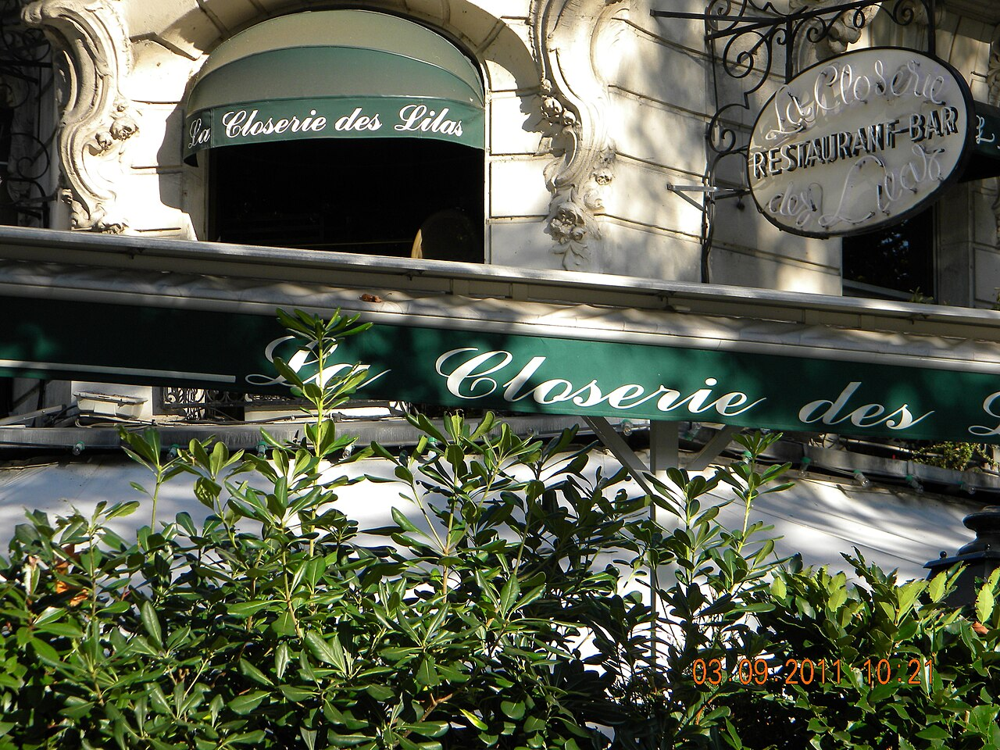

# La Closerie des Lilas

Walk along Boulevard du Montparnasse to the Observatoire crossroads and a row of storefronts wrapped in greenery and awnings comes into view, with a menu board at the door and piano music coming from inside. This is La Closerie des Lilas. Unlike Café de Flore or Les Deux Magots, it does not turn "literary café" into an obvious tourist label; the entrance is almost understated. Inside, however, Hemingway's name is engraved on the bar, old photographs hang on the walls, and the piano bar in the back has live jazz in the evening. It is a restaurant, a bar and a still-living piece of Montparnasse's literary memory.

Figure: The green frontage and sign of La Closerie des Lilas, 171 boulevard du Montparnasse. Image: Britchi Mirela, CC BY-SA 3.0, via Wikimedia Commons ([source page](https://commons.wikimedia.org/wiki/File:La_Closerie_des_Lilas,_Paris.jpg)).

## Location and history

The site's history goes back to 1847. That year the Bal Bullier dance hall opened at the Observatoire crossroads, and the adjacent inn and bar fed and watered the dancers; in 1883 the neighbouring brasserie began trading as La Closerie des Lilas, taking its name from the lilac bushes around it. It soon became a meeting point for students, painters and writers; late-nineteenth-century regulars included Zola, Cézanne, Verlaine, Gautier and the Goncourt brothers.

In the early twentieth century the poet Paul Fort made the café the setting for his Tuesday gatherings. Apollinaire, Alfred Jarry and Brancusi came; Lenin played chess there with Paul Fort. In 1910 Robert Delaunay, Albert Gleizes, Fernand Léger, Henri Le Fauconnier and Jean Metzinger met at the Closerie to plan how to get around the hanging committee of the Salon des Indépendants — a gathering often treated as one node in the formation of the Cubist group.

In 1922 Tristan Tzara and André Breton quarrelled here. The Paris Tourist Office describes the quarrel as literally ending Dada and giving birth to Surrealism; a more cautious reading is that it was a key conflict in the splitting of Paris Dada and the shaping of Surrealism. In 1925 Hemingway completed the first draft of The Sun Also Rises at the Closerie; he often wrote at the bar, which still keeps a place engraved with his name. After the war Sartre, Sagan and Juliette Gréco continued to use the café as a Left Bank meeting point.

On 7 March 2007 the Prix de la Closerie des Lilas was established, awarded to a French-language book by a woman writer published between January and March of that year. The prize keeps the café's literary identity in the present tense rather than leaving it as a thing of the past.

## The rooms and the drinks

The Closerie is layered: a glass-roofed street front and green terrace, a main restaurant, a bar and a piano bar. The interior keeps a 1920s decorative language: mosaic floor, leather banquettes, mirrors, dark woodwork, brass lamps and a piano. Tables are not widely spaced, and when the piano starts in the evening, conversation drops to a lower volume; this is what distinguishes it from a large brasserie.

The menu is French brasserie and full restaurant fare: onion soup, snails, foie gras, fish, steak and classic desserts; the bar offers champagne, French wine, whisky and classic cocktails. Hemingway-era prices are long gone, but a cognac or a glass of champagne with a snack is still the way to read the room. For coffee only, the terrace in the afternoon is easier than the evening.

## How to drink here

In the afternoon or early evening, start on the terrace with a coffee, champagne or kir and watch the boulevard; if you want a full meal, move inside to the restaurant. Once the piano bar begins, order a whisky, cognac or classic cocktail and sit near enough to hear the playing without blocking the pianist or the regulars' view.

Hemingway's "writing place" is on the bar side, and many visitors order a cognac or café crème near it. Do not expect a "Hemingway package" or a fixed commentary; this is a working restaurant, and ordering is the best way in, not treating the bar as a display case. For a quick drink, the bar is easier to find a place in than the restaurant.

## Practical information

- Address: 171 Boulevard du Montparnasse, 75006 Paris, at the Observatoire crossroads.
- Hours: daily 12:00–00:00; the last orders in the restaurant and bar differ, so telephone before a late visit.
- Transport: metro Vavin (Line 4) or Port-Royal (RER B); buses 38 and 68 stop nearby on the boulevard.
- Reservations: booking is advisable for the restaurant; the bar and terrace generally seat on arrival.
- Prices: restaurant, bar and terrace are priced differently; a full meal costs considerably more than a coffee.
- Piano: there is often live piano in the evening; during a set, avoid loud conversation or moving around the room.

## Etiquette and common mistakes

First, do not use "Hemingway sat here" as a reason to hold a bar stool. Bar seating is first-come, first-served, and standing for one drink before giving up the place is normal. Second, do not assume every area accepts drinks only; restaurant tables usually require a meal at dinner, so stay at the bar or terrace if you only want a drink. Third, do not write the 1922 quarrel as "Dada was formally ended here"; it was a key event in the Paris split, and accounts differ on cause and effect. Fourth, do not infer from "1847" that today's building and decoration are original to 1847; the site was rebuilt several times, and what you see is mostly twentieth-century space. Fifth, do not take loud calls or use flash during piano sets; this is not a concert hall, but the player and the guests share one room.

## Around and nearby

A few minutes east of the Closerie are La Coupole and Brasserie Lipp; west are Montparnasse station and the Tour Montparnasse; north through the Luxembourg Gardens is Saint-Germain-des-Prés. A "Montparnasse literary day" could run La Closerie des Lilas, La Coupole, Brasserie Lipp, Montparnasse Cemetery (Baudelaire, Sartre, Beauvoir) and the Luxembourg Gardens. For a single drink, the three historic cafés at the Observatoire crossroads are enough for an afternoon.

## Further reading and see also

- The Paris Tourist Office's Montparnasse artists' walk: <https://en.parisinfo.com/discovering-paris/walks-in-paris/the-montparnasse-of-artists> for 1847, the guest list and the Dada quarrel.
- Ville de Paris's Hemingway walk: <https://paris-recette.paris.fr/pages/balade-sur-les-pas-d-ernest-hemingway-19062> for the 1925 writing and The Sun Also Rises.
- Nearby `place:la-coupole` and `place:brasserie-lipp` compare other Montparnasse and Saint-Germain literary café types.
- For the full Left Bank route, see `route:saint-germain-literary-cafes`.
- This page treats the Dada quarrel as a key conflict rather than a single cause; literary history and the café's own storytelling differ in detail.
- Related entries: [Brasserie Lipp](ref:lipp)、[La Coupole](ref:coupole)、[Café de la Paix](ref:paix)、[Saint-Germain literary cafés route](ref:saint-germain)、[Hemingway Bar at the Ritz, Paris](ref:hemingway)

**Short definition:** At 171 Boulevard du Montparnasse, La Closerie des Lilas was already a dance-hall and inn site in 1847 and took its present name in 1883; Paul Fort's Tuesday salons, Hemingway's 1925 writing and the 1922 Dada quarrel made it a coordinate of Left Bank literary history.

For La Closerie des Lilas, begin with the address. Then look at the current opening status, and finally ask what the place is known for. The answers point to different choices, not to a single score.

The Sun Also Rises was published in 1926.
