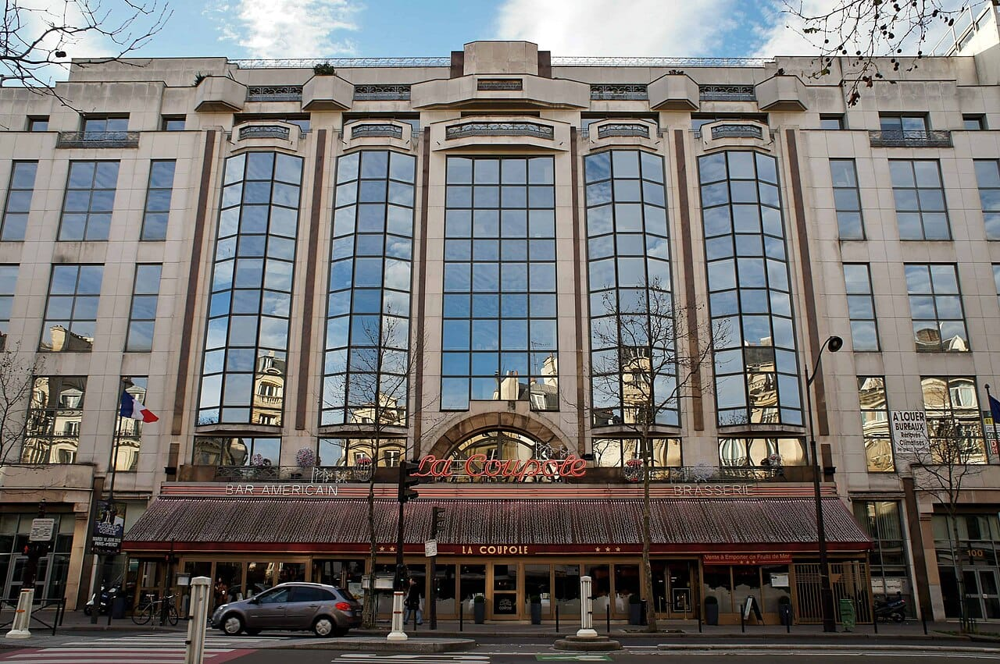
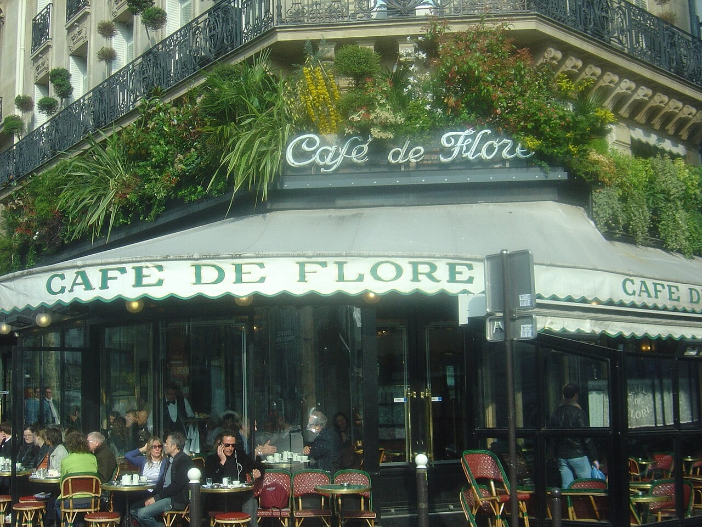

# La Coupole

At 102 Boulevard du Montparnasse, a restaurant so wide it almost fills the block announces itself with neon and an awning. Unlike the Saint-Germain cafés, it does not put seats on the pavement; a glass and marble front pulls people in. Inside are the domed main hall, rows of columns, white and cream walls, brass lamps and an open seafood counter. La Coupole is not a small, pretty Left Bank café; it is Montparnasse's ballroom from the crazy years and a large brasserie that still runs from morning to midnight.

Figure: The Art Deco facade and red awning of La Coupole, 102 boulevard du Montparnasse. Image: besopha, CC BY 2.0, via Wikimedia Commons ([source page](https://commons.wikimedia.org/wiki/File:La_coupole_(46200235745).jpg)).

## Location and history

La Coupole opened in December 1927, founded by Ernest Fraux and René Lafon. On opening night the house laid in 1,500 bottles of wine and sold them all; the figure has been repeated ever since as a measure of how lively Montparnasse was between the wars. In 1928 the basement dance hall opened, and jazz bands, the Charleston, painters, models, writers and American expatriates crowded into the same building.

The 32 columns in the main hall are La Coupole's most famous visual feature. In 1927, 27 Montparnasse artists — among them Marc Chagall and Louis Latapie — painted flowers, landscapes, figures and abstract patterns on them. This was not a museum-style commission but a way of turning the restaurant itself into a canvas, so that diners ate surrounded by art.

On 12 January 1988 the ground-floor hall was listed as a historic monument; that same year Michel Bourbon added a 33rd column, painted by him. In 1993 Louis Derbré's bronze La Terre was installed in the hall. In 2018 Groupe Bertrand acquired La Coupole and restored it, keeping the painted columns, mirrors, brass lamps and seafood counter while updating the kitchen and circulation.

In its first decade La Coupole became a canteen for Montparnasse's American expatriates, painters and writers; Hemingway wrote about it in A Moveable Feast, and Picasso, Sartre and Beauvoir later had their regular tables. It was a restaurant and a stage for seeing and being seen: a band in the evening, a dance floor below, diners staying from dinner into the night.

## The rooms and the drinks

La Coupole is a combination of main hall, terrace and basement bar. The hall has a dome, rows of columns, white tablecloths, leather banquettes and mirrors; the terrace faces Boulevard du Montparnasse; the basement bar has DJs or live music in the evening. Its scale does not suit whispered conversation, but it works for groups, families and anyone who wants to see the old Montparnasse on stage.

The menu is French brasserie and seafood: oysters, shrimp, crab, seafood platters, steak, duck confit, foie gras, onion soup, cassoulet and classic desserts. The drinks list is French wine, champagne and cocktails; beside the seafood counter, a Muscadet, Chablis or champagne is the natural order. It does not win on "creative" cooking but on steady traditional dishes, seafood and atmosphere.

## How to drink here

At midday, order a seafood platter or steak with a Muscadet or Chablis; oysters need a dry white, though champagne works too. In the afternoon, a coffee, champagne or kir on the terrace, watching the boulevard. After the basement bar opens, a cocktail or whisky with the music; for a full meal, the hall and terrace both work, but book at weekends.

Do not expect a re-enactment of the 1,500 bottles; that is an opening-night legend from 1927, not today's menu. For drinks only, the terrace and bar are easier than the main hall, which usually requires a meal at dinner.

## Practical information

- Address: 102 Boulevard du Montparnasse, 75014 Paris.
- Hours: Monday 08:00–23:00; Tuesday to Saturday 08:00–00:00; Sunday 08:00–23:00.
- Transport: metro Line 4 to Vavin or Line 6 to Edgar Quinet; RER B to Port-Royal; buses 38 and 68.
- Reservations: book for a full meal, especially at weekends and on performance days; the terrace and bar usually accept walk-ins. When booking, say if you want a window seat or a view of the painted columns, and staff will try to arrange it.
- Prices: seafood platters and full meals are expensive; coffee and snacks are lighter.
- Accessibility: the hall and terrace have steps; visitors with reduced mobility should telephone ahead about the entrance. On fine days the terrace is the first to fill, so arrive early for an outside table.

## Etiquette and common mistakes

First, do not treat the columns as touchable exhibits; the painted columns are part of a historic monument, and grease, sweat and flash damage them. Second, do not assume every seat accepts drinks only; the main hall usually requires a meal at dinner, so stay on the terrace or in the bar for drinks. Third, do not present "1,500 bottles sold on opening night" as a present-day fact; it is a historical anecdote, not current stock or a promotion. Fourth, do not let the "golden age of Montparnasse" hide today's commercial reality; La Coupole is now a large Groupe Bertrand restaurant, and service, prices and clientele have changed. Fifth, do not film in front of the seafood counter and block the pick-up line; that is a work area, not a set.

## Around and nearby

Two minutes west of La Coupole is La Closerie des Lilas; ten minutes east are Brasserie Lipp and Saint-Germain-des-Prés; north are Montparnasse Cemetery and the Tour Montparnasse. A route might run: lunch at La Coupole, coffee at La Closerie des Lilas, Montparnasse Cemetery, the Tour Montparnasse observation deck and dinner in Saint-Germain. For Montparnasse alone, the three historic restaurants around Vavin are enough for a day.

## Further reading and see also

- The house's "about" page: <https://www.lacoupole-paris.com/en/about-us/> for December 1927, the 1,500 bottles, the 32 columns, the 1928 dance hall, the 1988 listing and the 33rd column.
- Visit Paris Region's entry: <https://www.visitparisregion.com/en/la-coupole> for the "crazy years" identity and the present scene.
- Groupe Bertrand's menu PDF: <https://evenement.groupe-bertrand.com/wp-content/uploads/2025/05/LA-COUPOLE-MENUS-PE25.pdf> to cross-check the 2018 acquisition and address.
- Nearby `place:la-closerie-des-lilas`, `place:brasserie-lipp` and `place:cafe-de-la-paix` compare Paris's large brasseries with its literary cafés.
- For the Saint-Germain and Montparnasse literary route, see `route:saint-germain-literary-cafes`.
- Related entries: [La Closerie des Lilas](ref:closerie)、[Brasserie Lipp](ref:lipp)、[Café de la Paix](ref:paix)、[Saint-Germain literary cafés route](ref:saint-germain)、[Hemingway Bar at the Ritz, Paris](ref:hemingway)

**Short definition:** La Coupole on Boulevard du Montparnasse opened in December 1927 with 1,500 bottles of wine that sold out on the first night; its 32 columns painted by 27 artists, 1928 basement dance hall and 1988 historic-monument listing make it a living relic of Montparnasse's crazy years.

For La Coupole, begin with the address. Then look at the current opening status, and finally ask what the place is known for. The answers point to different choices, not to a single score.

Read [La Closerie des Lilas](ref:closerie) for the address and space side of La Coupole, and [Café de la Paix](ref:paix) for the operating status side. Together they locate it.

**Key facts.**

| Item | Detail |
| --- | --- |
| In one line | La Coupole on Boulevard du Montparnasse opened in December 1927 with 1,500 bottles of wine that sold out on the first night; its 32 columns painted by 27 artists, 1928 basement dance hall and 1988 historic-monument listi… |
| Address | 102 Boulevard du Montparnasse, 75014 Paris, France |
| City and country | Paris / France |
| Status | verified open |
| Official site | lacoupole-paris.com |

**Sources and limits.** The key claims about La Coupole are checked against the following sources: La Coupole (Used for the 102 boulevard du Montparnasse address and the Monday-to-Sunday hours), Visit Paris Region, Groupe Bertrand (Used to cross-check the 1927 opening, the Bertrand group's 2018 acquisition and the address). For current products, addresses or opening status, use lacoupole-paris.com. Prices, batches and status change; the body is project-written and does not reproduce source text.

## Related images

Image: Café de Flore in Saint-Germain-des-Prés, Paris, its green awning and terrace facing the corner.. Credit: DIMSFIKAS, CC BY-SA 3.0, via Wikimedia Commons ([source page](https://commons.wikimedia.org/wiki/File:Cafe_de_Flore,_Paris_-_2011.JPG)). Related image for La Coupole.
