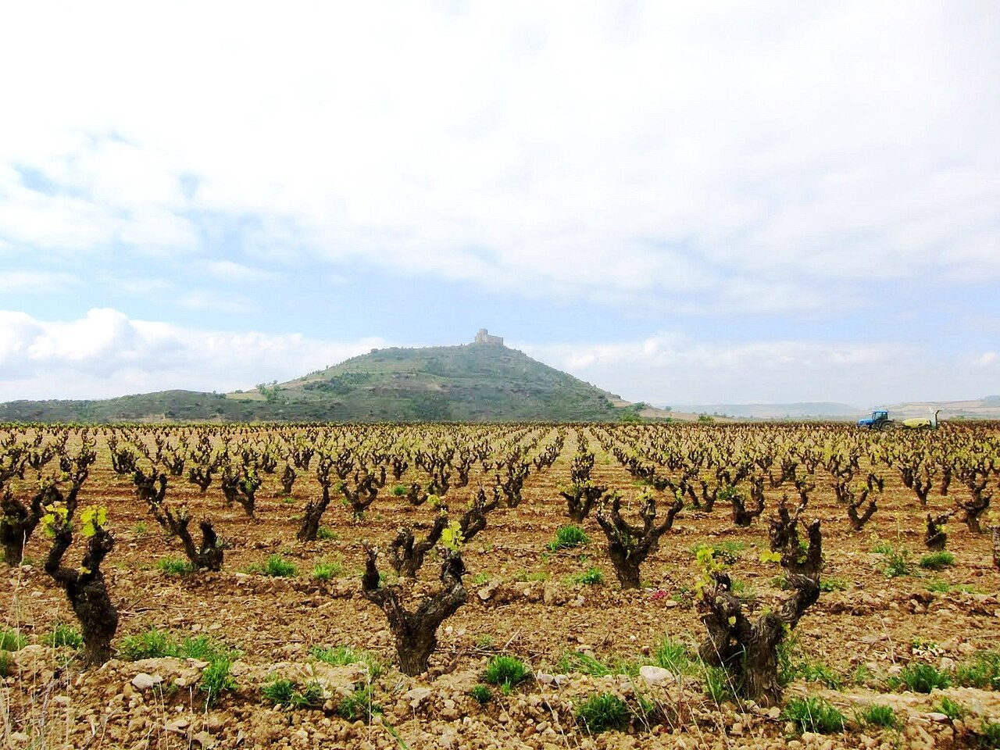

# La Rioja Alta, S.A.

Haro's Barrio de la Estación is a short street: railway on one side, a row of old wineries on the other, brick walls, iron gates and cellar vents pressed together. La Rioja Alta stands at Avenida de Vizcaya 8, a few minutes' walk from López de Heredia. It has not turned the visit into a theme park. Instead it opens a working winery that still follows an old rhythm: American-oak barrels, long maturation, slow racking and a shareholder structure that reaches back to 1890.

Figure: La Rioja Alta, S.A.. Photograph: A Rioja Vineyard - panoramio. Credit: Art Anderson, CC BY-SA 3.0 ([source page](https://commons.wikimedia.org/w/index.php?curid=56546384)). Category image; not a claim that it shows the exact product, site or event.

## Place and history

In 1890 five Riojan and Basque families founded the Sociedad Vinícola de La Rioja Alta in Haro's station district. The first president was Doña Saturnina García Cid y Gárate, a woman; the first winemaker was a Frenchman, Monsieur Vigier. The winery's own history treats the Reserva of 1890 as the ancestor of today's Gran Reserva 890, a name that points directly at the founding year. Two things are worth holding onto. First, modern Rioja was built from the start on cross-family and cross-regional capital, not on a single grower's shed. Second, the arrival of French winemakers was tied to the vine diseases that damaged French vineyards in the late nineteenth century, a moment that opened the French market to Rioja.

The winery is still owned by the founding families' shareholders and has not sold its brand to a large drinks group. It is often called a representative of "traditional Rioja", but traditional does not mean refusing modernity: fermentation, temperature control and equipment have all been updated. What has stayed is the maturation logic, with long ageing in American oak so that the wine reaches the market ready to drink rather than as a young product. That helps explain why the list looks old in years yet not extravagant in price.

Fruit comes from several Rioja sub-zones. Tempranillo is the main variety, with Garnacha, Graciano, Mazuelo and Viura added according to the wine. Viña Ardanza is the best-known name, usually Tempranillo-led with Garnacha, rounder and earlier to drink than the Gran Reservas; Gran Reserva 904 and 890 are the flagships with much longer ageing. The 904 takes its name from 1904 and the 890 from 1890; treating the numbers as ages misreads them. They are historical markers.

## The site and the visit

The winery runs along the street with a modest entrance, opening into reception, tasting rooms and production. A visit usually starts with the history and vineyards, then moves through fermentation, the barrel cellar and the bottle cellar. The barrel room is the heart of it: rows of American-oak casks, low light, mould on the walls and damp air, a very concrete sense of time. The winery has its own cooperage at Labastida, which lets it control toasting and cask use; that is not common in Rioja and helps explain the consistency of the house style.

Racking is another detail. Traditional Rioja periodically moves wine from one cask to another, separating sediment and giving brief contact with oxygen; it sounds simple but needs labour, space and experience. If you see bungs, siphons and old tools, they are not only props; some are still used. Cellars are cold and damp and floors can be slippery, so wear flat shoes with grip and bring a thin jacket. Do not use a flash directly on casks or old labels.

Visits are by appointment, usually on weekdays, and the harvest in September and October reduces or suspends reception. Packages differ in length, whether a tasting is included, which wines are poured and the language, so confirm each point when booking; trade and group arrangements may follow a separate route. Do not treat it as a winery where you buy a ticket at the door, and do not expect to taste without a booking. Non-drinkers can take the history and cellar part, or spend the time in Haro's old town.

## The range and tasting

The list can be read by ageing level, vineyard and historical name. Viña Alberdi is the younger Crianza, an everyday wine; Viña Arana is a Reserva with more structure; Viña Ardanza is the flagship Reserva, where Tempranillo and Garnacha give roundness and spice beyond fruit; Gran Reserva 904 and 890 are the long-aged top wines, arriving with dried fruit, leather, tobacco and vanilla. Whites and rosé are not the main line, but the winery makes them; availability depends on vintage and market.

American oak is the keyword. Compared with French oak, American oak usually gives more vanilla, coconut, dill and sweet spice, with softer tannin; long ageing folds those "sweet cask" notes into fruit and acidity, turning them into dried fruit, leather and tobacco. On a first visit, the most useful comparison is Viña Ardanza against Gran Reserva 904: the first is rounder and earlier, the second deeper and slower. If 890 is available, pay attention to texture and length rather than asking which is older.

Look at the colour, smell, then take a small sip. Rioja reds often throw sediment; stand the bottle up or decant, and do not assume the wine is faulty. Spit what you do not want, especially if you are driving or catching a train. The winery shop sells bottles, but hours are irregular and some periods are open only to booked visitors; check luggage and shipping rules before buying a case on the first day of a trip.

## Practical information

The address is Avenida de Vizcaya 8, 26200 Haro, La Rioja, Spain, in the station district. From Haro station it is about a five-minute walk. Logroño is roughly forty minutes to an hour by train or bus, and Bilbao about two hours by train, but services are infrequent, so check the day's timetable. By car, Logroño is about 45 km, Vitoria about 50 km and Bilbao about 120 km; parking in the centre is limited.

Book ahead through the Visit Us entry on the official site, or by phone or email, and confirm date, time, language, group size, whether a tasting is included and the price. The harvest closes or reduces visits, and Sundays and public holidays are usually unavailable. A visit usually lasts one to two hours depending on the package; cellars are cold and damp, so wear shoes with grip and a light jacket. Visitors with mobility needs should say so in advance, since thresholds and stairs in a historic building are not always suitable for wheelchairs.

Opening hours, prices and wines change. This page was checked on 2026-11-08; confirm with the winery and the official site before travelling. If this is the second stop on the Haro station-district route, book late morning or early afternoon, leaving time for lunch and the next winery. Do not crowd three tastings together; palate fatigue turns the third visit into an exercise in not tasting the difference.

## Etiquette and around

A winery is a production site, not a bar. Arrive at the booked time; lateness may shorten the visit or lead to refusal. Do not touch casks, pipes, old photographs or displays, and do not enter closed branches of the cellar. Check with the guide before photographing; flash and tripods are usually unwelcome. Avoid strong perfume and loud conversation, and use the spittoon without embarrassment.

For La Rioja Alta, S.A., anyone driving should not drink. The wineries of Rioja are close together, but rural roads bend, and driving after tasting is risky. The safest options are train plus walking, a chauffeur or a designated driver. If you come by train, note that return services are infrequent; do not put the last tasting half an hour before departure.

The station district itself supplies the next stops: López de Heredia, CVNE, Muga and Gómez Cruzado are all within walking distance, though each needs a booking. Haro's old town around Plaza de la Paz has bars and small restaurants for lunch. The Haro Wine Festival on 29 June, the Batalla del Vino, makes the town extremely busy, so avoid that date if you want a quiet visit. East lies the Vivanco wine museum at Briones; north are Laguardia and Rioja Alavesa. For how cellars shape flavour, read [Cellar and storage](ref:cellar); for the wider region, start with [Rioja](ref:rioja) and [Wine](ref:wine).

Further reading: [A Ginjinha](ref:c-extra-1), [À la Mort Subite](ref:c-extra-2).

[Wine](ref:wine) and [Cellars and storage: temperature, humidity, light and time](ref:cellar) answer different questions about La Rioja Alta, S.A.: address and space and operating status. Read them as a pair rather than as alternatives.
