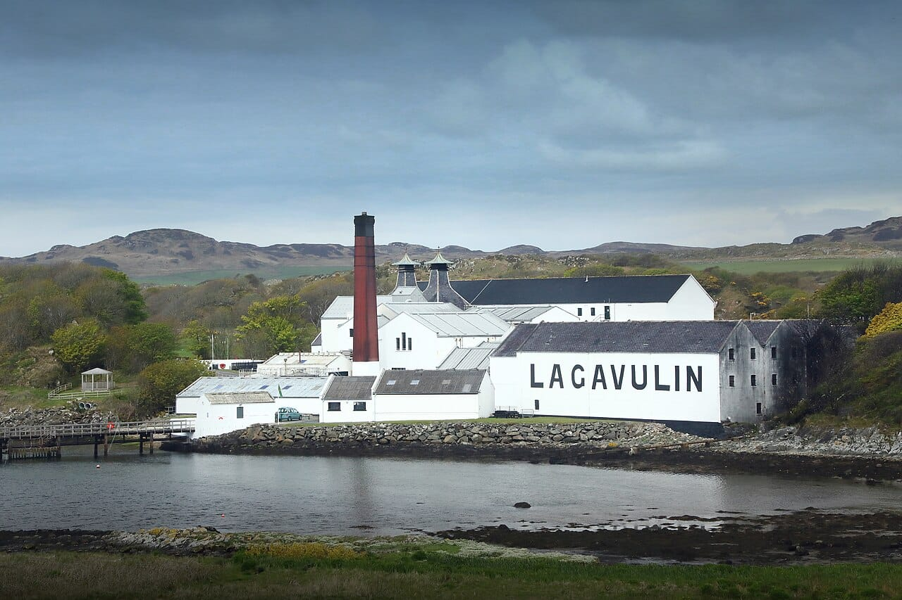

# Lagavulin Distillery

Lagavulin sits on Lagavulin Bay on the south coast of Islay, about two miles east of Port Ellen on the A846 coast road, near the ruins of Dunyveg Castle. It was founded in 1816 by John Johnston and is one of Scotland's oldest distilleries. Illicit distillation had existed in the area before that; once legalised, Lagavulin turned heavy peat, slow fermentation and long maturation into a consistent house style. The distillery is now part of Diageo, but the visit is still centred on the working site. The official pronunciation is "Laga-VOO-lin", with the stress on the second syllable.

Figure: Lagavulin Distillery. Image: Charlie Marshall, CC BY 2.0, via Wikimedia Commons ([source page](https://commons.wikimedia.org/wiki/File:2019-05-05_Lagavulin_Distillery.jpg)).

## Setting and history

Islay's whisky history is half farming and half coastline. The island has abundant peat, and malt dried over peat smoke absorbs a strong phenolic character; sea air and damp warehouses add iodine, seaweed and salt. Lagavulin's site was suited to distillation before 1816: the bay provided water and transport, the coast road linked it to the port at Port Ellen, and peat came from nearby bogs. In the 19th century Lagavulin, Laphroaig and Ardbeg together made the south coast the densest whisky district on Islay.

Today Lagavulin is known for being heavily peated without being coarse. Its malt has a high phenol level, fermentation is long, the stills are pear-shaped, and the spirit matures slowly in cask. The official core expression is the 16-year-old, which is not a marketing claim that older is always better but the most stable expression of the house style: smoke, iodine, sea salt, dried fruit and an oily texture at the same time. Understanding that is more useful than memorising a vertical of vintages.

## Space and whisky list

The buildings face the bay, with the visitor centre, shop and Malt Mill Bar, also called the Dramming Room, near the entrance. The production area includes mashing, fermentation, distillation and warehouses. The pear-shaped stills are singled out by the official page; the heavily peated malt brings iodine, seaweed, smoke and oiliness. The core bottling is the 16-year-old, alongside the 8-year-old, a 12-year-old cask strength special release, the Distillers Edition and Fèis Ìle festival bottlings. The bar serves drams, cocktails and soft drinks, and it is possible to use the shop and bar without joining a tour, subject to capacity.

The list can be read in three tiers: everyday, cask strength and experimental. The 16-year-old is the baseline and the best first Lagavulin; the 8-year-old is younger and more direct in its smoke; the 12-year-old cask strength is high in alcohol and opens up with a few drops of water; the Distillers Edition has extra sherry-cask maturation and more sweetness; Fèis Ìle and distillery-exclusive bottlings change each year and suit people who already know the core range. Do not start with cask strength, and do not treat "more peat" as the only measure of quality.

A whisky list alone makes Lagavulin look like a row of vintages; the production area explains where the style comes from. The malt absorbs peat smoke during drying, fermentation takes longer than at many distilleries, and the pear-shaped stills send more reflux back into the spirit, which helps retain an oily texture. Those steps together produce the combination of iodine, sea salt and smoke. The warehouses stand by the sea, and the damp air slowly rounds off the sharper edges during maturation. The process notes on the walls are more useful than guessing flavours in the bar.

## Visiting and tasting

Tours must be booked in advance on the official site. The Classic Distillery Tour lasts about 1.5 hours with a three-dram tasting and started at £22 per person in November 2026; the Warehouse No.3 Experience lasts about 1.25 hours from £60 and includes drawing whisky from the cask; the Premium Warehouse No.3 tour lasts about 2 hours at £105; the Distillery Exclusive Experience lasts about 2 hours at £130. Tours are capped at 16 people, and children under eight are not admitted. High season and Fèis Ìle sell out quickly, so book weeks ahead. For a drink without a tour, go to the Malt Mill Bar, but seating is limited and last orders are 30 minutes before closing.

When booking, distinguish between a tour and a tasting. The classic tour goes through the production areas, with steep stairs and wet floors, and may not suit visitors with limited mobility; the warehouse experiences focus on maturation and tasting, and it is worth stating access needs at the time of booking so the team can adjust. Arrive ten minutes early, as a late arrival may not be able to join the next group. Families should note that under-eights cannot join tours, under-18s must be accompanied by an adult, and minors cannot take part in whisky tastings.

## Practical information

The address is Lagavulin Distillery, Port Ellen, Isle of Islay, PA42 7DZ, United Kingdom. From Port Ellen it is about two miles along the A846, with a foot and cycle path; the local bus passes the distillery Monday to Saturday, but services are infrequent and taxis should be booked ahead. There is free parking. The official site in November 2026 listed November Monday to Saturday 10:00–17:00, December to February 10:00–16:00, and March to October daily 10:00–17:00; the Dramming Room bar opens 10:30–16:00 on open days, with last orders at 15:30. Winter weather can cause short-notice closures, and holiday or maintenance periods have separate hours, so check the day's official notice. This entry was verified on 2026-11-08; opening status, prices and bookings are subject to official confirmation.

From Glasgow or Edinburgh, the usual route is to Kennacraig and the CalMac ferry, about two hours to Port Askaig or Port Ellen; alternatively fly into Islay Airport and continue by bus or taxi. Ferries are weather-dependent and can be cancelled in winter, so do not put a distillery booking at the tightest point of the arrival day. Many island roads are single-track with passing places, and hiring a car means allowing time for giving way and parking.

## Etiquette and misconceptions

The first misconception is that Lagavulin is only about heavy peat and therefore rough. Its smoke is strong, but the body has sweetness and oiliness. The second is that you can walk into the production area without booking; tours are required. The third is tasting and then driving, which is a serious risk on Islay's narrow roads. The fourth is treating the 16-year-old as a minimum age rather than the core expression of the house.

Do not touch equipment or casks and do not cross safety lines. Warehouses are cold, so bring a jacket. Spitting at a tasting is normal and not rude; do not taste cask strength on an empty stomach. Check signs before taking photographs, as some production areas are off limits. If you are buying bottles, check airline and ferry limits and avoid filling a case on the first day of the trip.

## Surroundings and itineraries

The south coast's three distilleries, Laphroaig, Lagavulin and Ardbeg, are linked by the Three Distilleries Pathway, about four miles from Port Ellen and suitable for walking or cycling. To the west are the Kildalton Cross and Ardbeg; to the north are Bowmore and Bruichladdich. Island buses are infrequent, so two distilleries in a day is more realistic than three. From Edinburgh or Glasgow, travel to Kennacraig for the ferry or fly into Islay Airport, and allow at least two days on the island.

For a half-day, choose Lagavulin alone, take the classic tour, sit in the bar afterwards, then walk south to Ardbeg or north back to Port Ellen. Fitting three distilleries into one day looks efficient but usually disappears into waiting for buses, finding taxis and rushing tours. Island weather changes quickly, so leave slack in the plan.

## See also

Lagavulin is an entry point to [Scotch whisky](ref:scotch) and the [Islay](ref:islay) style; to compare peat, sherry and cask strength systematically, start with the [whisky introduction](ref:whisky-intro).

Further reading: [Whisky](ref:c-extra-1), [A Ginjinha](ref:c-extra-2).

Start with the address. From there, consider the current opening status, then what the place is known for. That is how a practical judgment about Lagavulin Distillery is built.

Put [Scotch whisky](ref:scotch)'s address and space next to [Whisky for beginners](ref:whisky-intro)'s operating status; the difference marks the boundary.
