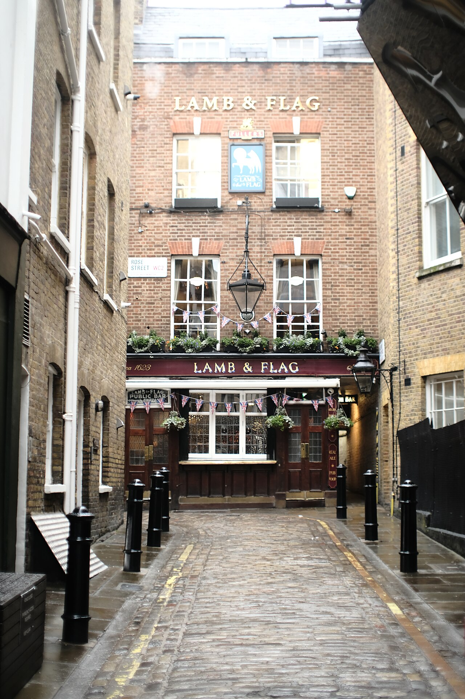
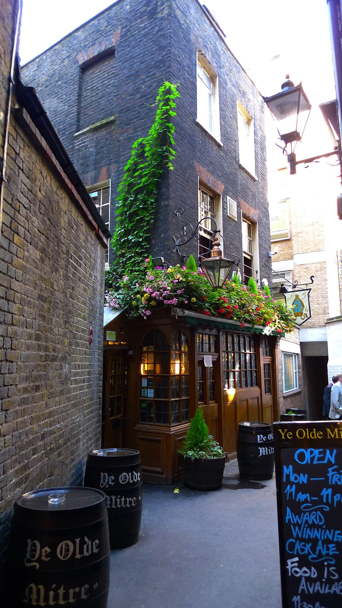

# The Lamb & Flag

Rose Street in Covent Garden is not wide, and the frontage of The Lamb & Flag sits between two narrow passages. There is no big window and no attempt to turn its history into an advertising board. First-time visitors often arrive from Lazenby Court or Rose Street and only then realise that this modest-looking pub opens onto one of Covent Garden's roughest old stories: bare-knuckle boxing, literary quarrels, market porters and theatre actors all moved through these lanes.

Figure: The Lamb & Flag on Rose Street, Covent Garden; its 1958 brick front conceals a possible early 18th-century timber frame, replacing a house of 1638. Image: Tanja Müller, CC BY 2.0, via Wikimedia Commons ([source page](https://commons.wikimedia.org/wiki/File:Lamb_and_Flag,_Covent_Garden_2025-02-08.jpg)).

## Location and history

The pub's official history records a tavern on this site from 1772, when it was called The Coopers Arms; it took its present name in 1833. The brick front dates from about 1958 and wraps a timber frame that may be early 18th-century, while the original house on the site dates from 1638. The often-repeated claim that a pub has stood here since 1623 is not reliable. In the early 19th century, bare-knuckle fights were held in an upstairs room, which gave the pub the nickname "Bucket of Blood." In 1679 the poet John Dryden was attacked by hired thugs in the passage beside the pub; the event predates the pub's first recorded licence, but the upstairs dining room is still called the Dryden Room. Dickens was a regular while working nearby, and in the 1960s the cast of Oliver! at the neighbouring theatre drank here.

The name deserves unpacking. CAMRA notes that "Lamb" refers to the Lamb of God in the Gospel of John, while "Flag" is the flag of St George; together they form a religious and English patriotic pair, not a rustic sign about a sheep and a banner. The boxing room explains the "Bucket of Blood" nickname, and the crowd that gathered around it made Rose Street a grey area of Covent Garden. In the 1960s the Oliver! company drank here, and the Australian comedian Barry Humphries met Peter Cook and Dudley Moore in the pub before their Barry McKenzie collaborations. Fuller's took a lease in 2011 and full ownership in 2013, carrying out a gentle refurbishment while keeping the two small bars, the absence of music and games, and the regulars' plaques. The beams of the Dryden Room still carry Latin inscriptions commemorating the 1679 attack.

## Space and drinks

The ground floor has two small rooms, with dark panelling, low beams, an open fire and old floorboards. Brass plaques to long-standing regulars hang on the walls, and some seats are still claimed by old customers. Upstairs is the Dryden Room, where full meals are served at the table. There is no background music and no gaming machine, which sets the pub apart from the louder bars around Covent Garden. The drinks list is built around Fuller's cask ale, usually London Pride and ESB, with a few guests; because Fuller's has leased the pub since 2011 and owned it since 2013, the guest range is smaller than at a free house, but the bar will usually offer a taste before you commit.

## How to drink

Start with a straightforward English bitter or pale ale, then try a more hop-forward version for contrast. Cask ale is not served over ice; it sits near cellar temperature, with soft carbonation and a malt sweetness that changes as the glass warms. If you want a meal, ask whether the upstairs room has a table rather than standing at the foot of the stairs with a drink. Weekday early evening is relatively quiet; weekends and theatre curtain-up or curtain-down are packed. The official hours are Monday to Saturday 12:00–23:00 and Sunday 12:00–22:30, with holiday changes. For a single drink, avoid the half hour before and after a show.

## Practical information

The address is 33 Rose Street, Covent Garden, London WC2E 9EB. Covent Garden station is about 200 metres away; Leicester Square and Charing Cross are also walkable. There is no car park, and Covent Garden is not a sensible place to drive, so walk or take the Tube. The ground floor is compact, and wheelchair access and turning space are limited; anyone with mobility needs should telephone ahead to ask about the route. Bookings are advised for the upstairs dining room; for drinks, walk in. Hours, menus and booking rules are on the official site.

## Etiquette and common misconceptions

First, "Bucket of Blood" is a nickname left by 19th-century boxing, not a comment on present-day safety. Treating it as a novelty label is crass. Second, the Dryden attack took place in the passage beside the pub and predates its first recorded licence, so it is wrong to say he was attacked inside the pub. Third, the "oldest pub in London, 1623" claim conflicts with the official and CAMRA accounts; use 1772 for the first recorded tavern and 1958 for the present brick front. Fourth, the upstairs room is a proper dining area, not a place to occupy a whole table with one drink; the ground-floor bar is also a poor spot for a long laptop session.

## Surroundings and routes

A few minutes' walk takes you to Covent Garden market, the Royal Opera House and Neal's Yard; Seven Dials is west, and Covent Garden station is south. The pub works well in the middle of [the classic London pub walk](ref:london-route): browse Covent Garden, drink a half pint here, then head north to [Ye Olde Mitre](ref:ye-olde) or take the Tube to [The Spaniards Inn](ref:spaniards) in Hampstead. For the wider role of pubs in the city, read [A city through its pubs](ref:pub-city) and [A history of taverns](ref:taverns).

## Further reading and see also

- [A city through its pubs](ref:pub-city)
- [A history of taverns: from alehouses and inns to bars](ref:taverns)
- [The classic London pub walk](ref:london-route)
- [Ye Olde Mitre](ref:ye-olde)
- [The Spaniards Inn](ref:spaniards)

**At a glance:** A historic pub on Rose Street in Covent Garden, first recorded as a tavern in 1772, nicknamed the "Bucket of Blood" for 19th-century bare-knuckle boxing, and linked to Dickens and the Dryden attack.

Checked on 2026-11-21 against the Lamb & Flag official page. The pub opens Monday–Saturday 12:00–23:00 and Sunday 12:00–22:30, with holiday changes; the upstairs restaurant takes bookings while the ground floor is usually walk-in for drinks. The 1623 "oldest in London" claim, the first record in 1772 and the 1958 facade are kept distinct in the body; "bucket of blood" was a 19th-century boxing nickname, not a description of today's safety. The image shows the Rose Street facade, not the interior or food.

**Key facts.**

| Item | Detail |
| --- | --- |
| In one line | A historic pub on Rose Street in Covent Garden, first recorded as a tavern in 1772, nicknamed the "Bucket of Blood" for 19th-century bare-knuckle boxing, and linked to Dickens and the Dryden attack. |
| Address | 33 Rose Street, Covent Garden, London WC2E 9EB, United Kingdom |
| City and country | London / United Kingdom |
| Status | verified open |
| Official site | lambandflagcoventgarden.co.uk |

## Related images

Image: The street frontage of Ye Olde Mitre seen from Ely Court; a tavern has stood here since 1546, while the present building is essentially 18th-century, not the original structure.. Credit: Ewan Munro from London, UK, CC BY-SA 2.0, via Wikimedia Commons ([source page](https://commons.wikimedia.org/wiki/File:Ye_Olde_Mitre,_Hatton_Garden,_EC1_(4140007697).jpg)). Related image for The Lamb & Flag.
