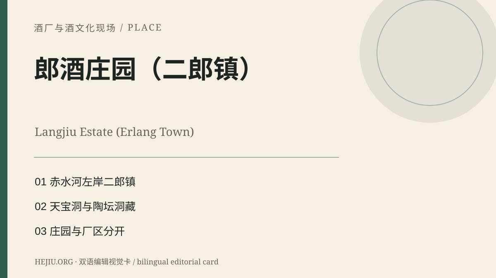

# Langjiu Estate (Erlang Town)

Langjiu Estate is not a “liquor-themed hotel” but a composite valley space on the left bank of the Chishui River where production, cave storage, tasting, lodging and sightseeing overlap. Many visitors come for Tianbao Cave and discover that the cave area, the brewing area and the estate hotel have separate entrances and booking rules. Decide whether you are buying a visit, a tasting, a room or a meal before choosing to stay on the hill; otherwise the day disappears into waiting for shuttles and finding gates.

Figure: Langjiu Estate (Erlang Town) bilingual editorial card. Project-created bilingual editorial card for topic identification, not a documentary photograph.

> **Quick verdict**
> **Best for:** travellers who want sauce-aroma brewing, cave storage and tasting in one valley; approach from Luzhou or Xishui.
> **Not for:** visitors who will not book and only want a roadside photo; the estate is not an open viewing platform beside the highway.
> **One line:** book visit, cave, tasting and lodging separately, and an overnight on the hill beats a same-day return.

## Keep estate, plant and caves apart

The first layer is the estate’s reception and lodging space, handling rooms, meals, displays and some tastings. The second is the working brewing plant, with pits, starter culture, distillation, storage and transport; it cannot be entered on your own. The third is cave storage such as Tianbao Cave and Dibao Cave, with stable temperature and humidity and dense rows of jars, usually entered on a booked route. All three sit in one valley but have different gates and safety rules. Start at the visitor centre, take a route map and ask which points are open and which are view-only; do not use an “estate ticket” to push into production.

## Sauce aroma on the left bank

Erlang lies on the left bank of the Chishui River, with a hot, humid valley and sloping ground. Sauce-aroma baijiu revolves around seasonal starter culture, grain stacking, pit fermentation and multiple distillations. In the brewing area, look at sorghum crushing ratio, starter-block cultivation, stacking temperature, pit sealing and the number of draw-off rounds; do not just memorise “12987” but see how it lands in a real workshop. The microclimate and water on both banks are part of the origin story but not the only variables; raw materials, craft and long storage also shape the liquor. If workshops are closed, use cutaways and flow diagrams in the exhibition, then compare valley orientation from the viewing point.

## Tianbao Cave and the jars

Tianbao Cave and Dibao Cave are natural rock caves used for storing liquor in ceramic jars. Temperature and humidity are stable and air moves slowly; the jars breathe without leaking, and the liquor changes over long storage. Look at three things: rock layers and seepage, jar seals and numbering, and passages and fire safety. Do not touch jars or shine a torch directly at a seal. The cave is dark and damp, so wear non-slip shoes and stay with the guide instead of lagging for photos. If you visit only one cave, choose the officially open one with the shortest route; leave the other for another trip rather than shuttling across the hill.

## Getting there and staying

Erlang is in Gulin County, Sichuan, usually approached from Luzhou, Xuyong or Xishui in Guizhou. Roads are mountainous, speeds drop in rain and fog, and self-driving needs night experience. Estate lodging and visits are often tied to bookings; room types, meals, shuttles and tasting packages change, so check official channels and cancellation rules. A same-day return is rushed: the drive from Luzhou alone takes hours, so stay one night on the hill and leave the next day. Outside the estate, Erlang and Xishui county towns have ordinary hotels, but allow time for morning and evening mountain transfers. Keep luggage light; big cases are awkward on frequent transfers.

## Pairing Erlang with Xishui

Erlang faces Xishui in Guizhou across the Chishui River, so a two-day loop can run Langjiu Estate and cave storage on the Sichuan side, overnight in Erlang or Xishui, then Xijiu’s plant exterior and Tucheng old town on the Guizhou side before returning to Zunyi or Luzhou. Check bridges, buses and navigation for cross-province detours, and watch for landslides and closures in the rainy season. For food, try Gulin spicy chicken, Chishui River fish, tofu pudding and cured meat, keeping sauce-aroma liquor modest. Buy from official or authorised shops and check baggage and consignment rules when carrying across provinces.

## Stay one night to see the estate’s rhythm

On a same-day return you will likely manage one display point, one meal, a few photos from the viewing deck and then the road. An overnight lets you split brewing, cave storage and tasting across different hours: arrive in the afternoon for displays and the viewpoint, taste in the evening, enter the cave or brewing area the next morning, and descend before noon. This avoids tour-group peaks and leaves room for rain or fog. With only one day, choose one cave plus displays and do not chase Erlang, Xijiu and Tucheng at once; mountain roads eat time. In every case, confirm lodging, visit and tasting separately rather than asking at the gate. Food choices on the hill are limited; ask breakfast and dinner times when staying, and bring a light jacket for the cave. In rain or fog, see one fewer point rather than drive the mountain road at night. The last shuttle time is the one given at check-in; do not drive mountain roads after tasting.

## Check before you go

- Confirm visit, cave, tasting and lodging separately
- Allow buffer time for rain and fog on mountain roads
- Wear non-slip shoes in caves; do not touch jars
- The driver skips the tasting
- Check consignment rules for cross-province transport
- Confirm the last estate shuttle
- Stay with the group in caves; no flash photography
- Ask about breakfast and checkout before booking on the hill

## Limits and next steps

Langjiu Estate sits in the valley at Erlang town, with visits spread between brewing areas, the Tianbao and Dibao caves, tasting rooms and reception, linked by walking and internal vehicles. It is not an open attraction and usually needs a booking or host arrangement; whether individual visitors can enter and which points are open depends on the day's policy. Confirm "estate visit" and "cave visit" separately so you do not arrive to find an area closed.

Approaches from Gulin or Xishui are mountain roads with rockfall and fog in the rainy season; do not drive at night. The estate has many steps and high humidity, so wear grippy shoes and do not drive down after tasting. If staying on site, confirm meals and room dates ahead; peak-season prices and minimum spend can rise.

This page does not rate the wines or promise a particular cave. Production and hosting schedules come before visitor plans; if something changes, keep the museum or the town as a backup.

## References

- gulin.gov.cn — official source — https://www.gulin.gov.cn/mlgl/zjgl/hzqhyrk (checked 2026-11-25)
- luzhou.gov.cn — official source — https://www.luzhou.gov.cn/ (checked 2026-11-25)
- langjiu.cn — official source — https://www.langjiu.cn/ (checked 2026-11-25)
- Official source — official source —  (checked 2026-11-25)

Related entries: [Erlang Town](ref:town), [Gulin Langjiu route](ref:route), [Langjiu](ref:brand), [Langjiu Group](ref:producer), [sauce-aroma baijiu](ref:style), [Guizhou](ref:region), [First baijiu guide](ref:guide), [History of Chinese wine](ref:history).

## Related images

Image: Sauce-aroma baijiu. Credit: Xiaomage de, CC BY-SA 4.0, via Wikimedia Commons ([source page](https://commons.wikimedia.org/wiki/File:Vertreter_der_vier_Baijiu_Kategorien.jpg)). Related image for Langjiu Estate (Erlang Town).

The administrative division reference is the 2007 edition of GB/T 2260.
