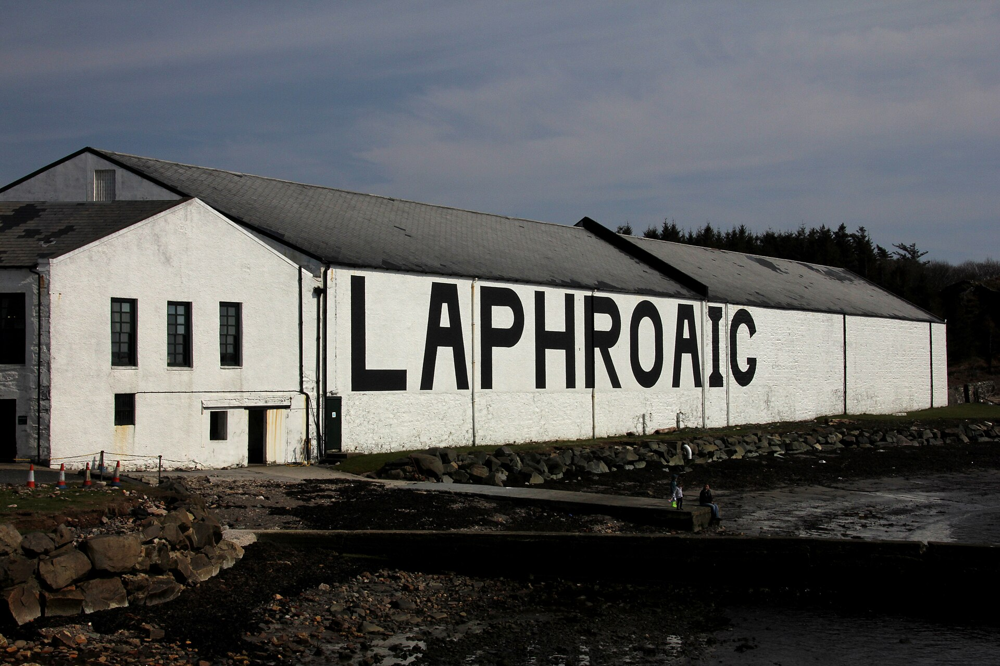

# Laphroaig Distillery

Laphroaig sits on the south coast of Islay, almost at sea level, with peatland behind it and the Kilbride stream beside it. Alexander and Donald Johnston founded the distillery in 1815, making it one of the island's earliest licensed concerns. What a visitor sees today is not a whisky theme park but a working plant: malt is turned on its own floor, peat burns in the kiln, seven stills run to a fixed rhythm, and the visitor centre is simply a door into that system.

Figure: Related photograph of Laphroaig Distillery. Image: Bjarne Henning Kvaal, CC BY-SA 3.0, via Wikimedia Commons ([source page](https://commons.wikimedia.org/wiki/File:Laphroaig_Distillery_-_panoramio_(4).jpg)).

## Place and history

"Laphroaig" is Gaelic, glossed by the distillery as "the beautiful hollow by a broad bay". The name describes topography, not flavour. After 1815 the company name and ownership changed repeatedly, but the site did not move. Single malt remains the core product, and the official story puts 1815 at the front of the brand narrative.

Three conditions tied to geography explain the whisky. The first is the sea: the distillery stands on the shore, and casks mature under constant exposure to salt-laden air, which feeds seaweed and brine notes into the spirit. The second is peat: Islay peat is built from moss, heather and plant remains, and the smoke from burning it is used to dry malt, carrying phenolic compounds into the whisky. The third is water: the Kilbride stream supplies water for mashing and cooling. Together they produce the style often described as iodine, sea salt, medicinal herbs and ash. None of that comes from an additive; it is the result of fuel, water and maturation conditions.

Islay is a distinctive region within Scotch whisky, but it is not uniform. Distilleries sit close together and still differ: some are heavily peated, some much lighter; some malt their own barley, others buy it. Laphroaig belongs to the group that treats heavy peat as an identity and keeps a floor malting, which is unusual in Scotland today. Treating Laphroaig as "the representative of all Islay" distorts the island; treating it as a stubbornly old-fashioned, heavily peated line is closer.

## Space and whisky list

The visitor centre contains a small museum, a shop and a lounge bar. The production areas matter more: maltings floor, peat kiln, mash tun, washbacks, stills and warehouses. This is not a reconstructed exhibit; floors are wet, equipment is warm and the smell changes with the stage of work. The distillery notes that the historic buildings include stairs and that visitors with limited mobility should say so when booking, when a sensory-led alternative can be arranged.

The range can be read as everyday bottlings, cask-strength and special casks, and annual limited releases. The 10 Year Old is the usual entry point, with peat, salt and citrus forming the outline. Quarter Cask finishes in smaller barrels, giving more wood contact and a clearer vanilla and coconut note. Lore blends different cask types and ages into a heavier body. Càirdeas is the yearly Friends of Laphroaig release, and its recipe changes. The visit page does not list every expression, so the bar menu on the day is the reliable source.

Warehouse 1 is the most distinctive space: a traditional dunnage warehouse on the shore, with casks stacked on stone rather than in modern racks, so humidity and temperature stay closer to the old conditions. The Warehouse 1 experience opens three casks there, lasts about 1.5 hours and lets guests take a bottle home. Its value is not "old whisky" but a clear demonstration that a warehouse is where maturation actually happens, not a stage set.

## Tours and ordering

Independent visitors cannot walk into production. Everything runs through booked experiences. The official page lists a 1.5-hour "Lessons in Laphroaig" that covers the process and ends with a tasting; a 2.5-hour "Distiller's Wares" that goes further behind the scenes; the 1.5-hour Warehouse 1 tasting; and a 4.5-hour walking day that follows the process from the Kilbride stream to bottling. Names, durations and prices change, so check the calendar before booking.

Book through the official site. Peak season and Fèis Ìle, the island's whisky festival, sell out early. The distillery also has a planned silent season, listed for 2026 as 8 July to 13 September, when production areas are closed and experiences are adapted towards history, warehouses and tasting. That detail matters: anyone coming specifically to see the stills should avoid those weeks.

Ordering happens in the lounge bar. For a first visit, start with the 10 Year Old to establish a baseline, then add Quarter Cask or a seasonal release. If unsure, tell the bar what you normally drink and how much peat you can take. Alcohol levels are high; tasting flights usually provide water, and adding a few drops is normal practice rather than ignorance. Non-drinkers can tour or shop without joining the tasting.

## Practical information

The address is Laphroaig Distillery, Port Ellen, Isle of Islay, Argyll PA42 7DU, Scotland, United Kingdom. The official site gives only the island and postcode, so navigate to "Laphroaig Distillery". The site lies a few kilometres north of Port Ellen. Public transport is limited; most visitors drive, take a taxi or join an island tour. From the mainland, the ferry leaves Kennacraig and takes about two hours, with schedules set by Caledonian MacBrayne. There is parking, and the south-coast three-distillery path along the A846 can be cycled from Port Ellen to the gate.

Visitor-centre hours in the 2026 official timetable are: March to October daily 09:45–17:00, with the lounge bar 10:00–16:30 and last orders at 16:15; November daily 09:45–16:30, with the bar 10:00–16:00 and last orders at 15:45; December Monday to Friday 09:45–16:30. It closes on 24 December and reopens on 5 January. The planned silent season runs from 8 July to 13 September 2026, when the production areas close and visits shift to history, warehouses and tastings. Holiday and maintenance changes follow the day's official notice.

Tickets and booking: every visit entering the production areas must be booked in advance on the official site, and peak season and Fèis Ìle sell out quickly. In 2026 the classic tour (Lessons in Laphroaig / Classic Tour) costs £22 per person and lasts about 1.5 hours, covering malting, mashing, fermentation and distillation before a tasting; the Warehouse One three-cask tasting is about £70 for 1.5 hours and includes a 100ml hand-filled bottle; the Whisky Trail is about £160 for four hours. The range is roughly £22–£160, all including tastings, with the official booking page as the final word. Under-18s may visit with an adult but cannot take part in whisky tastings; some warehouse and production experiences have additional access limits, which should be raised when booking. Island accommodation is tight in season, and trying to combine a tour with a same-day ferry is risky, so allow at least one night. The site is windy and the ground wet: shoes with grip matter more than shoes for photographs. Opening status, prices and bookings are subject to official confirmation. This page was verified on 2026-11-08.

## Etiquette and misconceptions

The most common mistake is to think Laphroaig's medicinal note comes from added iodine or medicine. It comes from phenols produced by burning peat, together with maturation in a maritime environment. The second is to read "single malt" as "single cask": single malt means malt whisky from one distillery, usually vatted from many casks. The third is to equate Islay with "the peatier the more authentic"; the island's styles vary widely.

On site, do not cross barriers, touch equipment or open casks, and do not use a flash around workers in production areas. In a tasting, do not knock the whisky back; the aroma needs time. Water is acceptable, but asking for cola or a large cube to dilute the dram is not the local convention. If you are driving, skip tasting altogether: island roads are narrow and the weather changes quickly.

One further detail: the "square foot of land" offered through Friends of Laphroaig is a membership device, not a transferable plot. The visitor centre can show the plot number and coordinates, but it is an honorary lease and should not be read as real property.

## Surroundings and routes

From Port Ellen, the A846 north can link Laphroaig with Lagavulin and Ardbeg for a south-coast distillery day. The three differ in style and tour rhythm; three in one day is rushed, two is more comfortable. East lies the Kildalton Cross and the old chapel, with medieval stonework; west lies Machir Bay, with beach and dunes. There is no rail service on the island, so the route depends on your own transport.

With only one day, take a Laphroaig tour in the morning, eat in Port Ellen, then choose either a neighbouring distillery or the coast in the afternoon. Keeping drinking and driving strictly separate is the most practical rule on Islay. Return ferries are weather-dependent and winter cancellations happen, so leave a buffer before leaving the island.

## See also

Laphroaig is a concrete entry point for understanding [Islay](ref:islay) and the [Scotch whisky](ref:scotch) industry; it shows how peat, sea air and warehouse maturation enter a spirit more directly than any flavour wheel. For the wider question of how a place gets into a drink, read [Why does a drink taste of a place?](ref:place-and-process).

Further reading: [Scotland](ref:c-extra-1), [Whisky](ref:c-extra-2).
