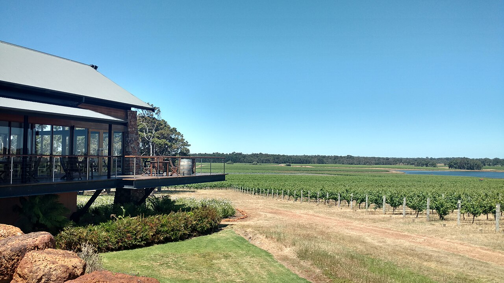
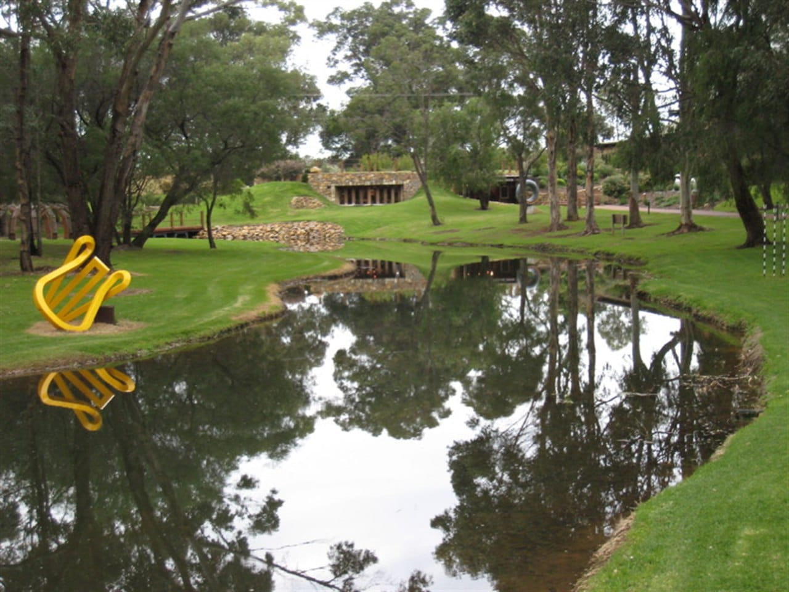

# Leeuwin Estate

Leeuwin Estate is one of Margaret River’s “founding five” wineries: the Horgan family bought the farm in 1969, established the winery in 1973, and released the first Art Series Chardonnay from the 1980 vintage. Today Block 20 Chardonnay, Art Series Cabernet and the concert series that began in 1985 tie wine, art and tourism into one brand.

Figure: Leeuwin Estate. Photograph: File:2016 Margaret River Australia. Watershed vineyard.jpg. Credit: Lasthib, CC BY-SA 4.0 ([source page](https://commons.wikimedia.org/wiki/File:2016_Margaret_River_Australia._Watershed_vineyard.jpg)). Category image; not a claim that it shows the exact product, site or event.

> **Quick verdict**
> **In one line:** This entry helps you decide whether Leeuwin Estate deserves a detour, and what to check before visiting.
>
> - **Best for:** Anyone planning a visit to Leeuwin Estate who needs to decide whether it deserves a half-day or a full day.
> - **Not for:** If you want only want a must-visit list and will not check booking, transport or opening hours.
> - **Check first:**
>   - Leeuwin Estate lies in southern Margaret River, at 1379 Bussell Highway, about ten minutes from the town of Margaret River.
>   - The visit centres on the cellar door, restaurant, Art Series gallery and open-air concert site.

## Position and history

Leeuwin Estate lies in southern Margaret River, at 1379 Bussell Highway, about ten minutes from the town of Margaret River. It did not begin as a winery: in 1969 Denis and Tricia Horgan bought the 121-acre cattle farm together with a plumbing business, with no complete plan to make wine. The turning point came in 1972, when Napa Valley’s Robert Mondavi visited and judged the maritime climate, laterite gravel over ancient granite and long, even growing season suitable for high-quality Chardonnay. Mondavi became an adviser and mentor.

The Horgans formally established the winery in 1973. A nursery was planted in 1974, vineyard blocks followed from 1975, the first commercial vintage arrived in 1979, and the first Art Series Chardonnay came from 1980. That timeline matters: 1969 was the land purchase, 1973 was the winery. Leeuwin’s early path was not “build a winery and look for a market” but “make a regional judgment, plant, then build a brand”.

In the early 1980s, Art Series Chardonnay drew international attention in blind tastings and put Leeuwin into the global fine-wine conversation. For more than four decades the estate has remained family-owned, with second-generation Justin Horgan and Simone involved in the business. Family ownership, long-term investment and tourism are central to what separates Leeuwin from a purely commercial winery.

## Vineyards and terroir

Leeuwin’s vineyards sit on rolling gravel slopes in southern Margaret River, over granitic base with laterite gravel. Drainage is fast and nutrients are low; the ocean moderates heat, keeping days from becoming extreme and nights cool enough to preserve acidity. Chardonnay, Cabernet Sauvignon, Shiraz, Riesling and Sauvignon Blanc dominate, with Pinot Noir among the early plantings. Today the portfolio is built mainly around Chardonnay and Cabernet.

The heart of Art Series Chardonnay is Block 20: a northwest-facing lower slope of gravelly hill, planted with the original Gin Gin clone. Small berries give high acidity and delicate but persistent flavour. Old vines and low yields make the wine tight when young but capable of long ageing. Leeuwin Chardonnay is not a heavy-oak wine; it relies on citrus, white flowers, hazelnut and mineral notes, with texture from fermentation and lees. The proportion of new oak and the length of lees contact decide whether a vintage feels leaner or fuller.

Cabernet comes mainly from southern slopes and tends toward a Bordeaux-shaped style: blackcurrant, cedar, graphite and fine tannin, structured without being heavy. Art Series Cabernet also holds a high place in the Langton’s Classification and is often compared with other Margaret River flagships. Vineyard management emphasises sustainability and low intervention, trying to let site differences reach the wine instead of flattening them with a fixed recipe.

## Winemaking and wines

The portfolio has three tiers: Art Series at the top, Prelude in the middle and Siblings for everyday drinking. Art Series covers Chardonnay, Cabernet Sauvignon, Shiraz, Riesling and Sauvignon Blanc. Each vintage’s label carries a work by a leading Australian contemporary artist, a tradition that began with the 1980 vintage and its first artist, Sidney Nolan. The label is not decoration; it is how the estate writes art into its brand structure, with a different artist and image for each year.

Art Series Chardonnay is generally gently pressed, part-fermented and matured in French oak with lees stirring, and the new-oak proportion is restrained. Art Series Cabernet uses longer maceration and oak ageing, aiming at structure rather than immediate fruit. From 2002 the estate moved entirely to screw caps, a controversial decision for high-end Australian wine at the time, justified by stability in long storage and reliability in transport.

Annual production is around 60,000 cases, spanning flagships as well as Prelude and Siblings for restaurants and retail. The flagship wines are made in small volumes, priced high and built for cellaring; Prelude and Siblings are easier to find for everyday occasions. Understanding those three tiers is more useful than memorising the name “Art Series”.

## Visiting and spaces

The visit centres on the cellar door, restaurant, Art Series gallery and open-air concert site. The estate sits on a slope, with views across vines to eucalypt and karri forest; restaurant, tasting room and gallery form an indoor-outdoor route that suits a half-day of tasting, lunch and art. Bookings are advisable, and transport and accommodation become tight around the summer concerts.

The Art Series gallery holds works by the Australian artists behind the labels, with original paintings, studies and limited prints rotating through the space. It is worth comparing the painting with the bottle: the same image is cropped to a small rectangle on a label, changing colour and composition. The choice of artist and work also says something about how the estate saw that vintage. The concert site is a grass meadow surrounded by forest. The first concert in 1985 brought the London Philharmonic Orchestra; later performers have included Ray Charles, Kiri Te Kanawa, Diana Ross, Tom Jones and Sting.

## Drinking and pairing

Art Series Chardonnay is best served around 10–12°C after a little warming. Too cold and the hazelnut and white-flower notes close down; too warm and the alcohol dominates. Cabernet is best at 16–18°C, with twenty to thirty minutes of air rather than aggressive decanting. Young Art Series Chardonnay is high in acidity and tight, and works with seafood, white meat, cream sauces and mushrooms. With age it gains honey, roasted hazelnut and deeper mineral notes, and suits roast chicken, pork and soft cheese.

Art Series Cabernet matches roasted lamb, braised beef, venison and hard cheese. Blackcurrant, cedar and graphite connect with the char on roasted meat, and the tannin cuts through fat. Prelude and Siblings are easier at the table, with pasta, roast meat, pizza or Chinese braised pork. In a restaurant, ask for the vintage and the block: Leeuwin’s flagship Chardonnay varies greatly by year, fuller in warm vintages and tighter and more acidic in cool ones.

## Practical information

From Margaret River town, drive south on Bussell Highway for about ten minutes. There is parking, though concerts and weekends can be busy. Tasting, gallery and lunch fit into three to four hours; a quick tasting still needs about ninety minutes. Leeuwin, Vasse Felix and Cape Mentelle can be combined into a day, but four stops is too many: driving between north and south, bookings and lunch add up quickly.

Opening hours, menus, tasting fees and concert line-ups change, so check the estate website before travelling. With children or older relatives, confirm child seats, step-free access and seating; the concert site is grass, so ask about entry and parking in advance. If the estate is closed for an event, check the website and phone rather than forcing an old itinerary.

## Etiquette and common misreadings

A winery is not a theme park. Arrive at your booked time, wear shoes that can handle grass, do not photograph working areas, do not touch equipment and do not take tasting glasses home; during concerts, stay out of backstage and vineyard areas. Spitting into a spit bucket is professional etiquette, not rudeness. If you are driving, keep to one or two tastings or buy a bottle to take away.

The most common misreading is to treat Leeuwin as only a concert brand. It is first a winery: Block 20 Chardonnay, southern-slope Cabernet, Art Series labels and family ownership are what make the concerts credible. Another mistake is to treat Art Series, Prelude and Siblings as the same tier. They represent flagship, mid-tier and entry positions, with different prices, volumes and ageing potential.

## Surroundings and routes

Leeuwin works as the core stop on a southern Margaret River route: continue south to Cape Leeuwin lighthouse, Augusta and Hamelin Bay, or north back to Margaret River town. With half a day, choose Leeuwin, one contrasting winery and lunch, and do not cross to northern Wilyabrup. With a full day, add the southern coast and lighthouse, but allow for driving and lunch.

The best way to understand Leeuwin is not to buy many vintages at once but to compare Art Series Chardonnay with Prelude Chardonnay from the same trip, recording fruit concentration, acidity, oak and lees texture. Do the same with Art Series and Siblings Cabernet. Once those differences are clear, comparisons with other estates become much easier.

## Further reading and see also

- Related entries: [margaret-river](ref:margaret-river), [australia](ref:australia), [chardonnay](ref:chardonnay), [syrah](ref:shiraz), [terroir](ref:art).
- This entry does not provide live prices, menus, concert line-ups or opening status; check the estate website and regional association before visiting.
- To understand Block 20, ask at the tasting about the fruit proportion, oak time and new-oak percentage in that year’s Art Series Chardonnay, then compare it with Prelude.

## Related images

Image: Category image for Margaret River. Credit: Mark Pegrum, CC BY-SA 2.0, via Wikimedia Commons ([source page](https://commons.wikimedia.org/wiki/File:Vasse_Felix_Winery.jpg)). Related image for Leeuwin Estate.
