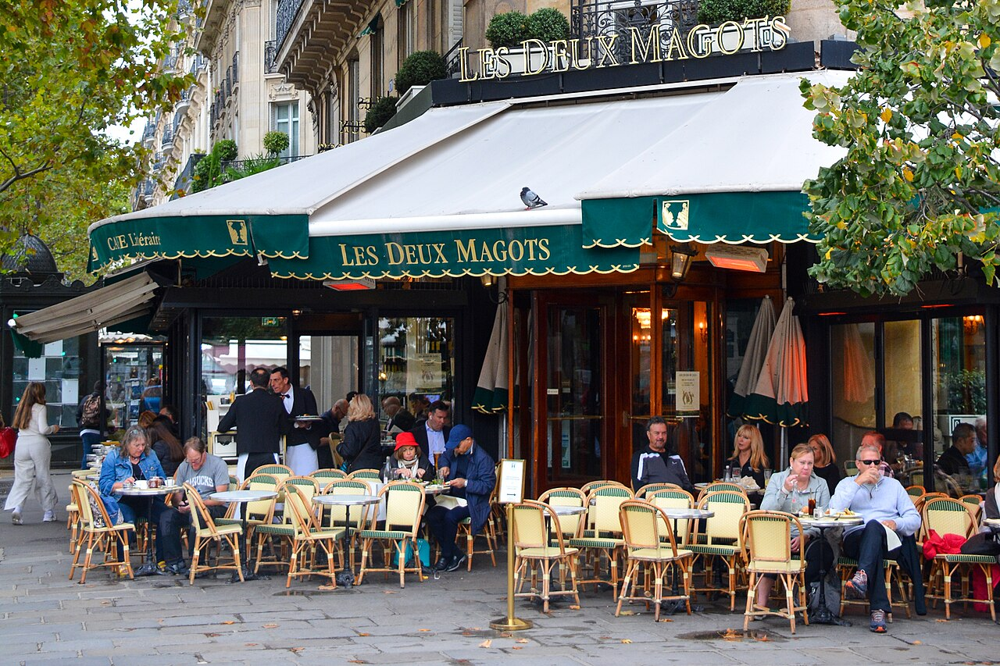

# Les Deux Magots

Les Deux Magots (Shuāng Sǒu Kāfēi Guǎn) stands at 6 Place Saint-Germain-des-Prés in the sixth arrondissement of Paris, facing the Romanesque church of Saint-Germain-des-Prés. It is usually described as a literary café, but a more precise description is this: a café converted from a nineteenth-century shop, still trading, and also the body that awards a literary prize. The two “magots” in the name are not a metaphor. They are wooden statues of Chinese merchants perched above a pillar inside the café, relics of the silk and novelty shop that once occupied the address. The café took over the space in 1885. Its official history begins in 1884, and the house marked 140 years in 2024.

Figure: Les Deux Magots. Image: Cheng-en Cheng from Taichung City, Taiwan, CC BY-SA 2.0, via Wikimedia Commons ([source page](https://commons.wikimedia.org/wiki/File:Les_Deux_Magots,_25_September_2019.jpg)).

## Place and history

The address began as a shop selling silk, cloth and curiosities in the nineteenth century. In 1885 it became a café serving alcohol. In 1914 the operator turned the somewhat dark inn into a brighter modern café; the mirrors, banquettes and terrace gradually settled into the look visitors see today. In 1933 the café created the Prix des Deux Magots, a literary award founded in reaction to a Goncourt Prize considered too academic. It honours a French-language novel or essay. That detail matters: the café is not merely a backdrop for famous names; it is an institution that has kept producing literary news. Hemingway, Sartre, Beauvoir, Picasso and Dora Maar are regularly mentioned in its story, but those visits belong to history. They do not reserve a particular seat for today’s guest.

## The room and the menu

The café has two distinct zones. Inside, red velvet banquettes, mirrors, wooden tables and pendant lights create a tight, conversational room. Outside, the terrace faces the square and the church, with good light and a constant flow of people. The two statues sit above a pillar inside, the most direct physical evidence of the old shop. Drinks centre on coffee, tea and hot chocolate, with a small selection of alcohol. Food includes tarte tatin, steak tartare, sandwiches and a weekend brunch. The official site presents hot chocolate as a signature and lists brunch on Saturdays, Sundays and public holidays from 11:00 to 15:30. This is not a cocktail bar, so do not judge it by the depth of its drinks list. Its offer is the everyday repertoire of a Parisian café: an espresso, a milky coffee, a hot chocolate, and something sweet or simple alongside.

## How to order on a first visit

Choose your seat before you order. Take the terrace to watch the square, or go inside for conversation; at midday and on weekend afternoons the terrace turns slowly, so do not stand in the passage while waiting. In French, “un café” means a small espresso by default. Ask for “café crème” if you want milk, or “café allongé” for a longer, weaker coffee. Hot chocolate is usually thick and intense, a good match for tarte tatin or a plain pastry. If you want something savoury, steak tartare or a sandwich makes more sense than a single drink. Two people can order one coffee and one hot chocolate and share a dessert; that is lighter than ordering two full sets. Avoid repeating “double espresso” in English; ordering from the menu is less likely to go wrong.

## Practical information

Address: 6 Place Saint-Germain-des-Prés, 75006 Paris (coordinates 48.85424, 2.33320), facing the church of Saint-Germain-des-Prés.

Transport: Metro line 4 to Saint-Germain-des-Prés puts you on the square; the Seine is about a ten-minute walk. The square is a pedestrian and bus zone, so drivers should use a public car park in the Saint-Germain area.

Opening hours and booking: the official booking page states 7:30 to 1:00 every day of the year, public holidays included, with rare exceptions. Reservations cover lunch and dinner only, require a €30 per-person card pre-authorisation and may be cancelled free of charge up to four hours before service; the café keeps tables for walk-ins, so arriving without a booking is possible and seating depends on the day. Groups of nine or more, private hire and corporate events go through commercial@lesdeuxmagots.fr.

Admission and spending: there is no entrance ticket; you pay from the menu, at Saint-Germain-des-Prés tourist prices, and coffee and desserts are not cheap. Brunch runs on Saturdays, Sundays and public holidays from 11:00 to 15:30. There is no formal dress code; smart casual is enough. The terrace is less pleasant in wind or rain, and large luggage or a stroller will struggle in the narrow passage.

Page checked on 2026-11-08; operating status, prices and bookings are subject to official channels.

## Etiquette and common mistakes

In a Parisian café, sitting down implies ordering; do not occupy a table without buying anything, and do not drag a neighbouring chair to your table. Service is deliberately unhurried; it is not neglect. When you want the bill, say “l’addition, s’il vous plaît”. A tip is not compulsory, but rounding up or leaving a small amount is normal. The statues are period fittings, not photo props: do not climb on them, touch them, or rest a cup on the base. When taking photographs, keep other customers’ faces out of the frame. The most common mistake is treating the café as a Hemingway museum. Famous visits are history; today’s seats, menu and service are a different matter. The second mistake is expecting a quiet library. The terrace is noisy on weekend afternoons.

## When not to come

This is the wrong place if you want a cheap quick coffee, a quiet desk for a laptop, or a full cocktail list. Families with small children will find the terrace difficult at peak times; visitors with limited mobility should check the entrance and seating layout first. People looking for nightlife should go to a bar, not a café. If crowds bother you, avoid weekends from late morning to late afternoon; a weekday morning is the closest the café comes to a neighbourhood rhythm.

## Nearby and around

The church of Saint-Germain-des-Prés is at the door. A few streets north lie Rue de Buci and Marché Saint-Germain; to the south you can walk to the Seine. The Musée Eugène Delacroix sits in a small street behind the church. [Café de Flore](ref:flore) is almost across the same corner, and the [Saint-Germain literary cafés walk](ref:route-saint-germain) pairs the two for half a day: first watch the square from Les Deux Magots, then cross the street to Flore. Do not rush the comparison. Both cafés deserve at least forty minutes; moving too fast hides the differences.

## See also

Coffee houses and bars are both part of a city’s public life; [Pub and city](ref:pub-and-city) sets out how seating, regulars and opening hours shape a place. For the other side of the same corner, read [Café de Flore](ref:flore) and the [Saint-Germain literary cafés walk](ref:route-saint-germain).

Start with the address. From there, consider the current opening status, then what the place is known for. That is how a practical judgment about Les Deux Magots is built.

[Reading a city through its bars](ref:pub-and-city) and [Saint-Germain-des-Prés literary cafés: a half-day walk](ref:route-saint-germain) are the two useful reference points for Les Deux Magots. [Reading a city through its bars](ref:pub-and-city) sets out address and space; [Saint-Germain-des-Prés literary cafés: a half-day walk](ref:route-saint-germain) brings in operating status. Read them together.
