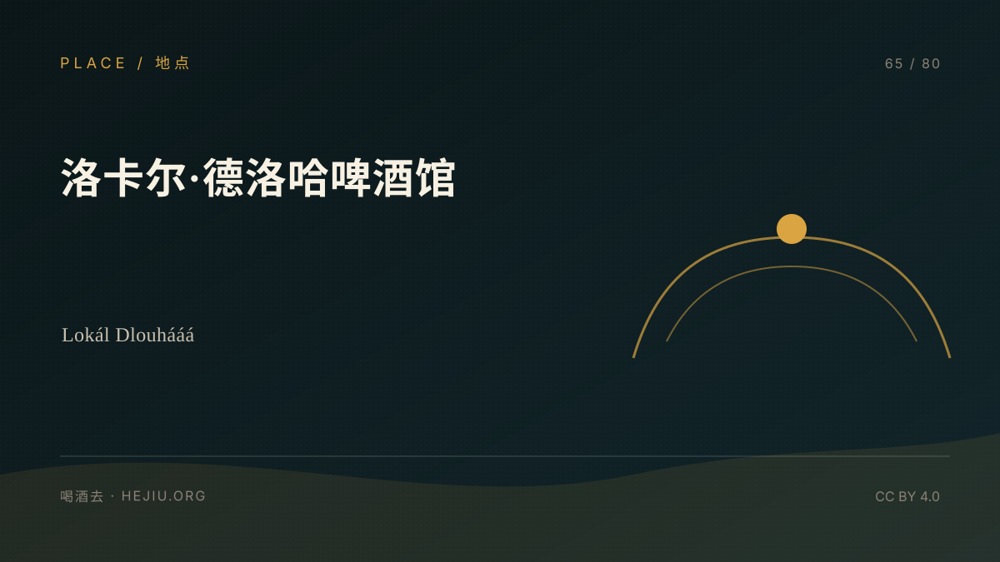

# Lokál Dlouhááá

Figure: Lokál Dlouhááá. Project-generated or category illustration used for beer context; not a photograph of the subject.

## Setting and history

Lokál Dlouhááá stands at Dlouhá 33 in Prague's Old Town, a short walk from both the Old Town Square and Republic Square. It does not belong to the centuries-old beer-hall category: it opened in 2009 as the first Lokál and the longest property in the brand. Lokál's brief is a "traditional Czech pub for the 21st century": carefully handled beer, freshly cooked food and professional service, without relying on imitation-antique décor to tell a story.

Dlouhá is a street in the eastern Old Town, with office and shopping traffic by day and restaurants and bars at night. The Dlouhááá premises are very long, and the official description calls it one of the longest restaurants in Prague; "long" here means physical length, not historical depth. It is more accurate to treat it as a modern pub that scales the standard Czech pub formula than as an ancient institution.

The brand later opened pubs in Prague, Brno and Pilsen, but Dlouhá remains the first and longest. That explains why it draws both local regulars and guidebook visitors: it is simultaneously the brand's flagship and a neighbourhood canteen.

## The room and the list

The interior is plain 1970s style: long wooden benches, a stainless-steel bar, and the beer tank installed directly under the tap, so the beer travels a short line into the glass. The official figures are 12 tanks and 69.78 metres of beer line; that tank-to-glass distance is how the pub makes "freshness" its selling point. The room is long and seats many people, yet dinner still fills up—not because seating is scarce, but because the place is genuinely used as a daily canteen.

The list is built on Czech lager: Pilsner Urquell pale lager, Velkopopovický Kozel dark, and Radegast Birell as the alcohol-free option; the official brand page also mentions unpasteurised, unfiltered Kozel on tap. On a first visit, order a hladinka of Pilsner Urquell and then decide whether to switch to the dark beer.

Czech pouring is taken seriously here. Hladinka is the standard glass, mostly beer with a layer of foam; šnyt has more foam and less beer; mlíko is almost all foam; čochtan has almost no foam and is filled to the brim. The pour changes texture and aroma rather than serving as a stunt; if unsure, hladinka is the safe choice.

Food is Czech home cooking: the menu changes daily, uses Czech ingredients from local suppliers, and is served at lunch and in the evening. Svíčková (braised beef in cream), vepřo knedlo zelo (roast pork with sauerkraut and bread dumplings) and roast duck are common directions; check the day's menu for what is actually available. Portions are large and the seasoning is salty, which suits lager better than water.

## What to order on a first visit

Start with a hladinka of Pilsner Urquell and either svíčková or roast pork with dumplings; this combination explains what the place is. If you want a change afterwards, order a Kozel dark; if you are not drinking alcohol, take Radegast Birell. Do not assume a beer hall means a large glass: both glass size and pour style are choices.

Order by naming the beer, the glass size and the pour; the staff are experienced, so ask how to order a hladinka if unsure. Service is at the table rather than a queue at the bar; groups and dinner slots should reserve, while walk-ins find it easier at lunch. Benches may be shared, so put bags down without blocking the aisle and do not occupy a whole bench.

Check the bill against the number of glasses; the usual Czech tipping practice is to round up or add 5%–10% and state a total including the tip. Do not leave the tip on the table and walk away, and do not take glasses or menus home.

## Practical information

**Address:** Dlouhá 33, 110 00 Praha 1, Czech Republic, in the Old Town (Staré Město). Dlouhá is lively at night, so following the house number is more reliable than following the crowd.

**Getting there:** take Metro line B to Náměstí Republiky and walk about 6–7 minutes, or line A to Můstek and walk about 8–10 minutes; trams stop at Dlouhá třída, about 2–3 minutes away. Check DPP for the day's connections, step-free exits and last trams.

**Opening hours:** the official page lists Monday–Saturday 11:00–00:00 and Sunday 11:00–22:00. Holidays and temporary events alter this; check the official site on the day.

**Tickets and reservations:** there is no admission charge; you pay for what you order. Reserve for dinner and weekends through the official booking page; walk-ins find it easier at lunch. Prices are mid-range for Prague's tourist core: one main course and two beers is a usual budget, with the menu as the final guide. Dress is casual. Cards are normally accepted, but a little cash is safer.

Page verified 8 November 2026; opening status, prices and reservations are subject to the official channels.

## Etiquette and common mistakes

First, look for a free place when you enter; at peak, do not treat a shared bench as a private table or stand in the aisle waiting. Second, state the glass size and pour when ordering beer; if you do not want a foamy šnyt or mlíko, order hladinka. Third, check the bill: Czech pub bills may accumulate by glass, so query anything you do not recognise on the spot. Fourth, tipping is not compulsory; rounding up or 5%–10% is common.

Four myths are common: that Lokál is a centuries-old pub (it is a modern brand that opened in 2009); that "longest" means "oldest"; that tank beer and bottled beer differ only in packaging (distance, temperature and freshness all affect the drink); and that dark beer must be stronger (Kozel dark is a flavour type, and strength is on the label). Another practical mistake is treating this as a quiet date spot: benches, large tables and dinner traffic make it better for groups of friends.

This place does not suit anyone wanting quiet conversation, anyone interested only in small, refined cocktails, or anyone in a hurry for a single standing drink. It suits people treating Czech beer and home cooking as a full dinner.

## Around and routes

Walk west a few minutes for the Old Town Square and the astronomical clock, east for Republic Square, the Powder Tower and the Municipal House, north for the Palladium shopping centre, and south about fifteen minutes for Charles Bridge. Put Lokál at midday: a Czech meal first, then the Old Town Square and the Powder Tower, then the Municipal House or the Vltava embankment in the afternoon; if you want another drink in the evening, Dlouhá itself offers plenty of choices.

Evening traffic on Dlouhá concentrates at restaurant and bar doors, and Lokál is one of the easiest places to fill up. Avoid the peak tour-group dinner slot or reserve ahead; if you only want one drink, afternoon is easier than evening. To extend the beer theme, Prague's beer halls and small breweries are spread across other districts, so there is no need to crowd them all into the Old Town.

## See also

- [U Fleků](ref:u-fleku): another Prague beer hall known for its own dark lager, a useful contrast with Lokál's modern tank-beer model.
- [Hofbräuhaus](ref:hofbrauhaus): Munich's large beer hall, useful for comparing space and service with a Czech pub.
- [Schlenkerla](ref:schlenkerla): the smoked-beer tavern in Bamberg, representing another local beer tradition.

Further reading: [Beer](ref:c-extra-1), [Reading a city through its bars](ref:c-extra-2).

**Short definition:** A Czech pub on Dlouhá street in Prague's Old Town, opened in 2009 and known for its 12 beer tanks, 69.78 metres of beer line, Pilsner Urquell, Kozel dark lager and Czech home cooking.
