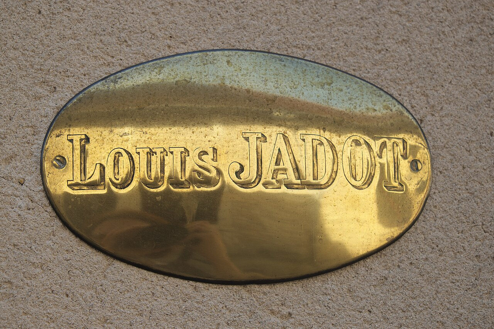

# Maison Louis Jadot

On the Route de Savigny north of Beaune, a nineteenth-century house, a connected fermentation room and cellars make up the daily working headquarters of Louis Jadot. There is no grand sign at the gate, only a brass plaque reading “Maison Louis Jadot”. It is a different Burgundy from DRC: one is built on a handful of monopoles and allocation, the other on a large négociant and estate system spanning regional wines to grands crus, owned vines and purchased fruit. The question is not whether Jadot is famous, but how it turns more than 200 hectares and a hundred appellations into a recognisable style.

Figure: The Maison Louis Jadot plaque on Route de Savigny in Beaune. Image: GFreihalter, CC BY-SA 3.0, via Wikimedia Commons ([source page](https://commons.wikimedia.org/wiki/File:Beaune_Maison_Louis_Jadot_535.jpg)).

## Location and history

The Jadot family came from Belgium, moved to Beaune in 1794 and soon began buying Premier and Grand Cru vineyards. In 1859 Louis Henry Denis Jadot founded the house under his own name. He learned the cellar and tasting first, then the vineyard; that order — understand the wine before the land — became the Maison’s method. It is not merely about owning plots, but about judging plot, vintage and market at the same table.

Jadot built its own cooperage in 1996, selecting, seasoning, toasting and finishing barrels in Beaune, which is unusual for a Burgundy négociant. From the 2024 vintage its estate vineyards have been organic certified. It owns about 528 acres (214 hectares), including some 280 acres of Premier and Grand Cru plots in the Côte d’Or, and sells into more than 120 markets. It also owns Château des Jacques in Beaujolais, Domaine Ferret in Pouilly-Fuissé and Maison Louis Picamelot, but the working headquarters remains in Beaune.

## Architecture and spaces

The headquarters is at 62 Route de Savigny. Offices and reception face the street; behind them are fermentation rooms, ageing cellars and tasting rooms, and further back the cooperage. The layout matters: grapes arrive, ferment, go into barrel, age, are bottled and sold in the same yard. Jadot is not simply buying wine to resell; it controls each step. La Cuverie is the visitor-facing tasting and sales space, with fixed opening hours, but the production area is not open to walk-ins.

The cellars are classic Beaune vaults: damp, cool, dim. New and used barrels are separated by cuvée and vintage; the cooperage smells of fresh wood and toast. Do not just count barrels. Look at provenance, toast level and age of the wood. Jadot argues for restrained new oak so that village and Premier Cru wines keep fruit rather than take on a barrel veneer.

## The wines and palate

The range is broad, but three groups are useful. First, Côte d’Or village and Premier Cru wines: Gevrey-Chambertin, Nuits-Saint-Georges, Beaune Premier Cru and the Beaune monopole Clos des Ursules. Clos des Ursules is an entry into the house style: red cherry, raspberry, spice and fine tannin, gaining leather and undergrowth with age. Second, grands crus: Corton, Corton-Charlemagne and Montrachet, small in quantity and expensive, but still aiming at transparency rather than density. Third, the south and Beaujolais: Pouilly-Fuissé, Mercurey and Château des Jacques’ Moulin-à-Vent, which show how the négociant system crosses regions.

Whites usually see gentle pressing and fermentation, preserving citrus, white flowers, hazelnut and mineral notes. Reds emphasise long maceration, wild yeast where possible and restrained new oak. Village wines are for three to six years, Premier Cru six to twelve, grand cru ten to twenty or more. Not every bottle needs ageing: Clos des Ursules and Corton-Charlemagne can wait, but a Bourgogne rouge is often better young.

## How to drink

Serve whites at 10–12°C and reds at 14–16°C. Young reds can be opened 30–60 minutes ahead; Premier and Grand Cru one to two hours, without violent decanting. Use a Burgundy glass or a large white-wine glass. Do not take whites below 8°C, or the perfume shuts down.

Pair village reds with roast chicken, mushrooms and hard cheese; Premier Cru with duck breast or pot-au-feu; Corton-Charlemagne with lobster, creamy mushrooms or roast fish; Pouilly-Fuissé with oysters and scallops. Avoid heavy chilli or sweet-and-sour sauces. Jadot’s wines are not built on sheer weight; fat and salt in the food matter more than spice.

## Practical information

Address: 62 Route de Savigny, 21200 Beaune. Telephone +33 3 80 26 31 98. La Cuverie is open Monday to Friday 10:00–12:00 and 15:00–19:00 (Wednesday only 15:00–19:00), Saturday 11:30–17:30; call ahead. Production visits and cellar tastings are usually by appointment or open only during special events such as the Hospices de Beaune auction weekend. Do not treat it as a daily rolling tour.

From Beaune station it is a 20–25 minute walk or a 5–10 minute taxi; by car from the A6 it is about ten minutes into Beaune. There is visitor parking in the yard, but it is tight during auction weekend. Combine Hospices de Beaune, Château de Meursault and Drouhin over a day; if you want only one visit, a focused tasting at La Cuverie is more efficient than rushing three estates.

## Etiquette and common misreadings

First, a négociant is not automatically a “broker without vines”. Jadot owns vineyards and also buys grapes and wine, but ferments and ages under its own control; do not dismiss its quality control with the label “négociant”. Second, a Maison is not a château. There is no visitor castle or manor-house narrative here; you come for cellars, cooperage and tasting. Third, do not enter the production area without an appointment; the cellars are slippery and the barrel aisles are narrow.

Fourth, do not ask for “direct from the estate” old vintages or private stocks; shop inventory and allocations are limited, and staff cannot promise what does not exist. Fifth, do not chill every wine to the same temperature; whites lose perfume when too cold and reds feel loose when too warm. Sixth, read the appellation, vintage and bottler. The same Louis Jadot label may cover a regional wine or a grand cru, with very different price and ageing potential.

## Around and routes

Put Jadot on the Beaune leg of the [Burgundy grands crus drive](ref:route): see the [Hôtel-Dieu](ref:hospices) in the morning, taste at La Cuverie at midday, then go to [Château de Meursault](ref:meursault) for another kind of estate architecture. To compare négociant and monopole, drive around the outside of [Romanée-Conti](ref:drc) the next day; one opens its door, the other keeps it closed, and both forms of power coexist in the same strip of land.

For half a day, do La Cuverie plus old Beaune. For a full day, add Meursault and Pommard. Do not park between vineyard rows, and do not improvise during auction weekend: the whole town is congested, and visits and parking need booking.

## Further reading and see also

- Regional comparisons: [Romanée-Conti](ref:drc), [Château de Meursault](ref:meursault), [Hospices de Beaune](ref:hospices), [Burgundy grands crus drive](ref:route).
- Background: [Burgundy](ref:burgundy).
- This page provides no map; visit and shop hours should be confirmed with official channels.

Start with [Domaine de la Romanée-Conti](ref:drc) for address and space, then read [Hôtel-Dieu des Hospices de Beaune](ref:hospices) for operating status. Seeing both keeps Maison Louis Jadot from being confused with a neighbouring idea.

For Maison Louis Jadot, this page was last checked in 2026; prices, batches and availability change, so confirm them against the sources below.

Frédéric Barnier became technical director in 2010.
