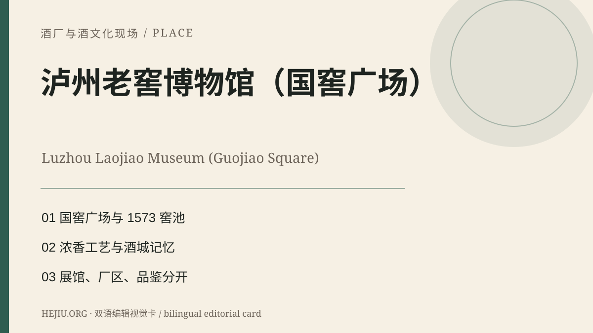

# Luzhou Laojiao Museum (Guojiao Square)

The common mistake in Luzhou is to photograph one “1573” pit without asking why it could be used continuously, or what the museum, workshops and tasting areas each show. Guojiao Square compresses heritage, craft and city memory into one district: first understand how the pit group relates to the workshops, then decide whether to spend time in the museum, at the pits or in the old town.

图：Luzhou Laojiao Museum (Guojiao Square) bilingual editorial card。Project-created bilingual editorial card for topic identification, not a documentary photograph.

> **Quick verdict**
> **Best for:** travellers who want to understand the strong-aroma system of pits, grain and distillation; pairs well with Luzhou’s old town and Yangtze waterfront for a day.
> **Not for:** pure shopping trips or visitors unwilling to book and walk; the museum and working areas are not one free entrance.
> **One line:** museum first for the framework, then the national treasure pits, and keep tasting separate from buying.

## The museum and the pits are different

Luzhou Laojiao’s visitor space has roughly three layers. Guojiao Square and the museum explain history, craft and brand. The 1573 national treasure pits and Ming–Qing workshops are living heritage, with the emphasis on pits, pit mud and continuous production. The tasting and sales area is where you sit down for a small cup. The three can form one route, but access differs: the museum follows its own notice, the pits and workshops follow scenic-area or official booking, and working areas cannot be entered on your own. Separate “exhibition”, “pits” and “drinking” before you start.

## What to look for at the 1573 pits

The value of a pit is not merely age but the microbial community cultivated in the mud over years. Strong-aroma baijiu uses solid-state fermentation in mud pits; older pits in continuous use tend to give more stable pit aroma and ethyl caproate. Look at three things: the shape and layout of the pits, the colour and maintenance of the mud, and the rhythm of grain going in and coming out. Do not touch the mud or throw anything into a pit; photography is allowed in some areas and not others, so follow on-site signs. Models and cutaways in the museum explain how a pit works, so see them before the real thing.

## Ming–Qing workshops and liquor-city memory

The heritage is not one pit but a group of Ming–Qing workshops distributed through the city. They connect shopfront-and-workshop production, river transport and old streets, explaining why Luzhou became a major strong-aroma origin. In a workshop, follow the material flow: where spent grain comes from, where the still sits, which room holds the ceramic jars, and how the finished liquor leaves. That logistics line is more useful than memorising dates. Nearby you can add the Yangtze–Tuo River confluence, Drum Tower and old streets, but do not expect “liquor city” to mean a continuous street of bars.

## Booking, transport and time

Guojiao Square sits near Sanxing Street in Jiangyang District. Allow time from Luzhou station or Yunlong Airport; bus routes change, so use a live map. The museum and square take about two hours; pits, workshops and a tasting need half a day or a full day. Opening times, tickets and booking rules change, so check official channels rather than an old guide. The pit area can be slippery and smells strong in summer; wear non-slip shoes. Do not drive after tasting. Taxis are easy in central Luzhou but slower at peak times.

## What to pair nearby

A half-day loop can run museum, Guojiao Square, the pits and the old town, ending at the Yangtze in the evening. With another day, consider Zhangba longan forest, Yaoba old town or Huangjing forest; all are far enough to need separate planning. For food, try Luzhou white cake, Hejiang grilled fish, pig-ear粑 and river fish, keeping the strong-aroma baijiu modest. When buying, distinguish factory direct sales, authorised shops and ordinary tobacco-and-liquor stores, and keep the receipt. Do not treat “internal” or “special supply” liquor as a bargain; avoid unclear sources and travel rules.

## Walk the liquor city as a timeline

With half a day, follow museum, Guojiao Square, the pits and the old town, focusing on pit shape, mud maintenance and the spatial logic of the Ming–Qing workshops; do not spend so long in the museum that the real pits get rushed. With a full day, add the Yangtze waterfront, Drum Tower and old streets, finishing by the river in the evening. Luzhou’s liquor memory lives in wharves, lanes and restaurants as much as inside the plant. With older relatives or children, cut the tasting and explain the museum models and the workshop material flow instead of memorising dates. Either way, separate heritage from shopping: finish the visit first, then buy at an official or authorised shop, and ignore “internal channel” offers at the gate. With only two hours, see the craft cutaways in the museum, then the pit exterior at Guojiao Square, and do not rush to buy. Take a taxi back after an old-town dinner; do not walk through the streets after drinking. Museum and pit bookings use different entrances, so reconfirm the day before, and with older relatives ask where the rest points are. Keep each booking code handy; parking is tight, so a taxi is simpler. Arrive ten minutes before a museum talk and keep the ticket; bring a hat in summer.

## Check before you go

- Check the booking entry for museum, pits and workshops
- Do not treat the museum as the production area
- Do not touch pit mud
- Do not drive after tasting
- Buy only from official or authorised shops
- Allow walking time between Guojiao Square and the old town
- Stay with the guide on group visits
- Wear non-slip shoes; pit floors are wet in summer

## Limits and next steps

The museum at Guojiao Square and the living fermentation pits are two different experiences with different rhythms. The museum covers history, vessels, documents and brand narrative and is better seen first; the pits are working production facilities with limited access, and you cannot enter them or touch the pit mud. Arrange them as "understand first, then see the site" for a fuller picture.

Central Luzhou is small: the museum, the old town and the riverfront are a walk or a short taxi apart. If you also want the liquor industrial park or another distillery, set aside a separate half day. The city is hot and humid in summer and the smell near the pits is strong; sensitive visitors can shorten the stay.

This page does not give tasting or buying advice. Prices and stock differ between the museum shop and city channels, so compare before deciding; if shipping, confirm the packing and the courier's liquid policy. Focus on the craft and the city's relationship with it rather than only photographing a pit.

## References

- 国窖之旅 — 泸州老窖 — https://www.lzlj.com/travel/ (泸州老窖, checked 2026-11-25)
- 泸州老窖 — 窖池群与酿酒遗产 — https://www.lzlj.com/news/enterprise/13004.html (泸州老窖, checked 2026-11-25)
- 泸州老窖窖池群及酿酒作坊 — 泸州市人民政府 — https://www.luzhou.gov.cn/sq/lylz/wlmk/lswhpp/gjjwwbhdw/content_986905 (泸州市人民政府, checked 2026-11-25)
- 泸州老窖景区旅游攻略 — 泸州本地宝 — http://m.luzhou.bendibao.com/tour/5894.shtm (泸州本地宝, checked 2026-11-25)

Related entries: [Luzhou Laojiao cellars](ref:cellars), [Luzhou Laojiao route](ref:route), [Luzhou Laojiao](ref:brand), [Luzhou Laojiao Group](ref:producer), [strong-aroma baijiu](ref:style), [Sichuan](ref:region), [First baijiu guide](ref:guide), [History of Chinese wine](ref:history).
