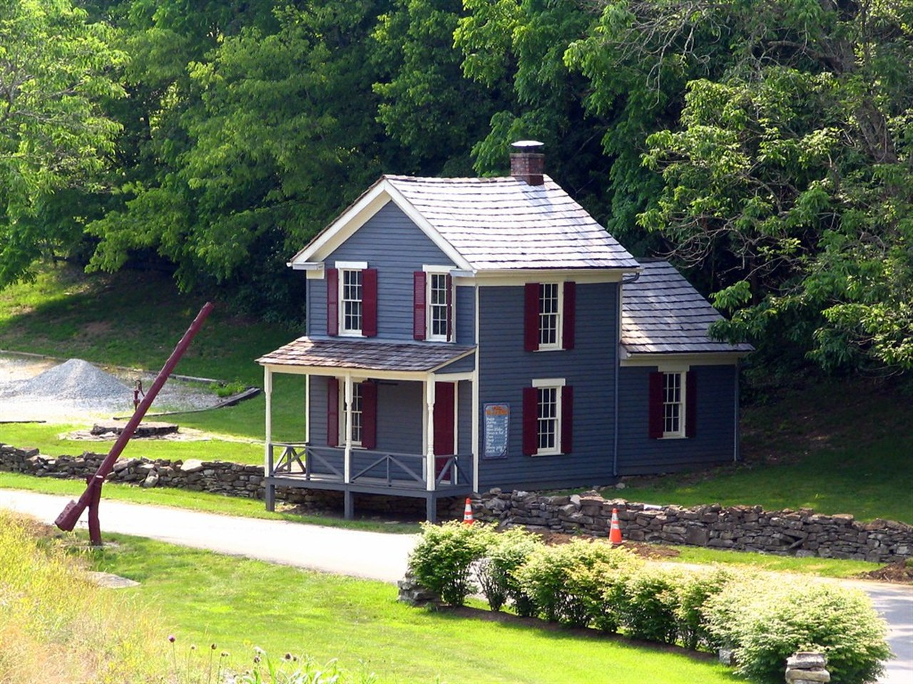

# Maker's Mark Distillery

Loretto sits in the rolling hills of central Kentucky, not far from Bardstown. Maker's Mark calls its site Star Hill Farm, and the name is not a later tourism addition: when the Samuels family chose the land in the 1950s, they wanted the limestone-filtered spring water and the watershed that came with it. What visitors see today is a working farm-distillery where sheep, wagyu cattle, solar-powered warehouses, hand-rotated barrels and red wax coexist. Its National Historic Landmark status has not stopped production.

Figure: Maker's Mark Distillery. Photograph: Toll Booth at Maker's Mark Distillery. Credit: SeeMidTN.com (aka Brent), CC BY 2.0, via Flickr / Openverse ([source](https://www.flickr.com/photos/94502827@N00/272886546)).

## Why Star Hill Farm

Bourbon is sensitive to water. Kentucky limestone filters iron out of the water and leaves calcium and magnesium, which helps mashing and fermentation stay consistent. Maker's Mark says it is one of the few distilleries with its own water source and a complete watershed: the spring feeds a limestone lake, and the lake feeds the mash house. Building a distillery on a farm also means the by-products can circulate on the same land. Spent grain can feed animals, manure returns to the fields, and the red winter wheat from those fields goes back into the mashbill. Today this is called regenerative agriculture, but in the 1950s it was first a practical siting decision.

## 1952 to 1958: burning the old recipe

In 1952, Bill Samuels Sr. began building at the current site. He wanted a bourbon he would drink every day, without a sharp, bitter edge. In 1953 he burned the family's old recipe and switched to soft red winter wheat instead of rye; Margie Samuels designed the bottle, the label, the name and the signature red wax. The company also credits her with inventing bourbon tourism, because she invited visitors in before a formal visitor centre existed. In 1958 the first hand-dipped bottle went on sale. In 1980 the distillery was designated a National Historic Landmark as "Burks' Distillery", the first in America recognised while its historic buildings were still in production. Maker's 46 followed in 2010, Private Select in 2015 and Star Hill Farm Whisky in 2025, all additions within the same wheat-and-handwork framework.

## Red wax, hand-rotated barrels and solar warehouses

Two gestures define the craft. The first is barrel rotation: every barrel is turned by hand on a regular schedule so the liquid keeps contact with the wood, which the distillery says gives more even maturation. The second is wax: each bottle is dipped by hand at the distillery, so the thickness and the drip pattern are never identical. The still house uses a continuous column still and a doubler, turning fermented mash into new make before it goes to barrel. The warehouses run on solar power, and the company says it bottles by taste rather than by a fixed age. On a tour, look at the racking and the floor: what happens in [oak](ref:oak-ageing) is not just time but temperature swings, height in the warehouse and the grain of the staves.

## Choosing a tour and timing the booking

The Classic Maker's Mark Tour lasts about 1 hour 15 minutes and covers history, mashing, fermentation, distillation and a warehouse, ending with a tasting. Other options include Behind the Bourbon, the farm-wide Star Hill Farm Estate Whisky Tour, the oak-focused Oak Experience and a cocktail class. Book online; peak dates and weekends fill quickly. Arrive 15 minutes early, bring ID, and note that the site is card-only at present. You will walk indoors and outdoors, so closed-toe shoes are required. Parking is free, but Uber and Lyft are unreliable in Loretto and may not bring you back, so a car or hired driver is safer. If you approach via Maker's Mark Road, expect a narrow, winding route; large vehicles should use Bill Samuels Jr. Road from Highway 52.

You can also eat on site: Star Hill Provisions serves lunch, the Homeplace Bar offers snacks and cocktails, and the distillery and shop open from 9:30 a.m. to 5 p.m. One of the most popular extras is dipping your own bottle, done at the shop after purchase. Founder's Series, Private Selection and Wood Finishing Series bottlings are distillery exclusives, and stock changes daily. Families should check each booking, because not every experience admits children and some are marked 21 and over.

## The range, from the classic to 46

Classic Maker's Mark is an all-wheat recipe: corn provides sweetness, red winter wheat gives a soft texture, and there is no rye pepper. Maker's 46 adds French oak staves after maturation for vanilla, caramel and spice. Cask Strength keeps the barrel proof and feels thicker; 101 is a higher-strength regular bottling; Private Select lets customers choose ten oak staves with different toast levels before finishing. For a first visit, compare the classic, 46 and Cask Strength: the same base spirit, changed by oak treatment and dilution. The classic also makes an excellent [Old Fashioned](ref:old-fashioned), though its sweetness means the bitters and orange peel should be kept in check.

## On the Kentucky bourbon map

US rules require bourbon to use at least 51% corn, mature in new charred oak and bottle at no less than 40% alcohol by volume; a "straight" bourbon must also age at least two years. Maker's Mark replaces rye with wheat, but corn remains above the threshold, so it is still bourbon rather than a "wheat whiskey". About half an hour northeast is [Heaven Hill](ref:heaven-hill) in Bardstown, and about an hour north is [Buffalo Trace](ref:buffalo-trace) in Frankfort. The three sites feel very different, and comparing them in one day is a good way to see the split between wheat-led and rye-led houses. For background, read the [bourbon](ref:bourbon) and [Kentucky](ref:kentucky) entries. The coordinates 37.6478, -85.3489 come from a public geographic listing; check official channels for the exact entrance.

Start with the address. From there, consider the current opening status, then what the place is known for. That is how a practical judgment about Maker's Mark Distillery is built.

[Bourbon Whiskey](ref:bourbon) explains address and space; [Oak ageing](ref:oak-ageing) adds operating status. Put Maker's Mark Distillery between them before deciding what it is.

**Key facts.**

| Item | Detail |
| --- | --- |
| In one line | A bourbon distillery in Loretto, Kentucky, founded in 1952 by Bill Samuels Sr. at Star Hill Farm and known for replacing rye with soft red winter wheat, hand-rotated barrels and hand-dipped red wax; a National Historic L… |
| Address | 3350 Burks Spring Rd, Loretto, KY 40037, USA |
| City and country | Loretto / United States |
| Status | verified open |
| Official site | makersmark.com |

**Sources and limits.** The key claims about Maker's Mark Distillery are checked against the following sources: Maker's Mark Distillery (Used to check the distillery address, Kentucky Bourbon Trail membership and visitor hours), Prestige Malts (Used to check the coordinates 37.648384, -85.349526, rounded to four decimals here), Unattributed (Migrated from the former reference list at the end of the article; access date not re-verified). For current products, addresses or opening status, use makersmark.com. Prices, batches and status change; the body is project-written and does not reproduce source text.
