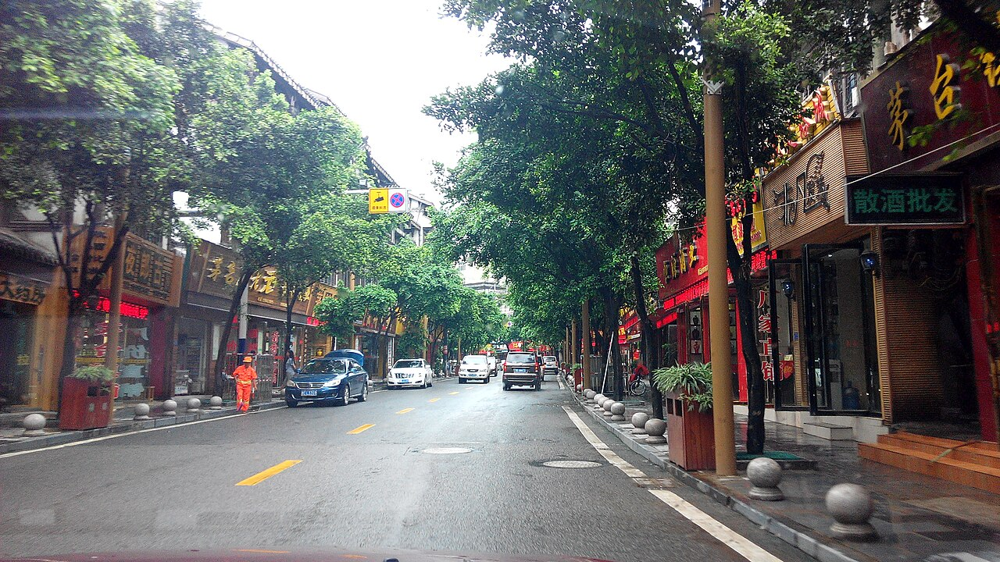

# Maotai Distillery (Kweichow Moutai)

Driving down to Maotai Town, the road follows the Chishui River. The distillery is here, at Maotai Town, Renhuai, Zunyi, Guizhou. The core production area is tightly managed, and the reliable public visit is the China Liquor Culture City inside the plant plus a few designated stops. Separating "Maotai Town", "the distillery" and "the Culture City" is the first step.

> **Visit information**
> - Address: Maotai Town, Renhuai, Zunyi, Guizhou, China.
> - Opening and booking: check the [official page](https://www.moutaichina.com/) before travelling; hours, tours and booking rules change by season.
> - Getting there and cost: check the official page before booking; this entry does not promise a fixed price.
> - Status: Verified; sources checked: 2026-11-08.

Figure: Related photograph of Maotai Distillery (Kweichow Moutai). Image: Jula2812, CC BY-SA 4.0, via Wikimedia Commons ([source page](https://commons.wikimedia.org/wiki/File:Maotai_-_Kweichow_Moutai_Distillery_China,_Flasche_Etikett_Detail_(2).jpg)).

> **Quick verdict**
> **In one line:** This entry helps you decide whether Maotai Distillery (Kweichow Moutai) deserves a detour, and what to check before visiting.
>
> - **Best for:** Anyone planning a visit to Maotai Distillery (Kweichow Moutai) who needs to decide whether it deserves a half-day or a full day.
> - **Not for:** If you want only want a must-visit list and will not check booking, transport or opening hours.
> - **Check first:**
>   - Individual tourists cannot enter the core production area on their own.
>   - Moutai is a 53% ABV sauce-aroma baijiu.

> **Decision checklist**
> Run these three checks before you buy or go.
>
> - **A distillery in the Chishui valley:** Moutai Group's headquarters stand at Maotai Town on the Chishui River; the official profile gives an average elevation of 423 metres and more than 40,000 employees.
> - **From three distilleries to a modern company:** Moutai Group's predecessor was the three century-old Maotai Town distilleries — Chengyi, Ronghe and Hengxing.
> - **Sauce-aroma craft: one year, one cycle:** Moutai's process is often summarised as "12987": one production cycle a year, two rounds of grain feeding, nine steamings, eight fermentations and seven rounds of distillation.

## A distillery in the Chishui valley

Moutai Group's headquarters stand at Maotai Town on the Chishui River; the official profile gives an average elevation of 423 metres and more than 40,000 employees. The Chishui is a first-order right-bank tributary of the upper Yangtze; a Guizhou Provincial Development and Reform Commission plan states that its main stream runs 436.5 kilometres, its basin covers 20,440 square kilometres, and the Guizhou section is 299 kilometres. The enclosed valley is warm in winter, hot in summer, humid and sheltered from wind, and the water filters through purple sandy shale.

The claim that "you cannot make Moutai outside Maotai Town" is often repeated, and the official account also stresses the core area's irreproducibility. More precisely, climate, water, soil, microorganisms and a long-established production system are bound together; move elsewhere, copy the steps, and the flavour is still hard to reproduce. The core production area covers 15.03 square kilometres and holds national and China–EU geographical indication, organic food and national intangible cultural heritage status.

Maotai Town is a mountain town: steep roads, buildings following the river, homes interlocking with production sites, and security gates between workshops and offices; "navigate to the distillery" does not mean "one entrance".

## From three distilleries to a modern company

Moutai Group's predecessor was the three century-old Maotai Town distilleries — Chengyi, Ronghe and Hengxing. In the early 1950s the local government purchased and took them over, integrating them into a state-owned distillery; by 1953 they had been combined. Kweichow Moutai Co., Ltd. was established in 1999 and listed on the Shanghai Stock Exchange in 2001. Today "Kweichow Moutai" may mean the listed company or the group, so check the entity.

The brand's modern fame is tied to a 1915 gold medal at the Panama-Pacific International Exposition and to the "Flying Fairy" trademark created in 1958.

For a visitor, the interesting part is how three distilleries became one production system. Chengyi, Ronghe and Hengxing had their own pits, methods and sales networks; integration produced common standards for raw materials, qu-making, fermentation, distillation and blending, which evolved into today's process documents and quality control. The museum tells this story more fully; the plant visit is about the physical setting.

## Sauce-aroma craft: one year, one cycle

Moutai's process is often summarised as "12987": one production cycle a year, two rounds of grain feeding, nine steamings, eight fermentations and seven rounds of distillation. The mnemonic is easy to remember but is a summary, not the complete specification. The official formulation more often runs: qu-making at the Dragon Boat Festival, grain feeding at the Double Ninth, nine steamings, eight fermentations and seven rounds of distillation; the cycle lasts a year, followed by more than three years of storage and blending before release.

Official figures add that a bottle takes about five years from raw material to dispatch, through five major processes — qu-making, distillation, storage, blending and packaging — with 30 operations and 165 process steps. Production insists on high-temperature qu-making, stacking and distillation, one cycle a year, long-term storage in clay jars and blending with wine rather than additives. Beside these figures, "12987" is an entrance rather than the whole story.

Dragon Boat qu and Double Ninth grain are tied to climate and farming: around the festival temperatures rise and suit qu-making; around the Double Ninth the sorghum ripens and temperatures cool, suiting the first feeding. The sorghum is local red-bristle glutinous sorghum, small-grained, thick-skinned and tolerant of repeated steaming and fermentation. "Xia sha" (下沙) means feeding grain, "sha" being the local word for sorghum.

## The plant, the museum and the limits of visiting

Individual tourists cannot enter the core production area on their own. The reliable visit is the China Liquor Culture City inside the plant: built by Moutai Group between 1993 and 1997, covering about 30,000 square metres, with seven galleries, a national 4A scenic site and, since 2017, the Guizhou Moutai Liquor Museum. It is an exhibition space, not a brewing workshop — it explains why sauce-aroma baijiu is made as it is, but do not expect to walk every production line.

To enter distillation or packaging workshops you normally need a consumer experience, industrial-tourism programme or media activity organised by Moutai or an authorised channel. The official site has reported a "beautiful Moutai" itinerary including the Culture City, the workshops, the Source of Moutai and the Tianniang Theatre, a four-day trip that moves consumers from looking to taking part. Opening dates, quotas and prices change, so check official notices.

The commonest mistake is believing in "internal supply", "employee wine" or "someone who can get you in". Moutai Group has repeatedly told consumers to use official channels; security cannot be bypassed with a payment. If someone offers "entry slots" at the gate or online, refuse, do not transfer money and do not hand over identity documents.

## How to taste and how to buy

Moutai is a 53% ABV sauce-aroma baijiu. Its typical style is described as a prominent sauce aroma, elegant and delicate, a full body, a long finish and an empty glass that retains fragrance. Taste it in a small cup: smell first, then sip a little and let it cover the tongue. Do not down it in one go or drink on an empty stomach; pair a small amount with staple food or mild dishes rather than heavy spice and oil.

Buying means separating "drinking" from "collecting". For everyday drinking, use official self-operated stores, specialist stores and official online channels. For collecting or gifting, confirm the year, batch, packaging and invoice, and keep the receipt; prices vary by product, vintage and channel. Do not buy from people selling at the gate, unknown WeChat groups or "internal channels"; if you suspect a counterfeit, keep the evidence and report it to the market regulator.

The Culture City has paid tastings and a shop, useful before buying, but a museum tasting is only about 10 millilitres: the point is aroma and first impression, not "a glass". Do not drive afterwards; use a designated driver or taxi. Families can focus on the galleries and old-town streets.

## Advanced judgment

Figure: A street view of Maotai town in Renhuai, Guizhou, where valley terrain and climate are tightly bound to sauce-aroma production. Image: Wahsaw, CC0, via Wikimedia Commons ([source page](https://commons.wikimedia.org/wiki/File:Streetview_of_Maotai(Moutai)_Town,_Renhuai_City,_Zunyi,_Guizhou.jpg)).

| Purpose | Suitable arrangement | Watch out for |
| --- | --- | --- |
| Visit | Book museum and permitted areas | Production floors are usually closed |
| Buy | Official channels and authorised shops | Authentication, invoice and batch |
| Learn | Craft exhibits and tastings | Separate explanation from advertising |
| Day trip | Half to one day | No drink-driving, no entering workshops |

**Can visitors walk into any Maotai distillery?** No. Production areas involve food safety and process confidentiality; usually only museums, cultural sites or booked routes are open. Check official booking information and avoid “inside channel” offers.

**Does Maotai town only produce Moutai?** No. The town has multiple distilleries and brands; Moutai is the most prominent product. Check producer, origin, standard and authentication, not just the place name.

**When is the best time to visit Maotai?** Avoid the hottest and coldest extremes; spring and autumn are more comfortable. Production milestones such as grain loading or spirit drawing are informative, but floors may not be open. Check weather, transport and bookings first.

Further reading: [Baijiu](ref:baijiu) and [Guizhou](ref:guizhou).

## Getting to Maotai, seasons and etiquette

By air, Zunyi Maotai Airport has routes to about thirty cities, including Beijing, Shanghai, Guangzhou, Shenzhen, Chengdu and Guiyang. According to the Guizhou Provincial Department of Transport, a tourist shuttle between the airport and Maotai Town began trial operation on 7 November 2025, with a flat fare of 5 yuan per person and stops including 1915 Square, the China Liquor Culture City and the Moutai Group. Routes, schedules and fares change, so check a real-time tool before travelling.

By rail, reach Zunyi or Zunyi high-speed railway station and transfer by bus, taxi or tourist coach; Renhuai's 2026 work plan proposes a coach service to the station, but actual operation depends on official announcements. Renhuai city to Maotai Town is about a dozen kilometres, half an hour by taxi or car; from Zunyi about 1.5 hours, and from Guiyang about 3 hours. Within the town, roads are steep and traffic is heavy on holidays; use designated car parks and wear comfortable shoes for the slopes.

On etiquette: the plant is a production site, so cooperate with security, do not climb fences, enter closed areas, smoke in no-smoking zones or use open flames; drones, tripods and commercial photography usually need permission. Do not touch exhibits, vessels or jars in the museum, and check on-site rules before photographing; some galleries ban flash. Taste in small quantities, spit what you do not want, and do not pressure others to drink.

This entry was verified on 2026-11-08; visiting policy, bookings, tastings, sales channels, transport schedules and prices are subject to official channels, and no map is provided here. Placed in the context of [baijiu](ref:baijiu) and [Guizhou](ref:guizhou), the distillery shows how the Chishui valley binds climate, raw materials, craft and time together; for the wider history of Chinese alcohol, see [Chinese wine history](ref:chinese-wine-history), and to start with the museum, see the [China Liquor Culture City](ref:culture-city).

Further reading: [China](ref:c-extra-1).
