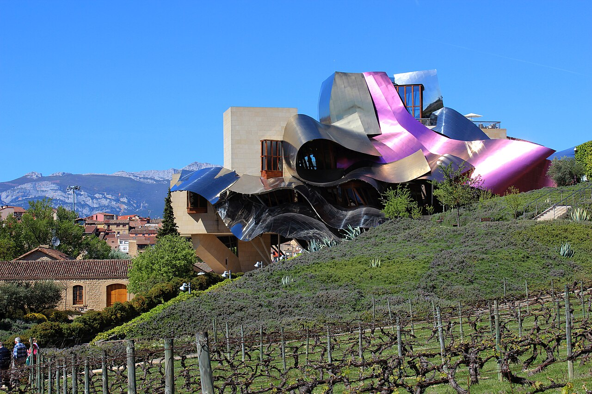

# Marqués de Riscal

Driving south from Bilbao into the hills of Rioja Alavesa, just as the roofs of Elciego and the vineyards meet, a titanium wave appears. It is Frank Gehry’s hotel for Marqués de Riscal, opened in 2006: a ribbon lifted by the wind over nineteenth-century cellars and vines. Riscal is not simply an old winery with a new landmark. Its history, wines and architecture map three Rioja transitions: bulk to bottled wine, tradition to modern ageing, and wine to cultural tourism.

Figure: Frank Gehry’s Marqués de Riscal hotel above the vineyards at Elciego. Image: Roderich Kahn, CC BY-SA 4.0, via Wikimedia Commons ([source page](https://commons.wikimedia.org/wiki/File:Elciego_-_Marqu%C3%A9s_de_Riscal_Hotel_RK01.jpg)).

## Location and history

In 1858 Guillermo Hurtado de Amézaga, later Marqués de Riscal, founded the estate in Elciego. He had lived in Bordeaux and knew the Médoc hierarchy and winemaking; back in Rioja he brought Bordeaux methods and released the first bottled Rioja in 1862. This was new: most Rioja was still sold in barrel, and bottling and labelling meant the winery was speaking directly to consumers.

In 1883 the estate built the El Palomar ageing cellar; in 1895 it won a diploma at the Paris Exposition, the first serious European recognition for Rioja. In 1972 it added a white-wine business in Rueda; in 1986 Barón de Chirel appeared, an early Rioja “modern premium” wine. In 2006 the City of Wine opened, combining Gehry’s hotel, cellars, restaurant and visitor centre. In 2024 the City of Wine was ranked first in the World’s Best Vineyards list.

## Architecture and spaces

The heart of the City of Wine is not the hotel but the 1858 cellar and the 1883 El Palomar. The old cellar is a long stone space with rows of barrels disappearing into the dark; El Palomar is a more open ageing hall for Gran Reserva and older vintages. Gehry’s hotel is the opposite: titanium panels change colour in the sun, the wavy roof reflects light onto the vines, and inside are 61 rooms, the Caesar spa, a restaurant and terraces.

The architectural point is that old and new do not pretend to merge. Gehry does not copy stone walls and arches; he sets a twenty-first-century hotel of metal, glass and curve beside a nineteenth-century cellar. The old cellar remains production; the hotel is reception; courtyards and paths connect them. Do not only photograph the hotel: look first at the barrel rows and the height of El Palomar, then return under the metal roof to see why the estate put history and contemporary architecture in one compound.

## The wines and palate

Reserva is the entry: mainly Tempranillo with Graciano and Mazuelo, aged in American oak and then rested in bottle. The perfume is red cherry, vanilla, leather and tobacco; the palate is round and approachable at five to ten years. Gran Reserva is made only in good years, aged longer, brick-red, with dried fruit, cedar, spice and leather, and a finer structure. Barón de Chirel, launched in 1986, is the premium line from old vines, more concentrated, with stronger tannin and a ten-to-twenty-year horizon.

Tapias is a later single-plot or selection line, emphasising site and low yield. Rueda’s Verdejo is the other white line: citrus, grass and mineral, for summer. Do not reduce Riscal to Reserva; the white, Barón de Chirel and Gran Reserva are three different expressions.

## How to drink

Serve reds at 16–18°C. Open Reserva 30–45 minutes ahead; Gran Reserva an hour ahead, or decant once; young Barón de Chirel one to two hours. Use a large red-wine glass and fill no higher than the widest part. Serve whites at 8–10°C, not below 6°C.

Pair Reserva with roast lamb, mushrooms and Ibérico ham; Gran Reserva with aged beef, stews and hard cheese; Barón de Chirel with roast meat, game and rich mushrooms; Verdejo with seafood, salads and soft cheese. Avoid very hot dishes; chilli will cover the oak and spice of Rioja.

## Practical information

Address: Calle Torrea 1, 01340 Elciego, Álava. Visits start at the City of Wine visitor centre; cellar tours and tastings are by reservation. The hotel, spa and restaurant are booked separately; non-guests can book the restaurant, but the winery experience and hotel reception are two systems. It is about 30 minutes by car from Logroño, 1 hour 15 minutes from Bilbao and 45 minutes from Vitoria-Gasteiz; parking in town is limited and the hotel offers valet parking.

Link Laguardia, about ten minutes away, Haro at about forty minutes, Briones at thirty and Logroño. To compare two Rioja estates in a day, Riscal’s architecture and [Muga](ref:muga)’s traditional cellars are a good contrast; but do not make both a deep tasting — choose one for architecture and one for winemaking.

## Etiquette and common misreadings

First, Gehry’s hotel is not a free viewing platform for the winery. Non-guests may use public areas and the restaurant, but the spa, pool and some terraces are for hotel guests; do not block guests while photographing. Second, do not touch the titanium panels; skin oils and scratches leave marks. Third, a winery visit is not a hotel tour; the booking systems differ, so do not ask reception to add a cellar tour on the spot.

Fourth, Reserva is not a “lesser” wine; it is the classic Rioja ageing style and more important to understand than chasing Gran Reserva. Fifth, Barón de Chirel is not a second wine of Riscal; it is a separate premium line with different vintage and plot selection. Sixth, Rioja oak is not better the stronger it is; American and French oak and barrel age all change the style, so do not reduce it to “how much vanilla”.

## Around and routes

Elciego sits in the centre of Rioja Alavesa: Laguardia’s medieval walls to the north, Logroño and the Ebro to the south, Haro’s station district to the west. Build a day around Elciego, Laguardia and Logroño, or split Riscal with [Muga](ref:muga), [López de Heredia](ref:lopez) and [CVNE](ref:cvne) over two days, using the [Haro station bodegas route](ref:route) for the Haro leg. For architecture alone, half a day at the hotel and old cellar is enough; for Gran Reserva, leave time for lunch and a clear palate.

From Bilbao, Guggenheim and Riscal can be one long day; from Logroño it is easier. Never taste before driving; Rioja’s country roads are narrow and lighting is limited at night.

## Further reading and see also

- Rioja comparisons: [Muga](ref:muga), [López de Heredia](ref:lopez), [CVNE](ref:cvne), [Haro station bodegas route](ref:route).
- Background: [Rioja](ref:rioja).
- This page provides no map; hotel, visit and restaurant information should be checked with official channels.

**Short definition:** A historic Rioja Alavesa estate in Elciego, founded in 1858 by Guillermo Hurtado de Amézaga and among the first to bottle Rioja, in 1862. Frank Gehry’s hotel opened in 2006 and the City of Wine was named World’s Best Vineyard in 2024; the range includes Reserva, Gran Reserva and Barón de Chirel.

Marqués de Riscal is best read by starting with the address, moving to the current opening status, and ending with what the place is known for.

**Key facts.**

| Item | Detail |
| --- | --- |
| In one line | A historic Rioja Alavesa estate in Elciego, founded in 1858 by Guillermo Hurtado de Amézaga and among the first to bottle Rioja, in 1862. Frank Gehry’s hotel opened in 2006 and the City of Wine was named World’s Best Vin… |
| Address | Calle Torrea 1, 01340 Elciego, Álava, Spain |
| City and country | Elciego / Spain |
| Status | verified open |
| Official site | marquesderiscal.com |

**Sources and limits.** The key claims about Marqués de Riscal are checked against the following sources: Marqués de Riscal (Frank Gehry's design, the 2006 opening, 61 rooms, the Caesar spa, the restaurant and estate experiences; the division between estate visits, cellar and tasting experiences, the hotel and the City of Wine). For current products, addresses or opening status, use marquesderiscal.com. Prices, batches and status change; the body is project-written and does not reproduce source text.
