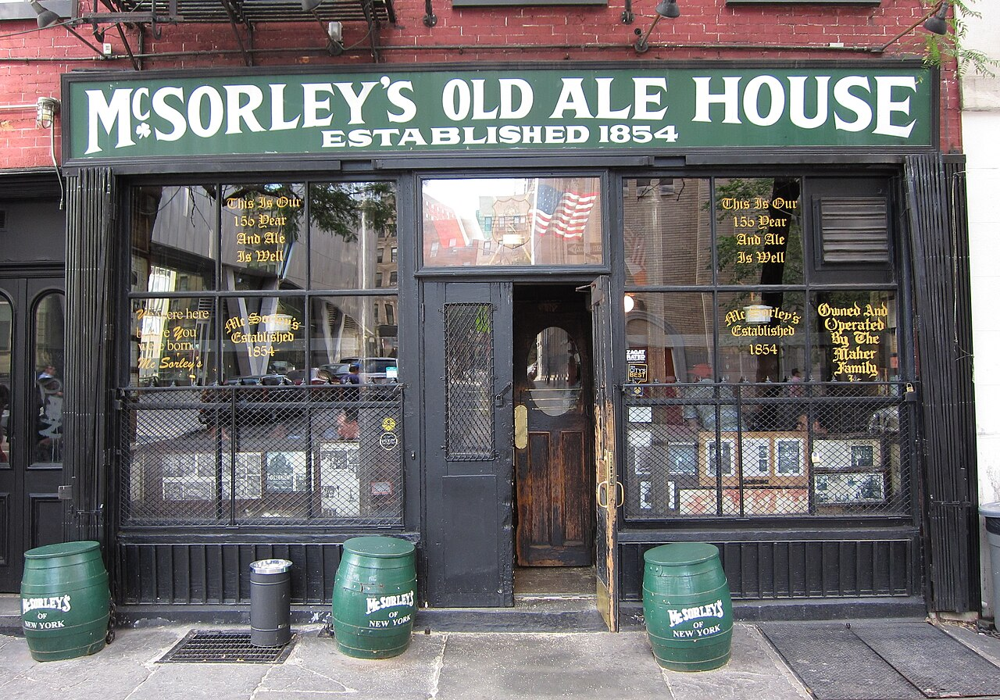
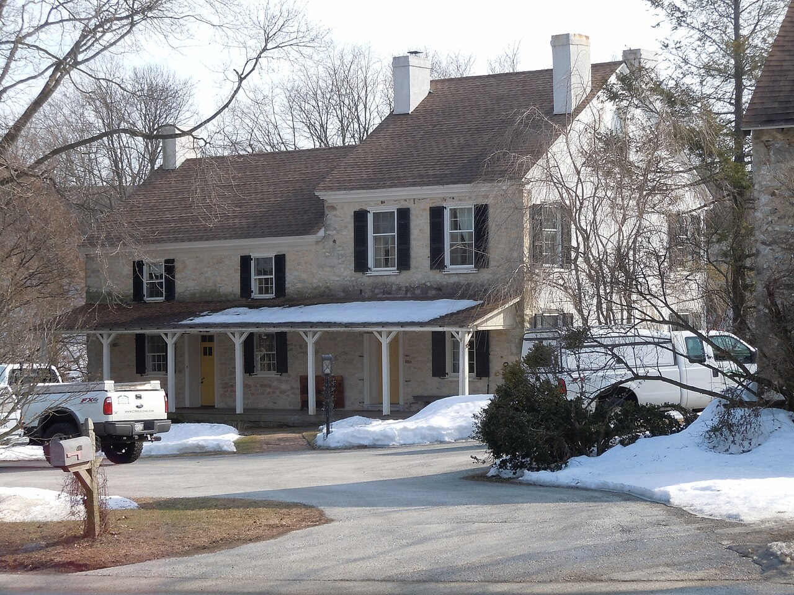

# McSorley’s Old Ale House

McSorley’s Old Ale House (Màikèsuǒlì Lǎo Màijiǔguǎn) stands at 15 East 7th Street in the East Village of New York. John McSorley, an Irish immigrant, opened it in 1854 under the name “The Old House at Home.” Its defining feature is not age but narrowness: for most of its history it has served one kind of drink, ale, in two forms, light and dark. The room still holds wooden tables, old posters, pendant lamps and objects left by generations of customers. In 1970, under court order and pressure from the city council, it ended its long men-only policy and admitted women. The sign at the door, “Be Good or Be Gone,” is both a house rule and a description of the place’s character.

Figure: McSorley’s Old Ale House. Image: Leonard J. DeFrancisci, CC BY-SA 3.0, via Wikimedia Commons ([source page](https://commons.wikimedia.org/wiki/File:McSorley%27s_Old_Ale_House_001_crop.jpg)).

## Place and history

John McSorley arrived in New York from County Tyrone, Ireland, in 1851 and opened the ale house in 1854. In 1864 the building was improved into a five-storey tenement, and the family moved upstairs over the bar; in 1888 John and his wife bought the building. In 1905 the house briefly experimented with hard liquor, then returned permanently to ale. During Prohibition it sold what it called “near beer.” In 1936 Daniel O’Connell, a regular and a city policeman, bought the business, the first owner outside the McSorley family. In 1940 Joseph Mitchell wrote “The Old House at Home” for The New Yorker, bringing the saloon national attention; the pieces were collected in 1943 as McSorley’s Wonderful Saloon. In 1969 the bar was sued over its refusal to admit women; in 1970 it opened its doors to them. In 1994 Teresa Maher de la Haba, daughter of the owner Matthew Maher, became the first woman to work behind the bar. That timeline explains why the place feels at once like a working tavern and a live archive.

## The room and the ale

The shop is narrow and deep, with a front room and a back room, both small. Wooden tables and chairs, old newspapers and photographs fill the walls; objects left by customers hang from the lamps. New York City’s tourism office notes a pair of handcuffs said to have belonged to the magician Houdini. The drinks list is extremely short: light ale and dark ale. There is no wine list, no cocktail menu and no spirits menu. Historically the house offered cheese and crackers, and raw onions were part of its signature offer; today’s exact food and charges should be checked on site. A common tradition is to serve two mugs at a time, with payment by the mug or by the round. The “choice paralysis” is deliberate: you only have to decide between light and dark.

## How to order on a first visit

Find a place, then tell the bartender “light or dark.” Choose light for a cleaner, easier drink; choose dark for more malt and roast. If you are unsure, order one of each and compare. The house often serves two at a time, so say if you want only one. Do not ask for a cocktail, a wine or a beer list with twenty styles; that is not how the place works. The food is light—cheese, crackers and onions are there to steady you, not to make a full meal. A weekday afternoon is the best first visit: fewer people, better light, and a chance to look at the room. Weekend nights are more like a standing social experiment.

## Practical information

The address is 15 East 7th Street, New York, NY 10003, USA, in the East Village near Cooper Union and Astor Place; the coordinates are 40.72883, -73.98967. The F train to Lower East Side–Second Avenue is about a 5-minute walk, and the 6 train to Astor Place is about 4 minutes; M1/M2/M3/M101 buses run nearby along Third Avenue and Broadway.

The official site lists hours of 11 am to 1 am Monday to Saturday and 12 pm to 1 am on Sunday; holidays and special events can change them, so check official channels. `operating_status` is `verified`, meaning the official site was live on 2026-11-08 with no closure notice; it does not guarantee a seat at any given time. The house takes no reservations, and queues form at weekends and in high season. It is cash only, so bring cash and confirm on site; the telephone is 212-473-9148. There is no cover charge and no dress code; casual is right. Prices are moderate for the East Village, but do not mistake fame for cheapness. The room is cramped; visitors with limited mobility or a stroller should call ahead about the entrance and aisle. Page verified 2026-11-08; opening status, prices and reservations are subject to official channels.

## Etiquette and common mistakes

Treat this as a bar, not a museum. The space at the bar belongs to people who are drinking, so do not hold it for a long photo session. Sharing tables is normal at peak times; ask “Is this seat free?” before pulling out a chair. Tip according to American bar custom, and cash is easier. Do not keep pressing the staff when they are busy. The most common mistake is joking about the old men-only policy, or presenting the 1970 change as sudden enlightenment; it came from a lawsuit, a court order and sustained pressure. Another mistake is treating “New York’s oldest bar” as a settled fact. It is the house’s claim and a common description, but “oldest” depends on whether you count the building, continuous operation or the brand. Stories about Abraham Lincoln and John Lennon passing through belong to the bar’s oral tradition, not to verified history.

## When not to come

This is the wrong place if you want wine, cocktails or a wide range of craft beer styles. It is also wrong for a quiet conversation, a comfortable seat or a full dinner. Large groups struggle in the narrow room, especially on weekend nights; families with children should avoid the late evening. Visitors with accessibility needs should confirm the entrance and aisle first. Anyone who dislikes crowds, smoke-era nostalgia or “old New York” mythology may find the place more specimen than bar.

## Nearby and around

In the East Village you can walk to Cooper Union, Astor Place and St. Mark’s Place; Tompkins Square Park is a little further east and gives you some air. To compare New York’s two famous old taverns, continue to the [White Horse Tavern](ref:white-horse) in the West Village, but the two are about two miles apart, so take the subway rather than forcing a walk. The White Horse has a broader drinks list and a heavier literary myth; McSorley’s has turned “ale only” into a system. Seeing the two kinds of “old” together explains more than checking off either one alone.

## See also

The ale here belongs to the wider family of [beer](ref:beer) styles; placed back in the story of [Pub and city](ref:pub-and-city), it becomes easier to see how such spaces structure hospitality. For another model of the “literary tavern” in the same city, read [White Horse Tavern](ref:white-horse).

Further reading: [A Ginjinha](ref:c-extra-1).

**In brief:** A historic East Village tavern in New York City, opened in 1854 and known for serving only light and dark ale.

Read McSorley’s Old Ale House through the address, then the current opening status, and finally what the place is known for. The sequence matters.

[Beer](ref:beer) and [White Horse Tavern](ref:white-horse) are the nearest useful comparisons: one clarifies address and space, the other tests operating status.

## Related images

Image: White Horse Tavern PA. Credit: Smallbones, CC0, via Wikimedia Commons.. Credit: Smallbones, CC0, via Wikimedia Commons ([source page](https://commons.wikimedia.org/w/index.php?curid=13351900)). Related image for McSorley’s Old Ale House.
